# Ownership and Lifetimes

<!--
Audience: adopter, integrator, contributor
Depth: mid
Status: current
Verified against: Melder 0.1.2 / git 7b31be6d7665
Last verified: 2026-08-29
Lifetimes verified against: Melder 0.2.8283 (text), 0.2.8286 (lifetime map) / git db1b97e8cef5
Lifetimes last verified: 2026-11-08 (lifetime text and lifetime map)
Diagram source: architecture_and_design/diagrams/source/ownership_lifetimes.mmd
Source anchors:
- src/melder/aether/spellbook/existence/existence.py
- src/melder/aether/conduit/creations/creations.py
- src/melder/aether/conduit/spell_space/spell_space.py
- src/melder/aether/conduit/creations/managed_spell_quantity.py
- src/melder/aether/conduit/creations/release_managed_spell.py
- src/melder/aether/conduit/creations/managed_spell_lease.py
- src/melder/aether/conduit/conduit.py
-->

[Architecture and design home](../README.md)

## Reader Question

Where do live objects belong, and when are they reused or disposed?

## Short Answer

Melder assigns every resolved object to an explicit lifetime boundary. The broadest
objects belong to a frame; narrower objects belong to conduits, conduit lineages,
clusters, or request-local spell spaces; `many` produces a new object per meld; and
`managed_spell_quantity` leases objects from a pool the owning root keeps, each one
returning to that pool only when its holder releases it. Cleanup walks owned scopes
inward-to-outward and disposes objects in reverse creation order.

[Editable diagram source](../diagrams/source/ownership_lifetimes.mmd)

## Lifetime Choices

| Existence | Reuse boundary | Typical role |
| --- | --- | --- |
| `unique` | Aetheric frame | Configuration, pools, shared services |
| `unique_per_conduit` | One conduit | Session or request scope |
| `unique_per_conduit_lineage` | Root and lesser-conduit family | Context shared down a scope tree |
| `unique_per_conduit_cluster` | Named conduit group | Coordinated cross-scope service |
| `unique_per_spell_space` | One leased spell space | Request-local ephemeral state |
| `many` | None | Fresh workers or value-producing services |
| `managed_spell_quantity` | Root-owned pool per spell version | Objects reused after each release |

## Managed Spells Are Leased

`managed_spell_quantity` binds classes only, and each spell version gets one pool in its
owning root's store. A meld, or an injection into a constructor during a meld, takes an
idle object from that pool, or builds a new one when the pool's mode allows. The holder
keeps the object until it gives it back: `ReleaseManagedSpell().release(obj)`, or a
`ManagedSpellLease` from `ReleaseManagedSpell().managed(obj)` or
`Conduit.managed_spell_meld(...)`, which releases once, by `release()` or at the end of
its `with` block. A release runs the reset methods named at bind, in order, and leaves
the object idle for the next lease; a reset that raises destroys the object instead.
Nothing gives an object back automatically: one never released stays out, and in a
`limited_quantity` or `queue` pool it holds its place until the root ends.

The mode is chosen at bind with `managed_spell_mode`:

- `elastic`, the default, always builds on a miss and keeps at most
  `managed_spell_limit` idle objects (256 unless set), trimming idle objects as demand
  falls;
- `limited_quantity` allows at most `managed_spell_limit` objects alive, idle plus out,
  and refuses a lease that finds nothing idle at that limit, before building anything;
- `queue` has the same limit, but such a lease waits up to
  `managed_spell_timeout_seconds` for a release before it is refused.

A managed spell may depend on `unique`, other managed, and `many` spells (its `many`
objects belong to the object they were built for), and any spell may depend on it. The
pool lives with its root: an ownership transfer carries it, and the root's teardown
disposes its idle objects. Objects that are out belong to whoever holds them.

## Cleanup Is Part of the Model

Creation stores preserve registration order for teardown. Newer dependents are disposed
before earlier dependencies, and failures are aggregated so one bad disposer does not
prevent the remaining scope from being cleaned.

A root's store cleans its managed pools first, so idle pooled objects are disposed
before the `unique` objects they hold. A pool runs disposal methods only when it
destroys an object (when it trims idle objects, when a reset raises, or at teardown),
never on a release.

## Why This Design Is Strong

Scope is expressed in the same graph that creates objects. The runtime therefore knows
which store may reuse an instance and which owner must eventually dispose it.

## Tradeoffs

Application authors must choose lifetimes and teardown vocabulary explicitly. That cost
buys predictable reuse, deterministic cleanup, and fewer hidden process-wide singletons.

## Where to Go Next

- [Scope work and resources](../03_usage/scope_work.md)
- [Runtime model](runtime_model.md)

Source entry points:

- [`Existence`](../../src/melder/aether/spellbook/existence/existence.py)
- [`Creations`](../../src/melder/aether/conduit/creations/creations.py)
- [`SpellSpace`](../../src/melder/aether/conduit/spell_space/spell_space.py)
- [`ManagedSpellQuantity`](../../src/melder/aether/conduit/creations/managed_spell_quantity.py)
- [`ReleaseManagedSpell`](../../src/melder/aether/conduit/creations/release_managed_spell.py)
