# Src Architecture (C4)

## What Melder Is (Read This First)

Melder is not a DI container. The beginner docs start with `bind`, `conjure` and `meld`, so it looks like one:
dependency injection is the first thing a new user touches, and it is one capability of Melder, not what Melder is.
Melder is a runtime that agents live in and build in (owner, 2026-10-15). Read every other section of this document,
and judge every behaviour of the code, through this picture.

### How Melder Is Used

- Agents load their world into the Python runtime and work inside it. They bind objects as spells, meld them in
  conduits, try them, change them, bind new versions and notch to the one they want, tear scopes down, record the
  blueprint and build the next thing. The iteration happens in the runtime, not outside it.
- Many agents work at once, each in its own conduits, sharing through links, contracts and clusters and handing
  work to each other by ownership transfer. Several agents can iterate on the same object: each notch moves the
  active version, the borrowers linked to the index follow it and rebuild, and nobody's existing objects are taken
  away. After five or ten versions the subsystem converges on the object the agents want.
- Versions are first-class. A spell index holds a lineage of versions and a notch only moves which one is active.
  MutationResearch records the versions (lanes, nodes, history), compositions pin specific member versions
  together, and the creation stores key objects by version id, so a `unique` spell can have one live object per
  version - several singletons at once, by design.
- Agents can build the subsystem they are sitting in: codegen rooms (Nexus, Rift, RiftSpace) run agent-written code
  against the live world under ACL profiles, and MutationResearch keeps the history of what changed.

### Runtime Model: Structure Is the Contract

Owner ruling (2026-10-14). Melder is a runtime that agents work inside, not a container that owns every object it
hands out.

What must be correct is the structure: bindings, spell indexes and their versions, which conduit owns which spell,
contracts and links, lineage and clusters, verdicts, and the record the Crystallizer keeps of them. That is what
Melder validates, gates, records and restores; a restore rebuilds structure with fresh identities and no saved
application objects.

Generated objects are working material. An object may be superseded by a newer version, left pending after a
transfer or a contract change, or kept by application code after Melder lets go of it, and agents clean such objects
up when they choose. Melder's infrastructure cleans up its own state: a store disposes what it records when it ends,
a scope teardown ends its stores, and a purge disposes what it retires. A root's teardown cleans only what the root
holds (owner, 2026-10-18): what its stores record and what its managed pools keep - their idle objects and the
children recorded with their objects, out ones included; an object a holder leased from a pool stays that holder's
(Operational Invariants). It does not police userland objects: it does
not dispose an object because something else changed (a transfer, a contract change, a removed definition), and an
object it lets go of is not a leak. A transfer hands over stewardship, not a working setup (Sequence: Transfer Spell
Ownership).

So a defect is structure that is wrong or stuck: a record that names the wrong owner, so the wrong teardown disposes
an object (a cluster's shared object recorded in its leader's store), or state an agent cannot get past (a torn-down
root still recorded in its cluster). An object that still references something its owner has since disposed - after
a transfer, a contract change or a teardown, or a holder whose `many` dependency the scope that built it disposed - is
pending work for the agent, not a defect.

Do not judge Melder by DI-container rules - one live instance per type, every object torn down with its scope, the
newest version replacing the old. Old versions staying alive, objects left pending after a transfer or a contract
change, and a borrower rebuilding after a notch are features. Read the code path before calling anything a bug,
and ask the owner when the intent is unclear.

## Metadata
- Doc ID: ARCH-SRC-2026-01-17
- Status: in_progress
- Owner:
- Created: 2026-01-17
- Updated: 2026-10-24

## Scope and Intent
This document describes the Melder core architecture at the C4 level for
`src/melder`. It focuses on system boundaries, runtime entrypoints,
boot/configuration sequencing, and execution lifecycle for dependency
resolution and cleanup. It is intended to stand on its own after context
compaction.
Melder is framed here as a Dependency Graph Runtime (DGR) with DI-style
binding and resolution as a subset capability.

In scope (core runtime):
- Spellbook binding and conjure pipeline.
- Aether global singleton and per-frame state.
- Conduit runtime (normal and lesser), contracts, and policies.
- SpellCompiler phases and validation pipeline.
- Meld resolution runtime and Creations lifecycle manager.
- Control-plane state (SpellSystemStates, change control, incidents).
- Logging and cleanup contracts.

Out of scope:
- Tests and examples.
- JSON sidecar metadata files (`__*.json`).
- External docs beyond the codebase.

## Indexing

This document is AUTHORED. Nothing generates its prose. Its only generated
companion is its index, `src_architecture_index`, rebuilt in the SAME pass as
any edit. The index lists every section's line range and name, plus a staleness
proof of this document (`line_count`, `line_ending`, `content_sha256`). Consume
it by slicing a named section rather than reading this document whole, and
recompute the staleness proof before trusting any range.

Format rules the index depends on, and which this document obeys:
- exactly one H1 (the document title)
- the navigable unit is H2 `## <Concern>`, at consistent depth
- section names unique and stable - index rows are selected BY NAME
- NO container headings: every H2 here is a selectable concern, so there is no
  wrapper heading to select by mistake

An index records `line_count`, `content_sha256`, and `line_ending`. Insert one
line near the top and every range below it is wrong while the index still parses
and still returns content - the WRONG content, confidently. On mismatch: STOP,
regenerate, never eyeball an offset.

The commands that rebuild, slice and check the index belong to the documentation
tooling, which does not ship with this document.

### Verifying the `path:line` citations in this document

The index checks this document's structure, not the `path:line` citations in its `EVIDENCE:` blocks, and those rot
silently when code moves: the file keeps existing, the citation keeps parsing, and it points at the wrong code. The
citation check - every cited file exists and every range lies inside it - is kept once, in src_components' Indexing
section, and covers this document too. In-bounds is necessary, not sufficient: open a citation you rely on, confirm
the symbol is there, and cite a function by its `def` line.

## DO NOT ASSUME / Unknowns Gate
Rule: No Unverified Claims.
Any statement that is not directly supported by evidence must be treated as UNKNOWN.

Evidence means at least one of:
- A specific source file reference (preferred: file + symbol/method/class name).
- A citation to an explicit, already-verified artifact (e.g., a prior approved doc section).

If not evidenced => UNKNOWN.

UNKNOWN items must be explicitly labeled UNKNOWN (or added to the Unknowns section).
UNKNOWN items must be investigated by reading the relevant source(s).
If investigation cannot be completed (missing source access, ambiguity, or time),
the item must remain UNKNOWN and must not be promoted to fact.

No reasonable assumptions.
Do not infer behavior from naming, patterns, conventions, or typical frameworks.
Only the code/docs count.

When unsure:
- Mark it UNKNOWN.
- Identify the most likely evidence target (file + symbol).
- Investigate, then update the doc (or leave it UNKNOWN).

## Unknowns
This section is a living list of claims currently not backed by evidence.
Each item must include:
- What is unknown.
- Why it matters (impact).
- Where to investigate (file(s) + symbol(s)).
- Current status (uninvestigated / investigating / blocked).

- PERMANENTLY REMOVED. These do not exist in `src/melder` and their absence is
  intentional, so do not treat a failed search for them as a gap:
  `meld/contracts/mutation_contract.py` (`MutationContract`,
  `MUTATION_CONTRACT_DISABLED`); the `structure_profiles` subsystem; the
  `spell_examiner` AI-profile files (live profiles are `binding_profile.py`,
  `general_profile.py`, `detailed_profile.py`, and
  `spell_compiler/profiles/resolution_profile.py`); `rift_event_configuration.py`;
  `phase12_*_executor.py`; `MeldGate` / `MeldGateController` (superseded by
  `utilities/synchronization/creation_gate.py` and `creation_gate_controller.py`);
  `SpellCrafter` (renamed `SpellCompiler`); `Configuration` (renamed
  `SpellbookConfiguration`).
  A path sweep and a symbol sweep are DIFFERENT CHECKS. A path resolves whenever
  the file exists, which stays true through every rename INSIDE that file, so a
  green path sweep says nothing about whether the symbols are real. Both were
  re-verified as of 2026-08-02 - paths via the graph join, symbols against an
  index of every `class` and `def` in `src/`. Do not widen a future stamp beyond
  what was actually run.

- UNKNOWN: Producer call sites for advanced state flags
  `SpellState.contract_violation`, `SpellState.mutation_candidate`,
  `SpellState.mutation_quarantined`, and `SpellState.mutation_failed` are not
  verified in runtime code.
  Why it matters: These flags/reasons exist in DevOps state enums and are used
  for diagnostics/governance, but missing producers make state semantics
  ambiguous during incidents and mutation rollout.
  Clarification: SpellContract behavior is no longer unknown. Its
  contract-unvalidated paths are evidenced in
  `src/melder/aether/spellbook/spell_compiler/validation/strategies/contract_provider_presence_strategy.py`,
  `src/melder/aether/spellbook/spell_compiler/spell_compiler.py`,
  `src/melder/aether/aetheric_frame/dev_ops/spell_system_states/spell_system_states.py`,
  `src/melder/aether/aetheric_frame/dev_ops/change_control_manager/change_control_manager.py`,
  `src/melder/aether/conduit/conduit_ward/conduit_ward.py`, and
  `src/melder/aether/conduit/meld/meld.py`.
  Where to investigate:
  `src/melder/aether/aetheric_frame/dev_ops/spell_system_states/spell_system_states.py`,
  `src/melder/aether/aetheric_frame/dev_ops/spell_system_states/spell_system_state.py`.
  SYNC NOTE (2026-07-11): the May MR skeleton (`research/**`, `promote_spell_version`,
  mutation node hooks) was deleted in the ResearchSet rebuild; producers for these
  flags now belong to the future MR runtime-seam slice (select/staged/promoted acts),
  not to any existing code path.
  Current status: blocked (producers await the MR runtime-seam slice; follow-up
  stories: `STORY-2026-02-13-spellstate-advanced-flag-producers`,
  `STORY-2026-02-13-mutation-research-runtime-wiring`).

- UNKNOWN: whether two patch releases of one Python minor give a class one spell_id. The digest reads instruction
  streams, constant and name tables and, for a class that holds one, a standard-library function's code, and the
  interpreter's cache tag names the minor only (cpython-314), so two patch releases agree exactly when they compile
  the same instructions for the code the digest reads. Measured on one release: 3.14.7's free-threaded build with
  the GIL off and on and its GIL build agree byte for byte over 788 targets (every class and plain function of
  `src/melder`'s importable modules and four user-like classes), and -O moves 8 of them (code that asserts). Why it
  matters: a creation cache or a record keyed by a spell_id goes cold, or a restore maps every id, when a patch
  release changes the compiled code. Where to investigate:
  `src/melder/aether/spellbook/bind/spell_code_digest.py:SpellCodeDigest._code_digest` with the same targets
  digested on two patch releases. Current status: uninvestigated (one patch release installed).

## System Context (C4)
Melder is a Dependency Graph Runtime embedded into user systems. User code
binds classes/functions/instances into a Spellbook, then conjures Conduits to
resolve instances via Meld. DI-style binding and resolution are a subset of
the runtime behavior. The live system now also includes:
- a hidden substrate/utility layer (`Aether`, `AetherUtilitySystem`,
  `AethericFrame`)
- a public AR runtime surface (`Nexus`, `Rift`, `RiftSpace`)
- tooling/introspection layers centered on SpellExaminer profile builders

Dependencies include:
- Python runtime (warns if < 3.14 or if GIL is enabled; 3.14+ is the supported floor).
- `ulid` for unique identifiers.
- Logging via `InitHelpers` + `AetherUtilitySystem` + `SafeLogger`
  (channel resolver first, stdlib fallback second).

## Glossary and Core Terms
- Aether: Global singleton that owns AethericFrames and global registries.
- AethericFrame: Per-frame container for conduits, registries, and dev-ops state.
- Dependency Graph Runtime (DGR): Runtime that builds and executes dependency
  graphs at resolution time, supports late binding via contracts/links, and
  enforces runtime validation gates before activation.
- Spellbook: User-facing binding and conjure surface for the DGR.
- Spell: Bound object metadata (spellframe, spell_id, existence, permissions).
- SpellIndex: Stable index (ULID) that categorizes and targets spells and holds
  the active selected spell. Version history is owned by MutationResearch.
- Conduit: Runtime scope and activation host for resolving spells via Meld.
- ConduitWard: Relationship manager for contracts, policies, and lineage links.
- Creations: Instance registry for a conduit; enforces existence semantics.
- SpellSpace: Scoped handle for unique_per_spell_space instances.
- SpellCompiler: Per-spell pipeline for requirements, graph, frame, validation.
- SpellSystemStates: Per-frame control plane for lineage topology and validity.
- ChangeControlManager: DevOps tracker for dirty roots and pending changes.
- AetherUtilitySystem: Process-wide utility host for shared providers,
  currently logger resolver/fallback registration.
- Nexus: Public singleton AR root over hidden Aether substrate state.
- FrameDescriptorManager: Nexus-owned manager for frame-scoped descriptors,
  passive publication, and Nexus-managed frame-record ownership.
- FrameACLManager: Nexus-owned manager for frame-local ACL containers,
  profile registries, and frame-level ACL change fan-out.
- NexusFrameBuilder: fluent authored-frame builder created by
  `NexusFrameManager.begin(...)` to stage one Nexus-managed frame
  configuration before rooted creation.
- FrameACLBuilder: frame-local mutable ACL authoring surface that owns one
  active view/command/codegen draft session for a `FrameACLContainer`.
- Rift: Live AR runtime object that attaches to Nexus-managed frames and
  userland target frames.
- RiftSpace: Room/workspace object owned by a Rift.
- FrameLinkContract: Rift-local frame selection contract storing the selected
  view, command, and codegen ACL family names per frame.
- FrameViewer: Rift-backed public viewer host that reads current view
  projections on demand and requires explicit `frame_name` for frame-local
  operations.
- ViewMultiFrame / ViewFrame / ViewConduit / ViewSpell: on-demand viewer helper
  surfaces above the current Rift projection state.
- Workstation: Room-local strong/weak binding canvas for saved objects,
  attributes, methods, and one active target.
- CommandSystem: Room-local mediated command layer above the
  viewer/workstation split, specialized by room mode.
- CodegenSystem: room-owned internal codegen engine that builds transaction
  contexts, validates code, builds namespaces, compiles/executes code, and
  publishes codegen lifecycle events for one `CodegenRiftSpace`.
- StaticFrameViewer: Static-room viewer overlay that filters spell-facing
  query/projection paths down to already-live spell surfaces.
- SpellExaminer profile layer: registry-backed `general` and `detailed`
  examination profiles used for richer inspection over raw candidates and live
  spells.
- Aetheric Mediator Plane: Aether-held top-level transaction plane under
  `aether/aetheric_mediator/`; frame creation submits through it today.
  Serializes above-frame structural work by scope. Imports
  `melder.utilities` only, never `melder.aether`.
- Mediator: the aetheric plane's root - admission, per-identity sessions,
  strategy dispatch, outcome policy, and reporting in one object.
- ClaimTable: atomic all-or-nothing, mode-aware scope-claim table. A LEAF -
  it never calls another plane component, which is what makes the plane's
  lock order provably one-way.
- ClaimMode: `x` exclusive / `s` shared / `ix` intent. DevOps' vocabulary
  verbatim. `ix` is the hierarchical parent marker: hold `ix` on the parent
  and `x` on the child, and disjoint children proceed in parallel while a
  whole-parent `x` still excludes every one of them.
- ScopeKey / ScopePrefix: canonical builders and the closed namespace
  vocabulary (`world`, `frame:<name>`, `subsystem:<name>`) for plane scope
  keys. The hierarchy is expressed by MODE, not by key shape.
- OutcomePolicy: per-transaction failure posture - `UNWIND` (run inverses and
  raise) or `LEAVE_BROKEN` (run nothing, record a residue ledger for a
  repairing agent).
- Policies: Conduit link/visibility rules used in dynamic mode.
- Permissions: Spell access levels across conduits (read/create/block).
- SpellMap: Declarative DI placeholder for explicit spell/frame/binding targets.
- SpellContract: Late-bound contract socket for dynamic linking across conduits.
- Mutation override overlay: `Spell.apply_mutation_override(...)` /
  `clear_mutation_override()`, emitting the `mutation_contract_set` /
  `mutation_contract_cleared` change reasons.
- ParameterDIShape: Phase 1 classification of how a parameter should resolve.
- Unresolved input: a single typed constructor parameter that no registered spell provides. It compiles as
  an UNRESOLVED_INPUT socket; the constructing meld supplies it by override, and `UnresolvedInputError`
  names it when a construction would go without it (2026-09-26).
- Key-set plan: the code one override key set compiles to in a `SitePlanOverrideRuntime`; it builds only what
  the payload does not supply. The empty key set is the normal plan of the many_only and generalized
  families (2026-09-26).
- Custody key: the key the Crystallizer's record keeps one spell's crystal under - the spell id under
  process-wide spell ids, `"<spell_id>@<frame>"` under per-frame ids, where one spell id can be bound in
  several frames (0.2.8214).
- Managed spell: a spell bound with `Existence.managed_spell_quantity` (0.2.8241-0.2.8246). Its objects are leased
  from the `ManagedSpellQuantity` pool its owning root keeps for that version, given back explicitly through
  `ReleaseManagedSpell` (optionally reset) and reused; the pool, not the meld, decides when an object is disposed.
  Its four bind settings (mode, limit, queue timeout, reset methods) are settings of the one spell, not part of its
  spell_id (0.2.8254); since 0.2.8258 they are fields of its binding manifest.
- ReleaseManagedSpell: the process singleton Aether builds last and owns - the class-keyed registry of the pools
  live root stores hold, through which a managed object goes back to its pool (0.2.8244).
- spell_id: the SHA256 of a registered object's code - its functions' instructions and the constants they load, its
  class-level values, the code of its bases outside the standard library and, for an existing object, its data - and
  of nothing from the bind call (`SpellCodeDigest`, 0.2.8257). Docstrings, comments and line numbers never move it;
  any code change does. One object is one spell.
- Binding manifest: how a spell is kept - its spellframe and kind, address, existence, disposal names, resolvable
  and managed settings - as a value record whose SHA256 is the binding hash (`BindingManifest`,
  `Spell.binding_manifest`, `Spell.binding_hash`, 0.2.8258).

## System Boundary and External Interfaces
External interfaces are Python APIs:
- package-root hardcopy document objects:
  `__architecture__`, `__components__`, `__graph_network__`, and
  `__graph_details__`
- `Aether.create_configuration()`,
  `Aether.create_configuration_builder()`, `Aether.configure(...)`, and
  `Aether.activate(...)` for root logger-policy installation; while any frame
  exists both refuse a configuration whose `process_wide_unique_spell_ids`
  differs from the regime the first frame sealed (0.2.8209)
- `Aether.process_wide_unique_spell_ids` (0.2.8213): a read-only, lock-free answer to which spell-id regime is
  in force - the sealed value once a frame exists, before that the installed configuration's value, else True
- `get_configuration_dictionary()` on `AetherConfiguration`,
  `CrystallizerConfiguration`, `MutationResearchConfiguration` and
  `NexusConfiguration` (0.2.8212): a snapshot of the property values a root
  configuration holds, so a host can compare policies without private access
- `Aether.attach_logger(...)` and `Aether.enable_logging(...)` for explicit
  post-boot root logger attachment or config-backed automatic logger enablement
- `Crystallizer.create_configuration()`, `configure(...)`, `activate(...)`,
  `deactivate()`, and `create_spell_crystal(...)` for crystallizer policy and
  spell-world manifest construction; profile/checkpoint facades
  (`create_profile`, `set_active_profile`, `describe_profile`,
  `list_profile_names`, `clear_profile`, `delete_profile`,
  `create_checkpoint`, `describe_checkpoint`, `checkpoint_replay_data`,
  `list_checkpoint_ids`, `load_checkpoint`, `flush_checkpoint`,
  `reload_cached_checkpoint`, `list_cached_checkpoint_ids`,
  `get_spell_crystal`) as the ONLY public
  surface over the buried persistence record; emit sink verbs (`emit`,
  `emit_spell_crystal`, `emit_spell_activity`, `emit_spell_removed`,
  `emit_spellbook_removed`, `emit_spell_index_removed`,
  `emit_contract_removed`, `emit_conduit_removed`, `emit_frame_removed`, `emit_nexus_state`,
  `emit_mutation_research_state`) are pushed by structural units at their
  own confirmation/teardown points and are NO-OPs while the crystallizer is
  inactive; `create_spell_index_crystal` / `create_contract_crystal` are
  the builder companions the seams emit through. Since 0.2.8214 `emit_spell_activity`, `emit_spell_removed`
  and `get_spell_crystal` take `frame_name`: under per-frame spell ids it names one frame's copy of a spell,
  and the two emit verbs refuse without it while recording
- `Aether.mutation_research` as the access path to the hosted mutation root: its configuration lifecycle
  (`create_configuration()`, `create_configuration_builder()`, `configure(...)`, `activate(...)`), the ResearchSet
  registry (`research_set(...)`, `create_research_set(...)`, `list_research_set_names()`) and the agent verb surface
  of a ResearchSet (spells and compositions, lanes, joins, history, campaigns, network snapshots), the research
  record (world entries, promotions, residency, campaigns, diffs), the foresight and crystal-well reads over
  recorded source, candidate preview and synthesis, and the composition reads. The spellbook's bind, bind_inactive
  and notch confirmation points auto-record while the root is active. The user surface is the Rift rooms'
  `research_*` commands, advertised via `list_supported_command_methods`. Spellbook and Conduit expose the root
  through borrowed read-only `mutation_research` properties; frames carry no mutation dimension. The full verb
  inventory is in src_components (Subcomponent: MutationResearch Root (ResearchSet Registry)).
- `Spellbook.bind(...)` and `SpellBinder` fluent binding helpers.
- `Spell.binding_manifest` and `Spell.binding_hash` (0.2.8258): the binding a spell was registered with and its
  SHA256, read-only; `BindingManifest.describe()` gives them as plain data. The SpellCrystal records the binding
  hash (record 4.3.0) and a restore's `RestoreReport.describe()["binding_changes"]` lists each binding it rebuilt
  differently.
- `Spellbook.scan(...)` and `Scan.scan_module(...)` for deferred module
  registration through `scan_bind` metadata
  (0.2.8228: `scan_bind` takes `bind()`'s target options - `resolvable`, per-target
  `disposal_method_names`, keyword metadata - and only an object's own declaration
  makes it a target, bound once per scan)
- `Conduit.notch_spell(...)`, `Conduit.add_to_spell_index(...)`, and
  `Conduit.remove_from_spell_index(...)` for transaction-backed SpellIndex
  member switching, move-in, and move-out flows. THE CONDUIT ADMITS THE
  TRANSACTION through the frame-local DevOps `TransactionMediator` (not the
  aetheric plane) - it calls `mediator.start_transaction(...)` ITSELF and calls into
  Spellbook inside the held window. Spellbook exposes no public verb here.
  THE CHAIN HAS THREE LAYERS, NOT TWO, and the middle one is easy to miss:
  `Conduit.<verb>` (public; opens and closes the transaction) ->
  `Spellbook._<verb>` (internal entry, called inside the window) ->
  `Spellbook._apply_<verb>` (the seam that mutates index membership).
  All three name the spell they act on by `spell_id=` - the spell_id `bind` or `bind_inactive` returned - or by
  `spell=`, exactly one, and resolve a spell_id inside the call to the exact spell the conduit's Spellbook owns,
  active or parked (0.2.8249; the two index moves on the owner's extension). Both or neither is a ValueError, a
  non-str spell_id or a str given as `spell` a TypeError, and a spell_id that Spellbook does not own a ValueError
  before anything starts. Before the transaction and again inside the held window a notch also refuses a spell of
  another index (ValueError); the index moves leave the rest to their seams (RuntimeError: an active spell, another
  Book's spell or target index, a non-member or only member on removal). A notch whose incoming version fails
  its structural check is refused with nothing moved (0.2.8262): SpellbookValidationError, its first line saying the
  notch did not happen and naming the version still active. Since 0.2.8253 the spell_id lookups
  (`get_spell_by_spell_id`, `find_spell_by_spell_id`) answer a parked spell_id with that parked spell, so a
  parked version can be named by its spell_id or by the Spell they return.
  EVIDENCE:
  - src/melder/aether/conduit/conduit.py:5652, 5777 (`notch_spell`; starts the transaction)
  - src/melder/aether/conduit/conduit.py:5806-6024 (`_resolve_notch_target`, `_owned_notch_target`,
    `_check_spell_argument`, `_owned_spell_by_id`, `_resolve_spell_to_move`)
  - src/melder/aether/conduit/conduit.py:6026, 6116 (`add_to_spell_index`; starts it)
  - src/melder/aether/conduit/conduit.py:6139, 6214 (`remove_from_spell_index`; starts it)
  - src/melder/aether/spellbook/spellbook.py:4545 (`_add_to_spell_index` entry)
  - src/melder/aether/spellbook/spellbook.py:4578 (`_apply_add_to_index` seam)
- `Spellbook.find_spell_by_spell_id(spell_id)` and `Conduit.get_spell_by_spell_id(spell_id,
  aetheric_frame_name="default")` (0.2.8253; renamed from `find_spell_by_id` and `get_spell_by_id`, with no
  alias): the spell a spell_id names - the active version, else the parked one - or None from the Book, and
  ValueError from the Conduit for a spell_id no conduit of the frame claims. A spell_id and a SpellIndex are
  separate things (owner ruling, 2026-10-17): the spell an index has active is a lookup by the index's id
  (`Conduit.get_spell_by_index_id`), never the answer to a spell_id. `Conduit.get_spell_permissions(spell_id)`
  answers the permissions that version was bound with. The Rift rooms' `get_spell_by_spell_id(spell_id, *,
  frame_name=None)` (renamed from `get_spell_by_id`, its command name and advertised name with it) and
  `get_spell_by_source_id` answer the spell their argument names - a capability or codegen room the Spell, a
  static room its live object - or raise.
  EVIDENCE:
  - `src/melder/aether/spellbook/spellbook.py:Spellbook.find_spell_by_spell_id`,
    `Spellbook._get_spell_by_id_via_aether`
  - `src/melder/aether/conduit/conduit.py:Conduit.get_spell_by_spell_id`, `Conduit.get_spell_permissions`
  - `src/melder/nexus/rift/command_system/command_system.py:CommandSystem.get_spell_by_spell_id`,
    `CommandSystem.get_spell_by_source_id`
  - `src/melder/nexus/rift/command_system/static_command_system.py:StaticCommandSystem.get_spell_by_spell_id`,
    `StaticCommandSystem.get_spell_by_source_id`
- `Spellbook.conjure(...)` for building a root Conduit.
- `Conduit.meld(...)` for resolving instances.
- `Conduit.managed_spell_meld(spell=None, *, spell_id=None, spellframe=None, binding_name=None, override=None)`
  (0.2.8245): a meld of a managed spell that returns a `ManagedSpellLease`; its `with` gives the object back.
- Managed spells (0.2.8241-0.2.8246): `Existence.managed_spell_quantity` and the keyword-only bind options
  `managed_spell_mode` (`ManagedSpellMode`: elastic | limited_quantity | queue), `managed_spell_limit`,
  `managed_spell_timeout_seconds` and `managed_spell_reset_methods` on `Spellbook.bind` / `bind_inactive`, the
  Conduit facades, `SpellBinder.as_managed_spell_quantity` and `scan_bind`; `ReleaseManagedSpell()` (`release`,
  `managed`, `release_all`, `describe`), `ManagedSpellLease` and `ManagedSpellExhaustedError`, exported at the
  package root with `ManagedSpellMode`. The four options are the spell's settings, not part of its spell_id
  (0.2.8254): changing them is `cleanup_spell` and a new `bind`, which keeps the spell_id and the pool.
- `Conduit.create_lesser_conduit(...)` for child scopes.
- `Conduit.enter_lesser_conduit(...)` (0.2.8203) for a child scope used as a `with` block. `with` on any
  Conduit is a dispose scope: at block exit a lesser returns to its root's pool and a root is torn down, and
  disposal failures are raised after that. Spellbook, Aether, AethericFrame, ConduitWard and SpellIndex keep
  `with` as a lock. `Cleanable.using_cleanup()` and `async_using_cleanup()` (every Cleanable) let cleanup
  errors propagate.
- `Aether.get_conduit_by_name(...)` (named roots and active named lessers) and
  `Aether.get_conduit_by_id(...)` (any live conduit) for frame-scoped discovery; root-only discovery is
  the `*_root_*` family (`get_root_conduit_by_name`, `get_root_conduit_by_id`, `list_root_conduit_ids`,
  ...), and `ConduitCloud.list_conduits()` lists one frame's named scopes (0.2.79).
- `Aether.find_frame(name)`, `Aether.get_frame(name)` and `Aether.list_frame_names()` (0.2.8208) find frames
  without creating one: the live frame or None, the live frame or ValueError, and the live names in the order
  they were created. Five reads let a host compare configuration facts without private access:
  `AethericFrame.shared_spellbook_configuration`, `AethericFrameConfiguration.frozen`,
  `SpellbookConfiguration.frozen`, `SpellbookConfiguration.aether_frame` and `Conduit.spellbook`.
- `Conduit.link(...)` / `Conduit.sever_link(...)` for dynamic linking.
- `SpellbookConfiguration` properties and hooks.
- `Nexus.configure(...)`, `Nexus.activate(...)`, `Nexus.create_rift(...)`,
  and `Nexus.create_rift_configuration(...)` for AR bootstrap. While Nexus is
  active, `configure(...)` and `activate(...)` handed another configuration
  refuse (0.2.8210); deactivate first.
- `Rift.get_nexus_frame(...)`, `Rift.create_nexus_frame(...)`, and the
  singular `Rift.space` / viewer helpers for live AR work.
  - Nexus-facing create/get paths both return rooted conduits, not frame
    objects.
  - `create_nexus_frame(...)` is strict-create and raises if the frame already
    exists.
  - `get_nexus_frame(...)` is the recovery path for existing managed frames.
- `SpellExaminer.create_profile(target, profile="general"|"detailed", ...)`
  for reflective profile generation.
- `ProtocolCrafter.craft_protocol_code(...)`,
  `craft_protocol_module_code_from_source_file(...)`, and
  `write_protocol_module_from_source_file(...)` for protocol generation and
  bounded interface-file maintenance.

External IO:
- Logging provider registration through `AetherUtilitySystem` and
  `SafeLogger`.
- `ProtocolCrafter` reads Python source files and can write generated protocol
  modules or append/remove bounded protocol blocks in interface files.
- User-provided callables bound as spells.

## Architecture Summary (C4)
Melder runtime flow is layered:
1) Global substrate (`Aether`) owns frames, conduit registries, and hidden
   process-wide support objects.
2) Utility and logging resolution (`AetherUtilitySystem`, `InitHelpers`,
   `SafeLogger`) provide system-wide logger/provider indirection.
3) Spellbooks bind spells, run structural/resolution phases, and conjure
   Conduits.
4) Conduits resolve spells via Meld and manage object lifecycles via
   Creations.
5) Public AR state (`Nexus`, `Rift`, `RiftSpace`) mediates live access into
   the Melder-owned object world.
6) Tooling/introspection layers centered on `SpellExaminer` build reflective
   profile views over live runtime truth.
7) Package-root hardcopy document and helper exports expose agent-facing
   `StaticSystemDocument` objects plus root configuration/protocol tooling
   without entering the runtime graph itself.

Spell registration uses Bind to reflect objects into SpellIndex + Spell.
SpellCompiler and PhaseScheduler run phases before Conduit creation.
ConduitWard and contracts govern cross-conduit sharing.
SpellSystemStates and ChangeControl track structural/resolution validity and dirty roots
used by Meld to gate execution and trigger revalidation.
SpellIndex member mutation is transaction-backed at the public CONDUIT surface
(not the Spellbook surface - the Conduit opens and closes the transaction) and
the member-store work is IMPLEMENTED behind the `_apply_notch`,
`_apply_add_to_index`, and `_apply_remove_from_index` seams, which execute
inside the held transaction window. Versions coexist by design (owner ruling 2026-10-15): a notch
moves which version is active, the borrowers follow it, and older versions stay alive. After the
window the conduit has every linked borrower park its copy of the outgoing version, makes a parked copy of
the incoming version active again (a version grant, 0.2.8250) and moves index-link borrowers to the new
one, which they build at their next meld: each change of a borrower's active copy marks that copy's
SpellContract consumers, and the notch marks everything downstream of the notched lineage, for
revalidation at their next meld (0.2.8250). MutationResearch records
the versions, compositions pin specific ones, and the creation stores key objects by version id,
so a `unique` can have one live object per version while agents iterate on one object and converge
on the version they want (corrected 2026-10-15: this paragraph called the borrower update a missing
fan-out). A notch names its target by spell_id or by Spell and checks that it is the Book's version of that
index before anything moves; the two index moves take a spell_id the same way (0.2.8249). A notch whose
incoming version fails its structural check is undone inside the window and refused, its borrowers untouched
(0.2.8262).
EVIDENCE: src/melder/aether/spellbook/spellbook.py:4107-4898 (the three seams, remeasured 2026-10-24 at 0.2.8266);
`src/melder/aether/conduit/conduit.py:Conduit.notch_spell`, `Conduit._owned_notch_target` (the target check),
`Conduit._resolve_spell_to_move` (the index moves' spell_id), `Conduit._deactivate_borrowed_spell`,
`Conduit._activate_borrowed_spell` and
`src/melder/aether/conduit/conduit_ward/conduit_ward.py:ConduitWard._emit_index_notch` (the borrowers); the marks:
`src/melder/aether/spellbook/spellbook.py:Spellbook._mark_contract_dependents_dirty` and
`src/melder/aether/aetheric_frame/dev_ops/spell_system_states/spell_system_states.py:SpellSystemStates.mark_dependents_for_revalidation`.

## Entrypoints and Runtime Guardrails
- `melder/__init__.py` warns on Python < 3.14 and on GIL-enabled builds
  via `_detect_nogil_mode()`.
- Registration of Melder internals as spells is blocked by `assert_allowed(candidate,
  context="bind")`, a module-level function in `bind.py`. There is NO guard class, no
  singleton, and no import-time guard construction; the check is a plain function over
  an imported frozenset. Instances resolve through `type(candidate)`, so binding an
  instance of an internal class is refused exactly like binding the class.
- Lookup is EXACT MATCH and does NOT walk the MRO. A user subclass of an internal
  class carries its own module and qualname, is absent from the manifest, and binds
  normally. This is an owner-accepted behavior change (2026-07-24): the retired
  `__melder_internal__` sentinel was read with `getattr` and therefore inherited, so
  tagging any user-extensible base silently made user subclasses unbindable.
- `INTERNAL_MANIFEST` is a `frozenset` of `(module, qualname)` pairs imported from the
  hand-written loader `melder._build_assets._bind_guard.bind_guard`, which re-exports it
  alongside `MANIFEST_VERSION`, `BUILT_FOR_VERSION` and `MANIFEST_ENTRY_COUNT` (629 at
  0.2.8267: `HolderDisposalEntry` left; 630 at 0.2.8257: `SpellCodeDigest` and `BindingManifest` joined; 628 at
  0.2.8246: the managed-spell classes joined at 0.2.8242-0.2.8244; 620 at 0.2.8216). The TRUTH is the COMMITTED
  manifest `_bind_guard/manifest/bind_guard_manifest.py`; the loader hydrates it through a `.meldercache`
  under `__melder_cache__/__bind_guard__/` that is an ACCELERATOR and never the source.
  The manifest module is imported lazily on cache miss only, so a warm process never
  parses it. `_builder.py` is build-time only and is regenerated explicitly with
  `python src/melder/_build_assets/_build_asset_runner.py`.
- Guarding and exporting are ORTHOGONAL: the guard restricts REGISTRATION, never USE.
  Exported, user-constructible surfaces such as the custom exceptions, `SafeGuard`, and
  `ProtocolCrafter` remain importable and usable while being unbindable.
- The only live enforcement call site is
  `src/melder/aether/spellbook/bind/bind.py:723` (in `Bind._bind_logic`) -
  `assert_allowed(spell, context="bind")`, a direct call to the
  module-level function. Identity resolution is factored into the pure helper
  `_internal_identity_of(candidate)` in the same module.
- Enforcement is ONE module-level function; there is no guard object or proxy.
- THE TEST SEAM IS FAIL-LOUD. `test_bind.py` patches `bind.assert_allowed` directly at
  seven sites, and every one of those `monkeypatch.setattr` calls uses
  `raising=True`, so if the enforcement seam is ever renamed or moved again, the tests
  fail immediately instead of silently creating an attribute nothing reads. That matters
  because `test_bind.py` neutralizes the guard for its whole file via an autouse
  fixture; a silently-dead patch would let the real manifest (629 entries at 0.2.8267) begin refusing
  binds mid-suite with no signal pointing back at the fixture. Preserve `raising=True`
  if these sites are ever touched.
- The guard is entirely absent from the package root: `melder/__init__.py` neither
  imports nor instantiates any guard, and exports no guard symbol.
- The first `Aether()` boot eagerly constructs hidden singleton support
  objects, including `AetherUtilitySystem`, `Crystallizer`, `Nexus` and, last,
  `ReleaseManagedSpell` (0.2.8244).

## Boot and Configuration Sequence
1) First `Aether()` boot:
   - Constructs the hosted singleton-level roots under `Aether._lock`, in
     this fixed order: `Crystallizer`, `AetherUtilitySystem`, `LoadGate`, the
     aetheric `Mediator` plane, `MutationResearch`, `Nexus`, then
     `ReleaseManagedSpell` (0.2.8244). Crystallizer leads because
     MutationResearch and Nexus read it out of the host as they construct.
     All seven are EAGER. MutationResearch was lazy once and was made
     eager by owner ruling (2026-08-03): a bare `MutationResearch()` before
     its first touch raised instead of returning the hosted root.
     `ReleaseManagedSpell` comes last: root stores register their pools in
     it only once frames exist, and it reads no other hosted root. No
     `AethericFrame` is constructed at boot.
     EVIDENCE: src/melder/aether/aether.py:186-266
   - Starts with a null `SafeLogger` wrapper and no attached raw logger.
   - Requires a later explicit `attach_logger(...)` call to attach a real
     logger.
   - A live root-owned `AetherConfiguration` /
     `AetherConfigurationBuilder` lifecycle already exists through
     `Aether.create_configuration*()`, `configure(...)`, and `activate(...)`;
     it can enable automatic channel logger activation in the utility system,
     but that path is disabled by default.
2) User constructs a `Spellbook` or explicitly engages `Nexus`.
3) `Spellbook.__init__`:
   - Ensures the Aether frame exists (`Aether._ensure_frame`).
   - Initializes `SpellbookConfiguration`:
      - If Aether already has a frame-owned shared `SpellbookConfiguration`,
        adopts it.
      - If a config is provided and does not match frame, raises.
      - Otherwise creates a fresh `SpellbookConfiguration` and loads defaults.
   - Initializes logging through `InitHelpers` and
     `AetherUtilitySystem` (provider-backed channel logger first,
     explicit logger override or stdlib fallback second).
   - Initializes spell registries and SpellValidationSystem.
   - Pulls SpellSystemStates from the frame.
   - Captures configuration Bind seeds into its own immutable callback registry. Runtime add/clear
     replaces that Book's registry only. Publishes its DevOps identity after initialization succeeds.
4) `Spellbook.conjure(...)`:
   - Opens a `ChangeTransactionType.CONJURE` transaction on the spellbook
     identity, then resolves the EFFECTIVE conjure mode via
     `_settle_or_inherit_conjure_mode(dynamic)` as it enters the transaction
     window (settle-then-inherit law, 2026-07-20): settle an unfrozen world
     when `dynamic=True` was asked, otherwise inherit the settled world's mode.
     A missing posture returns the caller's flag unchanged and defers to the
     honest refusal in `SpellbookCreationSystem.check_system_state`. BEFORE
     settling, conjure refuses the active-Crystallizer configuration discipline
     on the mode settlement would produce (`_effective_conjure_mode`,
     0.2.8211), so a refused conjure leaves the frame posture as it was. The
     EFFECTIVE mode is then threaded down the whole chain - creation system,
     blueprint dynamic/automatic mode where the conduit's state is born, the
     conjure dynamic hint, the crystallizer config-discipline guard, and cloud
     registration. The transaction is ended in a `finally`.
   - Validates and freezes `SpellbookConfiguration`.
   - Binds `SpellbookConfiguration` into Aether for the frame.
   - Derives and binds `AethericFrameConfiguration` for narrow frame posture.
   - Classifies the structural tier of the conduit bundle; a full hit replays the phase 3-4 rows,
     otherwise runs phases 1-4 (requirements, symbolic graph, local frame, validation).
   - Runs foundational conduit phases 5-7 (root blueprints, system validation, change control).
   - Runs conduit plan phases 8-11 (occurrence, injection, patch maps, execution plan) when foundational phases report no resolution errors.
   - Constructs a normal Conduit and registers it in Aether.
   - Fires pre/activated/post hooks and wires ownership into spells: every active version, and every version
     parked with `bind_inactive` before conjure, which gets the owner stamp alone (0.2.8248).
5) `Nexus` AR path (when engaged):
   - `Nexus.configure(...)` installs frozen process-wide AR policy. It refuses
     while Nexus is active, as does `activate(...)` handed another
     configuration (0.2.8210).
   - `Nexus.activate()` opens Rift creation.
   - `Nexus.create_rift_configuration()` builds a Rift config whose primary
     room posture is chosen through `space_type`.
   - `Nexus.create_rift(...)` creates a bare `Rift`, programs one primary room
     from `space_type`, and registers the live Rift without requiring an
     initial target frame.
   - `Rift.create_nexus_frame(...)` / `Nexus.create_nexus_frame_for_rift(...)`
     now use the normal public Spellbook API:
     - build the Spellbook-facing `SpellbookConfiguration`
     - construct a `Spellbook`
     - call `spellbook.conjure(name=<root_conduit_name>, dynamic=True)`
     - publish descriptor/ACL state from the rooted result
     - return the rooted conduit rather than the frame object
     - raise if the target Nexus-managed frame already exists
   - `Rift.create_frame_link(frame_name)` is the separate attachment step: it
     validates generic target-frame policy through `Nexus`, requires descriptor
     truth, delegates Nexus-managed frame authorization back through `Nexus`
     when the target frame is Nexus-managed, ensures the frame-name ACL contract
     exists, mutates the frame contract, and refreshes the owned-space viewer.

## Data Flows and Sequences
### Sequence: Import to Ready
1. `import melder`:
   - Runtime warnings for Python version and GIL mode.
   - `Aether()` boot runs eagerly from the package root.
   - No guard object is constructed at import. `INTERNAL_MANIFEST` is imported as a
     committed build asset the first time `bind.py` is imported.

### Sequence: Spellbook Initialization
1. `Spellbook.__init__`:
   - `Aether._ensure_frame(aetheric_frame)`.
   - `_initialize_configuration` (adopt or create `SpellbookConfiguration`).
   - `_initialize_logging` (SafeLogger and optional factory).
   - Initialize registries, validators, and SpellSystemStates.

### Sequence: Bind Spell
1. `Spellbook.bind(...)`:
   - Enum conversion for permissions and existence.
   - Retains one immutable Bind callback set inside the existing admitted transaction.
   - Bind pre callbacks inspect the original reference before reflection; rejection is by exception.
   - `Bind._bind_logic` produces SpellIndex and Spell.
   - Protocol admission checks class and actual existing-object targets before a Spell is published.
   - Disposal candidates resolve once into a Spell-owned ordered list.
     Book names own overlaps; priority places their block first or last (default).
   - The spell_id is the SHA256 of the target's code (`SpellCodeDigest`, 0.2.8257), nothing from the bind
     call; the Spell builds its binding manifest and binding hash from the bind call (0.2.8258).
   - Bind activation receives the actual new Spell before profile completion and publication.
   - Spellbook registers spell maps and SpellSystemStates lineage.
   - If Conduit exists, stamps ownership and registers existing objects.
   - Captured post callbacks receive the registered Spell after normal publication, before outer commit.
     Inactive binding follows the same stages and supplies the final parked Spell to post.

### Sequence: Conjure Conduit
1. `Spellbook.conjure(...)`:
   - Validate/freeze `SpellbookConfiguration`, bind to Aether.
   - Classify the structural tier of the conduit bundle BEFORE the structural run (2026-09-26): when every
     owned spell's captured rows carry the live key, the live world stamp and a replayable verdict, replay
     the phase 3-4 registry writes and skip phases 1-4; otherwise (miss, partial, caching off, the
     existing-conduit route, `validation_warnings=True`, or a logged replay failure) run structural
     phases 1-4 for every spell as before.
   - Only for `conjure(validation_warnings=True)`: log one WARNING event listing the Phase-4
     validation warnings grouped by code (unresolved inputs included), before the Phase 1-4 artifacts
     are released. The default logs nothing; internal conjure routes never pass True (2026-09-26).
   - Classify the creation cache BEFORE the conduit phases: the live set of
     resolvable, non-existing-creation spell ids is compared with the cached
     ids, and the bundle's recorded world stamp with the live one (0.2.8220),
     giving `disabled`, `full_hit` (every live id cached AND the stamps equal),
     `mixed` or `full_miss`.
   - Run conduit foundational phases 5-7.
   - Run conduit plan phases 8-11 only when foundational resolution has no
     errors AND the cache path is not `full_hit`. A full hit passes
     `force_skip_plan_phases=True`, loads both-lane creation contexts from
     the cache, and does not re-enforce the resolution verdict (it was
     enforced when the bundle was built). No cache path skips phases 1-7.
     EVIDENCE:
     - src/melder/aether/spellbook/spellbook_creation_system.py:242-263
     - src/melder/aether/spellbook/spellbook_creation_system.py:517-544
     - src/melder/aether/spellbook/spellbook_creation_system.py:616-746
   - Live 8-11 mapping:
     - phase 8 analyzer
     - phase 9 processor
     - phase 10 planner
     - phase 11 codegen creation
   - Construct Conduit and register it with Aether.
   - Fire conjure hooks and wire Conduit into spells: each active version gets the owner stamp, its resolution
     flag cleared and an existing object registered; each version parked with `bind_inactive` before conjure gets
     the owner stamp alone (0.2.8248), so after a notch it melds like a version staged after conjure.
     EVIDENCE: `src/melder/aether/spellbook/spellbook_creation_system.py:SpellbookCreationSystem.define_conduit_into_spells`.

### Sequence: Meld Resolution
1. `Conduit.meld(...)`:
   - In dynamic mode, enforce CreationGate checks/ticketing; delegate to `Meld.meld(...)`.
2. `Meld.meld(...)`:
   - Resolve spell by id or (spellframe, binding).
   - Enforce structural/resolution validity gates and choose reuse vs instantiate.
3. `CreationContext` compiled execution:
   - Select no-hooks/hooks and no-overrides/overrides lanes.
   - Execute codegen-creation-backed runtime lanes and return the resolved instance.
   - many_only and generalized roots run one site-plan runtime: normal melds its normal plan, override melds
     the plan compiled for their key set, which builds only what the payload does not supply (2026-09-26).
     Warm automatic melds by id, by registered name and by class, override payloads and existing objects
     included, use the fast meld door: two success-only door registries, one keyed by spell id and one by
     the name string or class object the caller passed, read by `Conduit.meld` and `SpellSpace.meld`
     with one guard ladder (2026-09-27).
   - Dynamic spells: the door takes the spell-index CreationGate ticket BEFORE it reads the context and
     holds it until the executor returns, calling the executor slots itself (2026-09-26).
4. Creations registration/reuse occurs inside compiled execution per Existence. Each slotted
   lifetime is built once under its slot's build lock (store `slot_guard`, or Spell lock for
   unique); the store lock is only taken as a leaf around publication (2026-09-25).
   The door takes that lock once: for a per-conduit or SpellSpace root, the normal site plan it calls
   does not take the root's lock again (0.2.73).
   Every disposal-bearing `many` registers in the meld's innermost scope - the spellspace store, else the
   melding conduit's - also one built inside a slotted site's first build: a `many` belongs to the scope that
   built it, not to the holder it is passed to (0.2.8267; 0.2.8235-0.2.8265 registered it with the holder's
   owner).
   A managed site leases instead (0.2.8245): the plan pops an idle object from the version's pool inline - a plan
   constant on an automatic root, a per-creation read of the owner store's pool elsewhere - and only an empty pool
   calls the site's miss, which reserves a place first, builds the children, then the object, and records the
   object's disposal-bearing `many` children with it. Each injection is its own lease.
5. A meld that would construct a spell without one of its unresolved inputs raises `UnresolvedInputError`
   naming the consumer, parameter, expected type and override keys, before anything under it is built
   (2026-09-26).

### Sequence: Meld-Time Validation Gate
1. `Meld._ensure_lineage_resolvable(...)` checks SpellSystemState validity.
2. If validity is UNKNOWN/GATED:
   - Acquire `spell._lock` and run `spell.run_structural_phases()`.
   - Raise SpellbookValidationError if validity stays invalid/gated.
3. If per-conduit resolution validity is UNKNOWN/GATED:
   - Run `spell._spellbook._run_resolution_phases_for_target_spell(conduit_id, spell)`.
   - Raise SpellbookValidationError if validity stays invalid/gated.
4. Under dynamic ownership every rerun above (and the deferred lane's run) first enters the spell's rebuild
   window: freeze and drain the spell-index gate, then take `spell._lock`, run the phases, publish the
   rebuilt context when its plan is present, reopen the gate (2026-09-26).
5. A spell flagged `resolution_required` takes the deferred lane (`Meld._ensure_runtime_resolution_ready`)
   instead of step 3: 8-11 for its own Phase 5 root or an existing creation, otherwise its full target pass
   5-11, which must leave it resolution-valid (0.2.8215). A successful target pass flags each owned dependency
   it compiled only inside the target's plan, so that dependency's first direct meld resolves it.
6. The per-conduit verdict step 3 reads belongs to a definition's life, not to its id (0.2.8219):
   `SpellSystemStates.unregister_index` retires the removed spell id's verdicts in every conduit state and
   `register_index` retires any verdict already held for the version id it publishes, so a definition bound
   again under the same content-stable id reads `unknown` in each conduit and step 3 runs for it there.
7. A meld enters this gate only while its Book's validation-required flag is up, and the warm meld doors serve a
   meld only while it is down. RiskManager raises the flag while a conduit of the Book holds a risky lineage,
   except one whose state carries `SpellState.non_resolvable` - a lineage whose selected version was bound
   resolvable=False, which every meld door refuses before this gate (0.2.8247). Such a definition never receives
   a resolution verdict, so until 0.2.8247 one of them kept the flag up for the Book's life and sent every meld
   of the Book through steps 1-3.
8. A satisfied SpellContract is not checked on every meld (0.2.8250, rule 2). A change of the provider a contract
   consumer resolves marks the consumer `gated` + `contract_unvalidated` - the borrower Book's contracted-map
   mutators (`Spellbook._mark_contract_dependents_dirty`) and a notch's downstream walk do - so step 2 is its
   recheck: Phase 4's presence check finds the provider, the lineage becomes `valid` and step 2 gates the conduit
   verdict (`structure_changed`), so step 3 rebuilds against the provider now active; a missing provider leaves the
   lineage `gated` and step 2 raises SpellbookValidationError naming the contract and its remedy. Until 0.2.8250
   every gated meld of a consumer read its signature, looked each contract up in the Book's contracted maps
   (MeldExecutionError on a miss) and forced step 3 (`Meld._check_contracts_and_force_revalidation`, retired):
   1668 us a warm meld of a borrower's consumer on 3.14t with the GIL off, 2.6 us now.
9. The catch-up (0.2.8250): before step 2 when the spell will compile at this meld (`Meld._may_compile`: its
   lineage unregistered, `unknown` or `gated`, or its verdict for the resolution conduit `unknown` or `gated`;
   never for a `resolution_required` spell), and first in step 5's deferred lane,
   `Meld._refresh_stale_dependencies` walks the dependencies its plan will expand - every socket target of its
   recorded topology and, for a SpellContract socket, the provider the Book's active contracted maps hold, each at
   the version its lineage selects now - and refreshes each stale one (`gated` or `unknown`) under that
   dependency's rebuild window and lock: phases 1-4 with its owner Book; broken -> `invalid` and
   SpellbookValidationError naming it; not `valid` -> the same error; `valid` -> its own plan is reset
   (CreationContext cleaned, Phase 5+ artifacts cleared, `resolution_required`), so its own next meld runs its
   full target pass. A dependent two hops from a notch thus compiles over its dependency's current structure
   instead of a version id the notch parked.

### Sequence: Create Lesser Conduit
1. Parent Conduit fires pre-create hook.
2. Acquires a pooled shell or constructs a lesser with the shared Book/configuration.
   An optional exact name is assigned for this use before activation; idle shells remain unnamed.
3. Wires root-lineage pointers (`_root_conduit_id`, `_meld._resolution_conduit_id`) and root-conduit ward reference.
4. Fires activation, then attaches to the immediate parent. The named branch publishes Cloud,
   structural recording and Nexus metadata under its existing child lock, before post-created.
5. Pool return (`cleanup()`, or the exit of a `with` block over the lesser) disposes descendants first,
   then the lesser's SpellSpaces, then its own store. A named scope then retires records and named
   discovery and clears its name; an anonymous leaf checks the name once and performs no
   Cloud/recorder/Nexus work. Both detach, restore temporary hooks and publish the ready shell idle.
   Disposal failures do not stop the return: they are raised as one ExceptionGroup once the shell is
   back in its pool (0.2.8203). A descendant still attached after failing, or a failed named
   retirement, keeps the lesser attached for retry. A second soft cleanup of a pooled shell does nothing.

### Sequence: Upgrade Lesser to Normal
1. `Conduit.upgrade_to_normal(name, configuration=None, hooks=None)` validates an attached,
   childless dynamic lesser, the requested root name and hook payload, then drains its creation gate.
2. Constructs an empty new Spellbook through ordinary local/default/frame-wide configuration selection.
3. Prepares the same Conduit as an independent normal root with its own pool/cluster facade, retaining
   its ID and creation stores. Ward conversion removes both directions of the old parent relationship.
4. Calls the separate `Spellbook._conjure_existing_conduit` route with that prepared target. The Book
   runs normal configuration/compilation under the preserved ID, replaces Meld/Space lookup aliases
   and hooks, and clears old input/fast-door caches. Definitions and old verdicts do not transfer.
5. Registers the root, restores its original gate admission and runs normal activation/publication.
   Explicit `hooks` are local additions after activation. Pre-attachment failure restores the lesser.
6. The caller quiesces lineage changes, concurrent scope acquisition and foreign-thread managed
   Spaces. Current-thread managed, registered manual and idle pooled Spaces are rebound in place.

### Sequence: Link and Sever Conduits
1. `Conduit.link(target_conduit)`:
   - Requires dynamic mode and valid target.
   - Delegates to `ConduitWard._link` to establish contract.
   - Fires `on_conduit_post_link` hook on success.
2. `Conduit.sever_link(target_conduit)`:
   - Requires dynamic mode.
   - Delegates to `ConduitWard._sever_link` to remove contract.
   - Fires `on_conduit_post_unlink` hook on success.

### Sequence: Transfer Spell Ownership
1. `Conduit.transfer_spell_ownership(...)` validates dynamic mode.
2. `TransferOfOwnership.preflight()` captures borrowers, deps, creations.
3. `TransferOfOwnership.execute()`:
   - Marks lineage disabled (transfer_in_progress) and flips registries under lock.
   - Stamps every member that carries an owner stamp onto the target root - the active one in the flip, the
     parked ones as they migrate - registering each stamp-back first, so a failed transfer stamps them back and
     discards the empty managed pools its stamps composed (0.2.8246).
   - With `move_creations=True` (the default since 0.2.8239) moves the source store's instances of every index
     member into the target's store - a holder alone: the `many` objects built for it stay in the store that
     recorded them (0.2.8267) - and a managed version's pool with its idle objects and count; with `False` takes
     the active member's instances (its pool among them) out of the source store, neither moved nor disposed.
     Lineage instances stay where they were resolved. A transfer disposes nothing.
   - Unshares or repoints contracts/clusters.
   - Optionally transfers or dirties dependencies.
   - Marks lineage dirty/gated for revalidation.
4. The target receives stewardship, not a working setup (0.2.8240). The spells the transferred one depends on
   stay with the source unless `include_dependencies` moves the direct ones, so once the source tears down, a
   moved instance can hold dependencies that were just disposed; the target purges what it does not want, binds
   what it needs (`UnresolvedInputError` names each missing input) and melds its own version.

### Sequence: SpellIndex Mutation Entry
1. Caller targets one live SpellIndex member through `Conduit.notch_spell(...)`,
   `Conduit.add_to_spell_index(...)`, or `Conduit.remove_from_spell_index(...)`.
   The entry point is the Conduit. Each verb names its spell by `spell_id=` (the
   spell_id `bind` or `bind_inactive` returned) or by `spell=`, exactly one, checked by
   the shared `_check_spell_argument` (0.2.8249). A notch's `_owned_notch_target`
   resolves the spell_id through the Spellbook's `_get_owned_spell` - the exact owned
   spell, active or parked - and refuses a spell the Spellbook does not own or one of
   another index before anything starts; the index moves' `_resolve_spell_to_move`
   resolves it the same way (`_owned_spell_by_id`) and refuses only a spell_id the
   Spellbook does not own, leaving the rest to their seams (step 5).
2. The Conduit derives the binding key plus source/target SpellIndex metadata
   and starts the corresponding transaction family through the frame's DevOps
   mediator: `notch`, `add_to_index`, or `remove_from_index` (corrected
   2026-10-16: this step said the Spellbook starts it; the Conduit does - see
   System Boundary and External Interfaces).
3. The resolved transaction strategy seals the owning spellbook/conduit
   surfaces and the targeted binding key for the duration of the mutation. The
   notch claims the Spellbook, the acting conduit and the conduits linked to it
   EXCLUSIVE and freezes their creation gates until it ends.
4. Inside the held transaction window a notch checks its target again
   (`_owned_notch_target`; a refusal ends the transaction as failed before the
   Spellbook is called), then the Conduit calls the Spellbook's
   internal entry - `_notch_spell(...)`, `_add_to_spell_index(...)` or
   `_remove_from_spell_index(...)` - which in turn delegates the member-store
   work to `_apply_notch(...)`, `_apply_add_to_index(...)` or
   `_apply_remove_from_index(...)`. THE ENTRY AND THE SEAM ARE DIFFERENT
   METHODS; the entry is what the Conduit calls, the seam is what mutates.
5. The seams execute the member-store work inside that held window:
   - notch parks the outgoing active member, promotes the incoming parked
     member, repoints the index pointer and the framewide binding signature,
     re-registers the index gated + dirty for lazy meld-time recompile (with
     the version's binding key), then marks everything downstream of the
     lineage for revalidation - its dependents by registry edge in any Book
     and the SpellContract consumers of its binding key, transitively
     (`SpellSystemStates.mark_dependents_for_revalidation`, 0.2.8250);
   - add/remove are membership-only moves that leave the spell owned and
     inactive with its id-keyed state untouched; add destroys an emptied source
     index, remove mints a fresh inactive index instead of destroying anything
     and registers it with the frame as `bind` registers the index it creates (0.2.8259);
   - before moving, the add and remove seams refuse (RuntimeError) a spell the
     Spellbook does not own and an active one; add also a target index it does not
     own, remove a spell outside the source index or its only member.
6. A notch then checks the version it made active, still inside the window (0.2.8262): when the Book is conjured
   and that version was never compiled - no Phase-4 result and no Phase-5 root blueprint, the test the commit's
   structural validator uses - `Spellbook._check_notched_version` runs its phases 1-4 there, while it is active
   and so in the pool Phase 3 resolves against. A version that passes, or needs no check, is journaled to the
   research record (`_record_research_promotion`), and the commit validator finds its Phase-4 result and skips
   it. A version that fails is refused: `Spellbook._revert_refused_notch` runs the seam back toward the outgoing
   version (change reason `mutation_rolled_back`), registers the lineage's dependencies and the outgoing
   version's topology again, sets a refused version's own address back when it differs, and resets the refused
   version's Phase 1-4 artifacts; `_notch_spell` then raises SpellbookValidationError whose first line says the
   notch did not happen and names the version still active, the transaction ends as failed, and step 7 never
   runs. Until 0.2.8262 the check ran at the transaction's commit, after the switch, and nothing undid it.
7. After the window the conduit updates its borrowers, by design (corrected 2026-10-15; this step
   called it a missing fan-out): `Conduit._deactivate_borrowed_spell` has every linked peer park its
   contracted copy of the outgoing version, `Conduit._activate_borrowed_spell` has every linked peer make
   a parked copy of the incoming version active again - a version grant parked by an earlier notch away
   comes back (0.2.8250) - and `ConduitWard._emit_index_notch` moves each index-link contract's
   subscription to the new version, parking the old copy and activating the new one on the receiver.
   Every change of a borrower's active copy marks that copy's SpellContract consumers (0.2.8250), so
   borrowers build the new version at their next meld; objects built from older versions stay alive, so
   agents iterating on one object keep their work while it converges.
   EVIDENCE:
   - `src/melder/aether/spellbook/spellbook.py:Spellbook._notch_spell`, `Spellbook._check_notched_version`,
     `Spellbook._revert_refused_notch` (step 6)
   - src/melder/aether/spellbook/spellbook.py:4107-4268
   - src/melder/aether/spellbook/spellbook.py:4578-4673
   - src/melder/aether/spellbook/spellbook.py:4788-4898
   - src/melder/aether/conduit/conduit.py:5652-5804
   - src/melder/aether/conduit/conduit.py:5806-6024
   - src/melder/aether/conduit/conduit.py:6026-6227
   - src/melder/aether/conduit/conduit.py:6308-6337
   - src/melder/aether/conduit/conduit.py:6339-6382
   - src/melder/aether/aetheric_frame/dev_ops/change_control_manager/transaction_manager/strategies/notch_transaction_strategy.py:239-269
   - src/melder/aether/conduit/conduit_ward/conduit_ward.py:2322-2387
   - src/melder/aether/aetheric_frame/dev_ops/spell_system_states/spell_system_states.py:921-1036

### Sequence: Change-Control Revalidation
1. `ChangeControlManager.revalidate_dirty_roots(conduit_id, ...)`:
   - Copies dirty roots for the conduit and calls the registered revalidator outside the lock.
   - On success, clears dirty sets and resets monitor state for that conduit.
2. `Meld._gated_validation_required(...)` checks `is_root_dirty(conduit_id, root_id)` and raises `MeldExecutionError` for dirty roots.
3. Survey note (2026-09-26): no shipped path marks roots dirty through `notify_spell_changed`, so this loop is
   mechanically live but unreached; the registry-side gating in `SpellSystemStates` (bind, notch, contract,
   transfer, index destroy) is the live invalidation path.

### Sequence: SpellSpace Usage
1. `conduit.enter_spellspace()` takes a pooled space, clears its released flag and pushes it on the
   calling thread's stack; `create_spellspace()` takes one for manual use and registers it with the conduit.
2. `SpellSpace.meld(...)` and `purge(...)` refuse a released space with SpellSpaceScopeError, then run
   through the space's own SpellSpaceMeld door. There is no active-scope check, no `reset()` and no version
   (corrected 2026-09-27; this sequence used to name all three).
3. The block exit pops the space (LIFO-checked), disposes its own store, restores temporary hooks and
   releases it to the pool, which sets the released flag; manual `cleanup()` does the same and unregisters
   it. A disposal failure is raised after the release (0.2.8203). A space released or destroyed inside its
   own block only leaves the stack at exit, and a second cleanup of a released space does nothing.

### Sequence: Cleanup
`Cleanable` defines the idempotent cleanup contract every one of these
implements. THE RECURRING SHAPE IS THAT THE LOGGER GOES LAST - a type tears down
what it owns while it can still report a failure, and only then loses the ability
to report.

1. `Conduit.cleanup()` on a root, and `permanent_cleanup()` on a lesser, fire hooks and tear down
   Meld, ConduitWard (the lesser lineage), SpellSpaces and Creations, clear hooks, logger last, and
   then raise the collected disposal failures as one ExceptionGroup (0.2.8203; before, they were only
   logged). On a lesser, `cleanup()` is the pool return of the Create Lesser Conduit sequence.
2. `Spellbook.cleanup()` cleans spells and SpellIndex keys - its parked versions and the indexes only they
   hold included (0.2.8260) - then configuration and validators, nulls references, logger last.
3. `Aether.cleanup()` opens the LoadGate and cleans the aetheric mediator plane first, so parked waiters wake;
   then the frames; then `ReleaseManagedSpell` (the frames' root stores have unregistered their pools); then
   Crystallizer, MutationResearch, the configuration, Nexus and the utility system. It resets singleton state in a
   `finally`, whatever a child raised, and cleans the logger last.
4. `AetherUtilitySystem.cleanup()` clears the channel-resolver and
   default-logger providers and resets singleton state for tests.
5. `Nexus.cleanup()` cleans registered Rifts, Nexus frame records, logger state.
6. `Rift.cleanup()` cleans the one owned space, the owned config snapshot, the
   owned `RiftGate`, and engaged `FrameLinkContract` objects, then clears
   Rift-local metadata, logger last.
7. `Creations.cleanup()` calls each Spell's established methods in list order and may raise
   `ExceptionGroup` - it AGGREGATES failures rather than stopping at the first, so a
   single bad object cannot strand the rest of the scope. Since 0.2.80 that holds per
   method too: every declared method runs even after one fails, and each failure is
   chained from what the method raised. Since 0.2.8203 the Conduit, ConduitWard and
   SpellSpace teardowns above it finish the same way and raise its groups last.
   A root store unregisters its managed pools from `ReleaseManagedSpell`, then cleans them first, newest first -
   their idle objects and the `many` children recorded with every pooled object, out ones included - before its
   disposable registry, because a pool is composed at conjure, before the uniques its objects hold; their failures
   join the same group (0.2.8243). The root's ward (its lesser lineage) and SpellSpaces end before its store, so a
   consumer held there gives a leased object back while the pools still take it; a consumer the root's own store
   holds meets an unregistered pool, and the teardown reports that release's error like any disposal method that
   raises. This follows the owner's rule that a root's teardown cleans only what it holds (Operational Invariants).

## Runtime Type Names (Concrete, No Interface Layer)
The runtime uses CONCRETE types on these surfaces. There is no `I*` interface
layer for them, so type against the concrete classes:
- `RiftEvent` - room-local event record
- `RiftMemory` - room-local memory record
- `CodegenValidationResult` - codegen validation verdict
- `CodegenExecutionResult` - codegen execution outcome
- `CodegenTransactionContext` - per-call codegen transaction context
- `Conduit` - conduit; link targets and rooted-creation returns

`Conduit.link(...)` performs a CONCRETE `isinstance(target_conduit, Conduit)`
check and raises `TypeError("Expected Conduit-compatible object, got {type}")`.
THIS IS NOT A STRUCTURAL CONTRACT AND CANNOT BE SATISFIED BY DUCK TYPING - a
conduit-shaped object that is not a `Conduit` subclass is rejected outright.
  EVIDENCE:
  - src/melder/aether/conduit/conduit.py:5601-5603 (the check and the raise)
  - src/melder/nexus/nexus_frame_builder.py:254 (`create(...) -> Conduit`)
  - src/melder/nexus/rift/rift_space/event_system/rift_event.py
  - src/melder/nexus/rift/rift_space/memory_system/rift_memory.py
  - src/melder/nexus/rift/codegen_system/validation/codegen_validation_result.py
  - src/melder/nexus/rift/codegen_system/execution/codegen_execution_result.py
  - src/melder/nexus/rift/codegen_system/codegen_transaction_context.py

## Extension Points
These are the ARCHITECTURE-LEVEL seams. Per-component extension points live in
each entry in `src_components.md`; this list is the set that crosses components.
- `SpellbookConfiguration` hooks for Conduit lifecycle and the Meld pipeline.
- Logger provider registration through `AetherUtilitySystem` and the hosted
  `InitHelpers` resolution path.
- Spellbook binding hooks (pre / activation / post).
- Dynamic Conduit policies and `ConduitCluster` auto-sharing.
- Validation strategies registered in `SpellValidationSystem`.

## Operational Invariants
- A `many` belongs to the scope that built it (2026-10-24, 0.2.8267;
  STORY-2026-10-24-remove_many_child_holder_ownership, on the owner's decision, chat 2026-10-24: "lets rip it out
  because it should behave like autofac not mysteriously cleanup transient objects"): every disposal-bearing `many` a
  site plan builds - a `many` root, the `many` child of a `many`, or one built inside a slotted holder's first build
  (`_miss{i}`) - registers through `many_store`, the meld's innermost scope (the spellspace store, else the melding
  conduit's); a function that registers one selects that store first (`_many_store_prologue`: the plan at its top, a
  miss after its unresolved-input check), and a `many` without disposal methods is recorded nowhere. Nothing records a
  child with the holder it was passed to: a store keeps two disposal shapes, a unique's `(object, methods)` tuple - a
  slotted holder's included - and a `ManyDisposalBucket` per `many` key. So cleaning up a holder - a purge of it or its
  store's end - runs only the holder's own disposal methods, and what the holder does with what it holds is its own
  dispose rule's business (as in Autofac, where a component is disposed by the scope that resolved it and nothing
  cascades from an object to its dependencies). The scope that built a child disposes it when that scope ends, even
  while the holder lives on - a lesser's pool return, a spellspace exit, a borrowing root's or a cluster member's
  teardown - and raises a failing child's disposal there; a lost cold race's children stay in the loser's innermost
  scope like any `many`; a `many` purge or live-creation probe of the child's spell counts every child its scope
  recorded; an ownership transfer moves a holder's entry and leaves its children where they were recorded
  (`include_dependencies` moves the child's spell, and its bucket, too). Removed: the 0.2.8235 placement (a miss
  registered its children in `c{i}`, the store its holder is published to) and the 0.2.8238 holder record
  (`HolderDisposalEntry`, `Creations.adopt_children` and the adoption line a miss emitted after publishing the
  holder). Not changed: managed pools' recorded children (a leasing miss appends them to `kids{i}` and the pool
  adopts them with the object), the opt-in singleton specializer's decline of graphs that feed a `many` step into a
  non-`many` step (its straight-line body would build a holder's `many` on every warm call), direct `many` melds, warm
  `_site_plan_executor` bodies (only misses change) and the cache and record formats: plans are emitted at hydration
  from manifest rows, and extract/restore rows are an in-memory handoff whose holder rows no longer carry a
  `children` list. Locks: the children are built before the holder's build lock and `register_many` stays the store
  lock's leaf call, as before; no lock or lock-order edge is added.
  EVIDENCE: `src/melder/aether/spellbook/spell_compiler/codegen_creation_system/shared_assets/site_plan_lowering.py:SitePlanEmission._emit_context`,
  `SitePlanEmission._emit_many`, `SitePlanEmission._emit_miss`, `SitePlanEmission._many_store_prologue` and
  `src/melder/aether/conduit/creations/creations.py:Creations.register_many`, `Creations._dispose_disposable_registry`,
  `Creations._dispose_entry`, `Creations.purge`, `Creations.extract_spell_creations`,
  `Creations.restore_spell_creations`.
- Cache saves are best-effort (2026-10-24, 0.2.8266; TASK-2026-10-24-cache_file_write_failure_fails_meld, on the
  owner's go, chat 2026-10-24: "yeah go ahead with all hte recommended things you need to do"): a creation-cache
  bundle is an accelerator - a missing or unreadable one already only made the cache cold - so a save the operating
  system refuses no longer fails the call that triggered it. `CachingSystem.emit()` returns True when the bundle was
  written and False when the folder, the temp write or the rename raised OSError; it never raises one. A refused
  save removes the temp file it started (one it cannot remove is logged with its path), leaves the bundle on disk as
  it was, keeps every staged payload in memory and logs the refusal - at WARNING the first time for that bundle, with
  the path, the error and the remedies (a writable cache folder; on Windows an exclusion from real-time scanning; or
  `with_system_caching_enabled(False)` for the frame), at DEBUG after. Each writer saves through its own temp file,
  `<conduit>.meldercache.<pid>.<thread id>.tmp`, so processes sharing a frame and root name never share one. On
  Windows only (`RETRY_REFUSED_RENAME`) a rename refused with PermissionError - [WinError 5] while another handle,
  such as an on-access scanner, holds the bundle open - is retried: five attempts within about 100 ms. POSIX renames
  do not refuse for sharing, so elsewhere the first refusal is final. `Spellbook._emit_cache_file_if_required`,
  which every meld door, the end of conjure and the explicit save call, returns what `emit()` returned and leaves its
  save flag cleared after a refusal: no meld retries the save or waits on it, and the next staging or conjure saves
  what is still staged. Any other error of a save still restores the flag and propagates (the end of conjure logs
  it). `Spell.emit_cache_file()` returns False for a refused save. Locks: the save runs under the CachingSystem's
  RLock as before and the Book lock is taken only around the flag; a Windows retry sleeps under the CachingSystem's
  lock, delaying only that Book's cache calls; no lock or lock-order edge is added. The cache envelope and its
  generation (23) are unchanged.
  EVIDENCE: `src/melder/utilities/caching_system/caching_system.py:CachingSystem.emit`,
  `CachingSystem._write_current_cache_to_disk_locked`, `CachingSystem._replace_bundle_locked`,
  `CachingSystem._log_refused_save_locked`,
  `src/melder/aether/spellbook/spellbook.py:Spellbook._emit_cache_file_if_required` and
  `src/melder/aether/spellbook/spell.py:Spell.emit_cache_file`.
- Cluster admission reserves one conduit at a time (0.2.8265): ConduitCloud checks registered membership
  and pending admissions under its own lock, reserves the conduit id, then registers it outside that lock.
  The reservation is released in finally after registration; recording callbacks and the join's sharing
  transaction run without the Cloud lock. Competing calls to the same or different clusters admit one
  caller and reject the others with the existing exclusivity ValueError. A failure before registration
  leaves admission available for retry; the existing share-failure behavior is unchanged.
  EVIDENCE: `src/melder/aether/aetheric_frame/conduit_cloud.py:ConduitCloud.add_conduit_to_cluster`.
- Staging, moving or disposing a parked version keeps every other spell's binding signature (2026-10-19,
  0.2.8263; STORY-2026-10-17-staged_version_releases_active_signature, on the owner's word, chat 2026-10-19: "try
  doing a few small ones"): `Spellbook._destroy_spell_index` destroys an index a PARKED member just left empty - the
  index Bind mints for every `bind_inactive` (folded off by `_apply_add_to_index`), a source index an index move
  emptied, or the index a lone parked version is disposed out of (`_dispose_spell`) - and touches no other spell's
  signature: the Book route `_lookup_spells[key]` goes only when it routes the key to that index, and the frame
  claim is released by the departing member's spell_id (`release_lookup_by_spell_id`, as `cleanup_and_remove_spell`
  releases), a no-op when it holds none, as a parked version claims no signature. Both callers pass the departing
  member's spell_id. Until 0.2.8263 the seam popped the route and released the claim by key, whoever held them: a
  parked member shares its key with the active version it was staged beside, or with an active spell of another
  Book of the frame, so that version lost its claim and route while it still served. Restores and grafts stage
  through `bind_inactive` and keep the active version's signature with it. Not changed: the notch's own signature
  handling (STORY-2026-10-17-notch_moves_signature_by_incoming_key_only); staging stays open to any key (the
  owner, 2026-10-17). Locks: the route check stays under the Book lock the pop took; the release is the frame
  container's leaf call, by spell_id instead of by key; no lock or lock-order edge is added.
  EVIDENCE: `src/melder/aether/spellbook/spellbook.py:Spellbook._destroy_spell_index`,
  `Spellbook._apply_add_to_index`, `Spellbook._dispose_spell`, `Spellbook.bind_inactive`,
  `Spellbook.cleanup_and_remove_spell` and
  `src/melder/aether/aetheric_frame/lookup_container.py:LookupContainer.release_by_spell_id`.
- A notch either stands or leaves the structure as it was (2026-10-19, 0.2.8262;
  STORY-2026-10-17-failed_notch_keeps_switch_without_borrowers; the owner's answer, chat 2026-10-17: "Yeah sure you
  can refuse it and throw and move on if you mean it couldn't notch", and his go, chat 2026-10-19: "it should roll
  back properly"): `Spellbook._notch_spell`, inside the conduit's held window, reads the before-state under the
  Book lock - the index's active version, its selected spell_id, the Book lookup and the frame claim of the
  incoming version's key - then whether SpellSystemStates tracks the lineage, its direct dependencies and the
  outgoing version's registered topology; runs the seam (`_apply_notch`); and checks the incoming version
  (`_check_notched_version`: phases 1-4 when the Book is conjured and the version has neither a Phase-4 result
  nor a Phase-5 root blueprint - the structural commit validator's own test - while it is active, so it is in
  the pool Phase 3 resolves against). A version that passes, or needs no check, is journaled to the research
  record and the notch stands; a notch to the active version is a no-op that journals nothing. A version that
  fails is refused before the error leaves the window (`_revert_refused_notch`): the seam runs back toward the
  outgoing version (change reason `mutation_rolled_back`), which is active, selected, claimed and routed by its
  key again, registered with SpellSystemStates and the RiskManager and published to Nexus, the refused version
  parked with its creation context cleaned; the lineage's dependencies (`update_dependencies`) and the outgoing
  version's topology (`register_local_topology`) are registered again, since the check's Phase 3 wrote the
  refused version's on the lineage; and a refused version keyed at another address has that key's lookup and
  claim set back (`_restore_binding_key`). A key the two share is left as the promotion set it: setting it back
  would release the restored version's claim wherever staging the refused one had dropped it
  (STORY-2026-10-17-staged_version_releases_active_signature). On an index with no active version (one
  `remove_from_spell_index` minted) `_revert_refused_activation` parks the refused version again, puts the
  selection back, unregisters a lineage SpellSystemStates did not track (with the RiskManager entry the seam
  added for it) and removes the Nexus record the seam published, and the key is set back. Last the refused
  version's Phase 1-4 artifacts are reset, so a retry is checked, and refused, again. The error is
  SpellbookValidationError with the refusal line as its preface (`_notch_refusal_line`), chained from the
  check's; any other error from the check is re-raised as it is after the reversal; a reversal that fails
  raises RuntimeError naming both versions (a Melder bug). Borrowers are untouched: the conduit's fan-out runs
  only after a notch that returns, and a refusal ends the transaction as failed. Not restored, by design: the
  restored version's creation context and its per-conduit verdicts - it is left `gated`, as after any notch,
  so its next meld revalidates it (the owner's ask, chat 2026-10-19) - the marks the switch left on dependents
  (mark only), the Crystallizer's twins (they take the switch, then its reversal) and the refused version's own
  topology under its spell_id (nothing reads it while it is parked). Locks: the check and the reversal run on
  the notch thread inside the window - the Book, the acting conduit and the conduits linked to it EXCLUSIVE,
  their creation gates frozen - and take the locks a notch commit took; no lock or lock-order edge is added. A
  notch that stands runs the same steps, its journal entry after the check.
  EVIDENCE: `src/melder/aether/spellbook/spellbook.py:Spellbook._notch_spell`, `Spellbook._check_notched_version`,
  `Spellbook._notch_refusal_line`, `Spellbook._revert_refused_notch`, `Spellbook._revert_refused_activation`,
  `Spellbook._restore_binding_key`, `Spellbook._apply_notch`,
  `src/melder/aether/conduit/conduit.py:Conduit.notch_spell` and
  `src/melder/utilities/custom_exceptions/spellbook_validation_error.py:SpellbookValidationError._check_preface`.
- A disposed version leaves every contract first (2026-10-19, 0.2.8261;
  STORY-2026-10-17-parked_cleanup_leaves_borrower_copies, on the owner's word, chat 2026-10-19: "check for active
  contracts and then cleanup"): every `cleanup_spell` door - `Conduit.cleanup_spell` on the root conduit or a
  lesser of its lineage, and `Spellbook.cleanup_spell`, which a conjured Book routes through its root conduit's -
  runs `Spellbook._dispose_spell` with `release_contracts`, the `_emit_spell_disposed` of the Book's ROOT conduit
  ward (a lesser's ward holds no contracts). `_dispose_spell` calls it once with the spell_id, after its
  Book-locked decision and its refusals and before anything is invalidated or disposed: for every contract whose
  owner-side Detail map holds the version - an index link's member Detail or a version grant -
  `_uncontract_member_spell` drops the Detail and has the borrower Book remove its entry, active or parked, and
  its borrowed id (`Spellbook._remove_contracted_spell`, whose active branch marks the borrower's contract
  consumers, rule 2), and the contract's record is emitted again. When the index went with the version,
  `_emit_index_destroy(index_id, ())` drops its index links after the disposal, with no member id. A refused call
  touches no contract; a raise from the release (a borrower Book holding no entry under an owner-side Detail)
  ends the call with nothing disposed and the in-flight mark cleared, so a retry repeats it; an unconjured Book
  holds no contract and disposes directly. Locks: the release runs with no Book lock held and takes ward ->
  contract -> borrower Book, the order sever and the index emissions take; no lock-order edge is added.
  `cleanup_spell` takes no transaction, so a link or grant of the version that lands between the release and the
  disposal is not ordered against it (pre-existing). Not changed: `cleanup_and_remove_spell` and a direct
  `Spell.cleanup()` release nothing (a direct cleanup of a parked version is refused there, "Spellbook could not
  resolve the requested local spell."), and a grant of a parked version still adds every member id of its index
  to the borrower's borrowed ids while its removal drops only its own (`_add_inactive_contracted_spell`).
  EVIDENCE: `src/melder/aether/conduit/conduit.py:Conduit.cleanup_spell`,
  `src/melder/aether/spellbook/spellbook.py:Spellbook.cleanup_spell`, `Spellbook._dispose_spell`,
  `Spellbook.cleanup_and_remove_spell`, `Spellbook._remove_contracted_spell`,
  `Spellbook._add_inactive_contracted_spell` and
  `src/melder/aether/conduit/conduit_ward/conduit_ward.py:ConduitWard._emit_spell_disposed`,
  `ConduitWard._uncontract_member_spell`, `ConduitWard._emit_index_destroy`.
- A Book's teardown retires its parked versions (2026-10-19, 0.2.8260;
  STORY-2026-10-17-book_teardown_leaves_parked_versions_uncleaned, on the owner's word, chat 2026-10-19: "Go
  ahead"): `Spellbook._cleanup_spells`, after its loop over the active versions (unregister each index from
  SpellSystemStates, clean the Spell, clean its index), walks `_inactive_spells`. For each parked version it reads
  the version's index while the version is live and notes the index when no active member holds it, then retires
  the version locally - `_spellbook_cleanup` set, then `Spell.cleanup()`, the teardown the parked branch of
  `_dispose_spell` runs - and last it cleans every noted index, one `remove_from_spell_index` minted (a shared
  index was cleaned with its active member). Every step is best-effort and logged, as in the active loop. A
  parked version holds no lineage registration, resolution-map entry or frame lookup of its own, and the root's
  teardown has already unregistered its index from the frame (0.2.8259; an unconjured Book registered none), so
  nothing else is owed: the Book's record subtree leaves with the Book (`emit_spellbook_removed`) and the root's
  store unregisters a parked managed version's pool with the rest. After the teardown every version the Book
  owned reads cleaned and its own `cleanup()` returns; until 0.2.8260 a parked one stayed uncleaned, a minted
  index with it, and its `cleanup()` routed to the torn-down Book and raised "Spellbook has already been
  cleaned.". Locks: the loop runs under the Book lock and takes each spell's and index's lock under it, the
  order the active loop and conjure's ownership stamping already take; no new edge, no user code.
  EVIDENCE: `src/melder/aether/spellbook/spellbook.py:Spellbook._cleanup_spells`, `Spellbook._cleanup_components`,
  `Spellbook._dispose_spell`, `src/melder/aether/spellbook/spell.py:Spell.cleanup` and
  `src/melder/aether/spellbook/bind/spell_index.py:SpellIndex.cleanup`.
- A root's teardown cleans only what the root holds (2026-10-19; the owner's rule, chat 2026-10-18: "if the root
  cleans up it only cleans up whats held by the root"; documentation only - the code is unchanged): what its stores
  record and what its managed pools keep - their idle objects and the `many` children recorded with their objects,
  objects still out included, since the pool holds those children (`_children_by_object`). An object a holder
  leased from a pool is the holder's: Melder keeps no reference to it, never disposes it at teardown, and a release
  of it after the teardown no longer reaches that root's pool (Failure Modes and Error Paths). Today's order:
  `Conduit._cleanup_normal_conduit` tears down the cluster facade, the Meld, the ward (the lesser lineage) and the
  SpellSpaces before the root's own store, so a consumer held by a lesser conduit or a spellspace gives its leased
  object back while the root's pools still take it; then `Creations.cleanup` detaches its maps under the store
  lock, unregisters every pool from `ReleaseManagedSpell`, cleans the pools newest first and disposes its registry
  newest first, raising one group; `ManagedSpellQuantity.cleanup` disposes each idle object, newest first, with its
  recorded children, then the children recorded for objects still out, then the orphaned records. A consumer the
  root's own store holds whose disposal method gives its leased object back therefore meets a pool already
  unregistered: the release raises the not-managed ValueError inside that method, the store collects it as that
  method's failure, and once everything else is disposed the teardown raises ExceptionGroup "Conduit torn down
  with disposal failures."; the leased object, which the root does not hold, is not disposed. Neither is a defect
  (the owner's review, chat 2026-10-19): the pool holds the children of its objects, so the root disposes them;
  resets run only when an object is given back and teardown runs only disposal methods; a disposal method that
  raises is reported. Measured on 0.2.8258 (3.14t, the GIL off and on): a root-held `many` handler whose `finish`
  releases its pooled connection makes the teardown raise and leaves the connection open, the same handler in a
  lesser conduit gives it back cleanly, and an out session's `many` cursor closes at teardown while the session
  stays open.
  EVIDENCE: `src/melder/aether/conduit/conduit.py:Conduit._cleanup_normal_conduit`, `Conduit._permanent_cleanup`,
  `src/melder/aether/conduit/creations/creations.py:Creations.cleanup`, `Creations._unregister_managed_quantities`,
  `Creations._cleanup_managed_quantities`, `Creations._dispose_disposable_registry`,
  `src/melder/aether/conduit/creations/managed_spell_quantity.py:ManagedSpellQuantity.cleanup`,
  `ManagedSpellQuantity.put_back` and
  `src/melder/aether/conduit/creations/release_managed_spell.py:ReleaseManagedSpell.release`,
  `ReleaseManagedSpell._resolve_pool`.
- A version moved into an index of its own is known to its frame (2026-10-19, 0.2.8259; the owner's word, chat
  2026-10-18: "it should properly follow the general spell index creation and registry binding processes the
  same way it does during bind"): `Spellbook._apply_remove_from_index` mints the fresh index as Bind creates one
  (`SpellIndex(initial_id=spell_id)`) and, right after its Book-locked move, registers it in the frame's spell
  registry the way a post-conjure `bind` registers the index it creates - bind's guard (the Book is conjured)
  and call (`Aether._register_single_spell_index` under the Book's root conduit). Every walk of that registry
  then finds the version, parked there or notched active: `find_index_for_spell` and
  `find_conduit_id_for_spell`, and through them the Conduit's spell_id lookups, a grant and an ownership
  transfer by spell_id, bind's collision guard (`Aether._check_for_spell`, in the frame and across frames under
  process-wide spell ids) and MutationResearch residency. The index leaves the registry when it empties
  (`_destroy_spell_index`, as an index bind created does) or with its root:
  `_unregister_conduit_spells_from_aether`, which only the root's teardown calls, unregisters the index of every
  parked version beside the active versions' indexes, so the frame keeps no entry for a torn-down root.
  Residency calls a version active only when its index selects it and the frame's lineage registry tracks it as
  that index's current version (`SpellSystemStates.get_by_index_id(...).current_spell_id`): the minted index
  selects its parked member (activation takes a notch; the owner's ruling, 2026-10-17) and no lineage tracks
  that member until a notch registers it, so it reads parked; members of every other index read as before. No
  new index state, and nothing persisted, cached or emitted changes. Locks: the registration takes the frame
  lock alone after the Book lock is released (bind's order); the teardown reads each parked version's index
  under the Book lock through the spell's own lock (Book -> spell, Book teardown's order) and unregisters with
  the frame lock alone; residency takes the lineage registry's lock, then the state's, each alone. Until 0.2.8259
  the minted index was never registered, so the version was unknown to its frame by spell_id - the Conduit
  lookups raised "not found in any conduit", a grant and a transfer by spell_id were refused, and another Book
  could bind its spell_id - and residency read it `declared_only`.
  EVIDENCE: `src/melder/aether/spellbook/spellbook.py:Spellbook._apply_remove_from_index`,
  `Spellbook._unregister_conduit_spells_from_aether`, `Spellbook._destroy_spell_index`,
  `src/melder/aether/aether.py:Aether._register_single_spell_index`, `Aether._check_for_spell`,
  `src/melder/aether/aetheric_frame/aetheric_frame.py:AethericFrame.find_index_for_spell`,
  `AethericFrame.unregister_conduit_spells`, `src/melder/aether/conduit/conduit.py:Conduit._cleanup_normal_conduit`,
  `src/melder/mutation_research/mutation_research.py:MutationResearch._locate_live_membership` and
  `src/melder/aether/spellbook/spell.py:Spell._spell_index_unless_cleaned`.
- A spell_id is the object's code; its binding is a manifest (2026-10-18, 0.2.8257-0.2.8258;
  EPIC-2026-10-18-spell_identity_is_the_code, S1 and S2, on the owner's direction - "a change anywhere is a change"
  - and his calls 1-5): `Bind._bind_logic` takes the spell_id from `SpellCodeDigest.spell_id(target)`, the SHA256 of
  `v5-code`, the interpreter's cache tag and the target's encoding, where it took `Bind.sha256_profile(...)`
  (removed, with `_fingerprint_repr_text`, `_fingerprint_default_text` and the binding profiles' `fingerprint_repr`
  fields). A class encodes as its module, qualname, metaclass and bases and, for itself and every class of its MRO
  outside the standard library, its namespace: each function by its code - the instruction stream with the constants
  it loads, argument counts, flags, name tables (so a renamed local counts) and exception table, never line numbers,
  a docstring or a comment - its defaults, annotations, closure values and type parameters, and every class-level
  value. An existing object is its class's code plus its slots and `__dict__` by value. Installed third-party code
  is named by qualified name and distribution version, never digested (decision B). Nothing from the bind call
  enters it: spellframe, binding name, existence, disposal names, resolvable and the managed settings are the
  binding manifest (`BindingManifest`, built last in `Spell.__init__`), whose SHA256 is `Spell.binding_hash`.
  Code-object digests are memoized per Bind (weakly keyed by code object); classes and objects are encoded at each
  bind, as they are then; no target code runs but `repr()` of a target with no Python-visible state, of a value
  type's object or of an installed third-party object. Every spell_id moved once; the same code is the same spell_id
  in every process, hash seed and GIL mode; and the duplicate-id refusals are the one-object rule - an object bound
  again under any binding, or in another Book where spell_ids are unique, is refused at bind, bind_inactive or
  conjure's integrity check, whose texts name the rule and the remedies (share it; `cleanup_spell` and bind again to
  change its binding; a changed method is a new spell_id to stage and notch). Both creation-cache tiers key on the
  binding hash beside the spell_id (structural key format 2; the world stamp hashes `<spell_id>=<binding_hash>` per
  pool and borrowed spell; generation 23), so a binding changed under one spell_id never replays a plan or row built
  for another; the SpellCrystal records the binding hash (RecordVersion 4.3.0) and a restore reports each binding it
  rebuilt differently (`RestoreReport.describe()["binding_changes"]`), never a shortfall.
  `Bind.spell_id_inspector(spell)` takes the target alone and equals bind's id, so `Spellbook.inspect_spell`'s stage
  3 finds any registered object by its code. Locks: the digest takes none; Bind calls it under its own lock, where
  the fingerprint ran, `spell_id_inspector` builds a fresh one per call, and it keeps no strong reference to a
  target. Cost: +37 to +55 us a bind on the gauntlet and on 200 generated classes; conjure and melds unchanged.
  Parity: one release's builds and GIL modes give one spell_id (3.14.7's free-threaded build with the GIL off and on
  and its GIL build: 788 targets byte-identical); -O is an input wherever the code the digest reads holds an
  `assert` - `Nexus.__new__`, and the standard library's `typing._namedtuple_mro_entries`, which every
  `typing.NamedTuple` class holds through `__orig_bases__` - and two patch releases are UNKNOWN (see Unknowns).
  Open: a rebind under another slotted existence keeps its spell_id, so its first meld can return the removed
  definition's slotted object (S3); and a record made before 0.2.8257 that holds one object twice fails at its
  second replayed bind (S5). Fixed in 0.2.8259: bind's collision check missed a version alone in an index
  `remove_from_spell_index` minted (STORY-2026-10-17-minted_index_missing_from_frame_registry).
  EVIDENCE: `src/melder/aether/spellbook/bind/spell_code_digest.py:SpellCodeDigest.spell_id`,
  `SpellCodeDigest._target_encoding`, `SpellCodeDigest._class_digest`, `SpellCodeDigest._code_digest`,
  `src/melder/aether/spellbook/bind/binding_manifest.py:BindingManifest.build`,
  `src/melder/aether/spellbook/bind/bind.py:Bind._bind_logic`, `Bind.spell_id_inspector`,
  `src/melder/aether/spellbook/spell.py:Spell.binding_hash`,
  `src/melder/aether/spellbook/spell_compiler/structural_snapshot/structural_snapshot.py:StructuralSnapshot.world_stamp`,
  `src/melder/crystallizer/crystals/spell_crystal.py:SpellCrystal.binding_hash` and
  `src/melder/crystallizer/crystal_loader_system/restore_engine.py:RestoreEngine._record_binding_change`.
- An index keeps an active version while it holds parked ones (2026-10-18, 0.2.8256; the owner's choice, chat
  2026-10-18: "Refusal" - all three cleanup calls refuse, the messages naming the remedies, Book teardown
  unaffected): `Conduit.cleanup_spell` (`Spellbook._dispose_spell`), `Spellbook.cleanup_and_remove_spell` and
  a direct `Spell.cleanup()` - which routes to `cleanup_and_remove_spell` - refuse the active member of an
  index that also holds parked versions before anything is unregistered, and change nothing; the sole member
  of an index is removed with its index, as before. Retiring an active version while parked ones remain is
  the agent's order, and Melder picks no version: (a) notch the index to a parked version, then
  `cleanup_spell` the old one, now parked; (b) `cleanup_spell` the parked versions, then the active one
  alone, and its index goes; (c) `remove_from_spell_index` each parked version (each move mints an index of
  its own, the version parked in it), then the active one. Known gaps on those paths, filed: a parked
  `cleanup_spell` left index-link borrowers a copy (fixed in 0.2.8261;
  STORY-2026-10-17-parked_cleanup_leaves_borrower_copies)
  and a minted index was missing from the frame registry (fixed in 0.2.8259;
  STORY-2026-10-17-minted_index_missing_from_frame_registry). The check is `SpellIndex.is_sole_member`, read
  under the index lock in `cleanup_and_remove_spell`'s first Book-locked section (Spellbook -> index, the
  order `_dispose_spell` already took), so no lock or lock-order edge is added. Book teardown never meets it:
  `_cleanup_spells` and the parked disposal set `_spellbook_cleanup` before they clean a spell, so its
  `cleanup()` does not route to the Book. `cleanup_spell` takes no transaction and decides and removes in two
  Book-locked sections, so a version staged onto the index between them now meets the check after the spell
  was invalidated, and the call raises with nothing removed. Until 0.2.8256 the two direct doors removed the
  version and cleaned the index under its parked versions, which stayed in the Book uncleaned and unknown to
  the frame, where no call could notch, move, dispose or clean them. Not changed: the direct doors
  (`cleanup_and_remove_spell`, a direct `Spell.cleanup()`) send index-link borrowers no emission; `cleanup_spell`,
  through a conduit or the Book, releases the version from every contract since 0.2.8261 (entry above).
  Book teardown retires the parked versions since 0.2.8260
  (STORY-2026-10-17-book_teardown_leaves_parked_versions_uncleaned).
  EVIDENCE: `src/melder/aether/spellbook/spellbook.py:Spellbook.cleanup_and_remove_spell`,
  `Spellbook._dispose_spell`, `Spellbook.cleanup_spell`, `Spellbook._cleanup_spells`,
  `src/melder/aether/spellbook/spell.py:Spell.cleanup`, `Spell._direct_removal_route` and
  `src/melder/aether/spellbook/bind/spell_index.py:SpellIndex.is_sole_member`.
- A managed spell's settings are not part of its spell_id (2026-10-18, 0.2.8254; SUPERSEDED in part at
  0.2.8257 by the entry above - no bind input is part of the spell_id, and `sha256_profile` is gone; the
  pool rebind stands; the owner's ruling, chat 2026-10-17:
  "the bind call itself shouldn't impact the actual SHA256 thats absurd"): `Bind.sha256_profile` hashes the binding
  profile, the spell name, spellframe, binding name, existence, the resolved disposal names and resolvable (the hash
  domain) and nothing else, so one class bound managed at one address with one disposal list has one spell_id
  whatever its mode, limit, queue timeout or reset methods. `_normalize_managed_options` still checks and normalizes
  the four before the fingerprint, the Spell keeps them, and `spell_id_inspector` checks them as bind does and hashes
  without them. A settings-only re-stage therefore meets the existing collision refusal, and a rebind under the same
  spell_id (`cleanup_spell`, then `bind`) meets the pool the earlier definition left in the owner store:
  `Creations.ensure_managed_quantity` finds it under the store lock, releases that lock and calls
  `ManagedSpellQuantity._rebind_spell`, which under the pool lock re-points the Spell, its class and its disposal list
  and, when a setting differs, takes the new mode, limit, timeout and reset names, sizes the retention band as a
  fresh pool of those settings (elastic: baseline min(20, limit), maximum the limit; limited_quantity and queue: both
  the limit; the target back at the baseline) and wakes every waiter to re-check. Equal settings (an ownership
  transfer's restamp) are a pure re-point that keeps the band. Nothing is destroyed: the count stays the objects
  alive, even above a lower limit, and the pool settles as objects are released. No emitted plan reads a managed
  setting, so plans are unchanged; creation cache generation 22 ("managed_settings_leave_spell_id") retires the
  bundles written while the settings were hashed (the release change cold-starts them anyway). Locks: the store lock
  stays a leaf (the rebind runs after it is released), the pool lock stays a leaf taken under the Spell lock as owner
  stamping takes it, and no user code runs under either. Not changed: the address, existence, disposal names and
  resolvable stay in the spell_id (owner, 2026-10-18), and one class staged in one SpellIndex at another address or
  with another disposal list is still a second version with its own pool (part B of
  STORY-2026-10-17-release_routes_parked_version_objects_to_active_pool, pending; since 0.2.8257 that
  staging is refused, one object being one spell).
  EVIDENCE: `src/melder/aether/spellbook/bind/bind.py:Bind.sha256_profile` (until 0.2.8257),
  `Bind.spell_id_inspector`,
  `Bind._bind_logic`, `src/melder/aether/conduit/creations/managed_spell_quantity.py:ManagedSpellQuantity._rebind_spell`,
  `src/melder/aether/conduit/creations/creations.py:Creations.ensure_managed_quantity` and
  `src/melder/utilities/caching_system/caching_system.py:CachingSystem.CACHE_VERSION_HISTORY`.
- Lookup by spell_id is exact (2026-10-17, 0.2.8253; the owner's rule: a spell_id - the SHA256 `bind` and
  `bind_inactive` return - and a SpellIndex - its ULID - are separate things; sharing an index follows whatever
  spell it has active, sharing a spell by spell_id is exactly that spell, and a spell_id lookup never answers with
  the spell its index has active): `Spellbook.find_spell_by_spell_id(spell_id)` returns the Spell bound under the
  spell_id - one read of `_spells_by_id` (active versions), else one of `_inactive_spells` (parked) - or None, and
  reads no index; its predecessor `find_spell_by_id` returned, for a parked spell_id, the spell the parked
  version's index had active. `Conduit.get_spell_by_spell_id` returns what the owner Book's lookup returns (Aether
  names the owner conduit; `Spellbook._get_spell_by_id_via_aether`), and `Conduit.get_spell_permissions` the
  permissions that version was bound with. A caller that needs the spell an index has active takes an explicit
  index step: it finds the member by spell_id, reads its index (`Spell._spell_index_unless_cleaned`) and asks for
  the index's active spell - the owner Book's `_find_spell` in the contract dependency walk and its preflight
  (`ConduitWard._link_spell_dependencies`, `_preflight_contract_dependency_collisions`), the conduit's
  `get_spell_by_index_id` in `Conduit._resolve_transfer_spell` and `ConduitWard._transfer_spell_ownership`, the
  source Book's `_spells` under its lock in `TransferOfOwnership._resolve_spell` and
  `_transfer_owned_dependencies`, the member's own Book in `_deps_resolvable_on_target`. That is what the old
  lookup returned for every spell_id of an owned spell, so a transfer, a dependency grant and their checks answer
  as before, and a parked Spell object never reaches a transfer. The grant check
  (`ConduitWard._check_spell_id_and_spell`) resolves exactly, so a grant or ungrant by a parked spell_id proceeds
  (a grant parks the copy on the borrower), and the outbound half of a contract listing names each granted
  version's own Spell. The Rift rooms follow: a lookup by spell_id or by a source id answers that spell - a
  capability or codegen room through the owner Book's lookup (`CommandSystem._get_spell_by_record_locked` for a
  source id), a static room by melding only the records published for that spell_id
  (`StaticCommandSystem._meld_live_spell_from_records_locked`, which the index path shares) - and only a lookup by
  spell index id answers what the index has active. Nexus publishes the version an index has active, so a room
  refuses a parked version's spell_id or source id rather than answering another version. Locks: the lookup takes
  none (two single-key dict reads; a disposal racing it returns the Spell it read, borrowed, or misses once the
  spell_id has left the map); an explicit index step reads the member's index under the member's own spell lock,
  releases it, then takes one Book lock alone, at a call site that holds no other lock, so no lock-order edge is
  added. Nothing persisted, cached or emitted reads the lookups, so no cache generation or record version moves.
  Not changed (the owner's to decide): `Spellbook._find_contracted_spell_by_id`, the contract row `Detail`,
  `ConduitWard._get_spell_in_contracts`, `_get_all_spells_in_contracts` and `_validate_contracts_and_define`, and
  `Meld._current_in_pool` still resolve a spell_id through its index, and three paths file a borrowed copy under
  `spell_index.selected_spell_id`.
  EVIDENCE: `src/melder/aether/spellbook/spellbook.py:Spellbook.find_spell_by_spell_id`,
  `Spellbook._get_spell_by_id_via_aether`, `src/melder/aether/conduit/conduit.py:Conduit.get_spell_by_spell_id`,
  `Conduit.get_spell_permissions`, `Conduit._resolve_transfer_spell`,
  `src/melder/aether/conduit/conduit_ward/conduit_ward.py:ConduitWard._link_spell_dependencies`,
  `ConduitWard._preflight_contract_dependency_collisions`, `ConduitWard._transfer_spell_ownership`,
  `ConduitWard._check_spell_id_and_spell`, `ConduitWard._get_spells_in_contract_by_conduit`,
  `src/melder/aether/conduit/conduit_ward/transfer/transfer_of_ownership.py:TransferOfOwnership._resolve_spell`,
  `TransferOfOwnership._deps_resolvable_on_target`, `TransferOfOwnership._transfer_owned_dependencies`,
  `src/melder/aether/spellbook/spell.py:Spell._spell_index_unless_cleaned`,
  `src/melder/nexus/rift/command_system/command_system.py:CommandSystem._get_spell_by_record_locked`,
  `CommandSystem.get_spell_by_spell_id` and
  `src/melder/nexus/rift/command_system/static_command_system.py:StaticCommandSystem._meld_live_spell_from_records_locked`.
- One version, one copy (2026-10-16, 0.2.8251; the owner's rule: "you remove that spell if its not active, you look
  in inactive"): a borrower Book holds each borrowed copy, by spell_id, either among its active contracted copies or
  among its parked ones, and `Spellbook._remove_contracted_spell` removes exactly the copy of the spell_id it is
  given - the active copy only when that copy's own spell_id is it, otherwise the parked copy - and raises
  RuntimeError "Spell version <id> not found for conduit ID <peer>." with nothing changed when it holds neither. It
  never reads the index's member set, so every caller gets the copy it names: an index unlink, destroy or member
  removal (`ConduitWard._uncontract_member_spell`, once per member, in the member set's order), a root's dependency
  fallout (`_remove_root_from_contracts`) and a version uncontract (`_remove_spell_from_contract`). Rule 2's mark
  stays on an active removal; the set of borrowed spell_ids keeps its per-index handling (an active removal drops
  every member id of a live index, a parked one its own id). No lock changes: the walk and the pops stay under the
  Book lock, the mark and the RiskManager call after it.
  EVIDENCE: `src/melder/aether/spellbook/spellbook.py:Spellbook._remove_contracted_spell` and
  `src/melder/aether/conduit/conduit_ward/conduit_ward.py:ConduitWard._uncontract_member_spell`,
  `ConduitWard._remove_index_from_contract`, `ConduitWard._remove_root_from_contracts` and
  `ConduitWard._remove_spell_from_contract`.
- Contract consumers and dependents follow a provider change (2026-10-16, 0.2.8250; rule 2 of the owner's
  2026-10-15 direction): a satisfied SpellContract is not checked on every meld, and a change of what a spell
  resolves marks it for revalidation instead. Every change of a conjured Book's ACTIVE contracted copy - added,
  parked, reactivated, removed, cleared, by `_add_contracted_spell`, `_deactivate_contracted_spell`,
  `_reactivate_contracted_spell`, `_remove_contracted_spell` (its active branch) and
  `_clear_contracted_spells_for_conduit` - marks the Book's consumers of the copy's key `gated` +
  `contract_unvalidated` through `Spellbook._mark_contract_dependents_dirty`, after the map change is published and
  the Book lock released; a parked copy's change, and any change before conjure, marks nothing. Every path that
  changes an active copy ends in those five: a grant and its dependency copies, an index link and its members, a
  lender's notch on its linked peers and on its index-link receivers, a member's removal, an index destroy, an
  uncontract, a remove-all, a root's dependency fallout and an ownership transfer; a sever marks both sides
  through `ConduitWard._invalidate_contract_consumers`. A version grant's copy is active exactly while its version
  is the lineage's active member: a notch away parks it on every linked peer, and a notch to it - back, or to a
  version granted while parked - makes it active again (`Conduit._activate_borrowed_spell`, after the deactivate
  fan-out and before the index emission; D3). A notch also marks everything downstream of the notched lineage
  (`SpellSystemStates.mark_dependents_for_revalidation`, D2): a lineage reached by a registry edge (frame-wide, so
  through borrowed spells too) goes `gated` + `impacted_by_dependency`, transitively dirty; a consumer, in any Book,
  of the binding key of a lineage reached gets the contract mark - `register_index(binding_key=...)` records one
  key per lineage, `Spell._key`, the normalization `SpellContract.canonical_key` uses; the walk goes on from each,
  visits each lineage once and marks no seed, and every contract mark walks on the same way. Mark only: nothing
  is built, disposed or extracted, and objects already built keep what they were built with. A marked lineage's
  next meld enters the gate (its mark raises the Book flag): the catch-up first refreshes every stale lineage the
  plan will expand (phases 1-4 with its owner Book under its window and lock, then its own plan reset), then the
  structural branch reruns the spell - Phase 4's presence check is the contract recheck - and a `valid` result
  gates the verdict, so phases 5-11 rebuild once; the CreationContext is per spell, so one rebuild serves every
  conduit. A warm meld whose lineage and verdict are `valid` reads no signature and walks nothing: on 3.14t a
  borrower's contract consumer went from 1668 to 2.6 us a warm meld with the GIL off and from 1705 to 2.7 us with
  it on; a provider change costs one more structural rerun (0.8-1.1 ms) and a notch's walk 0.2-0.5 ms more at 200
  dependents. Locks: every mark runs with the Book lock free (registry -> state, then RiskManager under the
  registry lock); callers may hold a ward lock (the index emissions), a contract lock
  (`_remove_root_from_contracts`) or the notch window, and nothing under the registry, state or RiskManager lock
  takes a ward, contract, conduit or Book lock, so no cycle closes; the catch-up holds no lock while it walks and
  one dependency's window and lock at a time, before the melded spell's own. Not covered, pre-existing: a lent
  consumer's Book-local provider loss, `Conduit.validate_resolution`'s conduit-wide pass (it runs no catch-up),
  and melds already in flight when a notch fans out (see Failure Modes and Error Paths).
  EVIDENCE: `src/melder/aether/spellbook/spellbook.py:Spellbook._mark_contract_dependents_dirty`,
  `Spellbook._deactivate_contracted_spell`, `Spellbook._reactivate_contracted_spell`,
  `Spellbook._add_contracted_spell`, `Spellbook._remove_contracted_spell`,
  `Spellbook._clear_contracted_spells_for_conduit`, `Spellbook._apply_notch`,
  `src/melder/aether/aetheric_frame/dev_ops/spell_system_states/spell_system_states.py:SpellSystemStates.mark_dependents_for_revalidation`,
  `SpellSystemStates._mark_dependents_locked`, `SpellSystemStates.mark_contract_dependents_dirty`,
  `SpellSystemStates.register_index`, `src/melder/aether/conduit/meld/meld.py:Meld._ensure_lineage_resolvable`,
  `Meld._may_compile`, `Meld._refresh_stale_dependencies`, `Meld._iter_planned_dependencies`,
  `Meld._refresh_dependency_structure`, `Meld._ensure_runtime_resolution_ready` and
  `src/melder/aether/conduit/conduit.py:Conduit._activate_borrowed_spell`.
- The notch names its target and checks it (2026-10-16, 0.2.8249): `Conduit.notch_spell(*, spell_index, spell=None,
  spell_id=None, change_reason=...)` takes exactly one of `spell_id` and `spell`. `_resolve_notch_target` refuses
  both or neither (ValueError) and a non-str spell_id or a str given as `spell` (TypeError); `_owned_notch_target`
  resolves the spell_id through `Spellbook._get_owned_spell` - a read of `_spells_by_id`, then of `_inactive_spells`,
  under the Book lock alone, released before it returns - and refuses a version that call does not return, a `spell`
  that is not the object it returns (a disposed, rebound or another Book's version; a cleaned Spell keeps its
  spell_id, so it is refused before its deleted `spell_index` is read), and a version whose `spell_index` is not the
  index passed.
  `notch_spell` runs the checks before `start_transaction`, so a refusal starts nothing (no seal, no gate freeze),
  and again first inside the held window, where the notch strategy holds the Book, the acting conduit and the
  conduits linked to it EXCLUSIVE: no bind, transfer or other index operation on the Book is admitted between that
  check and the switch, and a refusal there ends the transaction as failed (its `on_end` reopens the frozen gates)
  before `Spellbook._notch_spell` runs. The resolved Spell is rebound to `spell`, so the transaction metadata, the
  seam and the fan-out read one object and a valid call behaves as before; a notch to the active version stays a
  no-op. The checks exist because the seam cannot be handed a foreign target: `_apply_notch` parks the outgoing
  version before `_reactivate_owned_spell` checks the incoming one, and files it under its own `spell_index`.
  `Conduit.cleanup_spell` is not admitted through a transaction, so a disposal of the target between the in-window
  check and the seam's Book lock still meets that park-first order (pre-existing; filed for the seam). No lock or
  lock-order edge is added: `_get_owned_spell` takes the Book lock alone and the identity reads take none.
  `add_to_spell_index` and `remove_from_spell_index` take the same two forms (0.2.8249, the owner's extension):
  `_resolve_spell_to_move` runs the shared `_check_spell_argument` - its messages name the verb - and resolves a
  spell_id through `_owned_spell_by_id` (`_get_owned_spell`), refusing one the Book does not own before the
  transaction; a resolved or given Spell then meets the seams' checks as before - owned, parked, and for add a
  target index the Book owns, for remove a member of the source index and not its only member - so nothing new is
  checked inside the window, and a seam's refusal there ends the transaction as failed before anything moves.
  EVIDENCE: `src/melder/aether/conduit/conduit.py:Conduit.notch_spell`, `Conduit._resolve_notch_target`,
  `Conduit._owned_notch_target`, `Conduit._check_spell_argument`, `Conduit._resolve_spell_to_move`,
  `Conduit._owned_spell_by_id`, `src/melder/aether/spellbook/spellbook.py:Spellbook._get_owned_spell`,
  `Spellbook._apply_notch`, `Spellbook._reactivate_owned_spell`, `Spellbook._apply_add_to_index`,
  `Spellbook._apply_remove_from_index` and
  `src/melder/aether/aetheric_frame/dev_ops/change_control_manager/transaction_manager/strategies/notch_transaction_strategy.py:NotchTransactionStrategy._seal_scope_keys`.
- Parked versions are wired at conjure (2026-10-16, 0.2.8248): after conjure every version a Book owns carries the
  owner stamp - `Spell._add_owned_conduit` with the root's id, name and store, its dynamic flag and gate controller
  and the Book's caching posture, which configures the version's CreationContextFactory and, for a managed version,
  composes its pool in the root's store and registers it with `ReleaseManagedSpell`. `define_conduit_into_spells`
  stamps the active versions as before (each also has its resolution flag cleared and an existing object registered
  in the root's store), then, under the same Book lock, every version in `_inactive_spells` with the same arguments
  and nothing else, which is what a post-conjure `bind_inactive` gives a version it parks. A parked version stays off
  resolution until a notch promotes it - a meld of its id raises KeyError "No spell found with spell_id" - and a
  parked existing object is not registered as live; no disposal is lost by that, because Bind resolves disposal
  names only for a class binding profile, so an existing-object spell carries none. A stamp that raises is logged
  per version and the loop goes on, the active loop's policy. Locks: Book -> spell -> store leaf -> registry leaf,
  the order every stamp takes; no new edge. Until 0.2.8248 conjure walked `_spells` only and a notch stamps nothing
  (`_apply_notch`), so a version staged before conjure had no factory and its first meld after a notch raised for
  every existence (owner ruling, 2026-10-16: "bind_inactive should behave the same before and after conjure").
  Restore and graft stage members after conjure through `conduit.bind_inactive`, so they took the wired path
  already.
  EVIDENCE: `src/melder/aether/spellbook/spellbook_creation_system.py:SpellbookCreationSystem.define_conduit_into_spells`,
  `src/melder/aether/spellbook/spellbook.py:Spellbook.bind_inactive`, `Spellbook._apply_notch`,
  `src/melder/aether/spellbook/spell.py:Spell._add_owned_conduit`,
  `src/melder/aether/spellbook/bind/bind.py:Bind._bind_logic` and
  `src/melder/crystallizer/crystal_loader_system/restore_engine.py:RestoreEngine._bind_one_staged`.
- Non-resolvable definitions hold no Book flag (2026-10-16, 0.2.8247): `SpellState.non_resolvable` is the capability
  flag on the explanation axis, set exactly while a lineage's registered selected version was bound resolvable=False.
  `SpellSystemStates.register_index(..., *, resolvable=None)` writes it from the caller's `Spell.resolvable` - bind
  and `_apply_notch` pass it, as do the ownership transfer's flip and its rollback; the transfer's disable step
  passes none - under the registry lock and before `mark_structural_change` publishes: False sets it, True clears
  it, None keeps it only while the index still selects the version the state tracked (a new state or another
  selection clears it), and a non-bool raises TypeError before anything is registered. Validation never clears it
  and it changes no validity, verdict or other flag. In the same locked section the registry mirrors the flagged
  lineages into `non_resolvable_index_ids`, a frozenset replaced whole (never mutated) and read without a lock;
  `unregister_index` takes a lineage out, and cleanup leaves an empty set as the tombstone for lock-free readers.
  RiskManager's risk sets track exactly as before; only `_refresh_spellbook_flag` leaves a flagged lineage out, with
  one subset test of the conduit's risky keys against that set (`_has_unexcluded_risk`; a `spell:` key or a removed
  lineage is never excluded), so the Book flag no longer stays up for a definition that owes no verdict, and a
  notch back to a resolvable version counts the lineage again with the risk the sets kept. When the capability
  write changes the flag on a lineage already `gated` - a repeat notch, since a notch commit runs phases 1-4 only
  for a member never compiled - the gate publishes nothing, so `register_index` re-publishes the current validity
  (`SpellSystemState._republish_validity`) and every conduit holding the lineage refreshes, an index-linked
  borrower whose copy came back by reactivation included. `register_conduit` seeds every visible spell and
  refreshes once. No meld path reads the flag; the lock order stays registry -> state, the registry calls
  RiskManager under its lock and RiskManager never takes it. Measured on 3.14t with the GIL off: a warm meld in a
  Book holding one Protocol definition went from 15.1 to 0.26 us (automatic) and from 16.4 to 0.73 us (dynamic);
  worlds without a definition are unchanged.
  EVIDENCE: `src/melder/aether/aetheric_frame/dev_ops/spell_system_states/spell_system_states.py:SpellSystemStates.register_index`,
  `SpellSystemStates._record_selected_capability`, `SpellSystemStates._publish_non_resolvable_membership_locked`,
  `SpellSystemStates.non_resolvable_index_ids`, `SpellSystemStates.unregister_index`,
  `src/melder/aether/aetheric_frame/dev_ops/spell_system_states/spell_system_state.py:SpellSystemState.update_flags`,
  `SpellSystemState._republish_validity` and
  `src/melder/aether/aetheric_frame/dev_ops/risk_manager/risk_manager.py:RiskManager._refresh_spellbook_flag`,
  `RiskManager._has_unexcluded_risk`.
- Managed pools follow an ownership transfer's owner stamps (2026-10-15, 0.2.8246): a spell version's owner stamp -
  root id, name and store, dynamic flag, gate controller and the Book's caching posture, written by
  `Spell._add_owned_conduit` - follows the transfer's lineage both ways. The flip stamps the active member and
  `_migrate_inactive_members` every parked member that carries a stamp, through `TransferOfOwnership._restamp`, which
  registers the stamp-back to the source before stamping and, for a managed version whose pool the target store did
  not hold, the discard of the pool its stamp composed (`Creations.discard_managed_quantity`: an identity-checked
  pop under the store lock, unregistered after it, never cleaned there). Rollback runs newest first, so the rows go
  back before the stamps; a discarded pool is empty because the lineage is disabled for the whole transfer. A notch
  never re-stamps (`_apply_notch`), so the stamp must follow the transfer: until 0.2.8246 a parked version kept its
  source store (a `unique` stored its object there after a notch on the target, a managed meld found no pool) and a
  failed transfer left the active member on the target's store. Since 0.2.8248 conjure stamps the versions staged
  with `bind_inactive` before it too, so every member carries a stamp; only one whose stamp raised at conjure
  (logged) carries none and moves as before. Stamps run under both conduit locks and outside the Book locks (conduit ->
  spell -> store leaf -> registry leaf); rollbacks take no conduit lock.
  EVIDENCE: `src/melder/aether/conduit/conduit_ward/transfer/transfer_of_ownership.py:TransferOfOwnership._restamp`,
  `TransferOfOwnership._stamp_owner`, `TransferOfOwnership._discard_composed_pool`,
  `TransferOfOwnership._migrate_inactive_members` and
  `src/melder/aether/conduit/creations/creations.py:Creations.discard_managed_quantity`.
- Managed leases in emitted plans (2026-10-15, 0.2.8245): a managed site is per path - both sharedness predicates
  answer False for it, as for `many` - so each injection is its own lease. A LEASING site (no winning override key on
  its own parameters) is placed like a shared site and feeds exactly one consumer. Its value is an inline pop of the
  pool's idle deque - a plan constant when the owner is automatic, its store set and the pool present at emission,
  else a per-creation read of `spells[i]._owner_creations._managed_quantities[sid]` that raises the missing-pool
  MeldExecutionError - and only an empty pool calls its `_miss{i}`, which checks unresolved inputs, reserves a place
  (`reserve()` may serve an idle object at once), builds the children and the object inside a `try` whose handler
  gives the place back and disposes the children built (`abandon`), then records the object's disposal-bearing `many`
  children with it (`adopt`). A FRESH site (winning keys on its own parameters) is built like a `many` step and never
  pooled, counted or registered. Every lease taken for a consumer goes back to its pool when anything between the
  first lease and the consumer's construction - its guard, recheck and publication for a shared consumer - raises,
  and a shared consumer that loses its cold race returns its unused leases. Route "managed" maps onto the `many` door
  templates (so `created` is True on every lease and the activation hooks run for reused objects), solo discovery
  declines a managed model, the generalized manifest takes the route key and the singleton specializer keeps the
  plain door for any graph with a managed row. Plans without a managed step are byte-identical (4,461 emitted shapes
  compared). Plans are emitted at hydration, so no cache generation had to move; generation 21 (0.2.8248,
  "managed_spell_lease_codegen") retires the bundles written before this codegen anyway, on the owner's ruling
  that a codegen change bumps the cache: each is cold once after the upgrade and is rewritten at 21. The warm path
  takes no lock.
  EVIDENCE: `src/melder/aether/spellbook/spell_compiler/codegen_creation_system/shared_assets/site_plan_lowering.py:SitePlanEmission._emit_leased_region`,
  `SitePlanEmission._emit_leasing_miss`, `SitePlanEmission._managed_pool_constant`,
  `SitePlanRuntimeHelpers.return_leases`,
  `src/melder/aether/spellbook/spell_compiler/codegen_creation_system/strategies/generalized/compilers/generalized_manifest_no_overrides_compiler.py:rows_contain_managed_step`
  and `src/melder/aether/conduit/conduit.py:Conduit.managed_spell_meld`.
- ReleaseManagedSpell (2026-10-15, 0.2.8244): a process singleton with the hosted roots' shape - a double-checked
  `__new__` under a class lock, a once-only `__init__(*, aether=...)` that refuses a first construction without its
  host, `cleanup()` and `_reset_singleton_for_tests()` - built last by `Aether.__init__` and cleaned by
  `Aether.cleanup` right after the frames. It keeps two copy-on-write maps, `_pools_by_class` (class object -> tuple
  of pools) and `_registrations` (`id(pool)` -> class and holding root id), republished whole under a leaf lock and
  read without it. Creations registers a pool when a store takes it (ensure, restore) and unregisters it when the
  store gives it up (extract, discard, cleanup), outside the store lock, so the registry holds exactly the pools live
  root stores hold. `release(obj)` is one dict get by `type(obj)` and `put_back` when exactly one pool matches and no
  filter is given; otherwise the cold resolver filters by `spell_id` and by `conduit`'s root, prefers the version its
  index selects and raises a ValueError naming every candidate when one pool does not remain. Releasing needs
  neither a conduit nor Aether. `ManagedSpellLease` releases once; its `with` releases on exit and never suppresses.
  EVIDENCE: `src/melder/aether/conduit/creations/release_managed_spell.py:ReleaseManagedSpell.release`,
  `ReleaseManagedSpell._resolve_pool`, `ReleaseManagedSpell.register`, `ReleaseManagedSpell.unregister`,
  `src/melder/aether/conduit/creations/managed_spell_lease.py:ManagedSpellLease` and
  `src/melder/aether/aether.py:Aether.__init__`.
- Managed spell pools (2026-10-15, 0.2.8241-0.2.8243): `Existence.managed_spell_quantity` (the seventh member,
  appended, so the six keep their values) binds classes only and ranks 0 with `unique` in Phase 6 (it may depend on
  unique, managed and many spells; any holder may depend on it). Its four bind options are normalized once in
  `Bind._normalize_managed_options` (0.2.8242-0.2.8253 hashed them into a managed spell's id; since 0.2.8254 they
  are settings, not identity - see the 0.2.8254 entry above - and since 0.2.8258 binding-manifest fields); the
  crystal records them (RecordVersion 4.2.0) and restore and graft replay them. Every stamped managed
  version owns one `ManagedSpellQuantity` (an `AbstractElasticPool`) in its owner root's Creations, in
  `_managed_quantities` beside `_creations`, so resolution, the live probes and purge never read a pool as an object;
  conduit purge returns 0 for a managed spell and a spellspace refuses it. elastic keeps a baseline of min(20, limit)
  idle and at most the limit, with the kernel pools' stretch and decay; limited_quantity and queue are fixed at their
  limit, and `count` (built and alive, changed only under the pool lock) never exceeds it. The pool keeps no
  reference to an object that is out. A release runs the reset names outside every lock and appends; disposal runs
  only when the pool destroys an object (an elastic trim, a raising reset, teardown). `Creations.cleanup` cleans its
  pools before its disposable registry, and extract/restore carry a pool as a `managed` row.
  EVIDENCE: `src/melder/aether/conduit/creations/managed_spell_quantity.py:ManagedSpellQuantity`,
  `src/melder/aether/conduit/creations/creations.py:Creations.ensure_managed_quantity`, `Creations.cleanup`,
  `src/melder/aether/spellbook/bind/bind.py:Bind._normalize_managed_options` and
  `src/melder/aether/spellbook/spell_compiler/system/validation/scope_ordering_strategy.py:ScopeOrderingStrategy`.
- Ownership transfer moves by default and disposes nothing (2026-10-14, 0.2.8239-0.2.8240, owner ruling):
  `Conduit.transfer_spell_ownership` and `ConduitWard._transfer_spell_ownership` default to `move_creations=True`, so
  `TransferOfOwnership._move_creations` extracts every index member's entries from the source root's store and
  restores them into the target's - a `unique` stays one object; a holder's row carries the holder alone (0.2.8267) -
  while `move_creations=False` (`_teardown_creations`) takes the active member's entries out and keeps them only for
  the transfer's rollback. A moved entry replaces what the target's store holds under that id, undisposed; lineage
  instances stay where they were resolved; spellspace and cluster instances are not in a conduit store. No step of a
  transfer disposes anything, and it hands over stewardship, not a working setup: the spells the transferred one
  depends on stay with the source unless `include_dependencies` moves the direct ones, so once the source tears down
  the target purges what it does not want, binds what it needs and melds its own version. `TransferOfOwnership`'s own
  constructor keeps `move_creations=False`; the public verbs always pass the value.
  EVIDENCE: `src/melder/aether/conduit/conduit.py:Conduit.transfer_spell_ownership`,
  `src/melder/aether/conduit/conduit_ward/conduit_ward.py:ConduitWard._transfer_spell_ownership`,
  `src/melder/aether/conduit/conduit_ward/transfer/transfer_of_ownership.py:TransferOfOwnership.execute`,
  `TransferOfOwnership._move_creations` and `TransferOfOwnership._teardown_creations`.
- Holder records (2026-10-14, 0.2.8238; REMOVED at 0.2.8267 by the first entry above): right after a miss published a
  slotted holder it called `Creations.adopt_children`, which moved the holder's disposal-bearing `many` children out
  of their spells' buckets into the holder's `HolderDisposalEntry`, so purging the holder disposed them after it, an
  ownership move carried them in the holder's row and a `many` purge or probe of the child's spell skipped them.
  Nothing survives: the record, the verb, the adoption line and the holder branches of disposal, purge, extract and
  restore are gone, and a holder's disposal value is its own `(object, methods)` tuple again.
  EVIDENCE: `src/melder/aether/conduit/creations/creations.py:Creations._dispose_entry` and
  `Creations.extract_spell_creations`.
- The cluster owns its team store (2026-10-14, 0.2.8237): `ConduitCluster._team_store` is a `Creations` the cluster
  owns (owner and scope id the cluster id). `bind_elected_leader` binds every member root's `ClusterCreations` facade
  to it with the elected leader's id, which is the purge authority (`ConduitMeld._get_purge_creations`), and a root
  that joins while a leader is elected is bound the same way (`bind_member`); unelect, a leader's leave and a
  leader's teardown unbind the facades and keep the store, so the next election serves the same instances. The
  cluster's cleanup - `ConduitCloud.delete_cluster`, or the cloud's cleanup in frame teardown - disposes the store
  once; `delete_cluster` raises its disposal failures after the cluster is deleted, and frame teardown logs them.
  While no leader is elected `resolved_store()` raises, as before.
  EVIDENCE: `src/melder/aether/conduit/conduit_cluster.py:ConduitCluster.bind_elected_leader`,
  `ConduitCluster.bind_member`, `ConduitCluster.cleanup`,
  `src/melder/aether/conduit/creations/cluster_creations.py:ClusterCreations.resolved_store`,
  `src/melder/aether/aetheric_frame/conduit_cloud.py:ConduitCloud.delete_cluster` and
  `src/melder/aether/aetheric_frame/aetheric_frame.py:AethericFrame._cleanup_data_structures`.
- A root's teardown leaves its cluster (2026-10-14, 0.2.8236): `Conduit._cleanup_normal_conduit` first calls
  `_leave_cluster_for_teardown`, which finds the root's cluster through the frame's DevOps conduit->cluster index (one
  keyed read; membership is exclusive) and, while the frame is live, runs `ConduitCluster.release_member`: unelect
  first when the root leads, then one CLUSTER_LEAVE transaction that leaves `members` and unshares both directions
  while the share record is still present, then `remove_member`. During frame teardown, when no transaction can
  start, or when the exit raises (logged), `ConduitCluster.drop_member` makes the same changes without transactions
  (unbind the leader's facades, remove the membership, unbind its own facade; the ward's cleanup severs its
  contracts). `ConduitCloud.remove_conduit_from_cluster` takes the same ordered exit, so a leaver's shared roots no
  longer stay contracted to the remaining members, and `get_clusters_for_conduit` answers from the membership index
  through the cloud's `_cluster_names_by_id` map. No meld path changes.
  EVIDENCE: `src/melder/aether/conduit/conduit.py:Conduit._leave_cluster_for_teardown`,
  `Conduit._cleanup_normal_conduit`, `src/melder/aether/conduit/conduit_cluster.py:ConduitCluster.release_member`,
  `ConduitCluster.drop_member`,
  `src/melder/aether/aetheric_frame/conduit_cloud.py:ConduitCloud.remove_conduit_from_cluster` and
  `ConduitCloud.get_clusters_for_conduit`.
- Holder-owned many children (2026-10-14, 0.2.8235; REMOVED at 0.2.8267 by the first entry above): a disposal-bearing
  `many` child built for a slotted holder was registered in the store that owned the holder (the site's `c{i}`), not in
  the meld's innermost scope, so a lesser, spellspace, borrowing root or cluster member that first melded the holder
  did not dispose it when it ended. What survives: the opt-in singleton specializer, whose straight-line body would
  build a captured holder's `many` child on every warm meld, declines graphs in which a `many` step feeds a non-`many`
  step and keeps the plain door; the child is needed only in the holder's first build.
  EVIDENCE: `src/melder/aether/spellbook/spell_compiler/codegen_creation_system/strategies/generalized/compilers/generalized_manifest_no_overrides_compiler.py:rows_feed_many_into_non_many_step`
  and `src/melder/aether/spellbook/spell_compiler/codegen_creation_system/strategies/generalized/hydration/generalized_hydrator.py:_install_specializing_door`.
- Elastic pool retention (2026-10-12, 0.2.8234): the kernel pools keep what demand needed and let it go when demand
  falls. Every conduit's `SpellSpacePool` and every normal root's `ConduitPool` are built with `baseline_idle` 20 and
  `max_idle` 256. A miss always builds (live objects are never capped) and records pressure (`_note_miss`); a return
  that leaves at most 20 idle is one append and one compare, with no clock read and no lock. Above that,
  `_rebalance_after_return` reads the clock: under pressure (a miss within the settle time, 30 minutes) the target
  rises to the idle count a return observes, up to 256, and only shells above 256 are trimmed, so a burst is kept
  whole even while its returns race and its repeat builds nothing; once settled, the target falls by 10% of its
  stretched value every 10 minutes, with the steps of a quiet period applied together at the next return, never
  below 20, and the oldest idle shells are trimmed one decay step per return and destroyed outside the pool lock. A
  destroy that raises propagates from that return and the shells detached after it go back to the pool. A pool
  built with `max_idle == baseline_idle` keeps the one-eviction return with no clock read. There is no timer thread:
  a pool that sees no return keeps its shells. Through 0.2.8233 both kernel pools were pinned at 20/20, so every
  shell beyond 20 out at once was built and destroyed on each burst, and the base class's stretch (+200% per miss)
  and decay (only inside an overflowing return) never ran for them.
  EVIDENCE: `src/melder/utilities/general_base/abstract_elastic_pool.py:AbstractElasticPool._note_miss`,
  `AbstractElasticPool._rebalance_after_return`, `AbstractElasticPool._rebalance_locked`,
  `src/melder/aether/conduit/spell_space/spell_space_pool.py:SpellSpacePool.release`,
  `src/melder/aether/conduit/conduit_pool.py:ConduitPool.return_lesser_conduit` and
  `src/melder/aether/conduit/conduit.py:Conduit.__init__`.
- Direct spell cleanup (2026-10-11, 0.2.8233): `Spell.cleanup()` never holds the spell lock while it waits for or holds
  the Book, frame or Nexus locks. A direct call on a live spell (its Book is not driving the cleanup) decides under the
  spell lock (`Spell._direct_removal_route`), leaves it, and runs `Spellbook.cleanup_and_remove_spell` under the spell's
  own removal lock (`_removal_lock`, created on first use), which nothing else takes; the Book's call back with
  `_spellbook_cleanup` set runs the local teardown under the spell lock. Book teardown (`_cleanup_spells`, reached from
  root and frame teardown) and conjure, which holds the Book lock across its creation system (the structural hydration
  and `define_conduit_into_spells`), take spell locks under the Book lock, so the old order hung both threads when they
  met; two direct cleanups of one spell still serialize, on the removal lock. `cleanup_and_remove_spell` re-checks the
  Book under its lock: a Book torn down while the call waited returns for a Spell the teardown cleaned and raises the
  cleaned-Book RuntimeError otherwise. A teardown that starts after its first locked section is not ordered against the
  rest of the removal (callers quiesce removals before tearing a Book down).
  EVIDENCE: `src/melder/aether/spellbook/spell.py:Spell.cleanup`, `Spell._direct_removal_route`,
  `src/melder/aether/spellbook/spellbook.py:Spellbook.cleanup_and_remove_spell`, `Spellbook._cleanup_spells` and
  `src/melder/aether/spellbook/spellbook_creation_system.py:SpellbookCreationSystem.define_conduit_into_spells`.
- Lock residuals (2026-10-11, 0.2.8232): `Conduit.find_contracted_spell` takes no lock and walks a one-call copy of
  the Book's contracted peer ids, which a link or sever the peer starts writes under the Book lock while holding the
  peer's conduit lock, not this one; each peer is answered by the keyed, lock-free `_find_contracted_spell_by_id`.
  `Spellbook.inspect_spell` holds its Book lock only while it walks its own spells and `Conduit.inspect_spell` takes no
  conduit lock: the registry confirmations (`Aether._check_for_spell`) take frame locks, and frame teardown takes
  frame -> conduit -> Book (`AethericFrame._cleanup_data_structures` -> `Conduit.permanent_cleanup` ->
  `Spellbook.cleanup`), so holding either lock there could hang; the frame-wide walk reads a one-call copy of the
  frame's conduit map. `Spellbook._dispose_spell` marks the spell id in `_disposing_spell_ids` in the Book-locked
  section that decides ownership and clears it under the Book lock when the disposal ends, so two `cleanup_spell`
  calls of one spell never both dispose it. The spell lock is never held across a disposal: Book teardown
  (`_cleanup_spells`) and frame teardown take spell locks under the Book and frame locks the disposal needs. A direct
  `Spell.cleanup()`, which still held the spell lock across its removal here, follows the same rule since 0.2.8233
  (entry above).
  EVIDENCE: `src/melder/aether/conduit/conduit.py:Conduit.find_contracted_spell`, `Conduit.inspect_spell`,
  `src/melder/aether/spellbook/spellbook.py:Spellbook.inspect_spell`, `Spellbook._dispose_spell`,
  `Spellbook._cleanup_spells` and `src/melder/aether/aetheric_frame/aetheric_frame.py:AethericFrame.cleanup`.
- Cross-object locks (2026-10-11, 0.2.8231): a reader and a writer of one map take the same lock, or the reader
  takes a view its writers publish whole. The owner-side index emissions (`ConduitWard._emit_index_notch`,
  `_emit_index_destroy`, `_emit_index_member_added`, `_emit_index_member_removed`) walk the ward's contract registry
  under the ward lock, the lock link and sever write it under: they run after the owner's transaction has ended
  (notch, index moves, bind_inactive) or with none (`Conduit.cleanup_spell`), so the frame mediator, which serializes
  LINK/UNLINK against those transactions, never orders them against a link or sever. Contract detail maps are read
  and written under the contract lock (`_contract_member_spell` included); the borrower reads answer by key first,
  and the contract listing resolves ids through the Book (`_find_contracted_spell_by_id`, `find_spell_by_id` -
  `find_spell_by_spell_id` since 0.2.8253), never
  through the Conduit lookups, whose conduit lock taken under the ward lock deadlocked with link and sever (conduit
  lock, then ward locks). `Conduit.cleanup_spell` emits the index destroy that `Spellbook._dispose_spell` reports
  from its decision under the Book lock; since 0.2.8261 it first releases the version from every contract of
  the Book's root ward (`_emit_spell_disposed`, under the ward lock). Bind's cross-frame sweep and
  `_get_all_spell_ids` read `Aether._aetheric_frame_view`, a tuple of `(name, frame)` pairs republished under the Aether lock by frame birth,
  detach and teardown - no copy per bind - and ask each other frame through cleanup-safe probes that take its lock
  once (frame cleanup keeps the lock) and answer a cleaned frame as empty. Frame reads of a conjured Book's live
  `_spell_ids` take each set in one call. Lock orders: ward -> contract -> Book (as sever), ward -> Book (as link),
  frame -> SpellIndex; nothing these walks run under a ward lock takes a conduit, frame or Aether lock, so frame
  teardown (frame -> conduit -> ward) closes no cycle with them, and links are same-frame only.
  EVIDENCE: `src/melder/aether/conduit/conduit_ward/conduit_ward.py:ConduitWard._emit_index_destroy`,
  `ConduitWard._get_spells_in_contract_by_conduit`, `src/melder/aether/conduit/conduit.py:Conduit.cleanup_spell`,
  `src/melder/aether/spellbook/spellbook.py:Spellbook._dispose_spell`,
  `src/melder/aether/aether.py:Aether._check_for_spell` and
  `src/melder/aether/aetheric_frame/aetheric_frame.py:AethericFrame._has_spell_unless_cleaned`.
- Spell-map walks (2026-10-11, 0.2.8230): every writer of `Spellbook._spells`, `_lookup_spells`, `_spells_by_id`
  and `_spell_id_pool` holds the Book lock - bind now publishes all four inside one `with self._lock` block (its
  frame lookup claim and its callbacks stay outside), as removal, notch, index destruction and ownership transfer
  already did - so a walk that holds the Book lock never meets a resize. A walk that cannot hold it iterates a
  one-call snapshot (`list(...)`, exact under concurrent writers on 3.14t, where a comprehension or
  `next(iter(...))` over the live view is not): the book-wide phase factories and the resolution cleanup pass,
  which public `Conduit.validate_resolution` runs with no Book lock, `inspect_spell` over another Book, the
  contracted-spell lookup and the transfer impact walk. `Conduit.get_spell_permissions` and
  `CommandSystem.get_spell_by_id` resolve through `Spellbook.find_spell_by_id` instead of walking (renamed
  `get_spell_by_spell_id` and `find_spell_by_spell_id`, and exact, in 0.2.8253).
  `SpellIndex.has_spell` repeats its cleaned check under the index lock, so a racing cleanup raises the documented
  RuntimeError, never AttributeError; walks over indexes the caller neither owns nor locks (contracted maps,
  contract details) probe with `SpellIndex._has_spell_unless_cleaned`, which answers False for a cleaned index.
  No reader-side Book lock was added (conjure holds that lock while phase workers and hooks run).
  EVIDENCE: `src/melder/aether/spellbook/spellbook.py:Spellbook.bind`, `Spellbook._find_contracted_spell_by_id`,
  `src/melder/aether/spellbook/bind/spell_index.py:SpellIndex.has_spell`, `SpellIndex._has_spell_unless_cleaned`,
  `src/melder/aether/conduit/conduit_ward/contract/details.py:Detail.has_spell`, `IndexDetail.has_spell` and
  `src/melder/aether/spellbook/spellbook_creation_system.py:SpellbookCreationSystem.cleanup_phase_artifacts_after_resolution`.
- Lookup by version id (2026-10-11, 0.2.8229; SUPERSEDED in part at 0.2.8253 by the exact lookup above: renamed
  `find_spell_by_spell_id`, its parked branch returns the parked Spell and reads no index; the id maps, the
  absence of a Book lock and the concurrency answers below survive, per spell_id rather than per lineage):
  `Spellbook.find_spell_by_id` answers from the Book's id maps and
  never iterates a live map. A current version id is one read of `_spells_by_id`; a superseded or parked id is a
  read of `_inactive_spells`, then of the parked Spell's index through `Spell._spell_index_unless_cleaned` (under
  that Spell's own lock, the one `Spell.cleanup` deletes `spell_index` under, which cleanup keeps), then of
  `_spells` for that index's live spell. Every owned lineage id is in one of the two maps: a notch parks the
  outgoing version, add/remove-from-index move only parked versions and repoint their index under the Book lock,
  parked disposal drops the id with its membership, and an ownership transfer migrates the whole lineage
  (`_flip_registry_and_spellbooks`, then `_migrate_inactive_members`). The lookup takes no Book lock, by design:
  conjure holds that lock while phase-4 workers (the ambiguity report calls the lookup) and conduit hooks run, and
  both may call it from other threads. A concurrent bind, removal, notch, index move or transfer therefore never
  makes it raise or skip a registered spell; a lookup inside a notch, or between a transfer's flip and its
  migration, answers None for that lineage, and the returned Spell is borrowed, not leased.
  EVIDENCE: `src/melder/aether/spellbook/spellbook.py:Spellbook.find_spell_by_spell_id` (`find_spell_by_id` until
  0.2.8253), `src/melder/aether/spellbook/spell.py:Spell._spell_index_unless_cleaned`, `Spell.cleanup` and
  `src/melder/aether/conduit/conduit_ward/transfer/transfer_of_ownership.py:TransferOfOwnership.execute`.
- Scan declarations (2026-10-10, 0.2.8228): a module scan registers what the module's source declares, through
  the one bind pipeline. `scan_bind` takes every target option `Spellbook.bind` takes - `resolvable`, per-target
  `disposal_method_names` and keyword application metadata, with bind's defaults (`permissions` stays required);
  `Scan.scan_module` replays them into `Spellbook.bind`, so a scanned registration matches a direct bind of the
  same target with the same options, and Bind alone validates them (the strict bool check, the Protocol rule,
  the Book's disposal overlap and priority). A declaration is checked at decoration and immutable after it: hook
  and disposal groups must be lists or tuples of the right element type, and the 24 keys the bind chain takes
  natively are refused as metadata keys; metadata values are borrowed by identity and every bind gets a fresh
  dict, so a Spell's cleanup never empties the declaration a later scan replays. Eligibility is the object's OWN
  `__dict__` - an inherited, instance-level, metaclass or `__getattr__` answer does not count - and each object
  binds once per scan (by identity; the first name in module order), while distinct targets sharing a binding
  key and rescans still raise. A scan is not atomic in any window: ending a bind window unregisters nothing, so
  a failed scan keeps the targets it bound before the failure.
  EVIDENCE: `src/melder/aether/spellbook/bind/scan.py:scan_bind`, `ScanBindMetadata.to_bind_kwargs`,
  `Scan._own_scan_bind_metadata`, `Scan.scan_module` and `src/melder/aether/spellbook/spellbook.py:Spellbook.scan`.
- Descriptor binding names (2026-10-04, 0.2.8226): `SpellMap` and `SpellContract` keep `binding_name` exactly as
  written, as Bind keeps a spell's, and every match goes through the normalized address key bind registers and
  meld resolves by. Phase 3 compares a SpellMap default's binding name by `normalize_binding_name` on both sides
  (None and "" are the default binding) and string spellframes by `normalize_frame_key` (class and Protocol
  frames stay identity matches); SpellContract already matched through `canonical_key`. So "ScanProfile",
  "scanprofile" and "SCANPROFILE" select one provider on every surface. A non-string name raises TypeError at
  construction.
  EVIDENCE: `src/melder/aether/conduit/meld/contracts/spell_map.py:SpellMap.__init__`,
  `src/melder/aether/conduit/meld/contracts/spell_contract.py:SpellContract.__init__`,
  `src/melder/aether/spellbook/spell_compiler/phases/compiler_phase_3.py:CompilerPhase3._resolve_spellmap_default`,
  `CompilerPhase3._spellmap_frame_matches` and
  `src/melder/aether/spellbook/spell_compiler/structural_snapshot/structural_snapshot.py:StructuralSnapshot.annotation_refs`.
- Annotation matching by kind (2026-10-04, 0.2.8222; supersedes the 0.2.8218 address-key rule below): a spellframe is a
  string category or a `typing.Protocol` contract and nothing else - `Bind._classify_spellframe` records the kind
  (`SpellframeKind.none` / `category` / `contract`) and the Protocol on the Spell (`spellframe_kind`,
  `implemented_protocols`) and raises `TypeError` for a concrete class or any other object. Phase 3 reads the
  annotation's kind: a class annotation selects spells of that type (a class bound bare, an existing object of
  that class); a Protocol annotation selects the spells recording it as their contract plus the Protocol's own
  descriptive definition (bound `resolvable=False`), with the resolvable preference choosing an implementer; a
  `TYPE_CHECKING` string selects a type or a contract by name and never a string category; `list[...]` gathers the
  group the kind names (type / implementers / frame-key members). One predicate (`_matches_annotation`) serves the
  scan and the four-bucket index (`by_type`, `by_label`, `by_contract`, `by_definition`), so a category that shares a
  class's name never produces an ambiguity for that class. The crystal records `spellframe_kind` and the Protocol's
  module coordinates (RecordVersion 4.1.0); restore and graft re-import the Protocol or, when they cannot, bind the
  recorded name as a category and file a `spell_crystal` shortfall.
  EVIDENCE: `src/melder/aether/spellbook/bind/bind.py:Bind._classify_spellframe`,
  `src/melder/aether/spellbook/spell_compiler/phases/compiler_phase_3.py:CompilerPhase3._annotation_kind`,
  `CompilerPhase3._spell_keys_for`, `CompilerPhase3._matches_annotation`, `CompilerPhase3._build_candidate_index`,
  `src/melder/crystallizer/crystal_loader_system/restore_engine.py:RestoreEngine._hydrate_spellframe` and
  `src/melder/crystallizer/crystal_loader_system/graft_runner.py:GraftRunner._hydrate_spellframe`.
- Per-conduit verdicts retire with their definition (2026-10-03, 0.2.8219): a spell id that no registered
  `SpellSystemState` carries has no resolution verdict in any `ConduitResolutionState` of the frame, and a version
  id that `register_index` publishes starts with none.
  A spell_id is the object's code, so a rebind of the same class after `cleanup_spell` mints the same spell_id for a
  new Spell; without the retirement the removed definition's `valid` verdict would be read as current. The
  retirement and its lock order are in src_components (Subcomponents: SpellSystemStates Registry, Conduit Resolution
  State). The surviving product of a removed definition is deliberately left alive in its scope: for `many` the
  replacement builds anew; for a slotted existence (`unique_per_conduit` and kin) it keeps its id-keyed slot, the
  replacement's first meld there returns it, and an override against it is refused as against any stored shared
  instance (owner ruling 2026-10-03).
  EVIDENCE: `src/melder/aether/aetheric_frame/dev_ops/spell_system_states/spell_system_states.py:SpellSystemStates.register_index`,
  `SpellSystemStates.unregister_index`, `SpellSystemStates._forget_resolution_verdicts_locked` and
  `src/melder/aether/aetheric_frame/dev_ops/spell_system_states/conduit_resolution_state.py:ConduitResolutionState.forget_spell`.
- Root configuration guards for hosts (2026-09-30, 0.2.8209-0.2.8212): a host that embeds Melder next to another
  Melder user gets root configuration it can trust. While any frame exists, the installed Aether configuration's
  `process_wide_unique_spell_ids` equals the regime sealed at the first frame: `Aether.configure` and
  `Aether.activate` refuse a configuration saying otherwise and install nothing, under the lock frame birth
  holds. An active Nexus keeps its policy object: `configure`, and `activate` handed another object (identity,
  not values), refuse until `deactivate()` - the rule Crystallizer and MutationResearch already had; restore
  stage 4 deactivates an active Nexus before activating the reloaded configuration, as stage 3 does for
  MutationResearch. A dynamic conjure refused by the active-Crystallizer configuration discipline is refused on
  the PREDICTED effective mode before the frame posture is settled, and checked again on the settled mode in the
  transaction window, because another Book can settle the shared frame in between. The four root
  configurations expose `get_configuration_dictionary()`, a lock-guarded snapshot of the properties they hold
  (values by reference; it never freezes or validates).
  EVIDENCE: `src/melder/aether/aether.py:Aether._refuse_regime_change_while_frames_exist`,
  `src/melder/nexus/nexus.py:Nexus.configure`, `Nexus.activate`,
  `src/melder/crystallizer/crystal_loader_system/restore_engine.py:RestoreEngine._replay_nexus`,
  `src/melder/aether/spellbook/spellbook.py:Spellbook._effective_conjure_mode`,
  `Spellbook._refuse_recorded_conjure_after_mutable_binds` and
  `src/melder/aether/aether_configuration.py:AetherConfiguration.get_configuration_dictionary`.
- Frame lookups never create a frame (2026-09-29, 0.2.8208). `find_frame`, `get_frame` and `list_frame_names`
  read the frame registry and nothing else: an absent frame - "default" included - is None (ValueError from
  `get_frame`), no plane claim is taken, and the Aether configuration is neither installed nor frozen. Every
  other frame-scoped call (the conduit lookups, `get_conduit_cloud`) resolves "default" through the lazy
  creation path, so on a world with no frames it creates "default", seals the spell-id regime and freezes the
  Aether configuration. Only `_ensure_frame` and `_create_frame` create frames. A lookup takes no Aether lock -
  one `dict.get`, or one `dict.copy()` for the listing - which keeps it off the Aether -> Nexus lock order that
  detaching a cleaned frame takes; a frame that reads `cleaned` but is not yet detached counts as absent; the
  reference is borrowed with no lease, so its owner may clean it at any time and a later frame may reuse the
  name (compare with `is`). The five accessors read state that already exists: the two `frozen` flags under
  their object's lock, `shared_spellbook_configuration` only while the posture shares the rich configuration
  (None before a Book binds one), `aether_frame` as fixed at construction and `Conduit.spellbook` borrowed.
  None adds a lock, a lock-order edge or meld-path work.
  EVIDENCE: `src/melder/aether/aether.py:Aether.find_frame`, `Aether.get_frame`, `Aether.list_frame_names`,
  `Aether._find_registered_frame`, `Aether.get_conduit_cloud`, `Aether._collapse_configuration_on_first_frame`,
  `Aether._detach_cleaned_frame` and
  `src/melder/aether/aetheric_frame/aetheric_frame.py:AethericFrame.shared_spellbook_configuration`.
- Qualified spell identity (2026-09-28): Phase 4 checks the normalized `(frame_key, binding_key)` that
  registration and Meld use. Same-named classes at distinct frames or bindings can coexist, including
  discoverable and contracted registrations. Case/default normalization and frame-wide address ownership
  remain enforced; no global uniqueness of display names or class-identity lookup change is introduced.
  EVIDENCE: `src/melder/aether/spellbook/spell_compiler/validation/strategies/duplicate_spell_name_strategy.py:DuplicateSpellNameStrategy.validate`.
- Scope exits finish, then raise (2026-09-27, 0.2.8203): `with conduit:` disposes - `Conduit.__enter__`
  returns the conduit and takes no lock, `__exit__` calls `cleanup()` - so a lesser returns to its root's
  pool and a root is torn down; Spellbook, Aether, AethericFrame, ConduitWard and SpellIndex keep `with` as a
  lock. Every scope exit (SpellSpace managed exit and manual cleanup, lesser pool return, permanent teardown)
  runs all its steps when a disposal method raises, then raises the collected failures as one
  ExceptionGroup. That is safe because Creations swaps a store empty before any disposal method runs, so a
  failed method leaves nothing behind to retry. A lesser's pool return disposes descendants, then
  SpellSpaces, then its own store - the order permanent teardown already used; a descendant still attached
  after failing, or a failed named retirement, keeps the lesser attached and out of the pool for retry. Soft
  cleanup of a pooled lesser or a released SpellSpace is a no-op, so no scope is pooled twice and two
  acquisitions never share one object. A SpellSpace carries one lease flag: pool release sets it,
  acquisition clears it, and a released space refuses meld and purge. A pooled lesser handle is not checked on
  `Conduit.meld`, the hottest door: using a scope after cleanup stays a caller contract violation there.
  EVIDENCE: `src/melder/aether/conduit/conduit.py:Conduit.__exit__`, `Conduit._prepare_for_pool`,
  `Conduit._permanent_cleanup`, `src/melder/aether/conduit/spell_space/spell_space.py:SpellSpace.__exit__`,
  `SpellSpace.cleanup`, `src/melder/aether/conduit/spell_space/spell_space_pool.py:SpellSpacePool.release`
  and `src/melder/aether/conduit/conduit_ward/conduit_ward.py:ConduitWard._cleanup_children_for_pool`.
- Disposal failures (2026-09-27, 0.2.80): Creations runs every declared disposal method of every object, in
  declared order, even after one raises. Each failing method is one `RuntimeError` in the `ExceptionGroup` that
  cleanup, clear_all and purge raise, chained from the exception the method raised; a refused late publication
  chains its errors the same way. The error text never trusts the object's `__str__`, so one failing object
  cannot strand the rest of a scope. Disposal order and which objects are disposed are unchanged.
  EVIDENCE: `src/melder/aether/conduit/creations/creations.py:Creations._attempt_cleanup` and
  `Creations._describe_for_disposal_error`.
- Shared context rebuild windows (2026-09-26): a dynamic spell's CreationContext and phase-11 plan are shared
  by every conduit that melds it, and a conduit-local rebuild (structural 1-4, resolution 5-11, deferred
  8-11) replaces them. Each such rebuild runs inside a CreationContextRebuild window that freezes and drains
  the spell-index gate BEFORE the phases touch the plan or context, and publishes the rebuilt context before
  reopening; a dynamic meld holds one index ticket from before its context read until its executor returns.
  So no meld builds from the gap between Phase 5 clearing the plan and Phase 11 republishing it, and none
  uses a context that is cleaned under it. The window is entered before `spell._lock` because an
  `Existence.unique` build holds the spell lock while its meld holds a ticket. Revalidation itself, the warm
  read and automatic-mode doors are unchanged; the ticket pair moved, it was not added. Resets outside
  windows (ownership restamp, notch, teardown, transfer) do not drain. A failed context build releases its
  pending claim and records its cause, so waiting callers raise instead of hanging.
  EVIDENCE: `src/melder/aether/conduit/meld/creation_context/creation_context_rebuild.py:CreationContextRebuild`,
  `src/melder/aether/conduit/meld/meld.py:Meld._rebuild_window`, `Meld._execute_admitted` and
  `src/melder/aether/conduit/meld/creation_context/creation_context_factory.py:CreationContextFactory.get_or_build_for_spell`.
- Phase 1 decides injection (2026-09-26): only a single class-like annotation or `list[T]` is injected; a
  set, frozenset, dict or tuple parameter, and `typing.Any`, never are. Phase-4 validation judges only what
  Phase 1 decided and never breaks a spell over a caller input: such parameters are REQUIRED_HOLE warnings
  (for containers of user classes the message names list-only collection injection) and the caller supplies
  them through meld overrides.
  EVIDENCE: `src/melder/aether/spellbook/spell_compiler/validation/strategies/annotation_shape_guard_strategy.py:AnnotationShapeGuardStrategy`
  and `src/melder/aether/spellbook/spell_compiler/validation/strategies/required_holes_strategy.py:RequiredHolesStrategy`.
- Annotation reflection (2026-09-26): Melder reads user and library annotations without evaluating
  names that are unbound at runtime (a `TYPE_CHECKING`-only import; Python 3.14 evaluates annotations
  when they are read). Code that needs only parameters or defaults reads signatures in
  `annotationlib.Format.FORWARDREF`; code that renders them goes through `SignatureReflection`, which
  matches the VALUE-format text whenever every name resolves and otherwise shows the unavailable name as
  source text, never a ForwardRef owner or a memory address. The class binding profile reads class-level
  annotations the same way. Every annotation in `src/melder` evaluates once its `TYPE_CHECKING` imports are
  bound, enforced by a unit guard.
  EVIDENCE: `src/melder/utilities/helpers/signature_reflection.py:SignatureReflection`,
  `src/melder/aether/spellbook/spell_compiler/spell_examiner/strategies/binding_profile_strategy.py:BindingProfileStrategy._read_class_annotations`
  and `tests/unit/melder/test_annotation_integrity.py`.
- Creation build locks (2026-09-25): build-once exclusion is per SLOT (a spell id whose Existence
  promises one object in a store). unique_per_conduit, unique_per_spell_space, lineage and cluster
  slots use the target store's slot guard; unique uses its Spell lock (its one slot is the owner
  store); many has none. Doors and plan steps hold the build lock across recheck, construction and
  publication. The store lock is a LEAF around dict work only - never held while taking another lock
  or running user code. Build locks follow the acyclic dependency graph consumer-first, so resolution
  cannot form a wait cycle. Purge takes the same build lock before the store lock. Warm meld paths take no lock.
  EVIDENCE: `src/melder/aether/conduit/creations/creations.py:Creations.slot_guard`,
  `Creations.add_creation`, `Creations.purge` and
  `src/melder/aether/spellbook/spell_compiler/codegen_creation_system/shared_assets/creation_runtime_door_compiler.py:_build_no_overrides_lines`.
- Named lesser scopes (2026-09-23): create_lesser_conduit(logger=None, *, name=None) names only the
  current use. Exact nonempty names are frame-wide unique across roots and active lessers, in both
  automatic and dynamic mode. Cloud owns a named directory separate from frame-owned normal-root
  maps; naming does not create a Book, grant root operations or change Existence-based stores.
  Promotion reserves its destination, exchanges aliases for the same ID at normal-root registration
  and preserves the original lesser on pre-attachment rollback. Borrowed discovery grants no lease.
  EVIDENCE: `src/melder/aether/aetheric_frame/conduit_cloud.py:ConduitCloud`,
  `src/melder/aether/conduit/conduit.py:Conduit._link_new_lesser_under_lock`,
  `Conduit._prepare_named_for_pool` and `Conduit.upgrade_to_normal`.
- Conduit lookup coverage (2026-09-27, 0.2.79): Aether's lookups name what they cover. The `*_root_*` family
  reads the frame's root maps only; `get_conduit_by_name` reads the frame Cloud's named directory, so a live
  named lesser resolves by name at any depth and returns the same object as the Cloud; `get_conduit_by_id`
  reads the root map, then every root ward's lineage, so anonymous lessers resolve by id. Scopes returned to
  their pool or cleaned do not resolve. Lookups are frame-scoped (`aetheric_frame_name: str = "default"`, a
  non-string raises TypeError), grant no lease and read snapshots (`dict.copy()` of the root map and of each
  ward's child map), because links and pool returns write a ward's child map under two different locks.
  Ownership stays root-only: spell-owner resolution and the transfer impact sweep use the root lookups.
  EVIDENCE: `src/melder/aether/aether.py:Aether.get_conduit_by_name`, `Aether.get_conduit_by_id`,
  `Aether._find_live_conduit` and
  `src/melder/aether/conduit/conduit_ward/conduit_ward.py:ConduitWard._get_lesser_conduit`.
- Native registration capability (S2 foundation, 2026-09-19): bind/bind_inactive default to
  resolvable=True and retain the bool on each Spell version, independently of active/parked state.
  Since 0.2.8258 resolvable is a binding-manifest field and no part of the spell_id. Application
  Protocol definitions may be registered only with False; other admission and lifetime rules remain.
  Compiler consumers separate required supplied inputs from executable dependencies. Direct runtime
  resolution and reuse refuse False before validation or execution. Ordinary supplied inputs use
  existing override execution and Python constructor errors, including cached lanes; no new preflight.
  Nexus publishes capability and typed references, and Crystallizer preserves the bool on replay.
  EVIDENCE: `src/melder/aether/spellbook/bind/bind.py:Bind` and
  `src/melder/aether/spellbook/spell.py:Spell.resolvable`.
- Unresolved inputs (2026-09-26): only Phase 3 creates an UNRESOLVED_INPUT socket, and only for a
  SINGLE_BY_ANNOTATION parameter of a resolvable spell with no matching registration at all; ambiguity
  still fails. The socket adds no DAG edge, dependency id or construction step and keeps its frame key for
  the existing watcher. The parameter is omitted unless the call supplies it, by identity, with None
  counting as supplied. A later matching bind re-resolves it into a NORMAL edge. The named error is decided
  before constructing the object that owns the socket (key-set plans and the solo call target, 2026-09-26);
  a stored object never demands the
  input, including a consumer stored before its provider's spell was cleaned up (owner decision). Conjure
  never refuses these parameters.
  EVIDENCE: `src/melder/aether/spellbook/spell_compiler/phases/compiler_phase_3.py:CompilerPhase3._build_local_frame_dag`
  and `src/melder/utilities/custom_exceptions/unresolved_input_error.py:UnresolvedInputError.for_unsupplied`.
- Ordinary Python parameter defaults suppress inferred DI: the constructor retains its chosen
  value even when a matching provider is registered. Phase 1 classifies these parameters as PLAIN.
  Explicit SpellMap/SpellContract defaults retain their descriptor semantics; annotations without
  defaults retain existing DI inference.
  EVIDENCE: `src/melder/aether/spellbook/spell_compiler/spell_requirements_finder/spell_requirements_finder.py:SpellRequirementsFinder._classify_parameter`.
- Aether is a process singleton enforced in `__new__` under a double-checked
  class-level guard on `_instance`, so concurrent first construction on a
  free-threaded interpreter yields one object rather than a race. Construction
  failure rolls the bookkeeping back under the class lock, IDENTITY-CHECKED: the
  slot is cleared only when `Aether._instance is self`. Teardown is not:
  `cleanup()` resets `_instance` and `_initialized` in a `finally` whatever its
  children raised (BUG-149), so a failed teardown never leaves the cleaned
  instance published. A stale instance cannot unseat a live successor because
  its `cleanup()` returns at the `_cleaned` check before that reset. The explicit reset
  exists so a test can get a fresh world; it is the only supported way to do so.
  EVIDENCE:
  - src/melder/aether/aether.py:120 (`_instance` class slot)
  - src/melder/aether/aether.py:134-138 (double-checked construction)
  - src/melder/aether/aether.py:260-266 (identity-checked rollback when construction fails)
  - src/melder/aether/aether.py:296-300, 347-356 (cleanup's `_cleaned` return; the unconditional reset)
- A Spellbook conjures ONE root Conduit for its lifetime, tracked by the
  `_conjured` flag rather than by a lock, and read again at the Conduit
  ownership checks. The flag is deleted in `cleanup` along with the other
  slots, which is why a cleaned Spellbook cannot be re-conjured rather than
  merely refusing to be: the state that would answer the question is gone.
  EVIDENCE:
  - src/melder/aether/spellbook/spellbook.py:271 (`_conjured` initialised)
  - src/melder/aether/spellbook/spellbook.py:780 (ownership check reads it)
  - src/melder/aether/spellbook/spellbook.py:838 (deleted on cleanup)
- `SpellbookConfiguration` must be frozen before Conduit creation.
- Disposal order is established at bind: both groups contribute and book order owns shared
  names. `enforce_priority_disposal_methods=False` puts the book block last; True puts it first.
  Runtime carriers retain the established list; persisted crystals retain ordered values.
  No post-bind mutation protocol or disposal-time configuration matching is introduced.
  EVIDENCE: `src/melder/aether/spellbook/bind/bind.py:Bind._bind_logic`.
- Existing-object spells must use `Existence.unique` for Creations registration.
- A supplied object declared under a Protocol must pass Bind's direct-public-member presence/callability
  check, as class providers do. The check inspects the actual value, preserving instance-only members
  and rejecting non-callable shadows. Successful injection returns the supplied reference without
  construction. Inherited Protocol declarations, annotation-only fields and signatures remain unchecked.
  EVIDENCE: `src/melder/aether/spellbook/bind/bind.py:Bind._bind_logic` and `Bind._structurally_implements_protocol`.
- SpellIndex identity (ULID) is immutable; the active selected spell it targets
  can change. Versions are owned by MutationResearch.
- `dynamic=False` conjure only allows `Policies.default`.
- SETTLE-THEN-INHERIT: THE CONDUIT INHERITS THE WORLD'S MODE. Conjure does not
  police the `dynamic` flag against the frame posture.
  - UNSETTLED world (frame posture still the unfrozen birth default):
    `conjure(dynamic=True)` SETTLES the world dynamic through the canonical
    `bind_frame_configuration` lifecycle, where the first bind freezes.
  - SETTLED world (posture frozen/explicit): every conjure INHERITS the world's
    mode and the flag is ignored. Dynamic-only operations (link, sever,
    transfer, upgrade, clusters) then fail at their OWN gates with their own
    errors, on purpose - that is where the constraint properly lives.
  - Settlement mutates the RETAINED frame-owned posture object in place
    (`with_system_state(dynamic)`) and rebinds the SAME object. It must never
    mint a parallel posture object: when `bind_frame_configuration` is handed a
    DIFFERENT object while the existing posture is unfrozen, it copies FOURTEEN
    attempted values onto the canonical posture - system_state, ai_native,
    rift_enabled, shared_framewide_spellbook_configuration, the two caching
    settings, all seven `disable_*` flags, and
    max_transaction_wait_time_in_seconds - and then calls
    `cleanup()` on the object it was handed. A fresh posture's default-`False`
    disable flags would therefore bulldoze every flag staged before conjure,
    and the donor object would be destroyed. Binding the SAME object skips that
    copy block entirely and goes straight to `freeze(..., origin_frame_name)`.
  - The gate is `SpellbookCreationSystem.check_system_state(spellbook, policy,
    dynamic)` - a STATIC method on the creation system, not on `Spellbook`. It
    still refuses when the frame posture is missing (RuntimeError naming policy
    and dynamic), and it still enforces that a NON-dynamic effective mode
    admits only `Policies.default`. Only the flag-vs-posture mismatch throw is
    gone, because the `dynamic` argument reaching it is now the EFFECTIVE mode
    resolved from the posture, which makes a mismatch structurally impossible.
  EVIDENCE:
  - src/melder/aether/spellbook/spellbook.py:7573-7616
    (`Spellbook._settle_or_inherit_conjure_mode`; in-place settle :7603-7615,
    effective-mode return :7616; remeasured 2026-10-24 at 0.2.8266)
  - src/melder/aether/spellbook/spellbook.py:7829
    (`conjure` resolves the effective mode as it enters the transaction window,
    passing `dynamic=self._settle_or_inherit_conjure_mode(dynamic)`)
  - src/melder/aether/aetheric_frame/aetheric_frame.py:726-787
    (`bind_frame_configuration` unfrozen branch: the fourteen-value copy plus
    `frame_configuration.cleanup()` on the donor, then freeze with
    `origin_frame_name`)
  - src/melder/aether/spellbook/spellbook_creation_system.py:1288-1335
    (`SpellbookCreationSystem.check_system_state`: missing-posture refusal and
    the non-dynamic default-policy-only rule)
- A SpellSpace melds and purges only while leased: a space released to its pool refuses both with
  SpellSpaceScopeError, and a destroyed one raises the cleaned RuntimeError. There is no active-scope
  check - a leased space melds whether or not it is the top of its thread's stack.
  EVIDENCE: `src/melder/aether/conduit/spell_space/spell_space.py:SpellSpace.meld` and
  `SpellSpace._refuse_released`.
- FOUR OPERATIONS ARE GATED ON DYNAMIC POSTURE AS A SET, not individually:
  linking, severing, ownership transfer, and lesser-to-normal upgrade. They
  share one rationale - an `automatic` world promises ONE SELF-CONTAINED GRAPH
  FIXED AT CONJURE, and each of these four rewires the graph after that point.
  Reading them as four unrelated rules invites "fixing" one in isolation, which
  breaks the promise the posture makes.
  THE FRAME IS THE ENFORCEMENT POINT, NOT THE SPELLBOOK. This is the ordering
  consequence that explains the boot sequence: frames are created BEFORE books
  precisely because the frame owns the dynamic gate that conjure's
  `check_system_state` reads. It is also why a restore must posture a frame
  before rebuilding its books, and why the crystallizer warns when a book's
  frame twin is missing from a bundle - without the frame there is nothing to
  ask.
  EVIDENCE:
  - src/melder/aether/spellbook/configuration/system_state.py:32-49
  - src/melder/aether/spellbook/spellbook_creation_system.py:1288-1335
- Method/lambda spells must use `Existence.unique`, because a method or lambda
  has no stable identity to share: two resolutions of a non-unique existence
  would have to return the same object, and there is no object to return until
  it is bound to an instance.
- Bare Rift creation does not require an initial target frame.
- Rift target attachment requires descriptor truth before the frame is accepted
  into the Rift frame contract.
- Static target attachment requires target-frame configuration with
  `rift_enabled=True`.
- Dynamic target attachment additionally requires `ai_native_enabled=True` and
  `system_state=dynamic`.
- `RiftSpaceType.capability` is a real broad-manual room posture now; it is
  no longer placeholder-only.
- `RiftSpace.event_system` is the room-local `RiftEvent` publication surface,
  not the same thing as a Rift-level event orchestrator.
- Component mechanics recorded here before 0.2.8228 live in their src_components entries, not here: the
  creation-cache envelope (generations 9, 12, 15 and 19 - release admission, complete bundles, the structural
  snapshot, the executor world stamp) in Component: Spellbook Core (Binding and Conjure); site-plan emission (the
  key-set plan runtime, door-held roots, lazy `instance_results`, owner-store constants, deterministic codegen
  signatures, compiler pool reads, Phase-5 publication, OVERRIDE_REQUIRED sockets, the selector watcher) in
  Component: SpellCompiler and Validation Pipeline; `many` registration, slot guards and purge in Component:
  Creations and SpellSpace and Component: Meld Resolution Runtime, which also carries the injected-dependency flag
  and pooled Meld hooks; hook baselines, pool return, bind-hook stages and graduation in Component: Conduit Runtime
  (Normal and Lesser) and Component: Spellbook Core (Binding and Conjure); custody keys, per-frame record replay,
  named-scope recording and the native-capability record in Component: Crystallizer Root, Persistence Record, And
  Module-World Surfaces; the named-record lifecycle and published capability links in Component: Nexus Descriptor
  And ACL Managers; the document-view key map in Component: Packaged Hardcopy Documents And Public Helper Exports.

## Failure Modes and Error Paths
- Breaking (0.2.8267): a scope that builds a holder's disposal-bearing `many` dependency disposes it when that scope
  ends, even while the holder lives on - the behaviour through 0.2.8234, on the owner's decision. A `unique` holder
  first melded through a lesser, in a root spellspace or in a lesser's spellspace (also as the dependency of a
  per-conduit consumer melded in a lesser, and by an override meld through a lesser), a `unique_per_conduit` holder
  first melded in a spellspace, a lineage holder first melded through a lesser or in a root spellspace, a borrowed
  `unique` first melded by its borrower and a cluster holder first melded by a member each keep handing out the
  `many` object that scope disposed when it ended (pool return, spellspace exit, borrower or member teardown);
  0.2.8235-0.2.8265 recorded it with the holder's owner instead. That is the holder's business: meld the holder first
  in the scope it lives in, so that scope builds its `many` and disposes it when it ends, or leave the dependency
  without disposal methods (no per-bind or Book disposal names it has) and let the holder's own disposal close it.
  EVIDENCE: `src/melder/aether/spellbook/spell_compiler/codegen_creation_system/shared_assets/site_plan_lowering.py:SitePlanEmission._emit_context`
  and `tests/component/melder/aether/conduit/test_conduit_component_many_child_belongs_to_the_scope_that_built_it.py`.
- Breaking (0.2.8267): cleaning up a slotted holder runs only the holder's own disposal methods. A purge of the holder
  no longer disposes the `many` objects built for it, or raises their disposal failures with its own
  (0.2.8238-0.2.8265 did both): they are disposed when the store that recorded them ends, and their failures are
  raised there. An ownership move carries the holder alone; its `many` objects stay in the store that built them,
  which disposes them when it ends (0.2.8238-0.2.8265 moved them in the holder's row). A `many` purge or
  live-creation probe of the child's spell counts every child its store recorded, a live holder's included (it
  skipped them).
  EVIDENCE: `src/melder/aether/conduit/creations/creations.py:Creations.purge`, `Creations.extract_spell_creations` and
  `tests/integration/melder/conduit/test_conduit_integration_holder_cleanup_leaves_its_many_children.py`.
- Fixed in 0.2.8266: a creation-cache save the operating system refuses no longer fails the meld that triggered it.
  Every meld door saves the bundle after building its object when the meld staged new cache (a spell compiled at its
  first meld - one bound after conjure, for example), and the save raised its OSError to the caller: on Windows
  PermissionError [WinError 5] from the rename while another handle held the bundle (MelderOps' `Spectrum.configure`
  failed so on 0.2.8265; the holder there is not identified - an on-access scanner is suspected), on any platform for
  a read-only cache folder or a full disk. The object had been built and stored - a `unique` came back from the next
  meld, a `many` was lost to its caller, a managed lease stayed out of its pool for good - and while the refusal
  lasted every meld of the Book raised; the refused rename also left `<conduit>.meldercache.tmp` beside the bundle.
  Now the meld returns its object, the pool keeps its place, and the save logs one WARNING per bundle and removes
  its temp file.
  EVIDENCE: `src/melder/utilities/caching_system/caching_system.py:CachingSystem.emit` and
  `src/melder/aether/spellbook/spellbook.py:Spellbook._emit_cache_file_if_required`.
- Breaking (0.2.8266): `Spell.emit_cache_file()` returns False when the operating system refuses the save (the
  Book's cache utility logs it), where it raised the OSError; True still means the bundle was written, and False
  also covers caching off and nothing staged since the last save.
  EVIDENCE: `src/melder/aether/spellbook/spell.py:Spell.emit_cache_file`.
- Fixed in 0.2.8263: staging a version keyed like the active one no longer takes the active version's binding
  signature. After `bind_inactive` (before or after conjure), an `add_to_spell_index` back, or a `cleanup_spell` of
  a parked version alone in its index, the active version lost its frame claim and its Book route: a meld by address
  raised KeyError "[MELD] No spell found for frame='<frame>', binding='<binding>'.", `find_spell_index` raised
  RuntimeError "Spell not found in the spellbook.", and another Book of the frame could bind the signature while
  the version still served; staging in one Book under a key another Book's active spell held released that
  spell's claim. Each now keeps its claim and route.
  EVIDENCE: `src/melder/aether/spellbook/spellbook.py:Spellbook._destroy_spell_index`.
- Fixed in 0.2.8262: a notch whose incoming version fails its structural check no longer leaves a half-made switch.
  The check ran at the transaction's commit, after the seam had switched the index, and nothing undid it:
  `notch_spell` raised SpellbookValidationError "Spellbook validation failed. Broken spells: <name>." while the
  lender's index selected the broken version, its borrowers kept the old one, the lender's meld by address
  raised the same error and its meld of the old version's spell_id raised KeyError (probe N2; any failing check -
  a self-dependency, an ambiguous provider). Now the first line reads "notch_spell refused: '<name>' (spell_id
  <id>) failed its structural check, so the notch did not happen; '<name>' (spell_id <id>) is still the active
  version of the index." ("...; the index still has no active version." for an index with none), the validation
  report follows, and nothing has moved. `SpellbookValidationError` takes a keyword-only `preface=`, one line
  placed before the report (without it the message is unchanged; a non-str, empty or multi-line preface raises
  TypeError). A reversal that fails raises RuntimeError "notch_spell refused '<name>' (spell_id <id>) but could
  not put the index back to ...: <error>. ... This is a Melder bug; please report it with this message."
  EVIDENCE: `src/melder/aether/spellbook/spellbook.py:Spellbook._notch_spell`, `Spellbook._revert_refused_notch`
  and `src/melder/utilities/custom_exceptions/spellbook_validation_error.py:SpellbookValidationError._check_preface`.
- Fixed in 0.2.8261: a lender's `cleanup_spell` no longer leaves its borrowers a record of the version. A parked
  version whose index survived stayed with every index-link borrower - a parked entry holding the cleaned Spell,
  its borrowed id and the owner-side member Detail, past the borrower's own `remove_index_from_contract` - and a
  version grant, parked or active, stayed on its borrower, whose meld of a disposed active grant raised
  AttributeError "'Spell' object has no attribute '_resolvable'"; a later notch to the class staged again raised
  AttributeError in the borrower fan-out after the lender's switch, leaving the borrower with no active version;
  the Spellbook's own `cleanup_spell` told no borrower, not even of a destroyed index, and a lesser conduit's
  call reached no contract. Every borrower now drops the version before it is disposed, and a meld of a disposed
  granted version raises KeyError "[MELD] No spell found with spell_id: <id>" as for a version it never held.
  EVIDENCE: `src/melder/aether/conduit/conduit.py:Conduit.cleanup_spell` and
  `src/melder/aether/conduit/conduit_ward/conduit_ward.py:ConduitWard._emit_spell_disposed`.
- Fixed in 0.2.8260: a Book's teardown no longer leaves its parked versions behind. `Spellbook._cleanup_spells`
  reached an index only through its active member, so after a root's teardown, or a direct `Spellbook.cleanup()`,
  a version parked on a shared index, or alone in an index `remove_from_spell_index` minted, read `cleaned` False,
  a minted index stayed uncleaned, and the version's own `cleanup()` raised RuntimeError "Spellbook has already
  been cleaned.". Each now reads cleaned and its `cleanup()` returns.
  EVIDENCE: `src/melder/aether/spellbook/spellbook.py:Spellbook._cleanup_spells` and
  `src/melder/aether/spellbook/spell.py:Spell.cleanup`.
- Fixed in 0.2.8259: a version moved into an index of its own with `remove_from_spell_index` is found by its
  spell_id. The frame never listed that index, so `Conduit.get_spell_by_spell_id` and `get_conduit_by_spell_id`
  raised ValueError "Spell version <id> not found in any conduit." for a version the conduit's own Book owns,
  parked there or notched active; a grant (`add_spell_to_contract(spell_id=...)`) and an ownership transfer by
  spell_id raised the same; another Book bound its spell_id - of the frame, or of another frame under
  process-wide spell ids - so two Books held one spell_id, and a Book not yet conjured then had its conjure
  refused; and `residency_view` read it `declared_only`. A second bind now raises the existing RuntimeError
  "Spell ID collision detected: this object is already registered as spell_id <id>. ...".
  EVIDENCE: `src/melder/aether/spellbook/spellbook.py:Spellbook._apply_remove_from_index` and
  `src/melder/aether/aether.py:Aether._check_for_spell`.
- Breaking (0.2.8257-0.2.8258): every spell_id moves once, and from then on it moves with the object's code and with
  nothing from the bind call. A second registration of one object is refused: `bind` and `bind_inactive` raise
  RuntimeError "Spell ID collision detected: this object is already registered as spell_id <id>. A spell_id is the
  SHA256 of the object's code (its methods, constructor, class-level values and base classes, or an existing
  object's class and data), and one object is one spell: registering it again ... is refused. Use the spell already
  registered ..., or cleanup_spell it and bind it again to change how it is bound. A changed method, constructor,
  class-level value or base class is a new spell_id: stage it with bind_inactive and notch to it." - it was a second
  spell under another binding name, existence or spellframe - and conjure's integrity check refuses a second Book's
  binding of it, its text naming the rule. An edited class staged with `bind_inactive` is a new version (it was
  refused as a collision when only a method body changed). `Bind.spell_id_inspector(spell)` takes the target alone
  (TypeError for the binding keywords it took). Creation-cache bundles of generation 22 are cold once (23). A
  Crystallizer record made before 0.2.8257 restores through bind and maps its ids as before, and one that holds one
  object twice fails to restore at its second replayed bind (until S5). A restore under another receiving policy
  (another disposal order) keeps the spell_id and reports the binding change in `binding_changes` (before, the
  spell_id moved and the identity map held both).
  EVIDENCE: `src/melder/aether/spellbook/spellbook.py:Spellbook.bind`, `Spellbook.bind_inactive`,
  `src/melder/aether/spellbook/bind/bind.py:Bind.spell_id_inspector` and
  `src/melder/crystallizer/crystal_loader_system/restore_engine.py:RestoreReport.record_binding_change`.
- Breaking (0.2.8256): `Spellbook.cleanup_and_remove_spell(spell)` and a direct `Spell.cleanup()` of the
  active version of an index that also holds parked versions raise RuntimeError "Spellbook cannot remove
  spell <id>: it is the active member of a multi-member index, and disposing it would leave the index's
  parked versions without an active one. Notch the index to one of them, dispose them with cleanup_spell, or
  move them out with remove_from_spell_index first." and change nothing. Before, they removed the version and
  cleaned the index under its parked versions: each stayed parked in the Book, uncleaned and unknown to the
  frame - a notch to it raised AttributeError, `add_to_spell_index` and `cleanup_spell` of it raised
  "SpellIndex has already been cleaned.", the Book's teardown left it and its own `cleanup()` then raised
  "Spellbook has already been cleaned.". `cleanup_spell`'s refusal of the same member now names the same
  remedies after its "cleanup_spell: spell <id> is the active member of a multi-member index" prefix (it
  said "...; notch away from it before disposing it."). The sole member of an index is removed by any of the
  three, with its index, as before.
  EVIDENCE: `src/melder/aether/spellbook/spellbook.py:Spellbook.cleanup_and_remove_spell` and
  `Spellbook._dispose_spell`.
- Breaking (0.2.8254): every managed spell's spell_id moves once - the four settings left the fingerprint - and no
  other spell's does. `bind_inactive` of a managed binding that differs from the version on its SpellIndex only in
  its settings raises the existing RuntimeError "Spell ID collision detected. ..." with nothing registered (it was a
  second version with its own pool); change settings with `cleanup_spell`, then `bind` (the spell_id and the pool
  stay). Under process-wide spell ids one managed class bound at one address in two frames is one spell_id whatever
  its settings, so the second binding is refused as a duplicate, as any spell's is: at its bind once the first
  frame's Book is conjured, else at its conjure ("Conjure refused: ... already registered"). Bundles written before
  are cold once (generation 22), and a Crystallizer record made by 0.2.8242-0.2.8253 restores through `bind`, which
  gives each managed spell its new spell_id.
  EVIDENCE: `src/melder/aether/spellbook/bind/bind.py:Bind.sha256_profile` (until 0.2.8257) and
  `src/melder/utilities/caching_system/caching_system.py:CachingSystem.CACHE_VERSION_HISTORY`.
- Fixed in 0.2.8254: changing a managed spell's settings no longer leaves a pool counting an object it never gets
  back. A rebind with other settings minted a new spell_id and a second pool, and a release with no filter of an
  object leased before went to the new version's pool uncounted while the disposed version's pool counted it out
  for good; staging the class with only another limit in its SpellIndex did the same across a notch, and a
  limited_quantity or queue pool so stranded refused leases once its count reached the limit. A rebind now meets its
  pool under the same spell_id and the pool takes the new settings, and a settings-only re-stage is refused. Known,
  not fixed (part B of STORY-2026-10-17-release_routes_parked_version_objects_to_active_pool): one class staged in
  one SpellIndex at another address or with another disposal list is still a second version with its own pool, so
  an unfiltered release after a notch still goes to the active version's pool; pass `spell_id=` to route it.
  Since 0.2.8257 such a staging is refused: the class is one spell whatever its binding.
  EVIDENCE: `src/melder/aether/conduit/creations/managed_spell_quantity.py:ManagedSpellQuantity._rebind_spell`,
  `src/melder/aether/conduit/creations/creations.py:Creations.ensure_managed_quantity` and
  `src/melder/aether/conduit/creations/release_managed_spell.py:ReleaseManagedSpell._resolve_pool`.
- Breaking (0.2.8253): `Spellbook.find_spell_by_id` and `Conduit.get_spell_by_id` are gone, with no alias (a call
  raises AttributeError); `find_spell_by_spell_id` and `get_spell_by_spell_id` take the same arguments. Their
  answer for a parked spell_id changed: the parked spell itself, where the old pair answered the spell its index
  had active (English for French's spell_id). `find_spell_by_spell_id` also answers a version split off by
  `remove_from_spell_index` into an index with no active spell (it was None); the Conduit lookup still raised "not
  found in any conduit" for such a version until 0.2.8259, because the index the move mints was missing from the
  frame registry (STORY-2026-10-17-minted_index_missing_from_frame_registry). `Conduit.get_spell_permissions`
  answers that version's own permissions (it was the active version's). The Rift rooms' command
  `get_spell_by_id` is `get_spell_by_spell_id`, advertised under that name, and `get_spell_by_source_id` answers
  the spell its source id names. To reach the version an index has active, ask the index:
  `conduit.get_spell_by_index_id(conduit.get_spell_by_spell_id(spell_id).spell_index.id)`.
  EVIDENCE: `src/melder/aether/spellbook/spellbook.py:Spellbook.find_spell_by_spell_id`,
  `src/melder/aether/conduit/conduit.py:Conduit.get_spell_by_spell_id`, `Conduit.get_spell_permissions` and
  `src/melder/nexus/rift/command_system/command_system.py:CommandSystem.get_spell_by_spell_id`.
- A grant or ungrant by a parked spell_id no longer refuses (fixed in 0.2.8253): `add_spell_to_contract(spell_id=...)`
  and `remove_spell_from_contract(spell_id=...)` raised RuntimeError "Provided spell_id '<parked>' does not match
  inspected ID '<active>'." because the lookup answered the active version; a grant now parks the copy on the
  borrower, as a grant of the Spell object does. The inbound half of a contract listing still answers a parked
  grant through its index (`Spellbook._find_contracted_spell_by_id`: the index's active copy, or nothing),
  pending with the owner.
  EVIDENCE: `src/melder/aether/conduit/conduit_ward/conduit_ward.py:ConduitWard._check_spell_id_and_spell` and
  `ConduitWard._get_spells_in_contract_by_conduit`.
- An ownership transfer handed a spell_id still moves the index the spell_id belongs to, resolved to the version
  the index has active on the source (0.2.8253). A spell_id the source conduit cannot resolve to an active spell
  of that index - another conduit's spell whose index the source neither owns nor borrows - now refuses at
  resolution: RuntimeError "[CONDUIT] Transfer-ownership could not resolve the source spell on this conduit."
  (`Conduit`) or "Could not resolve spell for ownership transfer." (`ConduitWard`), where the old lookup handed
  the other conduit's spell on and the transfer refused it later with "Source conduit does not own the spell.".
  `TransferOfOwnership` constructed with a spell_id it cannot resolve raises RuntimeError "Unable to resolve spell
  for transfer: the source conduit's Spellbook has no active spell in the index of spell_id '<id>'." from its
  preflight; it failed with AttributeError on the None it handed to its ownership check.
  EVIDENCE: `src/melder/aether/conduit/conduit.py:Conduit._resolve_transfer_spell`,
  `src/melder/aether/conduit/conduit_ward/conduit_ward.py:ConduitWard._transfer_spell_ownership` and
  `src/melder/aether/conduit/conduit_ward/transfer/transfer_of_ownership.py:TransferOfOwnership._resolve_spell`.
- A static Rift room names what was asked when a spell_id or source-id lookup refuses (0.2.8253): ValueError
  "Spell id '<id>' uses unsupported static existence '<name>'." and "Spell id '<id>' is not live in frame
  '<frame>'.", and "Spell '<source_id>' ..." for a source id (they said "Spell index '<index id>' ..."; the index
  path keeps that wording). The base room's source-id lookup raises "Spell '<source_id>' has no owner conduit in
  frame '<frame>'." and "Spell '<source_id>' was not found in the owner spellbook for frame '<frame>'." (it said
  "Spell index id '<id>' was not found in the owner spellbooks for frame '<frame>'.").
  EVIDENCE:
  - `src/melder/nexus/rift/command_system/static_command_system.py:StaticCommandSystem._meld_live_spell_from_records_locked`
  - `src/melder/nexus/rift/command_system/command_system.py:CommandSystem._get_spell_by_record_locked`
- Fixed in 0.2.8251: a borrower that held a parked copy of one version of an index beside the active copy of
  another - an index link after the owner notched it, or two version grants across a notch - lost the wrong copy
  when the parked version was removed: `_remove_contracted_spell` matched an active copy by index membership, so it
  removed the index's active copy under the parked version's spell_id. `remove_index_from_contract` uncontracts the
  members in the member set's order, which follows the hash seed, so in about half of all processes (for one
  reproducer, the seeds 3, 4, 6, 8 and 9 of 0-9) an unlink after a notch raised RuntimeError "Spell version <id>
  not found for conduit ID <owner>." for the active member and left the parked copy behind for good (a retry
  returned normally and kept it); removing an old version's grant took the new version's active copy, so its
  consumers lost their provider.
  Each version's own copy goes now, in any order.
  EVIDENCE: `src/melder/aether/spellbook/spellbook.py:Spellbook._remove_contracted_spell` and
  `src/melder/aether/conduit/conduit_ward/conduit_ward.py:ConduitWard._remove_index_from_contract`.
- Breaking (0.2.8250): a meld of a SpellContract consumer whose provider is gone - an index destroy or unlink, a
  version grant parked by a notch away, an uncontract, a remove-all - raises SpellbookValidationError from the
  gate's structural branch, the first meld's error, where the per-meld scan raised MeldExecutionError
  "SpellContract could not be resolved. Missing contracted provider for key (frame_key=..., binding_key=...) on
  param ..." (both are RuntimeError). The consumer's block names the contract and the remedy: "  - Spell
  'Consumer' parameter 'service' has no provider for its SpellContract (frame_key='iservice', binding_key='svc'):
  no active spell with that frame and binding name is contracted to this Spellbook. Contract one from a linked
  conduit (add_index_to_contract, or add_spell_to_contract for one version) and meld again.
  [SPELL_CONTRACT_MISSING_PROVIDER]" - the one Phase-4 warning that holds a lineage gated is shown as the spell's
  reason (`SpellbookValidationError.GATING_WARNING_CODES`); before, such a consumer read "No validation error was
  recorded for this spell; ...".
  EVIDENCE: `src/melder/aether/conduit/meld/meld.py:Meld._ensure_lineage_resolvable`,
  `src/melder/aether/spellbook/spell_compiler/validation/strategies/contract_provider_presence_strategy.py:ContractProviderPresenceStrategy.validate`
  and `src/melder/utilities/custom_exceptions/spellbook_validation_error.py:SpellbookValidationError._compose`.
- Breaking (0.2.8250): a spell that depends on a notched one - by annotation or through a SpellContract, directly
  or through others, in its Book or another - builds the version now active at its next meld, or raises the first
  meld's error: UnresolvedInputError naming the parameter when the new version no longer resolves it (a class
  annotation the kind rule does not select it for), SpellbookValidationError naming a dependency whose refreshed
  structure is broken or not valid. Before, one built before the notch went on building the old version, and one
  never built raised RuntimeError "many_only manifest references unknown spell_id '<the old version id>'" on
  every meld; a dependent two hops away that did compile recorded a visibility failure and stayed refused.
  EVIDENCE: `src/melder/aether/spellbook/spellbook.py:Spellbook._apply_notch` and
  `src/melder/aether/conduit/meld/meld.py:Meld._refresh_stale_dependencies`.
- Fixed in 0.2.8250: a contract consumer whose borrowed provider changed without a notch of the owner's index kept
  its plan - after `remove_index_from_contract` it stayed `valid` and built the released provider; after a link or
  a grant its dependents kept a plan compiled while the provider was missing, built with the raw `SpellContract`
  default (AttributeError "'SpellContract' object has no attribute '<method>'"); and a version grant parked by a
  notch away stayed parked after the notch back, so its consumer had no provider until the version was granted
  again.
  EVIDENCE: `src/melder/aether/spellbook/spellbook.py:Spellbook._remove_contracted_spell`,
  `src/melder/aether/aetheric_frame/dev_ops/spell_system_states/spell_system_states.py:SpellSystemStates.mark_contract_dependents_dirty`
  and `src/melder/aether/conduit/conduit.py:Conduit._activate_borrowed_spell`.
- Known, not fixed (pre-existing; filed as TASK-2026-10-16-order_inflight_borrower_melds_against_notch_fanout): a
  meld of a borrower's contract consumer on another thread while its lender notches the provider, on a
  free-threaded build, can return the consumer built with its raw `SpellContract` default (a target pass compiled
  while the copy was parked; calling it raises AttributeError) or raise RuntimeError "many_only manifest
  references unknown spell_id" (the plan named the parked version), "Cannot build CreationContext before
  spell_codegen_creation exists." or "Spell creation context was not published: ..." (a meld admitted after
  another meld's pass failed). `notch_spell` fans out after its transaction ends, so a meld already past the gate
  is not ordered against the park and the activation; the marks make the next meld correct, not one in flight.
  Measured: 7 of 20 runs of four meld threads against 20 notches end a thread with one of these before and after
  0.2.8250 (the scan's MeldExecutionError is no longer among them); 0 of 20 with the GIL on.
  EVIDENCE: `src/melder/aether/conduit/conduit.py:Conduit.notch_spell`.
- `Conduit.notch_spell` refuses its target before anything moves (0.2.8249): ValueError "notch_spell accepts either
  `spell` or `spell_id`, not both." and "notch_spell needs a spell: pass spell_id=<the spell_id bind or
  bind_inactive returned>, or spell=<its Spell object>."; TypeError "notch_spell `spell_id` must be a string; got
  <type>." and, for a str given as `spell`, one that names `spell_id=`; ValueError "notch_spell: spell_id '<id>' is
  not owned by this conduit's Spellbook. ..." (remedy: notch through the conduit of the Spellbook that owns it, or
  stage the class on this index with bind_inactive, which returns the spell_id to pass) and "notch_spell: spell_id
  '<id>' belongs to another SpellIndex, not the one passed. ..." (remedy: pass
  `conduit.get_spell_by_spell_id('<id>').spell_index` - `get_spell_by_id` until 0.2.8253 - or move it with
  add_to_spell_index first). A refusal before the transaction changes nothing; one inside the window (another
  operation moved the target after the first check) ends the transaction as failed, and the Spellbook is never
  called.
  EVIDENCE: `src/melder/aether/conduit/conduit.py:Conduit._check_spell_argument` and `Conduit._owned_notch_target`.
- `Conduit.add_to_spell_index` and `remove_from_spell_index` refuse before anything starts (0.2.8249): the same
  argument refusals worded for the verb ("<verb> accepts either `spell` or `spell_id`, not both.", "<verb> needs a
  spell: ...", the two TypeErrors) and ValueError "<verb>: spell_id '<id>' is not owned by this conduit's
  Spellbook. Call <verb> through the conduit of the Spellbook that owns it." Past that the Spellbook refuses as it
  always did, inside the window (RuntimeError; the transaction ends as failed and nothing moves): a spell another
  Book owns, an active spell ("... is active in its index; notch away from it before moving it."), a target index
  the Book does not own (add), a spell outside the source index or its only member (remove; "... use cleanup_spell
  to dispose it instead."). Until 0.2.8249 neither verb could be called from public code, since no public call
  returns a parked spell's Spell object, and their docstrings said the Spellbook admits the transaction.
  EVIDENCE: `src/melder/aether/conduit/conduit.py:Conduit._resolve_spell_to_move`, `Conduit._owned_spell_by_id`,
  `src/melder/aether/spellbook/spellbook.py:Spellbook._apply_add_to_index` and
  `Spellbook._apply_remove_from_index`.
- A notch to a version of another index, or to another Spellbook's version, no longer damages the index (fixed in
  0.2.8249). Through 0.2.8248 nothing checked the target: a version parked in another index of the same Book was
  accepted and corrupted both indexes - this one selected it with no active entry (a meld of its former version
  raised KeyError), the other kept selecting its old version while its active entry was the moved one, and a meld
  of the moved version raised RuntimeError "Cannot build CreationContext before spell_codegen_creation exists.";
  the active version of another index, or another Book's version, raised RuntimeError "Owned spell_id not parked
  for reactivation" after this index's active version had been parked, leaving the index with no active version
  until a notch back. Each now raises the ValueError above with both indexes as they were.
  EVIDENCE: `src/melder/aether/conduit/conduit.py:Conduit._owned_notch_target`,
  `src/melder/aether/spellbook/spellbook.py:Spellbook._apply_notch` and `Spellbook._reactivate_owned_spell`.
- A notch to the Spell the spell_id lookup returns for a parked spell_id moves the index to it (fixed in
  0.2.8253): `get_spell_by_spell_id` and `find_spell_by_spell_id` return the parked version itself. Through
  0.2.8252 `get_spell_by_id` and `find_spell_by_id` returned the index's active member, so that notch was a
  silent no-op.
  EVIDENCE: `src/melder/aether/spellbook/spellbook.py:Spellbook.find_spell_by_spell_id`.
- A Book holding a definition bound resolvable=False - a Protocol or abstract base kept for discovery, whose
  consumers receive the value by override - no longer runs the meld-time validation gate on every meld (fixed in
  0.2.8247). The definition never receives a resolution verdict, so RiskManager counted it as risk and kept the
  Book's validation-required flag up for the Book's life: every meld paid the gate (about 15 us instead of 0.3 us)
  and no warm meld took the fast door. A meld of the definition itself is still refused before the gate with the
  same MeldExecutionError. `SpellSystemStates.register_index` raises TypeError for a `resolvable` that is neither
  None nor a bool.
  EVIDENCE: `src/melder/aether/aetheric_frame/dev_ops/risk_manager/risk_manager.py:RiskManager._has_unexcluded_risk`,
  `src/melder/aether/conduit/meld/conduit_meld.py:ConduitMeld.meld` and
  `src/melder/aether/aetheric_frame/dev_ops/spell_system_states/spell_system_states.py:SpellSystemStates.register_index`.
- A managed meld can refuse (0.2.8243-0.2.8245): `ManagedSpellExhaustedError`, a `MeldExecutionError` exported at the
  package root, before anything is built - limited_quantity "Managed spell '<name>' (limited_quantity, limit <N>) has
  all <N> objects out. Release one with ReleaseManagedSpell().release(obj) before melding another, or bind it with a
  higher managed_spell_limit."; queue, after waiting its timeout, "Managed spell '<name>' (queue, limit <N>) had no
  object free within <T> s. ...". A version with no pool to lease from - its owner root torn down, or its owner store
  holding no pool for it - raises MeldExecutionError "Managed spell '<name>' has no pool to lease from: its owner root
  was torn down, or its owner store holds no pool for this version. Meld it through a live root that owns it."
  (0.2.8248; the pre-conjure staging cause and its "stage the version after conjure" remedy are gone). `Conduit.managed_spell_meld` of another existence raises ValueError
  "managed_spell_meld leases a managed spell; '<name>' is <existence>. ..." before melding anything.
  EVIDENCE: `src/melder/utilities/custom_exceptions/managed_spell_exhausted_error.py:ManagedSpellExhaustedError`,
  `src/melder/aether/spellbook/spell_compiler/codegen_creation_system/shared_assets/site_plan_lowering.py:SitePlanRuntimeHelpers.raise_missing_managed_pool`
  and `src/melder/aether/conduit/conduit.py:Conduit.managed_spell_meld`.
- `ReleaseManagedSpell().release(obj)` raises ValueError "<Type> is not a managed spell class in any live root: ..."
  for a class no live root pools; ValueError "<Type> is managed by <k> pools: ... Pass spell_id=... or conduit=... to
  pick one." when several pools match (two binding names, two roots or frames, or a parked version notched in on the
  new owner after a no-move transfer); ValueError "No pool of managed class <Type> matches ..." for filters no pool
  matches; and TypeError for a filter of the wrong type (0.2.8244). A release after the pool's root was torn down
  raises the not-managed ValueError, because the root's store unregisters its pools before it cleans them, so no
  live root pools the class (corrected 2026-10-18: this said RuntimeError). RuntimeError "The pool of managed spell
  '<name>' was torn down with its root conduit; the object is yours to dispose." comes from the pool itself: a
  `ManagedSpellLease.release` after the teardown, or a release that resolved the pool before the teardown cleaned
  it. A reset that raises destroys the object (its disposal methods and recorded children run), frees its
  place and propagates (an ExceptionGroup when the disposal failed too). A release racing a transfer of its spell can
  meet the gap between extract and restore and raises the not-managed ValueError for that call.
  EVIDENCE: `src/melder/aether/conduit/creations/release_managed_spell.py:ReleaseManagedSpell._resolve_pool`,
  `src/melder/aether/conduit/creations/managed_spell_quantity.py:ManagedSpellQuantity.put_back`,
  `src/melder/aether/conduit/creations/creations.py:Creations.cleanup` and
  `src/melder/aether/conduit/creations/managed_spell_lease.py:ManagedSpellLease.release`.
- A root's teardown raises ExceptionGroup "Conduit torn down with disposal failures." when a consumer its own store
  holds gives a leased object back in its disposal method (documented 2026-10-19). The store has already
  unregistered and cleaned its pools, so the release raises ValueError "<Type> is not a managed spell class in any
  live root: ..." inside that method (when no other live root pools the class), collected as RuntimeError "Failed
  to dispose object ... using method '<name>': ..." chained from it. It is reported like any disposal method that
  raises, after the teardown has disposed everything the root holds; the leased object, which the root does not
  hold, is not disposed. A consumer held by a lesser conduit or a spellspace gives the object back cleanly, because
  those scopes end before the root's store. To keep the teardown quiet, give such objects back before the root
  ends, or hold their consumers in a lesser conduit (Operational Invariants: a root's teardown cleans only what it
  holds).
  EVIDENCE: `src/melder/aether/conduit/creations/creations.py:Creations.cleanup`,
  `src/melder/aether/conduit/conduit.py:Conduit._cleanup_normal_conduit` and
  `src/melder/aether/conduit/creations/release_managed_spell.py:ReleaseManagedSpell._resolve_pool`.
- Bind refuses a managed binding before any registry change (0.2.8242): a `managed_spell_*` option on another
  existence (ValueError); a function, method, lambda or existing object (TypeError: classes only); an unknown mode; a
  limit that is not an int >= 1, or missing for limited_quantity or queue; a timeout given for elastic or
  limited_quantity, or missing or not positive for queue; reset names that are not a list or tuple of names of
  callable attributes of the class (TypeError or ValueError, each message naming the remedy).
  EVIDENCE: `src/melder/aether/spellbook/bind/bind.py:Bind._normalize_managed_options`.
- An ownership transfer no longer leaves an owner stamp naming the wrong store (fixed in 0.2.8246). A version parked
  before the transfer kept the old owner's store, so after `notch_spell` to it on the new owner its `unique` object
  was stored in the old owner's store and a managed meld raised the missing-pool error; a transfer that failed after
  the flip left the active version on the new owner's store, so the old owner's next meld built a second `unique`
  object there, and a managed meld raised missing-pool or leased from an empty pool left in the new owner.
  EVIDENCE: `src/melder/aether/conduit/conduit_ward/transfer/transfer_of_ownership.py:TransferOfOwnership._restamp`.
- A version staged with `bind_inactive` before `conjure` melds after a notch (fixed in 0.2.8248). Conjure stamped
  the Book's active versions only and a notch stamps nothing, so after a notch to such a version its first meld
  raised RuntimeError "Spell has no configured CreationContextFactory." for every existence, and a managed consumer
  raised the missing-pool error; staging the version after conjure was the workaround. Conjure now stamps every
  parked version (owner ruling, 2026-10-16).
  EVIDENCE: `src/melder/aether/spellbook/spellbook_creation_system.py:SpellbookCreationSystem.define_conduit_into_spells`,
  `src/melder/aether/spellbook/spellbook.py:Spellbook._apply_notch` and
  `src/melder/aether/spellbook/spell.py:Spell._get_or_build_creation_context`.
- A transfer's new owner can start out broken, by design (documented in 0.2.8240): once the source tears down, a
  moved instance may hold dependencies the source disposed, and a meld that must build the spell again without them
  raises `UnresolvedInputError` naming each missing input ("<Spell>.<param> expects <Type>, but nothing registered
  provides it and this meld did not supply it. ... or bind a provider for <Type>."). Bind the providers (or transfer
  with `include_dependencies=True`) and meld again.
  EVIDENCE: `src/melder/aether/conduit/conduit.py:Conduit.transfer_spell_ownership` and
  `src/melder/utilities/custom_exceptions/unresolved_input_error.py:UnresolvedInputError`.
- Breaking (0.2.8239): `transfer_spell_ownership` defaults to `move_creations=True`. Pass `False` for the old
  behaviour: the active member's instances leave the source store, neither moved nor disposed, and the target builds
  its own - for a `unique`, a second instance.
  EVIDENCE: `src/melder/aether/conduit/conduit.py:Conduit.transfer_spell_ownership`.
- A cluster's shared object survives a leader change and is disposed once, by the cluster's deletion or its frame's
  teardown (0.2.8237); `delete_cluster` raises ExceptionGroup "Conduit cluster cleaned with disposal failures." after
  deleting the cluster. Through 0.2.8236 a leader change built a second object and the old leader's teardown disposed
  the first while members still used it.
  EVIDENCE: `src/melder/aether/conduit/conduit_cluster.py:ConduitCluster.cleanup` and
  `src/melder/aether/aetheric_frame/conduit_cloud.py:ConduitCloud.delete_cluster`.
- A torn-down root no longer stays in its cluster (0.2.8236): through 0.2.8235 `unelect_leader()` then failed
  part-way, `elect_leader()` refused because the dead leader was still recorded, adding a conduit raised, and
  `delete_cluster()` removed the cluster and then raised before cleaning it up; an explicit leave left the leaver's
  roots contracted to every remaining member.
  EVIDENCE: `src/melder/aether/conduit/conduit.py:Conduit._leave_cluster_for_teardown` and
  `src/melder/aether/conduit/conduit_cluster.py:ConduitCluster.release_member`.
- A direct `Spell.cleanup()` no longer hangs against a concurrent teardown or conjure of its Spellbook (fixed in
  0.2.8233): the call held the spell lock while it waited for the Book lock, and root, Spellbook or frame teardown, or a
  conjure, held the Book lock while it waited for the spell lock. A direct call racing its Book's teardown now returns
  once the teardown has cleaned the spell, or raises RuntimeError "Spellbook has already been cleaned. ";
  `Spellbook.cleanup_and_remove_spell` waiting on a Book torn down meanwhile raises that error, or returns for a spell
  the teardown cleaned, instead of AttributeError "... has no attribute '_spells_by_id'".
  EVIDENCE: `src/melder/aether/spellbook/spell.py:Spell.cleanup` and
  `src/melder/aether/spellbook/spellbook.py:Spellbook.cleanup_and_remove_spell`.
- Contracted lookups, object inspection and overlapping disposals no longer fail under concurrent changes (fixed in
  0.2.8232): `Conduit.find_contracted_spell` no longer raises RuntimeError "dictionary changed size during iteration"
  while a peer links or severs; `inspect_spell` no longer answers None for a registered object while a root registers
  or retires in the frame, and no longer holds the Book or conduit lock where a racing frame teardown could hang it; a
  `cleanup_spell` that overlaps another of the same spell raises RuntimeError "cleanup_spell: spell <id> is already
  being disposed by another call." (before, both disposed it and one failed part-way).
  EVIDENCE: `src/melder/aether/conduit/conduit.py:Conduit.find_contracted_spell` and
  `src/melder/aether/spellbook/spellbook.py:Spellbook._dispose_spell`.
- Index-link notifications, contract reads and binds across frames no longer fail under concurrent changes (fixed in
  0.2.8231): `cleanup_spell`, `notch_spell`, `add_to_spell_index`, `remove_from_spell_index` and `bind_inactive` no
  longer raise RuntimeError "dictionary changed size during iteration" after their change committed when a link or
  sever of the same conduit runs, and no longer leave a borrower subscribed to a destroyed index or without an active
  copy; `get_spell_in_contracts` and `get_spells_in_contract_by_conduit` no longer raise that error, "Detail has
  already been cleaned." or AttributeError while the lender moves index members, and the listing no longer hangs
  against `sever_link` or `link` of the same conduit; `bind` with two or more frames no longer fails with that error,
  "AethericFrame has already been cleaned." or AttributeError while a frame is born or torn down; and a conjure's
  duplicate-id check no longer raises "Set changed size during iteration" while another Book of the frame binds. A
  second `cleanup_spell` of a disposed spell raises RuntimeError "cleanup_spell: spell <id> has already been
  disposed." (it raised AttributeError), and `AethericFrame.has_spell` / `spells_in_index` racing the frame's
  cleanup raise their documented RuntimeError (they raised AttributeError).
  EVIDENCE: `src/melder/aether/conduit/conduit_ward/conduit_ward.py:ConduitWard._emit_index_notch`,
  `src/melder/aether/spellbook/spellbook.py:Spellbook._dispose_spell` and
  `src/melder/aether/aetheric_frame/aetheric_frame.py:AethericFrame.spells_in_index`.
- Concurrent binds and removals no longer make `Conduit.validate_resolution`, `Conduit.get_spell_permissions`, the
  Rift command surface's spell lookup, `inspect_spell`, contract lookups or the transfer impact check raise
  RuntimeError "dictionary changed size during iteration", and a walk under the Book lock no longer meets bind's
  insert mid-walk (fixed in 0.2.8230). `SpellIndex.has_spell` racing the index's cleanup raises its documented
  RuntimeError "SpellIndex has already been cleaned." instead of AttributeError "... has no attribute
  '_spells_in_index'", and a contract detail over an index its owner cleaned answers False instead of raising.
  EVIDENCE: `src/melder/aether/spellbook/bind/spell_index.py:SpellIndex.has_spell` and
  `src/melder/aether/spellbook/spellbook.py:Spellbook.bind`.
- `Conduit.get_spell_by_spell_id` (`get_spell_by_id` until 0.2.8253) and `Conduit.get_conduit_by_spell_id` raise
  ValueError "Spell version <id> not found in any conduit." for an id no conduit in the frame claims - unknown or
  removed, bound in another frame, its owner
  cleaned, or a lineage between owners while an ownership transfer runs - and "Aetheric frame '<name>' does not
  exist." for an unknown frame. They always did; until 0.2.8230 their docstrings said they return None. A `get_*`
  lookup raises on a miss and a `find_*` lookup returns None (owner decision 2026-10-11).
  EVIDENCE: `src/melder/aether/aether.py:Aether._get_conduit_by_spell_id` and
  `src/melder/aether/spellbook/spellbook.py:Spellbook._get_conduit_by_spell_id`.
- `Spellbook.find_spell_by_id`, and `Conduit.get_spell_by_id` through it (`find_spell_by_spell_id` and
  `get_spell_by_spell_id` since 0.2.8253), no longer fail while other spells are
  bound, removed or parked on other threads (fixed in 0.2.8229; MelderOps hit it on 0.2.8226, reproduced on
  0.2.8228). The old walk over the live index map raised RuntimeError "dictionary changed size during
  iteration", AttributeError "'SpellIndex' object has no attribute '_spells_in_index'" or RuntimeError
  "SpellIndex has already been cleaned.", or returned None for a spell that was still registered. A parked
  version disposed during a lookup answered None instead of raising (since 0.2.8253 it answers the Spell the
  lookup read, borrowed, or None once its spell_id has left the map).
  EVIDENCE: `src/melder/aether/spellbook/spellbook.py:Spellbook.find_spell_by_spell_id`.
- Breaking (0.2.8228): a module scan no longer registers an undecorated subclass of a `scan_bind`-decorated
  class; decorate the subclass to register it. Before, the subclass was bound with its parent's declaration.
  A module-level instance of a decorated class, a class whose metaclass was decorated and a module object
  answering every attribute are skipped too - the instance used to fail the scan with "Binding signature
  already active in this frame" and the proxy with "scan_bind metadata for '<name>' is invalid or corrupted."
  A second module name for one decorated object no longer fails with "Spell ID collision": the object is bound
  once.
  EVIDENCE: `src/melder/aether/spellbook/bind/scan.py:Scan._own_scan_bind_metadata` and `Scan.scan_module`.
- `scan_bind(...)` raises TypeError at decoration for a metadata key the bind pipeline takes natively (the
  message names every such key), for a `disposal_method_names` that is not a list or tuple of strings (a bare
  string included) and, as before, for hook groups that are not lists or tuples of callables. A non-bool
  `resolvable`, or a Protocol target left resolvable, raises from Bind when the module is scanned (0.2.8228).
  EVIDENCE: `src/melder/aether/spellbook/bind/scan.py:_normalize_disposal_method_names` and
  `_normalize_spell_metadata`.
- A scan that fails part-way keeps the targets it bound before the failure - before conjure and after it, in
  its own bind window or an outer one - and the error propagates. The `Spellbook.scan` docstring promised a
  rollback with the window until 0.2.8228 (a documentation correction; the behaviour did not change).
  EVIDENCE: `src/melder/aether/spellbook/spellbook.py:Spellbook.scan`.
- A meld that races a link sever, an uncontract or an unbind of a spell its resolution pass is planning raises
  SpellbookValidationError, as a meld starting a moment later does, and the next meld resolves against the current
  links and contracts (0.2.8227).
  EVIDENCE: `src/melder/aether/spellbook/spell_compiler/artifact_processor/strategies/spell_occurrence_contract_processor_strategy.py:SpellOccurrenceContractProcessorStrategy._compile_contract_overrides_for_occurrence`
  and `src/melder/aether/spellbook/spell_compiler/artifact_processor/strategies/spell_runtime_processor_strategy.py:SpellRuntimeProcessorStrategy.process`.
- `bind(..., spellframe=SomeClass)` with a concrete (non-Protocol) class raises TypeError "spellframe must be a string
  category or a Protocol contract; got the concrete class 'SomeClass'. To group spells under it as a label, pass its
  name (spellframe='SomeClass'); to make it a contract the spell is checked against, declare it as a
  typing.Protocol." (0.2.8222, Breaking). Any other non-string, non-class object is refused the same way.
  EVIDENCE: `src/melder/aether/spellbook/bind/bind.py:Bind._classify_spellframe`.
- A restore or graft whose recorded Protocol frame cannot be imported binds the spell under the recorded name as a
  category and files one `spell_crystal` shortfall, `spellframe_contract_hydration_failed (<module>.<qualname>):
  <error>; bound as the category '<name>'`; the report still completes and Protocol-typed consumers of that spell
  do not resolve it (0.2.8222).
  EVIDENCE: `src/melder/crystallizer/crystal_loader_system/restore_engine.py:RestoreEngine._hydrate_spellframe`.
- A spell bound on a live dynamic root after conjure and first built as a consumer's dependency, whose own full
  target pass leaves it unresolved for the conduit (a visibility failure), makes its first direct meld raise
  SpellbookValidationError, and its flag stays set (0.2.8215).
  EVIDENCE: `src/melder/aether/conduit/meld/meld.py:Meld._raise_unless_resolution_valid`.
- `Aether.configure(configuration)` and `Aether.activate()` raise RuntimeError while frames exist when the
  configuration's `process_wide_unique_spell_ids` differs from the sealed regime; the message names both values
  and the remedy (install it before the first frame, or keep the sealed value).
  EVIDENCE: `src/melder/aether/aether.py:Aether._refuse_regime_change_while_frames_exist`.
- A restore raises "restore failed at stage 'aether_configuration'" (the all-or-nothing wrapper; nothing was
  built) when the record binds one spell id in two frames - possible only under per-frame ids - and the live
  regime is already fixed process-wide by a configured Aether or a live frame; the chained RuntimeError names
  the remedy (restore into an unconfigured Aether with no frame, or configure per-frame ids before the first
  frame; 0.2.8214). A recorded regime the live world cannot take otherwise files a shortfall on
  ("aether", "process_wide_unique_spell_ids"): `recorded_per_frame_ids_restored_under_process_wide_ids` or
  its mirror (0.2.8213).
  EVIDENCE:
  `src/melder/crystallizer/crystal_loader_system/restore_engine.py:RestoreEngine._replay_aether_configuration`.
- Under per-frame spell ids, `Crystallizer.emit_spell_removed` and `emit_spell_activity` raise ValueError without
  `frame_name` while recording (0.2.8214); every Melder call site passes its Book's frame.
  EVIDENCE: `src/melder/crystallizer/crystallizer.py:Crystallizer._custody_key_for`.
- `Nexus.configure(...)`, and `Nexus.activate(...)` handed a configuration other than the installed one, raise
  RuntimeError "Cannot reconfigure Nexus while it is active. Deactivate it first." (0.2.8210).
  EVIDENCE: `src/melder/nexus/nexus.py:Nexus.configure` and `Nexus.activate`.
- A dynamic conjure refused by the active-Crystallizer configuration discipline does not settle its frame
  (0.2.8211).
  EVIDENCE: `src/melder/aether/spellbook/spellbook.py:Spellbook.conjure`.
- A context build that raises records its cause on the spell and releases its pending claim; a meld that
  waited on it raises RuntimeError chained from that cause. A rebuild window that cannot drain within 30 s
  raises RuntimeError from the rebuilding meld and leaves the gate open. A constructor that melds its own
  spell through a conduit that must rebuild it drains itself and hits that timeout (2026-09-26).
  EVIDENCE: `src/melder/aether/conduit/meld/creation_context/creation_context_factory.py:CreationContextFactory.get_or_build_for_spell`
  and `src/melder/utilities/synchronization/creation_gate.py:CreationGate.close_and_drain`.
- Reading Melder's own API with the default `inspect.signature` (VALUE format) or `typing.get_type_hints`
  raises NameError for any annotation naming a type imported only under `TYPE_CHECKING` (817 of 7,689
  callables, measured 2026-09-26). This follows from the typing policy and is not a defect to patch per
  call site: read with `inspect.signature(obj, annotation_format=annotationlib.Format.FORWARDREF)`;
  `help()`/pydoc work unchanged. Melder's own readers no longer raise on such annotations in user code.
- A build that publishes into a Creations store cleaned during that build is refused with
  RuntimeError after its disposal methods run (2026-09-25). A reusable clear does not wait for
  in-flight builds; such a build publishes into the fresh store. Quiesce melds before cleanup.
  EVIDENCE: `src/melder/aether/conduit/creations/creations.py:Creations._refuse_publish_into_cleaned_store`.
- A conduit lookup given a non-string frame raises TypeError naming the lookup; a not-found lookup raises
  ValueError naming the searched frame, and a missing custom frame keeps "Aetheric frame 'F' does not exist."
  (0.2.79).
  EVIDENCE: `src/melder/aether/aether.py:Aether._resolve_lookup_frame` and `Aether.get_conduit_by_name`.
- `Aether.get_frame(name)` raises ValueError when no live frame has the name; the message starts "Aetheric frame
  '<name>' does not exist." and says that constructing a Spellbook for that frame creates it and that
  `find_frame` tests for it without raising. `find_frame` and `get_frame` raise TypeError naming the call for a
  non-string name, and every lookup and accessor raises RuntimeError once its object is cleaned (0.2.8208).
  EVIDENCE: `src/melder/aether/aether.py:Aether.get_frame` and `Aether._find_registered_frame`.
- Named collision/acquisition failures preserve other directory owners. Soft retirement failures
  retain ownership for retry and never publish idle; a descendant that could not finish its own return
  prevents ancestor return (one that finished but raised disposal failures does not, 0.2.8203).
  Hard teardown logs frame-summary publication failure and continues disposal. Cloud/Nexus reads
  are not one atomic snapshot, and ordinary references do not remain valid through owner cleanup.
  EVIDENCE: `src/melder/aether/conduit/conduit.py:Conduit._prepare_named_for_pool`,
  `Conduit._cleanup_lesser_conduit` and
  `src/melder/aether/conduit/conduit_ward/conduit_ward.py:ConduitWard._cleanup_children_for_pool`.
- Bind callbacks raise HookExecutionError carrying pre_bind, bind_activation or post_bind plus
  callback identity and the original cause. Pre refusal creates no Spell. Activation failure and
  native collisions retire only the unpublished allocation/index. Post failures retain already
  published state and do not promise rollback of application effects. Lessers cannot edit the
  borrowed Book's hooks through Conduit facades. EVIDENCE:
  `src/melder/aether/spellbook/bind/bind.py:Bind._cleanup_unpublished_spell`,
  `src/melder/aether/conduit/conduit.py:Conduit.add_bind_hooks`.
- Direct meld and reuse-only resolution of a non-resolvable registration raise MeldExecutionError
  with its selected name/id and caller-supply guidance. Observational lookup remains available.
  EVIDENCE: `src/melder/aether/conduit/meld/meld.py:Meld._raise_non_resolvable_registration`.
- A meld that would construct a spell without one of its unresolved inputs raises `UnresolvedInputError`, a
  `MeldExecutionError` exported at the package root, before anything under that spell is built and with no
  `__cause__` (2026-09-26; until then it was raised from the binding TypeError). It names the consumer,
  parameter, expected type and override keys, and lists every missing input. A TypeError from a constructor
  body with every unresolved input supplied keeps the existing error. Since 2026-09-26 conjure no longer raises for a
  typed parameter with no provider; two or more providers still refuse the spell (next entry).
  EVIDENCE: `src/melder/utilities/custom_exceptions/unresolved_input_error.py:UnresolvedInputError`.
- A single typed parameter that two or more registered resolvable spells provide refuses its spell through the
  readable report (0.2.8224): Phase 3 records an `AMBIGUOUS_INPUT` socket (no target, no edge, the candidates as
  references) and Phase 4's `AmbiguousProviderStrategy` emits `AMBIGUOUS_PROVIDER`, so conjure raises
  `SpellbookValidationError` - "Parameter 'profile' on spell 'MCPScanner' expects ScanProfile, but 2 registered
  spells provide it: ScanProfile at (spellframe='agents', binding_name='ScanProfile'); ScanProfile at
  (spellframe='artificial_intelligence_tools', binding_name='ScanProfile'). Select one with a SpellMap default on
  the parameter (SpellMap(spellframe=..., binding_name=...)), supply it at meld with override={'profile': ...}, or
  bind only one provider of this type. [AMBIGUOUS_PROVIDER]" - and a consumer late-bound into a dynamic world is
  refused at that bind and at its melds. Before 0.2.8224 this was a `RuntimeError("SpellCrafter Phase 3: multiple DI
  candidates ...")` out of the compiler, never reaching the report. Ambiguity stays an error by owner ruling
  (2026-10-04): never a warning, never an input the meld picks.
  EVIDENCE: `src/melder/aether/spellbook/spell_compiler/phases/compiler_phase_3.py:CompilerPhase3._build_local_frame_dag`
  and `src/melder/aether/spellbook/spell_compiler/validation/strategies/ambiguous_provider_strategy.py:AmbiguousProviderStrategy.validate`.
- An override key that names no socket, a UNIQUE key that matches more than one, or equal-rank keys with
  different values raise `MeldExecutionError("Failed to apply overrides.")` chained from the key error; a key
  that targets a stored shared instance raises "already exists". Texts are unchanged by the 2026-09-26
  key-set plans; a failed key set is not cached.
- Duplicate binding keys or spell id collisions raise RuntimeError.
- Conjure raises SpellbookValidationError when broken spells exist. Since 2026-09-26 the message names each
  broken spell and lists only its errors, each with what to change; the conduit verdict's reasons (scope
  ordering, visibility, cycles) are included, errors that belong to no spell appear as whole-graph errors,
  warnings are only counted, and Melder's own consistency codes are marked [internal] to report. A constructor
  that takes its own class is refused the same way (SELF_DEPENDENCY, naming the parameter). A spell that only
  needs a cycle is named as its consumer ("cannot be built: it needs 'Y' ... 'X' itself is not part of that
  cycle"), not as a member.
  EVIDENCE: `src/melder/utilities/custom_exceptions/spellbook_validation_error.py:SpellbookValidationError` and
  `src/melder/aether/spellbook/spellbook_creation_system.py:SpellbookCreationSystem._enforce_conduit_resolution_valid`.
- Meld raises SpellbookValidationError when spell validity is invalid/gated/disabled.
- ChangeControl blocks roots marked dirty for the active conduit (`is_root_dirty(conduit_id, root_id)`).
- SpellSpaceScopeError when a SpellSpace released to its pool is used for meld or purge (0.2.8203), and
  when a managed exit is not the top of the calling thread's stack ("stack corruption"). A space released
  or destroyed inside its own block leaves the stack without error.
  EVIDENCE: `src/melder/aether/conduit/spell_space/spell_space.py:SpellSpace._refuse_released` and
  `src/melder/aether/conduit/spell_space/spell_space_thread_state.py:SpellSpaceThreadState.pop_expected`.
- `Nexus.create_rift(...)` fails when the Rift configuration is invalid, but it
  no longer requires an initial target frame.
- `Rift.create_frame_link(...)` rejects target frames that do not satisfy the AR
  eligibility policy for the Rift's chosen room type.
- `Rift.create_frame_link(...)` also fails when descriptor truth does not yet exist
  for the requested frame.
- `Rift.create_frame_link(...)` also fails when a Nexus-managed target frame is
  not accessible to the requesting Rift under the active Nexus frame topology.
- `Rift.get_nexus_frame(...)` raises when a requested managed frame is
  unavailable under the current Nexus frame mode.
- `Rift.create_nexus_frame(...)` raises when the requested managed frame
  already exists or creation is not valid under the current Nexus frame mode.
- Cleaning the returned root conduit for a Nexus-managed frame should collapse
  the frame when it was the last conduit, which then triggers Nexus-side
  manager/descriptor/ACL cleanup through the normal Aether frame detach path.
- `SpellExaminer.create_profile(...)` raises `ValueError` when the requested
  profile name is not registered.
- Disposal failures are raised, not logged (0.2.8203): a scope exit or teardown finishes - the scope is
  pooled or destroyed - and then raises one ExceptionGroup of the Creations groups it collected ("Lesser
  conduit returned to its pool with disposal failures.", "Conduit torn down with disposal failures.",
  "Lesser conduits torn down with disposal failures."); a SpellSpace exit raises its store's group. When the
  `with` block raised too, the group rises with the block's exception as its `__context__`. Other teardown
  errors (gate unregistration, record retirement, Nexus publication, Spellbook and pool cleanup) stay
  logged, and frame teardown logs a failing conduit and keeps going. Each Creations group holds one error
  per failing disposal method, chained from what that method raised (0.2.80).
  EVIDENCE: `src/melder/aether/conduit/conduit.py:Conduit._permanent_cleanup`,
  `src/melder/aether/conduit/conduit_ward/conduit_ward.py:ConduitWard.cleanup` and
  `src/melder/aether/aetheric_frame/aetheric_frame.py:AethericFrame._cleanup_data_structures`.
- The four posture-gated operations all raise `RuntimeError` in automatic mode -
  linking, severing, `upgrade_to_normal`, and ownership transfer. They are
  listed separately below because they are separate call sites, but a reader
  diagnosing one should check the world's posture before checking the operation:
  a single posture setting explains all four at once, and it is the common
  cause.
- SpellMap defaults that resolve to zero or multiple candidates raise RuntimeError.
- A non-string `binding_name` on a SpellMap or SpellContract raises TypeError (0.2.8226); a SpellMap default matches
  its provider's binding name and string category in any case.
  EVIDENCE:
  `src/melder/aether/spellbook/spell_compiler/phases/compiler_phase_3.py:CompilerPhase3._resolve_spellmap_default`.
- SpellContract requires at least `spell` or `spellframe` (ValueError).
- Ownership transfer raises RuntimeError when dynamic mode is disabled (same
  posture gate as linking, severing and upgrade).

## Promoted Patch Decisions (re-absorbed 2026-08-02)

The four sections below are owner-ruled architecture decisions promoted from completed patch lanes between
2026-07-07 and 2026-07-12. When they were promoted RecordVersion was "1.0.0"; it advanced to "2.0.0" for
non-resolvable policy, "3.0.0" for named lesser topology and "4.0.0" for frame-scoped custody keys (0.2.8214), then
by minor additions to "4.1.0" (0.2.8222), "4.2.0" (0.2.8242) and "4.3.0" (0.2.8258). The cache folder remains.

### Persistence & Restore Architecture (promoted from patch restore_engine_2026_07_07 + successor lanes, 2026-07-07)


#### Canonical configuration/boot order (owner-ruled)
Aether|AetherUtilitySystem -> Crystallizer -> MutationResearch -> Nexus ->
AethericFrame -> Spellbook -> Conduit|Ward. The restore engine's stage
machine mirrors this order exactly; frames posture BEFORE books because
frames own the dynamic gate that conjure's check_system_state reads.

#### EMIT model invariants
- The crystallizer is a passive sink: structural units push twins at their
  configuration lock-in and pivotal runtime points; the sink never reaches
  into emitters. Bind owns structural emission; the ONLY sanctioned
  catch-up is the aether root at crystallizer activation (a single root
  emission, never a world walk), because the aether hosts its own recorder
  and legally precedes it.
- R-A covenant: crystallizer-off worlds stay byte-identical; recording
  changes no runtime behavior.
- Every snapshot is self-describing: the recorder's policy twin rides
  every sealed window.
- Records carry plain values only; callables appear as presence flags
  (logger resolvers, DB handlers) and reload as code-participation
  reports.

#### Restore invariants
- Checkpoint-shaped replay through PUBLIC verbs only - never raw map
  merges; the engine is a driver, not a surface.
- Never-rehydrate-ULIDs: fresh structural identities always; recorded ids live only
  in the report's translation map. Spell SHA256 ids remain stable when bind signatures agree.
  A changed receiving policy can change the new SHA; restore maps that result before
  replaying anchors, selections, and contract grants (until 0.2.8257: since then a receiving
  policy moves the binding hash, never the spell_id, and the restore reports each such binding in
  `binding_changes`, 0.2.8258).
- All-or-nothing: any stage failure tears down every built unit in
  reverse order and re-raises with the cause chained.
- Re-emission is intended: the rebuilt world re-records itself into the
  fresh active profile as it comes up.
- Honesty ledger: everything unreplayable is a named shortfall (never
  silent) - hook callables, non-hydratable/synthetic bind targets
  (loader-chain M3 pending), cluster leader election, index
  subscriptions, MutationResearch.

#### Durability layering
Ledger (in-process, FIFO at max_persistence_crystals) -> local cache
(profile folders under __crystallizer_cache__, FIFO file cap at the same
limit) -> user DB via ExternalPersistenceManager callables (unbounded,
explicitly the user's opt-in and operational responsibility). Boot lane:
CrystallizerBootstrap composes activation, manager attach, cache reload,
remote pull with local re-store, chain-verification gating, and
newest-checkpoint restore into one fluent, single-use chain.


### Persistence Subsystem Topology (promoted from patch crystallizer_decomposition_2026_07_09, 2026-07-10)


The 2026-07-09/10 decomposition replaced the persistence god object with
the V3 subsystem model.

Crystallizer (thin facade, byte-compatible public surface)
├── persistence/PersistenceSystem      THE RECORD - profiles, journal,
│     checkpoint minting/retention, chain verify, feedstock
│     (cached_item_forms, detach_profile_chain), the insert sink.
│     In-process truth ONLY; calls nobody; constructs no engines.
├── asset_management/AssetManagementSystem   BYTES AT REST - owns
│     CrystallizerCache + ExternalPersistenceManager; flush =
│     seal-then-ship (cache write, FIFO retention at the record's live
│     cap, lenient upload leg - one feedstock pull, both legs);
│     reloads feed the record's sink; formation files live here.
└── crystal_loader_system/CrystalLoaderSystem   THE UNFOLD - owns
      LoadAdmission (LoadPlan -> gated engine -> scope adjudication;
      renamed from BootMediator 2026-07-11),
      RestoreEngine (refuse_on_blockers at the fold->preflight seam:
      blockers refuse BEFORE any replay, teach-grade), bootstrap_loader
      (thinned; old preflight-gate knob absorbed as a no-op), and
      durable last-load state (describe_last_load).

Shared surfaces: crystallizer/crystals/ is the package-level twin
vocabulary (carrier law: crystals carry results, never analyzers);
crystallizer/crystal_analysis/ is the shared analyzer service (custody
strategies with physical SHA256 fingerprints, fact strategies incl.
export_surface + topological load order, the relocated preflight set) -
consumed by SpellCrystal at bind and by the loader's admission, and
re-runnable over RETAINED payloads (the MutationResearch seam).

Laws: EDGE (acyclic - the record calls nobody; borrowers clean before
the record), LOCK (one-way facade -> subsystem -> record -> profile),
VERDICT (blockers refuse standard, warnings proceed + report; conduit/
frame-scoped loads adjudicate expected frame-posture warnings into the
additive "admission" view without rewriting raw findings). All prior
restore invariants (all-or-nothing, never-rehydrate-ULIDs, re-emission,
shortfall honesty, R-A covenant) are unchanged.


### V3 Horizon Architecture (promoted 2026-07-12 from six patch dirs; owner-run full-tree green)


- LAZY FRAMES + LOADGATE (Aether substrate): `import melder` builds ZERO
  frames - the first Spellbook births the frame it names; collapsed
  config falls back to a lazily created "default". One Aether-hosted
  LoadGate (constructed before any frame CAN exist, so mid-load-born
  frames inherit coverage) grants a crystallizer load exclusive
  system authority: acquire+drain at load start, mediator
  wait_for_passage at every NEW-ROOT transaction start (the loading
  thread passes free; joins never gate), release in finally. The gate
  reaches mediators via an additive ctor kwarg threaded frame ->
  DevOpsManager -> CCM -> TransactionMediator. Recorded frame postures
  now PROPAGATE their transaction wait bound into the live mediator at
  bind (the disable_* gates were already live-reads).
- LOAD SCOPES MATURE: formations COMPOSE into live worlds - detached-
  window retargeting (copy-on-write; single-frame law), host preflight
  in LoadAdmission (registry reads only; collisions are blockers that
  refuse pre-engine or downgrade to "skipped_existing"), engine skip
  lanes (unnamed conjure fallback; cluster reuse). Restore units:
  world, frame slice, conduit slice.
- PHYSICAL CUSTODY (opt-in): user-source TEXT rides the SpellCrystal
  beside the M3 synthetic sources; absent files rebuild through the
  synthetic module lane (live files always win; drift/tamper are
  preflight rows). Fresh pods rebuild user-file spells from the record
  alone.
- IMPACT VIEW: ImpactEngine turns the custody manifests into blast-
  radius answers (transitive reverse-import closure; source-drift
  report) behind one read seam (describe_spell_crystals) and one facade
  (analyze_impact). Read-only by law.
- EXTERNAL MESH: ONE generic callable quartet (store/fetch/list/delete,
  kind-partitioned) carries ANY mesh unit to the user's DB - legacy
  checkpoint handlers bridge to it; formations ship at save; an opt-in
  emission tap streams every recorded twin (payload captured BEFORE
  record - the thread-safety law - shipped after); melder-driven remote
  retention is opt-in via the delete lane. Callables-first stands: the
  record stores presence flags, never code.
- RECORD VERSIONING: RecordVersion "4.0.0" stamps every durable
  artifact (cached items, formation records, tap envelopes); readers
  gate on the MAJOR (newer refuses with the upgrade instruction;
  pre-versioning reads as 0.0.0 into the tolerance lanes). The twin
  describe() dict IS the interface: classes in, lossless JSON across
  the boundary.
- MR = BUILD STAGE: checkpointed worlds unfold WITH their research
  (reload verb -> hosted root -> folded-truth activation -> wholesale
  composition rebuild; disabled/cleaned/pre-Phase-B lanes honest;
  world-scope-only with expected_for_scope adjudication on formation
  loads).


### Three-Lane Tail (promoted 2026-07-11; owner-directed finish of the public_cloud_seams, source_drift_preflight, and spell_index_graft lanes)


- PUBLIC CLOUD SEAMS: cross-package cloud access is public-verb-only.
  AethericFrame.conduit_cloud (property) + ConduitCloud.has_cluster_name
  retire the two documented private seams; every crystallizer reader
  repointed; zero behavior change (same objects, same answers).
- SOURCE DRIFT PREFLIGHT (10th default row): every load re-hashes EVERY
  bind-time module fingerprint against disk, retention-agnostic - a
  restore ANNOUNCES working-tree divergence from the sealed world before
  building anything (drift/absent = warnings, never refusal);
  UserSourceIntegrityStrategy narrows to retained-text tamper only.
- SPELL-INDEX GRAFT: restore grain below the conduit slice - ONE index
  (members + custody + selection, parked members included) captured as
  a versioned dict and re-integrated into any LIVE conjured book through
  normal verbs only (bind creates the fresh index; bind_inactive parks;
  resident members refuse or skip - existing indexes are NEVER mutated).
  Retained-text worlds rebuild through the shared user_world_rebuild
  lane the engine also delegates to. Grafts are user-verb activity: no
  LoadGate, emissions re-record freely.


## C1 Code Map (Core Only)

Ranges are MEASURED, never estimated: `start_line`/`end_line` are the file's own extent and `loc` is its line count,
read from disk at `verified_at`. A directory is never an entry; it is expanded into its modules. `note` is a short
description of the file beside the five contract fields; what changed in a file is recorded in the Context / Handoff
Summary, not in its note.

- path: `src/melder/utilities/ai_native_support_tools/system_document_view.py`
  start_line: 1
  end_line: 1423
  loc: 1423
  verified_at: 2026-10-24T22:31:53Z
  note: package-root query views with complete-state lazy index publication.

- path: `src/melder/aether/spellbook/spell_compiler/validation/strategies/duplicate_spell_name_strategy.py`
  start_line: 1
  end_line: 166
  loc: 166
  verified_at: 2026-10-24T22:31:53Z
  note: Phase-4 lookup-address uniqueness across the visible spell pool.

Package root:

- path: `src/melder/__init__.py`
  start_line: 1
  end_line: 284
  loc: 284
  verified_at: 2026-10-24T22:31:53Z
  note: runtime warnings, version metadata.
- path: `src/melder/_build_assets/_bind_guard/bind_guard.py`
  start_line: 1
  end_line: 96
  loc: 96
  verified_at: 2026-10-24T22:31:53Z
  note: hand-written loader publishing `INTERNAL_MANIFEST`; hydrates the
    committed manifest via an accelerator cache.
- path: `src/melder/_build_assets/_bind_guard/manifest/bind_guard_manifest.py`
  start_line: 1
  end_line: 651
  loc: 651
  verified_at: 2026-10-24T22:31:53Z
  note: GENERATED DURABLE BUILD ASSET holding `ENTRIES`; committed, do not
    edit by hand.
    629 entries at 0.2.8267 (`HolderDisposalEntry` left; 630 at 0.2.8257), measured on this landing's rebuild output.
- path: `src/melder/_build_assets/_bind_guard/_builder.py`
  start_line: 1
  end_line: 387
  loc: 387
  verified_at: 2026-10-24T22:31:53Z
  note: package scanner and asset writer; build-time only, never imported at
    runtime.
- path: `src/melder/_build_assets/_build_asset_runner.py`
  start_line: 1
  end_line: 399
  loc: 399
  verified_at: 2026-10-24T22:31:53Z
  note: explicit regeneration entrypoint.
- path: `src/melder/system_document.py`
  start_line: 1
  end_line: 403
  loc: 403
  verified_at: 2026-10-24T22:31:53Z
  note: immutable hardcopy system-document carrier used by package-root
    agent-facing docs.
- path: `src/melder/__architecture__.py`
  start_line: 1
  end_line: 45
  loc: 45
  verified_at: 2026-10-24T22:31:53Z
  note: packaged architecture hardcopy export.
- path: `src/melder/__components__.py`
  start_line: 1
  end_line: 42
  loc: 42
  verified_at: 2026-10-24T22:31:53Z
  note: packaged components hardcopy export.
- path: `src/melder/__graph_network__.py`
  start_line: 1
  end_line: 56
  loc: 56
  verified_at: 2026-10-24T22:31:53Z
  note: packaged graph-network hardcopy export.
- path: `src/melder/__graph_details__.py`
  start_line: 1
  end_line: 49
  loc: 49
  verified_at: 2026-10-24T22:31:53Z
  note: packaged graph-details hardcopy export.

Spellbook and binding:

- path: `src/melder/aether/spellbook/spellbook.py`
  start_line: 1
  end_line: 8398
  loc: 8398
  verified_at: 2026-10-24T22:31:53Z
  note: Spellbook core and conjure pipeline.
- path: `src/melder/aether/spellbook/spellbook_creation_system.py`
  start_line: 1
  end_line: 3551
  loc: 3551
  verified_at: 2026-10-24T22:31:53Z
  note: conjure and target-local resolution orchestration.
- path: `src/melder/aether/spellbook/spellbinder.py`
  start_line: 1
  end_line: 928
  loc: 928
  verified_at: 2026-10-24T22:31:53Z
  note: fluent binding adapter.
- path: `src/melder/aether/spellbook/bind/bind.py`
  start_line: 1
  end_line: 1534
  loc: 1534
  verified_at: 2026-10-24T22:31:53Z
  note: binding pipeline.
- path: `src/melder/aether/spellbook/bind/spell_code_digest.py`
  start_line: 1
  end_line: 1316
  loc: 1316
  verified_at: 2026-10-24T22:31:53Z
  note: `SpellCodeDigest`: the spell_id, the SHA256 of a registration target's code and data (0.2.8257).
- path: `src/melder/aether/spellbook/bind/binding_manifest.py`
  start_line: 1
  end_line: 408
  loc: 408
  verified_at: 2026-10-24T22:31:53Z
  note: `BindingManifest`: a spell's binding as a value record and its SHA256, the binding hash (0.2.8258).
- path: `src/melder/aether/spellbook/spellframe_kind/spellframe_kind.py`
  start_line: 1
  end_line: 47
  loc: 47
  verified_at: 2026-10-24T22:31:53Z
  note: `SpellframeKind` - none / category / contract, the kind a binding records (0.2.8222).
- path: `src/melder/aether/spellbook/bind/scan.py`
  start_line: 1
  end_line: 855
  loc: 855
  verified_at: 2026-10-24T22:31:53Z
  note: deferred module scan and `scan_bind` metadata replay.
- path: `src/melder/aether/spellbook/bind/spell_index.py`
  start_line: 1
  end_line: 583
  loc: 583
  verified_at: 2026-10-24T22:31:53Z
  note: stable index that categorizes/targets spells and holds the active selected spell.
- path: `src/melder/aether/spellbook/spell.py`
  start_line: 1
  end_line: 2035
  loc: 2035
  verified_at: 2026-10-24T22:31:53Z
  note: spell metadata and hooks.
- path: `src/melder/aether/spellbook/existence/existence.py`
  start_line: 1
  end_line: 165
  loc: 165
  verified_at: 2026-10-24T22:31:53Z
  note: existence modes.
- path: `src/melder/aether/spellbook/existence/managed_spell_mode.py`
  start_line: 1
  end_line: 91
  loc: 91
  verified_at: 2026-10-24T22:31:53Z
  note: `ManagedSpellMode`: elastic, limited_quantity, queue (0.2.8242).
- path: `src/melder/aether/spellbook/spell_types/spell_types.py`
  start_line: 1
  end_line: 101
  loc: 101
  verified_at: 2026-10-24T22:31:53Z
  note: spell type classification.

Configuration and hooks:

- path: `src/melder/aether/aether_configuration.py`
  start_line: 1
  end_line: 937
  loc: 937
  verified_at: 2026-10-24T22:31:53Z
  note: root logger-policy configuration for Aether.
- path: `src/melder/aether/aether_configuration_builder.py`
  start_line: 1
  end_line: 286
  loc: 286
  verified_at: 2026-10-24T22:31:53Z
  note: fluent builder for Aether root configuration.
- path: `src/melder/crystallizer/configuration/crystallizer_configuration.py`
  start_line: 1
  end_line: 1097
  loc: 1097
  verified_at: 2026-10-24T22:31:53Z
  note: crystallizer root configuration surface.
- path: `src/melder/crystallizer/configuration/crystallizer_configuration_builder.py`
  start_line: 1
  end_line: 275
  loc: 275
  verified_at: 2026-10-24T22:31:53Z
  note: standalone builder for crystallizer root policy assembly.
- path: `src/melder/mutation_research/mutation_configuration.py`
  start_line: 1
  end_line: 693
  loc: 693
  verified_at: 2026-10-24T22:31:53Z
  note: mutation-research root configuration surface.
- path: `src/melder/mutation_research/mutation_configuration_builder.py`
  start_line: 1
  end_line: 335
  loc: 335
  verified_at: 2026-10-24T22:31:53Z
  note: fluent builder for mutation-research root configuration.
- path: `src/melder/aether/spellbook/configuration/spellbook_configuration.py`
  start_line: 1
  end_line: 1479
  loc: 1479
  verified_at: 2026-10-24T22:31:53Z
  note: properties, hooks, freeze.
- path: `src/melder/aether/spellbook/configuration/system_state.py`
  start_line: 1
  end_line: 54
  loc: 54
  verified_at: 2026-10-24T22:31:53Z
  note: automatic vs dynamic.
- path: `src/melder/aether/aetheric_frame/aetheric_frame_configuration.py`
  start_line: 1
  end_line: 2074
  loc: 2074
  verified_at: 2026-10-24T22:31:53Z
  note: narrow frame posture (system state, AR flags, sharing); `frozen` marks a settled world.

SpellCompiler and validation:

- path: `src/melder/aether/spellbook/spell_compiler/phases/compiler_phase_5.py`
  start_line: 1
  end_line: 729
  loc: 729
  verified_at: 2026-10-24T22:31:53Z
  note: visible dependency blueprints with publication restricted to the current compilation targets.
- path: `src/melder/aether/spellbook/spell_compiler/spell_compiler.py`
  start_line: 1
  end_line: 693
  loc: 693
  verified_at: 2026-10-24T22:31:53Z
  note: per-spell phase artifacts.
- path: `src/melder/aether/spellbook/spell_compiler/validation/validation_system.py`
  start_line: 1
  end_line: 354
  loc: 354
  verified_at: 2026-10-24T22:31:53Z
  note: phase 4 validation.
- path: `src/melder/aether/spellbook/spell_compiler/validation/strategies/ambiguous_provider_strategy.py`
  start_line: 1
  end_line: 198
  loc: 198
  verified_at: 2026-10-24T22:31:53Z
  note: Phase-4 refusal of a single typed parameter with several providers.
- path: `src/melder/aether/spellbook/spell_compiler/validation/strategies/contract_provider_presence_strategy.py`
  start_line: 1
  end_line: 264
  loc: 264
  verified_at: 2026-10-24T22:31:53Z
  note: Phase-4 SpellContract presence check, the recheck a marked consumer's next meld runs.
- path: `src/melder/aether/spellbook/spell_compiler/system/spell_system_validation_system.py`
  start_line: 1
  end_line: 268
  loc: 268
  verified_at: 2026-10-24T22:31:53Z
  note: phase 6 validation.
- path: `src/melder/aether/spellbook/spell_compiler/spell_requirements_finder/parameter_di_shape.py`
  start_line: 1
  end_line: 70
  loc: 70
  verified_at: 2026-10-24T22:31:53Z
  note: DI shape classification.
- path: `src/melder/aether/spellbook/spell_compiler/codegen_creation_system/shared_assets/site_plan_lowering.py`
  start_line: 1
  end_line: 2105
  loc: 2105
  verified_at: 2026-10-24T22:31:53Z
  note: key-set plan lowering: site graph from steps, placement, emission, call shape.
- path: `src/melder/aether/spellbook/spell_compiler/codegen_creation_system/shared_assets/site_plan_override_runtime.py`
  start_line: 1
  end_line: 405
  loc: 405
  verified_at: 2026-10-24T22:31:53Z
  note: per-root site-plan runtime: normal plan and one plan per override key set.
- path: `src/melder/aether/spellbook/spell_compiler/codegen_creation_system/shared_assets/override_key_resolver.py`
  start_line: 1
  end_line: 334
  loc: 334
  verified_at: 2026-10-24T22:31:53Z
  note: override key grammar, ranks, P1 cuts and conflicts over a site graph.

Aether and frames:

- path: `src/melder/aether/aether.py`
  start_line: 1
  end_line: 3007
  loc: 3007
  verified_at: 2026-10-24T22:31:53Z
  note: global singleton, frame registry and the noncreating frame lookups (0.2.8208).
- path: `src/melder/aether/aether_utility_system.py`
  start_line: 1
  end_line: 495
  loc: 495
  verified_at: 2026-10-24T22:31:53Z
  note: process-wide utility/logging provider host.
- path: `src/melder/crystallizer/crystallizer.py`
  start_line: 1
  end_line: 3089
  loc: 3089
  verified_at: 2026-10-24T22:31:53Z
  note: hosted crystallizer root owned by Aether (owns three same-rank
    children since the 2026-07-10 decomposition: the record, the asset system,
    and the loader - see "Persistence Subsystem Topology" below).
- path: `src/melder/crystallizer/crystals/spell_crystal.py`
  start_line: 1
  end_line: 1481
  loc: 1481
  verified_at: 2026-10-24T22:31:53Z
  note: bind-signature CARRIER for one spell version.
- path: `src/melder/crystallizer/persistence/persistence_profile.py`
  start_line: 1
  end_line: 1636
  loc: 1636
  verified_at: 2026-10-24T22:31:53Z
  note: the record: custody keyed by custody key (per frame under per-frame spell ids,
    0.2.8214), journal and checkpoint capture.
- path: `src/melder/crystallizer/crystal_loader_system/restore_engine.py`
  start_line: 1
  end_line: 3178
  loc: 3178
  verified_at: 2026-10-24T22:31:53Z
  note: staged restore driver.
- path: `src/melder/crystallizer/crystal_loader_system/graft_runner.py`
  start_line: 1
  end_line: 723
  loc: 723
  verified_at: 2026-10-24T22:31:53Z
  note: spell-index graft driver.
- path: `src/melder/crystallizer/crystal_analysis/conduit_hierarchy.py`
  start_line: 1
  end_line: 264
  loc: 264
  verified_at: 2026-10-24T22:31:53Z
- path: `src/melder/crystallizer/crystal_analysis/preflight/conduit_hierarchy_strategy.py`
  start_line: 1
  end_line: 44
  loc: 44
  verified_at: 2026-10-24T22:31:53Z
- path: `src/melder/crystallizer/synthetic_module.py`
  start_line: 1
  end_line: 1625
  loc: 1625
  verified_at: 2026-10-24T22:31:53Z
  note: live in-memory module embodiment for crystallized code.
- path: `src/melder/mutation_research/mutation_research.py`
  start_line: 1
  end_line: 4005
  loc: 4005
  verified_at: 2026-10-24T22:31:53Z
  note: hosted mutation-research root owned by Aether (ResearchSet registry + composition emission).
- path: `src/melder/mutation_research/research_set/grouped_research_node.py`
  start_line: 1
  end_line: 488
  loc: 488
  verified_at: 2026-10-24T22:31:53Z
  note: `GroupedResearchNode`, the composition node of the formal research record.
- path: `src/melder/mutation_research/research_set/network_versioner.py`
  start_line: 1
  end_line: 458
  loc: 458
  verified_at: 2026-10-24T22:31:53Z
  note: `NetworkVersioner`, part of the formal research record.
- path: `src/melder/mutation_research/research_set/research_journal.py`
  start_line: 1
  end_line: 430
  loc: 430
  verified_at: 2026-10-24T22:31:53Z
  note: `ResearchJournal`, part of the formal research record.
- path: `src/melder/mutation_research/research_set/research_lane.py`
  start_line: 1
  end_line: 988
  loc: 988
  verified_at: 2026-10-24T22:31:53Z
  note: `ResearchLane` with `LaneState` and `LaneType`, part of the formal research record.
- path: `src/melder/mutation_research/research_set/research_node.py`
  start_line: 1
  end_line: 412
  loc: 412
  verified_at: 2026-10-24T22:31:53Z
  note: `ResearchNode`, part of the formal research record.
- path: `src/melder/mutation_research/research_set/research_set.py`
  start_line: 1
  end_line: 2645
  loc: 2645
  verified_at: 2026-10-24T22:31:53Z
  note: `ResearchSet`, the facade of the formal research record.
- path: `src/melder/mutation_research/research_set/residence_registry.py`
  start_line: 1
  end_line: 407
  loc: 407
  verified_at: 2026-10-24T22:31:53Z
  note: `ResidenceRegistry`, part of the formal research record.
- path: `src/melder/mutation_research/research_set/transition_entry.py`
  start_line: 1
  end_line: 551
  loc: 551
  verified_at: 2026-10-24T22:31:53Z
  note: `TransitionEntry` with `TransitionAct`, part of the formal research record.
- path: `src/melder/aether/aetheric_frame/aetheric_frame.py`
  start_line: 1
  end_line: 1307
  loc: 1307
  verified_at: 2026-10-24T22:31:53Z
  note: per-frame state and control plane.

Aetheric mediator plane (WIRED - FRAME_CREATE LIVE, held by Aether):

- path: `src/melder/aether/aetheric_mediator/mediator.py`
  start_line: 1
  end_line: 1217
  loc: 1217
  verified_at: 2026-10-24T22:31:53Z
  note: plane root; constructed, owned, and cleaned by Aether and live for
    frame creation.
- path: `src/melder/aether/aetheric_mediator/claim_table.py`
  start_line: 1
  end_line: 714
  loc: 714
  verified_at: 2026-10-24T22:31:53Z
  note: atomic mode-aware scope-claim table (leaf).
- path: `src/melder/aether/aetheric_mediator/admission_orchestrator.py`
  start_line: 1
  end_line: 329
  loc: 329
  verified_at: 2026-10-24T22:31:53Z
  note: serialized admission decision point.
- path: `src/melder/aether/aetheric_mediator/transaction_session.py`
  start_line: 1
  end_line: 1035
  loc: 1035
  verified_at: 2026-10-24T22:31:53Z
  note: live transaction span, joins, inverses, outcome policy.
- path: `src/melder/aether/aetheric_mediator/information_registry.py`
  start_line: 1
  end_line: 1057
  loc: 1057
  verified_at: 2026-10-24T22:31:53Z
  note: fact baselines plus live activity indexes.
- path: `src/melder/aether/aetheric_mediator/strategy_builder.py`
  start_line: 1
  end_line: 310
  loc: 310
  verified_at: 2026-10-24T22:31:53Z
  note: transaction type to strategy class registry.
- path: `src/melder/aether/aetheric_mediator/transaction_strategy.py`
  start_line: 1
  end_line: 212
  loc: 212
  verified_at: 2026-10-24T22:31:53Z
  note: the per-family dispatch ABC; owns scope proportionality.
- path: `src/melder/aether/aetheric_mediator/identity.py`
  start_line: 1
  end_line: 333
  loc: 333
  verified_at: 2026-10-24T22:31:53Z
  note: claimant identity; caller-owned, borrowed by the plane.
- path: `src/melder/aether/aetheric_mediator/claim_mode.py`
  start_line: 1
  end_line: 174
  loc: 174
  verified_at: 2026-10-24T22:31:53Z
  note: claim vocabulary and the static compatibility matrix.
- path: `src/melder/aether/aetheric_mediator/scope_keys.py`
  start_line: 1
  end_line: 171
  loc: 171
  verified_at: 2026-10-24T22:31:53Z
  note: canonical scope-key builders over the `ScopePrefix` vocabulary.
- path: `src/melder/aether/aetheric_mediator/transaction_type.py`
  start_line: 1
  end_line: 94
  loc: 94
  verified_at: 2026-10-24T22:31:53Z
  note: closed transaction vocabulary (PROVISIONAL membership).
- path: `src/melder/aether/aetheric_mediator/transaction_request.py`
  start_line: 1
  end_line: 576
  loc: 576
  verified_at: 2026-10-24T22:31:53Z
  note: frozen pre-admission record plus the value-only metadata guard.
- path: `src/melder/aether/aetheric_mediator/staged_transaction.py`
  start_line: 1
  end_line: 334
  loc: 334
  verified_at: 2026-10-24T22:31:53Z
  note: post-admission record consumed by commit hooks and reporting.
- path: `src/melder/aether/aetheric_mediator/admission_result.py`
  start_line: 1
  end_line: 311
  loc: 311
  verified_at: 2026-10-24T22:31:53Z
  note: admission verdict; evidence, never a bare bool.
- path: `src/melder/nexus/nexus.py`
  start_line: 1
  end_line: 3582
  loc: 3582
  verified_at: 2026-10-24T22:31:53Z
  note: public AR singleton root.
- path: `src/melder/nexus/frame_descriptor_manager.py`
  start_line: 1
  end_line: 871
  loc: 871
  verified_at: 2026-10-24T22:31:53Z
  note: frame-scoped descriptor and canonical-record owner.
- path: `src/melder/nexus/frame_acl_manager.py`
  start_line: 1
  end_line: 814
  loc: 814
  verified_at: 2026-10-24T22:31:53Z
  note: frame-local ACL container and profile manager.
- path: `src/melder/nexus/nexus_frame_manager.py`
  start_line: 1
  end_line: 1185
  loc: 1185
  verified_at: 2026-10-24T22:31:53Z
  note: Nexus-managed frame registry and topology owner.
- path: `src/melder/nexus/nexus_frame_builder.py`
  start_line: 1
  end_line: 268
  loc: 268
  verified_at: 2026-10-24T22:31:53Z
  note: fluent authored-frame builder for Nexus-managed frames.
- path: `src/melder/nexus/rift/rift.py`
  start_line: 1
  end_line: 1151
  loc: 1151
  verified_at: 2026-10-24T22:31:53Z
  note: live Rift runtime object.
- path: `src/melder/nexus/rift/frame_link/frame_link_contract.py`
  start_line: 1
  end_line: 238
  loc: 238
  verified_at: 2026-10-24T22:31:53Z
  note: per-frame ACL selection contract for one Rift/frame pair.
- path: `src/melder/nexus/rift/frame_link/frame_link.py`
  start_line: 1
  end_line: 231
  loc: 231
  verified_at: 2026-10-24T22:31:53Z
  note: Rift-local frame-link wrapper over the contract surface.
- path: `src/melder/nexus/rift/rift_gate/rift_gate.py`
  start_line: 1
  end_line: 411
  loc: 411
  verified_at: 2026-10-24T22:31:53Z
  note: per-Rift admission/drain gate.
- path: `src/melder/nexus/rift/rift_gate_controller/rift_gate_controller.py`
  start_line: 1
  end_line: 333
  loc: 333
  verified_at: 2026-10-24T22:31:53Z
  note: Nexus-owned coordinator for per-Rift gates.
- path: `src/melder/nexus/rift/frame_viewer/frame_viewer.py`
  start_line: 1
  end_line: 6673
  loc: 6673
  verified_at: 2026-10-24T22:31:53Z
  note: Rift-backed public viewer host.
- path: `src/melder/nexus/rift/frame_viewer/view_multiframe.py`
  start_line: 1
  end_line: 3134
  loc: 3134
  verified_at: 2026-10-24T22:31:53Z
  note: cross-frame descriptor viewer helper.
- path: `src/melder/nexus/rift/frame_viewer/view_frame.py`
  start_line: 1
  end_line: 2647
  loc: 2647
  verified_at: 2026-10-24T22:31:53Z
  note: frame-local viewer helper.
- path: `src/melder/nexus/rift/frame_viewer/view_conduit.py`
  start_line: 1
  end_line: 1929
  loc: 1929
  verified_at: 2026-10-24T22:31:53Z
  note: conduit-local viewer helper.
- path: `src/melder/nexus/rift/frame_viewer/view_spell.py`
  start_line: 1
  end_line: 3145
  loc: 3145
  verified_at: 2026-10-24T22:31:53Z
  note: spell-local viewer helper.
- path: `src/melder/nexus/rift/frame_viewer/static_frame_viewer.py`
  start_line: 1
  end_line: 336
  loc: 336
  verified_at: 2026-10-24T22:31:53Z
  note: static-room viewer overlay.
- path: `src/melder/nexus/rift/rift_space/rift_space.py`
  start_line: 1
  end_line: 990
  loc: 990
  verified_at: 2026-10-24T22:31:53Z
  note: base room/workspace object.
- path: `src/melder/nexus/rift/rift_space/event_system/rift_event_system.py`
  start_line: 1
  end_line: 290
  loc: 290
  verified_at: 2026-10-24T22:31:53Z
  note: room-local event publication system.
- path: `src/melder/nexus/rift/rift_space/event_system/rift_event.py`
  start_line: 1
  end_line: 166
  loc: 166
  verified_at: 2026-10-24T22:31:53Z
  note: immutable room-local event object.
- path: `src/melder/nexus/rift/rift_space/static_rift_space.py`
  start_line: 1
  end_line: 142
  loc: 142
  verified_at: 2026-10-24T22:31:53Z
  note: static room type.
- path: `src/melder/nexus/rift/rift_space/codegen_rift_space.py`
  start_line: 1
  end_line: 176
  loc: 176
  verified_at: 2026-10-24T22:31:53Z
  note: codegen room type.
- path: `src/melder/nexus/rift/rift_space/capability_rift_space.py`
  start_line: 1
  end_line: 148
  loc: 148
  verified_at: 2026-10-24T22:31:53Z
  note: broad manual non-codegen room type.
- path: `src/melder/nexus/rift/rift_space/workstation.py`
  start_line: 1
  end_line: 947
  loc: 947
  verified_at: 2026-10-24T22:31:53Z
  note: room-local binding canvas.
- path: `src/melder/nexus/rift/rift_space/memory_system/rift_memory_system.py`
  start_line: 1
  end_line: 435
  loc: 435
  verified_at: 2026-10-24T22:31:53Z
  note: room-local memory sequencing and callback hub.
- path: `src/melder/nexus/rift/rift_space/memory_system/rift_memory.py`
  start_line: 1
  end_line: 135
  loc: 135
  verified_at: 2026-10-24T22:31:53Z
  note: immutable room-memory record object.
- path: `src/melder/nexus/rift/command_system/command_system.py`
  start_line: 1
  end_line: 1823
  loc: 1823
  verified_at: 2026-10-24T22:31:53Z
  note: shared room-local command surface.
- path: `src/melder/nexus/rift/command_system/static_command_system.py`
  start_line: 1
  end_line: 789
  loc: 789
  verified_at: 2026-10-24T22:31:53Z
  note: static command posture.
- path: `src/melder/nexus/rift/command_system/capability_command_system.py`
  start_line: 1
  end_line: 1681
  loc: 1681
  verified_at: 2026-10-24T22:31:53Z
  note: capability command posture.
- path: `src/melder/nexus/rift/command_system/codegen_command_system.py`
  start_line: 1
  end_line: 1936
  loc: 1936
  verified_at: 2026-10-24T22:31:53Z
  note: codegen command posture.
- path: `src/melder/nexus/acl/builder/frame_acl_builder.py`
  start_line: 1
  end_line: 773
  loc: 773
  verified_at: 2026-10-24T22:31:53Z
  note: frame-local family draft/commit surface over view, command, and
    codegen ACL chains.
- path: `src/melder/nexus/rift/codegen_system/codegen_system.py`
  start_line: 1
  end_line: 537
  loc: 537
  verified_at: 2026-10-24T22:31:53Z
  note: internal codegen engine root owned by codegen rooms.
- path: `src/melder/nexus/rift/codegen_system/codegen_transaction_context.py`
  start_line: 1
  end_line: 293
  loc: 293
  verified_at: 2026-10-24T22:31:53Z
  note: per-call transaction context for validation/execution.
- path: `src/melder/nexus/rift/codegen_system/namespace/codegen_namespace_builder.py`
  start_line: 1
  end_line: 211
  loc: 211
  verified_at: 2026-10-24T22:31:53Z
  note: live namespace builder for codegen transactions.
- path: `src/melder/nexus/rift/codegen_system/namespace/codegen_namespace_configuration.py`
  start_line: 1
  end_line: 366
  loc: 366
  verified_at: 2026-10-24T22:31:53Z
  note: namespace policy/configuration payload.
- path: `src/melder/nexus/rift/codegen_system/validation/codegen_validator.py`
  start_line: 1
  end_line: 277
  loc: 277
  verified_at: 2026-10-24T22:31:53Z
  note: orchestrated codegen validation surface.
- path: `src/melder/nexus/rift/codegen_system/validation/codegen_validation_result.py`
  start_line: 1
  end_line: 310
  loc: 310
  verified_at: 2026-10-24T22:31:53Z
  note: validator-owned result object.
- path: `src/melder/nexus/rift/codegen_system/validation/codegen_validation_reporter.py`
  start_line: 1
  end_line: 103
  loc: 103
  verified_at: 2026-10-24T22:31:53Z
  note: public payload formatter for validation results.
- path: `src/melder/nexus/rift/codegen_system/execution/codegen_compiler.py`
  start_line: 1
  end_line: 102
  loc: 102
  verified_at: 2026-10-24T22:31:53Z
  note: compile step for accepted codegen requests.
- path: `src/melder/nexus/rift/codegen_system/execution/codegen_executor.py`
  start_line: 1
  end_line: 127
  loc: 127
  verified_at: 2026-10-24T22:31:53Z
  note: execution step for compiled codegen requests.
- path: `src/melder/nexus/rift/codegen_system/execution/codegen_execution_result.py`
  start_line: 1
  end_line: 355
  loc: 355
  verified_at: 2026-10-24T22:31:53Z
  note: executor-owned result object.
- path: `src/melder/nexus/rift/codegen_system/observability/codegen_monitor.py`
  start_line: 1
  end_line: 182
  loc: 182
  verified_at: 2026-10-24T22:31:53Z
  note: room-local codegen event publisher/monitor.
- path: `src/melder/nexus/rift/codegen_system/observability/codegen_event_publisher.py`
  start_line: 1
  end_line: 248
  loc: 248
  verified_at: 2026-10-24T22:31:53Z
  note: room-event publisher for codegen lifecycle signals.
- path: `src/melder/aether/aetheric_frame/conduit_cloud.py`
  start_line: 1
  end_line: 1126
  loc: 1126
  verified_at: 2026-10-24T22:31:53Z
  note: dynamic conduit registry.
- path: `src/melder/aether/conduit/conduit_cluster.py`
  start_line: 1
  end_line: 1516
  loc: 1516
  verified_at: 2026-10-24T22:31:53Z
  note: cluster auto-sharing.
- path: `src/melder/aether/conduit/creations/cluster_creations.py`
  start_line: 1
  end_line: 301
  loc: 301
  verified_at: 2026-10-24T22:31:53Z
  note: a member root's facade over the cluster's team store.

Introspection and tooling:

- path: `src/melder/aether/spellbook/spell_compiler/spell_examiner/spell_examiner.py`
  start_line: 1
  end_line: 242
  loc: 242
  verified_at: 2026-10-24T22:31:53Z
  note: registry-backed `general` / `detailed` profile facade.
- path: `src/melder/aether/spellbook/spell_compiler/spell_examiner/profiles/general_profile.py`
  start_line: 1
  end_line: 190
  loc: 190
  verified_at: 2026-10-24T22:31:53Z
  note: general spell profile.
- path: `src/melder/aether/spellbook/spell_compiler/spell_examiner/profiles/detailed_profile.py`
  start_line: 1
  end_line: 592
  loc: 592
  verified_at: 2026-10-24T22:31:53Z
  note: detailed spell profile.
- path: `src/melder/aether/spellbook/spell_compiler/profiles/resolution_profile.py`
  start_line: 1
  end_line: 515
  loc: 515
  verified_at: 2026-10-24T22:31:53Z
  note: resolution profile.

Conduit runtime:

- path: `src/melder/aether/conduit/conduit.py`
  start_line: 1
  end_line: 7909
  loc: 7909
  verified_at: 2026-10-24T22:31:53Z
  note: conduit lifecycle and meld facade.
- path: `src/melder/aether/conduit/conduit_pool.py`
  start_line: 1
  end_line: 165
  loc: 165
  verified_at: 2026-10-24T22:31:53Z
  note: root-owned lesser pool.
- path: `src/melder/aether/conduit/conduit_state/conduit_state.py`
  start_line: 1
  end_line: 94
  loc: 94
  verified_at: 2026-10-24T22:31:53Z
  note: conduit state enum.
- path: `src/melder/aether/conduit/conduit_ward/conduit_ward.py`
  start_line: 1
  end_line: 4062
  loc: 4062
  verified_at: 2026-10-24T22:31:53Z
  note: contracts and lineage.
- path: `src/melder/aether/conduit/conduit_ward/policies/policies.py`
  start_line: 1
  end_line: 75
  loc: 75
  verified_at: 2026-10-24T22:31:53Z
  note: policy enum.
- path: `src/melder/aether/conduit/conduit_ward/permissions/permissions.py`
  start_line: 1
  end_line: 65
  loc: 65
  verified_at: 2026-10-24T22:31:53Z
  note: permission enum.
- path: `src/melder/aether/conduit/conduit_ward/transfer/transfer_of_ownership.py`
  start_line: 1
  end_line: 2225
  loc: 2225
  verified_at: 2026-10-24T22:31:53Z
  note: ownership transfer.

Resolution and creations:

- path: `src/melder/aether/conduit/creations/managed_spell_quantity.py`
  start_line: 1
  end_line: 995
  loc: 995
  verified_at: 2026-10-24T22:31:53Z
  note: the managed pool: an `AbstractElasticPool` of one managed version's idle objects, its count, reserve,
    put_back, abandon, adopt, destroy and cleanup (0.2.8243).
- path: `src/melder/aether/conduit/creations/release_managed_spell.py`
  start_line: 1
  end_line: 686
  loc: 686
  verified_at: 2026-10-24T22:31:53Z
  note: the Aether-owned release registry: class-keyed copy-on-write maps, release, managed, release_all,
    describe and the cold resolver (0.2.8244).
- path: `src/melder/aether/conduit/creations/managed_spell_lease.py`
  start_line: 1
  end_line: 161
  loc: 161
  verified_at: 2026-10-24T22:31:53Z
  note: one leased managed object and its pool.
- path: `src/melder/aether/conduit/meld/meld.py`
  start_line: 1
  end_line: 2378
  loc: 2378
  verified_at: 2026-10-24T22:31:53Z
  note: meld orchestration.
- path: `src/melder/aether/conduit/meld/creation_context/creation_context.py`
  start_line: 1
  end_line: 310
  loc: 310
  verified_at: 2026-10-24T22:31:53Z
  note: compiled execution lanes and runtime dispatch.
- path: `src/melder/aether/conduit/meld/contracts/spell_map.py`
  start_line: 1
  end_line: 359
  loc: 359
  verified_at: 2026-10-24T22:31:53Z
  note: SpellMap descriptor.
- path: `src/melder/aether/conduit/meld/contracts/spell_contract.py`
  start_line: 1
  end_line: 351
  loc: 351
  verified_at: 2026-10-24T22:31:53Z
  note: SpellContract descriptor.
- path: `src/melder/aether/conduit/creations/creations.py`
  start_line: 1
  end_line: 1680
  loc: 1680
  verified_at: 2026-10-24T22:31:53Z
  note: instance registry.
- path: `src/melder/aether/conduit/creations/conduit_creations.py`
  start_line: 1
  end_line: 134
  loc: 134
  verified_at: 2026-10-24T22:31:53Z
  note: conduit/root specialization seam over the generic creations store.
- path: `src/melder/aether/conduit/spell_space/spell_space.py`
  start_line: 1
  end_line: 792
  loc: 792
  verified_at: 2026-10-24T22:31:53Z
  note: spellspace scoping; lease flag and finished exits.
- path: `src/melder/aether/conduit/spell_space/spell_space_pool.py`
  start_line: 1
  end_line: 307
  loc: 307
  verified_at: 2026-10-24T22:31:53Z
  note: spellspace pool.
- path: `src/melder/aether/conduit/spell_space/spell_space_thread_state.py`
  start_line: 1
  end_line: 328
  loc: 328
  verified_at: 2026-10-24T22:31:53Z
  note: per-thread managed spellspace stack.

Control plane:

- path: `src/melder/aether/aetheric_frame/dev_ops/dev_ops_manager.py`
  start_line: 1
  end_line: 568
  loc: 568
  verified_at: 2026-10-24T22:31:53Z
  note: dev-ops hub.
- path: `src/melder/aether/aetheric_frame/dev_ops/devops_information_registry.py`
  start_line: 1
  end_line: 1775
  loc: 1775
  verified_at: 2026-10-24T22:31:53Z
  note: frame-local topology and transaction mirror.
- path: `src/melder/aether/aetheric_frame/dev_ops/spell_system_states/spell_system_states.py`
  start_line: 1
  end_line: 2052
  loc: 2052
  verified_at: 2026-10-24T22:31:53Z
  note: lineage registry.
- path: `src/melder/aether/aetheric_frame/dev_ops/spell_system_states/spell_system_state.py`
  start_line: 1
  end_line: 806
  loc: 806
  verified_at: 2026-10-24T22:31:53Z
  note: lineage state.
- path: `src/melder/aether/aetheric_frame/dev_ops/spell_system_states/spell_state.py`
  start_line: 1
  end_line: 93
  loc: 93
  verified_at: 2026-10-24T22:31:53Z
  note: lineage flags.
- path: `src/melder/aether/aetheric_frame/dev_ops/spell_system_states/spell_state_change_reason.py`
  start_line: 1
  end_line: 99
  loc: 99
  verified_at: 2026-10-24T22:31:53Z
  note: change reasons.
- path: `src/melder/aether/aetheric_frame/dev_ops/change_control_manager/change_control_manager.py`
  start_line: 1
  end_line: 1683
  loc: 1683
  verified_at: 2026-10-24T22:31:53Z
  note: change control.
- path: `src/melder/aether/aetheric_frame/dev_ops/risk_manager/risk_manager.py`
  start_line: 1
  end_line: 751
  loc: 751
  verified_at: 2026-10-24T22:31:53Z
  note: risk gating.

Utilities:

- path: `src/melder/utilities/caching_system/caching_system.py`
  start_line: 1
  end_line: 1122
  loc: 1122
  verified_at: 2026-10-24T22:31:53Z
  note: release-bound creation-cache admission, the envelope's world stamp and atomic persistence.

- path: `src/melder/utilities/general_base/abstract_elastic_pool.py`
  start_line: 1
  end_line: 599
  loc: 599
  verified_at: 2026-10-24T22:31:53Z
  note: elastic pool base of both kernel pools: stretch under pressure, timed decay with catch-up, bounded trims
    outside the lock, the fixed-capacity eviction (0.2.8234).
- path: `src/melder/utilities/general_base/cleanable.py`
  start_line: 1
  end_line: 429
  loc: 429
  verified_at: 2026-10-24T22:31:53Z
  note: cleanup contract.
- path: `src/melder/utilities/synchronization/phase_scheduler.py`
  start_line: 1
  end_line: 988
  loc: 988
  verified_at: 2026-10-24T22:31:53Z
  note: phase orchestration.
- path: `src/melder/utilities/logger/safe_logger.py`
  start_line: 1
  end_line: 699
  loc: 699
  verified_at: 2026-10-24T22:31:53Z
  note: logger adapter.
- path: `src/melder/utilities/ai_native_support_tools/protocol_crafter.py`
  start_line: 1
  end_line: 2733
  loc: 2733
  verified_at: 2026-10-24T22:31:53Z
  note: protocol generation and bounded interface-file maintenance utility.
- path: `src/melder/utilities/helpers/id_builder.py`
  start_line: 1
  end_line: 172
  loc: 172
  verified_at: 2026-10-24T22:31:53Z
  note: id generation.
- path: `src/melder/utilities/helpers/init_helpers.py`
  start_line: 1
  end_line: 145
  loc: 145
  verified_at: 2026-10-24T22:31:53Z
  note: logger resolution.
- path: `src/melder/utilities/custom_exceptions/managed_spell_exhausted_error.py`
  start_line: 1
  end_line: 174
  loc: 174
  verified_at: 2026-10-24T22:31:53Z
  note: `ManagedSpellExhaustedError`, a MeldExecutionError raised before a refused managed meld builds
    anything (0.2.8243).
- path: `src/melder/utilities/custom_exceptions/spellbook_validation_error.py`
  start_line: 1
  end_line: 541
  loc: 541
  verified_at: 2026-10-24T22:31:53Z
  note: `SpellbookValidationError`.

## Diagrams
### Creation Cache Compatibility
```text
bundle -> format/release/interpreter admission -> compatible payloads -> existing context loading
                                           -> cold store -> normal planning -> fresh stamped bundle
```

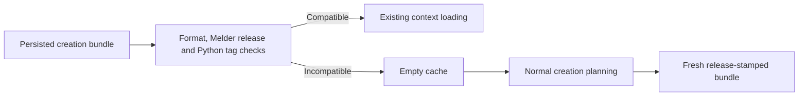

### Named Scope Discovery and Replay
```text
create(name) -> attach -> Cloud + dynamic record + Nexus -> active named lesser
cleanup -> dispose descendants -> retire name/record -> clear/detach -> ready pool
checkpoint -> fold surviving carriers -> validate ancestry -> new root and lesser IDs
```

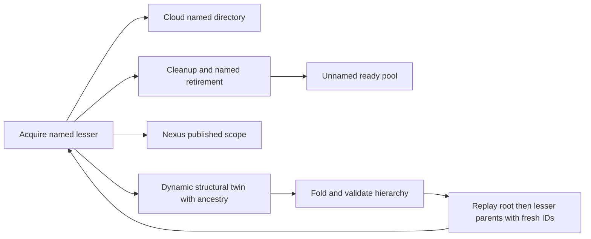

### Pooled Hook Lifecycle
```text
root-owned baseline -> scope lease -> dispose creations -> restore temporary hooks -> idle pool
                                                                  next acquisition -> owner selection
```

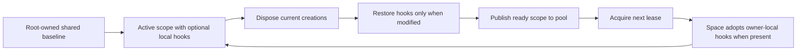

### Bind Lifecycle
```text
Book admission -> capture stages -> pre(reference) -> native Spell construction
 -> activation(Spell) -> profile/publication -> post(Spell) -> transaction completion
```


### Scoped Purge
```text
Conduit / SpellSpace -> shared discovery -> concrete Meld: authorize -> Creations: lock + retire -> dispose
```


### Registration Capability Foundation
```text
bind / bind_inactive -> Bind bool admission -> Spell.resolvable (a binding-manifest field, 0.2.8258)
                                                     |
                                          spellbook descriptions
(the spell_id is the target's code and does not depend on resolvable since 0.2.8257)
```


This diagram describes the registration boundary. Compiler selection now preserves reference-only
required inputs through both plan variants. Direct runtime admission refuses False; ordinary supplied
inputs use existing execution, Nexus exposes references, and durable replay preserves the capability.

### Unresolved Input Resolution
```text
conjure: typed parameter, no provider -> UNRESOLVED_INPUT socket -> Phase-4 warning (conjure succeeds;
         listed only by conjure(validation_warnings=True))
meld:    value supplied -> constructor receives it
         value missing  -> UnresolvedInputError (a MeldExecutionError) before construction
bind:    matching provider added later -> consumer re-resolves -> normal dependency edge
```

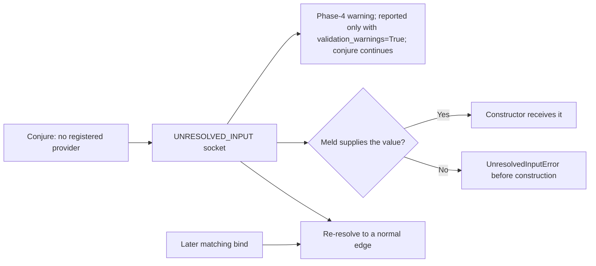

### Override Key-Set Plans
```text
meld(override) -> key tuple -> stored plan? -> plan(meld, ov)
                               no -> resolver -> demand (skip supplied subtrees) -> emit, compile, store
normal meld   -> normal plan (empty key set) of the same runtime
```

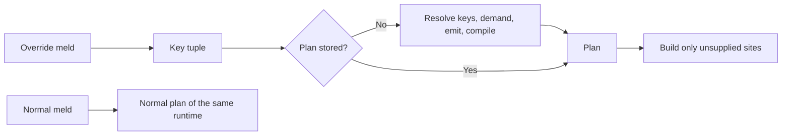

### Conduit Lookup Coverage
```text
Aether lookup(frame: str = "default") -> _resolve_lookup_frame -> frame
  *_root_*            -> frame root maps              -> roots
  get_conduit_by_name -> frame ConduitCloud directory -> named roots + active named lessers
  get_conduit_by_id   -> root map snapshot, then each root ward's lineage snapshot -> any live conduit
```

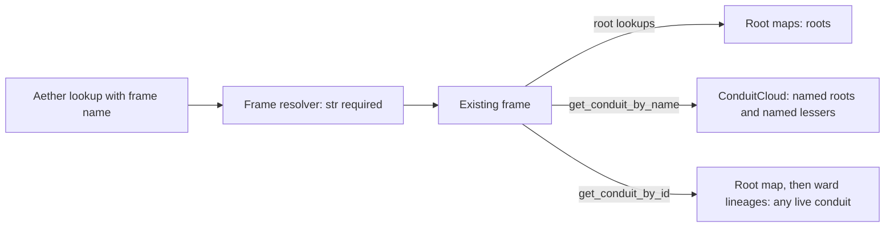

### Frame Lookups
```text
find_frame(name) | get_frame(name) -> _find_registered_frame -> registry dict.get
    live frame -> borrowed frame | absent or cleaned -> None (get_frame: ValueError)
list_frame_names() -> registry dict.copy() -> live names, creation order
(no lock, no plane claim, no frame created, no regime sealed)
Spellbook(aetheric_frame=F) -> _ensure_frame(F) -> creates F when absent
conduit lookups, get_conduit_cloud -> _get_existing_frame -> creates "default" when absent; others must exist
```

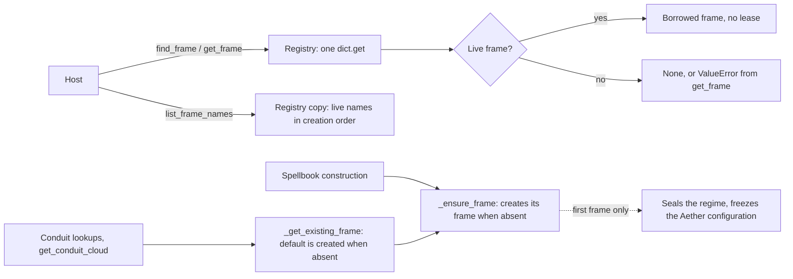

### Scope Exit and Pool Return
```text
with lesser: / lesser.cleanup():
  descendants -> SpellSpaces -> own store -> retire name | detach -> hooks -> pool -> raise failures
with conduit.enter_spellspace() as space:
  pop (LIFO) -> dispose space store -> reset hooks -> release (released=True) -> raise failures
  released space: meld / purge -> SpellSpaceScopeError; the next acquisition clears the flag
with root: / root.cleanup():
  ward (lesser lineage) -> SpellSpaces -> stores -> hooks -> logger -> raise failures
```

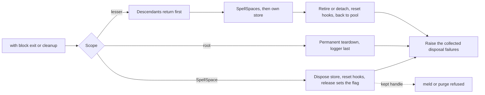

### Managed Lease and Release
```text
meld or injection -> plan: pop the pool's idle deque -> hit: the object (no lock)
                                                     -> empty: miss: reserve -> children -> object -> adopt children
                                                        (refused: ManagedSpellExhaustedError; raised: abandon)
holder -> ReleaseManagedSpell().release(obj) -> type(obj) -> pool.put_back: resets -> append (-> trim, notify)
root teardown -> ward, SpellSpaces -> Creations.cleanup: unregister the pools -> clean them (idle objects, every
                 recorded child, out objects' included) -> the store's registry
ownership transfer -> rows carry the pool; the owner stamp follows; a failed one stamps back, discards composed pools
rebind under the same spell_id (cleanup_spell, bind) -> ensure_managed_quantity -> the same pool, new settings
```

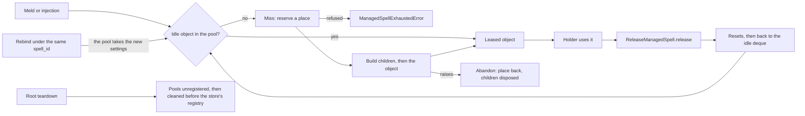

### ASCII Context Diagram (C4)
```
[User Code]
    |
    v
[Spellbook] -> [Aether (global)] -> [AethericFrame] -> [SpellExaminer Profiles]
    |               |
    |               +--> [AetherUtilitySystem]
    |               +--> [Nexus] -> [Rift] -> [RiftSpace]
    |
    v
[Conduit] -> [Meld] -> [Creations]
    |
    v
[Resolved Instances]
```

### Mermaid Context Diagram (C4)
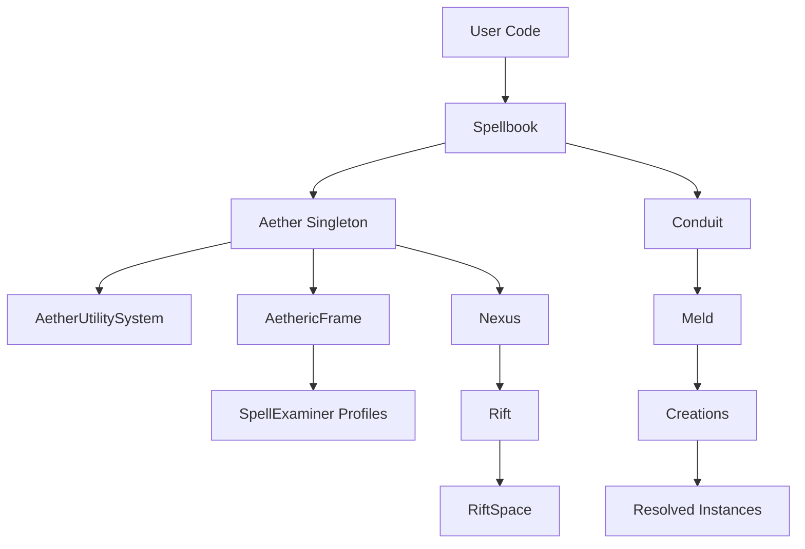

### ASCII Conjure Pipeline Diagram
```
[Spellbook.conjure]
  -> validate/freeze config
  -> bind config to Aether
  -> structural tier: full hit -> replay phase 3-4 rows | else phases 1-4 (structural)
  -> phases 5-7 (foundational resolution)
  -> phases 8-11 (plan resolution, if no errors)
  -> Conduit() + hooks
  -> wire ownership into spells (active versions; parked versions get the stamp alone)
```

### Mermaid Meld Flow
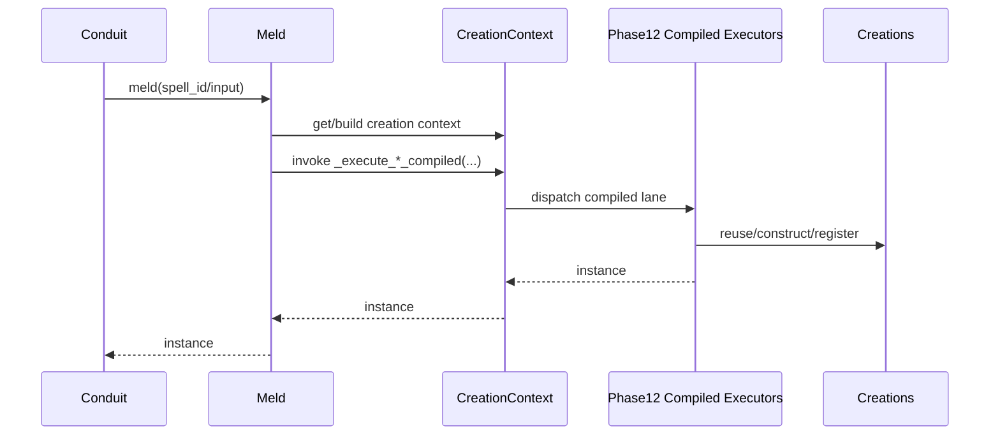

### Mermaid Conduit Upgrade
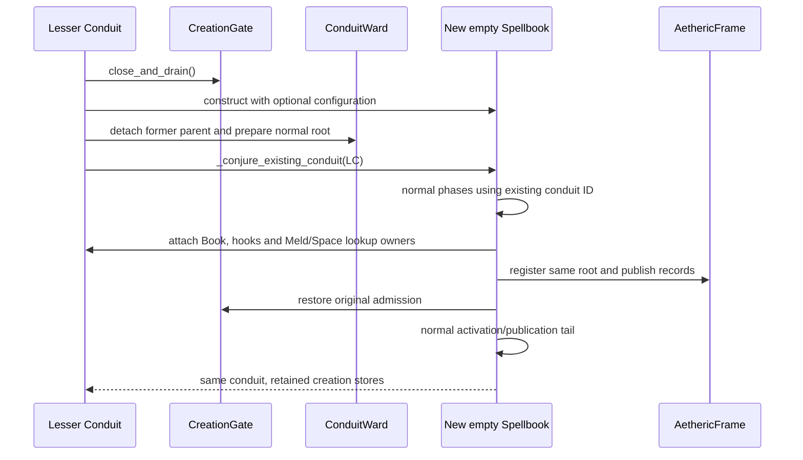

### Ordered Disposal Data Flow
```text
Book + per-bind candidates -> Bind -> Spell list -> compiler -> Creations -> ordered calls
                                       |
                                       +-> crystal ordered values -> replay -> new Bind
```

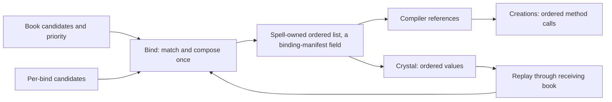

Recorded values cross a persistence boundary; runtime references do not create a second
policy source. Receiving-book order wins on replay. The order is a binding-manifest field, so a
receiving book's order keeps the spell_id, moves the binding hash and is reported in the restore's
`binding_changes` (0.2.8258).

## Information Sources
- `src/melder/mutation_research/mutation_research.py`
- `src/melder/aether/spellbook/spell_compiler/structural_snapshot/structural_snapshot.py`
- `src/melder/aether/spellbook/spell_compiler/validation/strategies/spellmap_shape_validation_strategy.py`
- `src/melder/utilities/caching_system/caching_system.py`
- `src/melder/aether/spellbook/spell_compiler/validation/strategies/ambiguous_provider_strategy.py`
- `src/melder/aether/spellbook/spell_compiler/dag/socket_kind.py`
- `src/melder/aether/spellbook/spellframe_kind/spellframe_kind.py`
- `src/melder/crystallizer/crystal_loader_system/graft_runner.py`
- `src/melder/utilities/helpers/general_helpers.py`
- `src/melder/aether/spellbook/spell_compiler/codegen_creation_system/shared_assets/site_plan_lowering.py`
- `src/melder/aether/spellbook/spell_compiler/codegen_creation_system/shared_assets/site_plan_override_runtime.py`
- `src/melder/aether/spellbook/spell_compiler/codegen_creation_system/shared_assets/override_key_resolver.py`
- `src/melder/aether/spellbook/spell_compiler/codegen_creation_system/strategies/generalized/hydration/generalized_hydrator.py`
- `src/melder/aether/spellbook/spell_compiler/codegen_creation_system/strategies/generalized/compilers/generalized_manifest_no_overrides_compiler.py`
- `src/melder/utilities/helpers/signature_reflection.py`
- `src/melder/utilities/custom_exceptions/unresolved_input_error.py`
- `src/melder/aether/spellbook/spell_compiler/phases/compiler_phase_3.py`
- `src/melder/crystallizer/crystal_analysis/conduit_hierarchy.py`
- `src/melder/crystallizer/crystal_analysis/preflight/conduit_hierarchy_strategy.py`
- `README.md`
- `src/melder/__init__.py`
- `src/melder/_build_assets/_bind_guard/manifest/bind_guard_manifest.py`
- `src/melder/system_document.py`
- `src/melder/__architecture__.py`
- `src/melder/__components__.py`
- `src/melder/__graph_network__.py`
- `src/melder/__graph_details__.py`
- `src/melder/aether/aether_configuration.py`
- `src/melder/nexus/configuration/nexus_configuration.py`
- `src/melder/crystallizer/crystal_loader_system/restore_engine.py`
- `src/melder/crystallizer/crystallizer.py`
- `src/melder/crystallizer/crystals/spell_crystal.py`
- `src/melder/crystallizer/persistence/persistence_profile.py`
- `src/melder/crystallizer/persistence/record_version.py`
- `src/melder/crystallizer/crystal_loader_system/load_admission.py`
- `src/melder/aether/aether_utility_system.py`
- `src/melder/aether/aether_configuration_builder.py`
- `src/melder/aether/spellbook/spellbook.py`
- `src/melder/aether/spellbook/spellbinder.py`
- `src/melder/aether/spellbook/bind/bind.py`
- `src/melder/aether/spellbook/bind/spell_code_digest.py`
- `src/melder/aether/spellbook/bind/binding_manifest.py`
- `src/melder/aether/spellbook/bind/scan.py`
- `src/melder/aether/spellbook/bind/spell_index.py`
- `src/melder/aether/aetheric_frame/dev_ops/change_control_manager/transaction_manager/strategies/add_to_index_transaction_strategy.py`
- `src/melder/aether/aetheric_frame/dev_ops/change_control_manager/transaction_manager/strategies/remove_from_index_transaction_strategy.py`
- `src/melder/aether/aetheric_frame/dev_ops/change_control_manager/transaction_manager/strategies/notch_transaction_strategy.py`
- `src/melder/aether/spellbook/spell.py`
- `src/melder/aether/spellbook/configuration/spellbook_configuration.py`
- `src/melder/aether/spellbook/existence/existence.py`
- `src/melder/aether/spellbook/existence/managed_spell_mode.py`
- `src/melder/aether/spellbook/spell_types/spell_types.py`
- `src/melder/aether/spellbook/resolution_style_matrix.py`
- `src/melder/aether/spellbook/spell_compiler/spell_requirements_finder/parameter_di_shape.py`
- `src/melder/aether/spellbook/spell_compiler/spell_compiler.py`
- `src/melder/aether/spellbook/spell_compiler/validation/validation_system.py`
- `src/melder/aether/spellbook/spell_compiler/validation/strategies/circular_dependency_strategy.py`
- `src/melder/aether/spellbook/spell_compiler/validation/strategies/duplicate_spell_name_strategy.py`
- `src/melder/aether/spellbook/spell_compiler/validation/strategies/binding_resolution_cycle_strategy.py`
- `src/melder/aether/spellbook/spell_compiler/validation/strategies/contract_provider_presence_strategy.py`
- `src/melder/aether/spellbook/spell_compiler/system/spell_system_validation_system.py`
- `src/melder/aether/spellbook/spell_compiler/system/validation/cycle_detection_strategy.py`
- `src/melder/aether/spellbook/spell_compiler/system/validation/contract_graph_cycle_strategy.py`
- `src/melder/aether/aether.py`
- `src/melder/aether/aetheric_frame/aetheric_frame.py`
- `src/melder/aether/aetheric_frame/aetheric_frame_configuration.py`
- `src/melder/aether/aetheric_mediator/mediator.py`
- `src/melder/aether/aetheric_mediator/claim_table.py`
- `src/melder/aether/aetheric_mediator/claim_mode.py`
- `src/melder/aether/aetheric_mediator/admission_orchestrator.py`
- `src/melder/aether/aetheric_mediator/admission_result.py`
- `src/melder/aether/aetheric_mediator/identity.py`
- `src/melder/aether/aetheric_mediator/information_registry.py`
- `src/melder/aether/aetheric_mediator/scope_keys.py`
- `src/melder/aether/aetheric_mediator/staged_transaction.py`
- `src/melder/aether/aetheric_mediator/strategy_builder.py`
- `src/melder/aether/aetheric_mediator/transaction_request.py`
- `src/melder/aether/aetheric_mediator/transaction_session.py`
- `src/melder/aether/aetheric_mediator/transaction_strategy.py`
- `src/melder/aether/aetheric_mediator/transaction_type.py`
- `src/melder/nexus/nexus.py`
- `src/melder/nexus/frame_descriptor_manager.py`
- `src/melder/nexus/frame_acl_manager.py`
- `src/melder/nexus/nexus_frame_manager.py`
- `src/melder/nexus/nexus_frame_builder.py`
- `src/melder/nexus/acl/builder/frame_acl_builder.py`
- `src/melder/nexus/rift/rift.py`
- `src/melder/nexus/rift/frame_link/frame_link_contract.py`
- `src/melder/nexus/rift/frame_link/frame_link.py`
- `src/melder/nexus/rift/rift_gate/rift_gate.py`
- `src/melder/nexus/rift/rift_gate_controller/rift_gate_controller.py`
- `src/melder/nexus/rift/rift_space/codegen_rift_space.py`
- `src/melder/nexus/rift/rift_space/memory_system/rift_memory_system.py`
- `src/melder/nexus/rift/rift_space/memory_system/rift_memory.py`
- `src/melder/nexus/rift/codegen_system/codegen_system.py`
- `src/melder/nexus/rift/codegen_system/codegen_transaction_context.py`
- `src/melder/nexus/rift/codegen_system/namespace/codegen_namespace_builder.py`
- `src/melder/nexus/rift/codegen_system/namespace/codegen_namespace_configuration.py`
- `src/melder/nexus/rift/codegen_system/validation/codegen_validator.py`
- `src/melder/nexus/rift/codegen_system/validation/codegen_validation_result.py`
- `src/melder/nexus/rift/codegen_system/validation/codegen_validation_reporter.py`
- `src/melder/nexus/rift/codegen_system/execution/codegen_compiler.py`
- `src/melder/nexus/rift/codegen_system/execution/codegen_executor.py`
- `src/melder/nexus/rift/codegen_system/execution/codegen_execution_result.py`
- `src/melder/nexus/rift/codegen_system/observability/codegen_monitor.py`
- `src/melder/nexus/rift/codegen_system/observability/codegen_event_publisher.py`
- `src/melder/nexus/rift/frame_viewer/static_frame_viewer.py`
- `src/melder/nexus/rift/rift_space/rift_space.py`
- `src/melder/nexus/rift/rift_space/event_system/rift_event_system.py`
- `src/melder/nexus/rift/rift_space/event_system/rift_event.py`
- `src/melder/nexus/rift/rift_space/static_rift_space.py`
- `src/melder/nexus/rift/rift_space/codegen_rift_space.py`
- `src/melder/nexus/rift/rift_space/capability_rift_space.py`
- `src/melder/nexus/rift/rift_space/workstation.py`
- `src/melder/nexus/rift/command_system/command_system.py`
- `src/melder/nexus/rift/command_system/static_command_system.py`
- `src/melder/nexus/rift/command_system/capability_command_system.py`
- `src/melder/nexus/rift/command_system/codegen_command_system.py`
- `src/melder/aether/conduit/conduit.py`
- `src/melder/aether/conduit/conduit_cluster.py`
- `src/melder/aether/conduit/creations/cluster_creations.py`
- `src/melder/aether/aetheric_frame/conduit_cloud.py`
- `src/melder/aether/conduit/creations/creations.py`
- `src/melder/aether/conduit/creations/managed_spell_quantity.py`
- `src/melder/aether/conduit/creations/release_managed_spell.py`
- `src/melder/aether/conduit/creations/managed_spell_lease.py`
- `src/melder/aether/conduit/conduit_ward/conduit_ward.py`
- `src/melder/aether/conduit/spell_space/spell_space.py`
- `src/melder/aether/conduit/spell_space/spell_space_pool.py`
- `src/melder/aether/conduit/conduit_pool.py`
- `src/melder/utilities/general_base/abstract_elastic_pool.py`
- `src/melder/aether/conduit/spell_space/spell_space_thread_state.py`
- `src/melder/aether/conduit/meld/spellspace_meld.py`
- `src/melder/utilities/general_base/cleanable.py`
- `src/melder/utilities/custom_exceptions/spell_space_scope_error.py`
- `src/melder/utilities/custom_exceptions/managed_spell_exhausted_error.py`
- `src/melder/utilities/custom_exceptions/spellbook_validation_error.py`
- `src/melder/aether/conduit/meld/meld.py`
- `src/melder/aether/conduit/meld/conduit_meld.py`
- `src/melder/aether/spellbook/spellbook_creation_system.py`
- `src/melder/aether/conduit/meld/creation_context/creation_context_rebuild.py`
- `src/melder/aether/conduit/meld/creation_context/creation_context.py`
- `src/melder/aether/spellbook/spell_compiler/spell_compiler_artifact.py`
- `src/melder/aether/spellbook/spell_compiler/codegen_creation_system/codegen_creation_system.py`
- `src/melder/aether/conduit/meld/contracts/spell_map.py`
- `src/melder/aether/conduit/meld/contracts/spell_contract.py`
- `src/melder/aether/spellbook/spell_compiler/dag/resolution_frame/resolution_frame.py`
- `src/melder/aether/conduit/conduit_ward/transfer/transfer_of_ownership.py`
- `src/melder/aether/aetheric_frame/dev_ops/spell_system_states/spell_system_states.py`
- `src/melder/aether/aetheric_frame/dev_ops/spell_system_states/spell_system_state.py`
- `src/melder/aether/aetheric_frame/dev_ops/spell_system_states/spell_state.py`
- `src/melder/aether/aetheric_frame/dev_ops/spell_system_states/spell_state_change_reason.py`
- `src/melder/aether/aetheric_frame/dev_ops/dev_ops_manager.py`
- `src/melder/aether/aetheric_frame/dev_ops/change_control_manager/change_control_manager.py`
- `src/melder/aether/aetheric_frame/dev_ops/risk_manager/risk_manager.py`
- `src/melder/aether/spellbook/spell_compiler/spell_examiner/spell_examiner.py`
- `src/melder/aether/spellbook/spell_compiler/spell_examiner/profiles/general_profile.py`
- `src/melder/aether/spellbook/spell_compiler/spell_examiner/profiles/detailed_profile.py`
- `src/melder/aether/spellbook/spell_compiler/profiles/resolution_profile.py`
- `src/melder/utilities/ai_native_support_tools/protocol_crafter.py`

## Context / Handoff Summary

2026-10-24 src_architecture to its authoring spec (documentation only; EPIC-2026-10-24-src_architecture_to_spec, the
owner's ask): component mechanics recorded here before 0.2.8228 - cache envelope generations, site-plan emission,
store and slot locks, hook maps, recording keys - now live only in their src_components entries, named at the end of
Operational Invariants, and that period's fixed-defect and correction history left Failure Modes and the other
sections; the MutationResearch interface inventory moved verbatim to src_components (Subcomponent: MutationResearch
Root (ResearchSet Registry)); C1 notes keep their descriptions, not per-version changes; the citation check is kept
once, in src_components' Indexing; three paths into the documentation tooling are gone. This change log keeps the
entries from 0.2.8228 on, the release-note boundary. Still unknown: see Unknowns. Where to start: What Melder Is
(Read This First), the Architecture Summary, then src_components by component name.

2026-10-24 a `many` belongs to the scope that built it (0.2.8267;
STORY-2026-10-24-remove_many_child_holder_ownership, on the owner's decision "lets rip it out because it should
behave like autofac not mysteriously cleanup transient objects"): a disposal-bearing `many` built for a slotted
holder is recorded and disposed by the meld's innermost scope, like any `many`, and cleaning up a holder runs only
its own disposal methods; the 0.2.8235 placement and the 0.2.8238 holder record (`HolderDisposalEntry`,
`adopt_children`) are removed. A new first operational invariant, the meld and transfer sequences, the Runtime
Model's defect example, two Breaking failure modes in place of the 0.2.8235 fix and the 0.2.8238 purge entry, the
two removed invariants (marked REMOVED; the specializer's decline is kept), the transfer-default invariant, the
guardrail's bind-guard count (629) and the code map (five files remeasured) carry it; the component map carries the
per-component contracts. Numeric citations into conduit.py past `transfer_spell_ownership` moved two lines with its
docstring and were remapped.

2026-10-24 cache saves are best-effort (0.2.8266; TASK-2026-10-24-cache_file_write_failure_fails_meld, on the
owner's go "yeah go ahead with all hte recommended things you need to do"): a save the operating system refuses no
longer fails a meld - `CachingSystem.emit()` returns False and logs, its temp file is per writer and removed, a
Windows sharing refusal of the rename is retried, and the Book leaves its save flag cleared; `Spell.emit_cache_file()`
returns False (Breaking). A new operational invariant, two failure modes (one fixed, one Breaking) and the code map
(three files remeasured) carry it; the component map carries the per-component contracts. Numeric citations into
spellbook.py past the edit moved 20 lines and were remapped line by line; the settle-then-inherit inner citations
(:6971-6983, :6984), stale since an earlier lane, point at the settlement block and its return again. Open: the
Windows holder behind the owner's failure is not identified (an on-access scanner is suspected).

2026-10-19 cluster admission (0.2.8265): the pending-id reservation makes competing admissions exclusive
without holding the Cloud lock across registration/recording or sharing. The operational invariant and
the Cloud code-map extent carry it; the component map describes the reservation and its release.

2026-10-19 staging keeps the active signature (0.2.8263; STORY-2026-10-17-staged_version_releases_active_signature,
on the owner's word "try doing a few small ones"): `_destroy_spell_index` drops a Book route only when it routes the
key to the destroyed index and releases only the departing member's frame claim, by spell_id, so staging, an index
move back and a lone parked disposal keep every other spell's signature. A new operational invariant, a fixed failure
mode and the code map (spellbook.py remeasured) carry it; the component map carries the per-component contract.
Numeric citations into spellbook.py past the edit were remapped line by line.

2026-10-19 a refused notch moves nothing (0.2.8262; STORY-2026-10-17-failed_notch_keeps_switch_without_borrowers,
on the owner's answer "refuse it and throw and move on" and his go "it should roll back properly"): a notch
checks a version it makes active inside the window and, when the check fails, puts the structure back before it
raises, so the lender and its borrowers stay on the outgoing version; `SpellbookValidationError` takes a one-line
`preface`. The boundary list, the summary, the SpellIndex Mutation Entry sequence (a new step 6), a new
operational invariant, a fixed failure mode and the code map (four files remeasured) carry it; the component
map carries the per-component contracts. Numeric citations into spellbook.py and conduit.py past the edits
were remapped line by line; the one the remap widened to the whole new comment block cites its first three
lines again (4022-4024).

2026-10-19 cleanup releases the contracts (0.2.8261; STORY-2026-10-17-parked_cleanup_leaves_borrower_copies, on
the owner's word "check for active contracts and then cleanup"): every `cleanup_spell` door takes the version
out of every contract of the Book's root conduit - an index link's member Detail or a version grant, with the
borrower's entry and borrowed id - after the Book's decision and before its disposal, and the Spellbook's own
door goes through its root conduit once conjured. A new operational invariant, a fixed failure mode and the code
map (three files remeasured) carry it; the 0.2.8256 invariant's filed gap is marked fixed and its unchanged
doors are named, and the 0.2.8231 entry says the release comes first; the component map carries the
per-component contracts. Numeric citations into conduit.py and spellbook.py past the edits moved 25 and 42
lines and were remapped line by line; none into conduit_ward.py moved here.

2026-10-19 a Book's teardown retires its parked versions (0.2.8260;
STORY-2026-10-17-book_teardown_leaves_parked_versions_uncleaned, on the owner's word "Go ahead"): after the
active versions `_cleanup_spells` retires every parked version locally and cleans every index only parked
versions hold, so no version of a dead Book reads live or refuses its own cleanup. The cleanup sequence, a new
operational invariant, a fixed failure mode and the code map carry it, and the 0.2.8256 invariant no longer lists
Book teardown as unchanged; the component map carries the per-component contract. Every numeric citation into
spellbook.py past the edit moved 45 lines and was remapped line by line.

2026-10-19 a root's teardown cleans only what the root holds (documentation only; the owner's rule, in chat on
2026-10-18): a sentence in the Runtime Model, the cleanup sequence (the unregister-first order, the ward and
SpellSpaces ending before the store), a new operational invariant (the rule, what the root holds, today's order,
measured on 0.2.8258), a failure mode (a consumer the root's own store holds that gives its object back in its
disposal method makes the teardown report that release's error) and the managed lease diagram's teardown order (it
read "pools first ... -> unregistered"; the code unregisters first) carry it; the component map carries the
per-component text. Corrected after the owner's review (chat 2026-10-19): the first wording left two behaviours
as questions for the owner - a pool disposing the children it keeps for objects still out, and the reported
release error - and neither is a defect: the pool holds those children, so the root disposes them, and a
disposal method that raises is reported like any other. Checked against `Conduit._cleanup_normal_conduit`,
`Creations.cleanup`, `ManagedSpellQuantity.cleanup` and `ReleaseManagedSpell._resolve_pool`.

2026-10-19 the minted index is registered (0.2.8259; STORY-2026-10-17-minted_index_missing_from_frame_registry, on
the owner's word "it should properly follow the general spell index creation and registry binding processes the same
way it does during bind"): the index `remove_from_spell_index` mints is registered with the frame as a post-conjure
`bind` registers the index it creates, the root's teardown unregisters it with the rest, and residency reads its
version parked until a notch. A new operational invariant, a fixed failure mode, the index mutation sequence and the
code map carry it; the 0.2.8256 invariant's and the 0.2.8253 failure mode's filed gap is marked fixed; the component
map carries the per-component contracts. No new index state (the owner withdrew it).

2026-10-18 follow-ups to the identity landing (documentation only): the identity invariant records the build parity
and the -O rule; the Unknowns gain the patch-release question; the managed release's failure mode is corrected - a
`ReleaseManagedSpell` release after the root's teardown raises the not-managed ValueError, because the store
unregisters its pools first, and the torn-down RuntimeError comes from the pool through a lease or a release that
resolved it before the teardown. Checked against `Creations.cleanup`, `ReleaseManagedSpell._resolve_pool`,
`ManagedSpellQuantity.put_back` and `ManagedSpellLease.release`.

2026-10-18 spell identity is the code (0.2.8257-0.2.8258; S1 and S2 of EPIC-2026-10-18-spell_identity_is_the_code,
on the owner's direction and calls): a spell_id is the SHA256 of the registered object's code (`SpellCodeDigest`),
nothing from the bind call, so every real edit is a new version and one object is one spell; the bind call is the
binding manifest, whose hash keys both creation-cache tiers (generation 23) and rides the SpellCrystal (record
4.3.0), a restore reporting each binding it rebuilt differently. The glossary, the boundary list, the guardrail's
bind-guard count (630), the bind sequence, a new operational invariant (the 0.2.8254 entry marked superseded in
part), a Breaking failure mode, the capability diagram, the code map (the changed files re-measured, two modules
added) and the sources carry it; the component map carries the per-component contracts. Numeric citations into the
changed files were remapped line by line from 0.2.8256. Open: S3 (a changed binding revalidates), S4 (the refusal
names the existing registration), S5 (records holding one object twice).

2026-10-18 direct cleanup refusal (0.2.8256; STORY-2026-10-17-direct_cleanup_of_active_member_orphans_parked_versions,
on the owner's choice "Refusal"): `Spellbook.cleanup_and_remove_spell` and a direct `Spell.cleanup()` refuse
the active version of an index that holds parked versions, as `cleanup_spell` refuses it, and all three
messages name the remedies (notch first, dispose the parked versions, or move them out); Book teardown never
meets the check. A new operational invariant, a Breaking failure mode and the code map (two files
remeasured) carry it; the component map carries the per-component contracts. Every numeric citation into
spellbook.py past the check moved 27 lines (31 past `cleanup_spell`'s docstring) and was remapped line by
line. Open: the direct doors' silence to index-link borrowers, Book teardown's parked versions (S7), and the
hole rule (an index alive with nothing active), which the owner proposed and then withdrew for the refusal.

2026-10-18 managed settings leave the spell_id (0.2.8254; part A of
STORY-2026-10-17-release_routes_parked_version_objects_to_active_pool, on the owner's ruling "the bind call itself
shouldn't impact the actual SHA256"): a managed spell's mode, limit, queue timeout and reset methods are settings of
the one spell, not its identity - the fingerprint no longer hashes them, a rebind under the same spell_id gives its
pool the new settings, and creation cache generation 22 retires older bundles. The glossary, the boundary list, a new
operational invariant (the 0.2.8241-0.2.8243 pools entry's hashing sentence points at it), two failure modes (one
Breaking, one fixed with its part-B residue), the managed lease diagram and the code map (six files remeasured)
carry it; the component map carries the per-component contracts. The guardrail's citation of the internal-bind call
moves to `src/melder/aether/spellbook/bind/bind.py:715` (it had drifted two lines). Open with the owner: part B
(refusing a second managed version of one class in one SpellIndex), a record holding two settings-only versions of
one class, and whether more of the bind call leaves the spell_id.

2026-10-17 lookup by spell_id is exact (0.2.8253; the owner's rule: a spell_id and a SpellIndex are separate
things, and a spell_id lookup never answers with the spell its index has active): `Spellbook.find_spell_by_id`
and `Conduit.get_spell_by_id` are renamed `find_spell_by_spell_id` and `get_spell_by_spell_id` (Breaking, no
alias) and answer the spell a spell_id names, active or parked; `get_spell_permissions` answers per version;
callers that need an index's active spell (the transfer's spell_id handles, the contract dependency walks) take
an explicit index step and answer as before; the Rift rooms' `get_spell_by_id` command is renamed
`get_spell_by_spell_id` and both rooms' spell_id and source-id lookups answer the spell named. The boundary list,
a new operational invariant (the 0.2.8229 lookup entry marked superseded in part), four failure modes (one
Breaking), the corrected notch remedy and no-op entry, and the code map (eleven files remeasured) carry it; the
component map carries the per-component contracts. Every numeric citation into the changed files was remapped
line by line. Open with the owner: the five other places that resolve a spell_id through its index (the
contracted-copy lookup, the contract row `Detail`, and three ConduitWard contract reads and checks),
`Meld._current_in_pool`, and the three paths that file a borrowed copy under the selected id.

2026-10-16 one version, one copy (0.2.8251; the owner's rule for removing a borrowed copy):
`_remove_contracted_spell` matches an active copy by its own spell_id, never by index membership, so an unlink after
a notch completes in any member order and a removal never takes another version's copy. A new operational
invariant, a failure mode (fixed) and the code map carry it; the component map carries the per-component contract.
Every numeric citation into spellbook.py after the method moved seven lines and was remapped; the two inner
citations of the settle-then-inherit evidence (`:6823-6835`, `:6836`), stale since an earlier lane, now point at
the settlement block and its return.

2026-10-16 contract recheck on notch (0.2.8250; rule 2 of the owner's 2026-10-15 direction, his decisions D1-D5):
a satisfied SpellContract is no longer checked on every meld. A change of what a spell resolves marks it instead -
the borrower Book's five contracted-map mutators mark their key's consumers, a notch marks everything downstream
of the notched lineage (registry edges and contract keys, transitively; D2) and every contract mark walks on -
and before a plan compiles the meld refreshes each stale lineage the plan expands (D2); a lost provider is named
with its remedy (D1-B); a notch back makes a parked version grant active again (D3). The boundary summary, the
meld-time gate and SpellIndex mutation sequences, a new operational invariant, four failure modes (two Breaking,
one known race), the code map (five files remeasured, two added) and the sources carry it; the component map
carries the per-component contracts. Every numeric citation into the seven changed files was remapped line by
line across the edit. Open: in-flight borrower melds racing a notch's fan-out
(TASK-2026-10-16-order_inflight_borrower_melds_against_notch_fanout) and a lent consumer's Book-local provider
loss (TASK-2026-10-16-investigate_lent_consumer_provider_loss).

2026-10-16 public notch target (0.2.8249): `Conduit.notch_spell` takes `spell_id=` - the spell_id `bind` or
`bind_inactive` returned - beside `spell=`, exactly one, and resolves it inside the call to the exact version the
Book owns, active or parked (owner ruling, option A: "just use the private version if its inside the public call
thats reasonable"), so the stage -> notch -> meld loop runs on public calls. Both forms are checked - owned by the
conduit's Book, a member of the index passed - before the transaction and again under its seal, which closes
three ways a notch used to damage a Book. The boundary list (its conduit.py citations remeasured), the summary,
the SpellIndex Mutation Entry sequence (whose steps 1-2 said the Spellbook starts the transaction; the Conduit
does), a new operational invariant, three failure modes and the code map carry it; the component map carries the
per-component contract. The rubric pass repointed the two citations of `SpellbookCreationSystem.check_system_state`,
which had drifted 29 lines above the method since earlier lanes. On the owner's extension `add_to_spell_index` and
`remove_from_spell_index` take `spell_id=` the same way and their docstrings say the conduit admits the
transaction; the same sections and a fourth failure mode carry it, the conduit.py citations and code-map extent are
remeasured (the file grew 172 lines), and this lane's text says spell_id, as the owner asked, not "version id".

2026-10-16 parked versions wired at conjure (0.2.8248): conjure stamps every version parked with `bind_inactive`
before it with the owner stamp alone, as a post-conjure `bind_inactive` does, so such a version melds after a notch
for every existence (owner ruling: "bind_inactive should behave the same before and after conjure"); the creation
cache moves to generation 21, retiring bundles written before the managed lease codegen (owner: a codegen change
bumps the cache); the missing-pool message loses its pre-conjure cause. The boot and conjure sequences, a new
operational invariant, the transfer and managed-lease invariants, two failure modes (one now a fixed defect), the
code map (five files remeasured), the pipeline diagram and the settle-then-inherit citations (three lines further
down spellbook.py) carry it; the component map carries the per-component contracts. The 2026-10-15 entry's open
item, stamping versions staged before conjure, is closed.

2026-10-16 non-resolvable definitions leave the Book flag (0.2.8247): a lineage whose selected version was bound
resolvable=False carries the new capability flag `SpellState.non_resolvable`, written by `register_index` from its
callers' `Spell.resolvable` and published as the registry's frozenset `non_resolvable_index_ids`; RiskManager's
Book flag leaves such lineages out with one subset test, so one Protocol or abstract definition no longer sends
every meld of its Book through the validation gate (15-16 us -> 0.3-0.7 us per warm meld). The meld-time gate
sequence, an operational invariant, a failure mode, the code map (six files remeasured) and the sources carry it;
the component map carries the per-component contracts. Numeric citations into spellbook.py moved one or two lines
with the two call-site keywords and point at their code again. Open for the owner: whether the meld's contract
check should run only when the melded spell's state calls for it (a contract consumer in a borrower Book still
costs about 2 ms a meld).

2026-10-15 managed spells (0.2.8241-0.2.8246; promoted at the end of their lane): `Existence.managed_spell_quantity`
leases objects from a pool its owning root keeps per version and takes them back through `ReleaseManagedSpell` -
the member and its Phase 6 rank (0.2.8241), the four bind options and their record (0.2.8242), the pool in the
root's Creations (0.2.8243), the Aether-owned registry and the lease (0.2.8244), leases through the emitted plans
and `Conduit.managed_spell_meld` (0.2.8245), and the owner stamp following an ownership transfer (0.2.8246). The
glossary, the boundary list, the guardrails, the boot, meld, transfer and cleanup sequences, four operational
invariants, five failure modes, the code map (five new modules; every changed file remeasured, and
`spell_system_states.py`, three lines stale since 2026-10-04), the sources and a diagram carry it; the component
map carries the per-component contracts. The numeric citations into conduit.py, spellbook.py, aether.py and
bind.py point at their code again (most had drifted since 0.2.8235). Open for the owner: stamping versions staged
before conjure.

2026-10-15 what Melder is (documentation only, owner-directed): the document opens with "What Melder Is (Read
This First)" - Melder is not a DI container but a runtime agents live and build in: many agents iterate on the
same objects through versions, borrowers follow a notch, versions coexist (MutationResearch, compositions, one
`unique` object per version), and agents build the subsystem they are in. The Runtime Model moved under it, with
the rule not to judge the code by DI-container rules.

2026-10-15 notch borrowers (documentation only, owner ruling): the Architecture Summary and the SpellIndex
Mutation Entry sequence no longer call the borrower update a missing fan-out. A notch moves which version is
active; the conduit has every linked borrower park its copy of the outgoing version and moves index-link
borrowers to the new one; older versions and their objects stay alive, because versions coexist by design
(MutationResearch, compositions, one `unique` object per version).

2026-10-14 slotted lifetimes and the runtime model (0.2.8236-0.2.8240): the new section "Runtime Model: Structure
Is the Contract" records the owner's ruling - correctness lives in the structure; generated objects are working
material agents iterate on, leave pending and clean up; Melder's infrastructure cleans up its own state, not
userland objects. A root's teardown leaves its cluster (0.2.8236), the cluster owns its team store (0.2.8237), a
holder's `many` children are recorded with it (0.2.8238), and a transfer moves by default, disposes nothing
(0.2.8239) and hands over stewardship, not a working setup (0.2.8240). The transfer sequence, the operational
invariants, the failure modes and the code map carry it; the component map carries the per-component rules, and
the 0.2.8235 invariant's cluster-store and purge sentences point at the newer entries. Contract invalidation (a
retired consumer leaves the root's store undisposed; lessers keep theirs) is intended behaviour by the same ruling
and is not listed as a failure.

2026-10-14 holder-owned many children (0.2.8235): a slotted holder's disposal-bearing `many` children register in
the holder's store (the site's `c{i}`) instead of the meld's innermost scope, so a lesser, spellspace, borrower or
cluster member that first melded the holder no longer disposes them under it; the opt-in specializer declines
graphs that feed a `many` step into a non-`many` step. The meld sequence, the operational invariants, the failure
modes, the code map and the sources carry it; the component map carries the emission rule, the store selection
and the live-creation probe.

2026-10-12 elastic pool retention (0.2.8234): the kernel pools keep what a burst needed, up to 256, and decay back to
20 once no miss has happened for 30 minutes - a miss records pressure, a return above 20 idle stretches, decays (with
catch-up) or trims outside the lock, and a fixed-capacity pool keeps the old eviction. The operational invariants,
the code map and the sources carry it; the component map carries the per-pool rules. Citations into conduit.py moved
10 lines with the prewarm docstrings, and the stale ones for the index-mutation verbs and `Conduit.link`'s type
check (off by 11 before this change) now point at their code.

2026-10-11 direct spell cleanup (0.2.8233): a direct `Spell.cleanup()` decides under the spell lock and runs the Book
removal outside it, serialized per spell by a removal lock nothing else takes, so it no longer hangs against Book, root
or frame teardown or a conjure of its Book, which take spell locks under the Book lock; `cleanup_and_remove_spell`
re-checks a Book torn down while it waits. The operational invariants (the 0.2.8232 entry's recorded residual is
closed), the failure modes and the code map carry it; the component map carries the per-component rules.

2026-10-11 lock residuals (0.2.8232): `find_contracted_spell` walks a one-call copy of the Book's contracted peer ids
with no lock, `inspect_spell` walks a one-call copy of the frame's conduits and holds no Book or conduit lock while it
asks the frames (which frame teardown could hang against), and `cleanup_spell` refuses a second disposal of a spell
while the first runs, through an id mark kept under the Book lock - not the spell lock, which Book and frame teardown
take under theirs. The operational invariants, the failure modes and the code map carry it; the component map carries
the per-component rules.

2026-10-11 cross-object locks (0.2.8231): the owner-side index emissions walk a ward's contracts under the ward lock,
contract detail maps are read and written under the contract lock, the contract listing resolves through the Book
instead of the conduit-locked Conduit lookups (a deadlock with link and sever), `cleanup_spell` emits the destroy the
Book's locked decision reports, and bind's cross-frame sweep reads a frame view Aether republishes on frame birth and
detach and asks frames through cleanup-safe probes; the frame copies each Book's live id set in one call. The
operational invariants, the failure modes and the code map carry it; the component map carries the per-component
rules.

2026-10-11 spell-map walks (0.2.8230): bind publishes its four maps under the Book lock; the walks of a Book's spells
that cannot hold that lock (the `validate_resolution` phases and cleanup pass, foreign-Book inspection, contracted
lookups, the transfer impact walk) take one-call snapshots; `get_spell_permissions` and the command surface's spell
lookup read the id maps; `SpellIndex.has_spell` re-checks cleaned under its lock and contract details probe through
the new `SpellIndex._has_spell_unless_cleaned`. `Conduit.get_spell_by_id` and `get_conduit_by_spell_id` document
the ValueError they raise for an unclaimed id (owner decision: `get_*` raises, `find_*` returns None). The
operational invariants, the failure modes and the code map carry it; the component map carries the per-component
rules.

2026-10-11 lookup by version id (0.2.8229): `Spellbook.find_spell_by_id` answers from the Book's id maps
(`_spells_by_id`, then `_inactive_spells` and the parked spell's index) instead of walking the live index map, so
concurrent binds and removals no longer make it raise or miss a registered spell; the new internal
`Spell._spell_index_unless_cleaned` keeps the parked branch safe against a concurrent disposal. The operational
invariants, the failure modes and the code map carry it; the component map carries the threading rationale.

2026-10-10 scan_bind option parity (0.2.8228): `scan_bind` takes bind()'s target options (`resolvable`, per-target
disposal names, keyword metadata) and a scan replays them through `Spellbook.bind`; only an object's own
declaration makes it a target and each object binds once per scan (undecorated subclasses and instances of a
decorated class are no longer registered - Breaking; aliases no longer collide); a failed scan keeps what it
bound, and the `Spellbook.scan` docstring no longer claims a rollback. The boundary list, the operational
invariants, the failure modes and the code map carry it; the component map carries the declaration contract
and the scan flow.

OLDER HISTORY: the entries for 0.2.8227 and earlier (2026-07-25 to 2026-10-04), with the record of the 2026-08-01
and 2026-08-02 recompositions, were removed on 2026-10-24. They are in git history - commit 3bedd65bb holds this
document as it stood before the trim - and the changes from 0.2.8202 to 0.2.8227 are in the release note
`release_docs/0.2.8227.md`. The 2026-08-01 recomposition's migration file (patch lane
system_doc_recompose_2026_08_01) was deleted in commit 0fddab923; what src_components did not absorb from it is in
git history only.

DECISIONS IN FORCE, carried from the 2026-07-25 summary; the section named carries each one:
- Melder is framed as a Dependency Graph Runtime; DI-style binding and resolution are a SUBSET capability, not the
  whole model (Architecture Summary; What Melder Is (Read This First) since 2026-10-15).
- Internal-bind refusal is one module-level function over a committed manifest, exact match, no MRO inheritance
  (Entrypoints and Runtime Guardrails).
- Conjure follows settle-then-inherit: the conduit inherits the world's mode rather than policing the caller's flag
  (Operational Invariants).
- Structural mutation is admitted through one moded scope-acquisition gate (src_components, Component: Transaction
  Admission Plane (Scope Acquisition)).
- The crystallizer is a passive sink; recording never changes runtime behaviour (Persistence & Restore
  Architecture).
