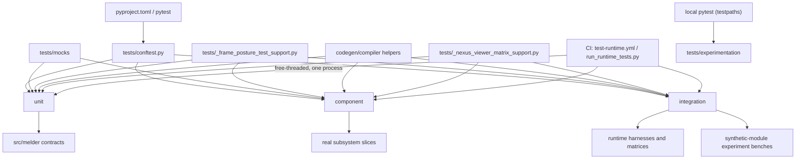

# Tests Architecture (C4)

## Metadata
- Doc ID: ARCH-TESTS-2026-01-22
- Status: in_progress
- Owner:
- Created: 2026-01-22
- Updated: 2026-11-08T20:11:28Z

## Scope and Intent
This document describes the tests architecture (C4) for `tests/` and how it
maps to `src/`. It is intended to stand on its own after context compaction.

The current test system is not one undifferentiated pytest pile. It is a
three-tier suite with shared bootstrap and shared runtime harness layers:
- `unit/`
- `component/`
- `integration/`

The suite also includes:
- shared top-level helpers in `tests/`
- deterministic fixture/mocks under `tests/mocks/`
- a locally collected experimentation tree under `tests/experimentation/`
  (under `testpaths`, outside the three tiers CI runs)

## Indexing
This document is AUTHORED. Its only generated companion is its index
(`tests_architecture_index`), rebuilt in the SAME pass as any edit by the
documentation tooling that maintains these documents. The commands live with that
tooling, not here: this document ships with the code and the tooling does not.

Consume it by slicing a named section rather than reading it whole, and verify the
index proof (line count, line ending, content hash) before trusting a range.

The index was STALE for an extended period before 2026-08-02 - 115 recorded lines
against a live 386 - which means every range it offered was wrong while still
parsing and still returning content. On mismatch: regenerate, never eyeball an
offset.

### Verifying the cited test paths and ranges in this document

THIS SIDE HAS NO GRAPH. `src_graph_index.md` is built from the source tree, so
every source-side citation gets a free resolution check and NOTHING here does.
A renamed or deleted test file leaves a citation that still parses and points
nowhere, and a range that drifts inside a file that still exists is invisible
even to an existence check. That is why the instructions require ranges to be
REMEASURED every pass rather than carried forward.

Run this after any pass that touches the test tree or this document:

```bash
python - <<'EOF'
import pathlib, re

here = pathlib.Path.cwd().resolve()
root = next((p for p in (here, *here.parents) if (p / "tests").is_dir()), here)
docs = next(p for p in (pathlib.Path("system_docs"), pathlib.Path("."))
            if list(p.glob("tests_*.md")))

CITE = re.compile(r"`?((?:tests|src)/[A-Za-z0-9_/.]*\.py):(\d+)(?:\s*-\s*(\d+))?`?")
PATH = re.compile(r"`((?:tests|src)/[^`]+\.py)`")

for doc in docs.glob("tests_*.md"):
    if doc.name.endswith("_index.md"):
        continue
    text = doc.read_text(encoding="utf-8")

    # 1. every cited path exists. Globs are statements about a set, not
    #    citations, so they are skipped rather than reported.
    for i, line in enumerate(text.split("\n"), 1):
        for p in PATH.findall(line):
            if "*" in p or "?" in p:
                continue
            if not (root / p).exists():
                print("MISSING", doc.name, i, p)

    # 2. every path:line range is in bounds
    for i, line in enumerate(text.split("\n"), 1):
        for m in CITE.finditer(line):
            f = root / m.group(1)
            if not f.exists():
                continue
            n = len(f.read_bytes().decode("utf-8", "replace").splitlines())
            s = int(m.group(2)); e = int(m.group(3) or m.group(2))
            if s < 1 or e > n or s > e:
                print("OUT OF BOUNDS", doc.name, i, m.group(0), "file has", n)

    # 3. every C1 record's end_line still matches the file on disk. This is the
    #    check that catches drift, and the one nothing else here can do.
    cur = None
    for i, line in enumerate(text.split("\n"), 1):
        m = re.match(r"^- path: `([^`]+)`", line)
        if m:
            cur = m.group(1); continue
        if cur:
            m2 = re.match(r"^\s+end_line:\s*(\d+)", line)
            if m2:
                f = root / cur
                if f.exists():
                    n = len(f.read_bytes().decode("utf-8", "replace").splitlines())
                    if int(m2.group(1)) != n:
                        print("STALE RANGE", doc.name, i, cur, m2.group(1), "->", n)
                cur = None
EOF
```

Measured ranges in this repository go stale FAST - a re-verification on 2026-08-03
found sixteen source-side ranges that had been green earlier the same day. A
range here is true as of its `verified_at` stamp and no longer.

## DO NOT ASSUME / Unknowns Gate
Rule: No Unverified Claims.
Any statement that is not directly supported by evidence must be treated as UNKNOWN.

Evidence means at least one of:
- A specific source file reference.
- A citation to an explicit, already-verified artifact.

If not evidenced => UNKNOWN.

UNKNOWN items must remain explicitly marked until the relevant source is read.

## Unknowns
- RESOLVED 2026-09-26 (was UNKNOWN: external CI shard/split behavior, blocked while
  the checkout had no in-repo `.github/` workflow config). CI now lives in the
  repository and does not shard: `.github/workflows/test-runtime.yml` runs
  `.github/scripts/run_runtime_tests.py`, which runs `tests/unit`,
  `tests/component` and `tests/integration` in ONE pytest process per OS/Python
  cell. See `## System Boundary and External Interfaces`.
- RESOLVED 2026-10-05 (was UNKNOWN: which Python releases a given CI run tested, because
  the matrix was discovered at run time from GitHub's release catalog). The tree names
  them now: one manifest per exact release under `.github/python/tests/` (3.14.0 through
  3.14.8) builds the matrix with no network lookup, so a run tested exactly the manifests
  at its commit. The `runtime-python-matrix-*` artifact still records each run's matrix.
- UNKNOWN: whether the six tracked `bundle.json` files under
  tests/unit/melder/utilities/_caching_system_tmp_load_*/ are fixtures or leftovers.
  Why it matters: no current test references those directories (the caching tests
  that write cwd-relative directories use other names, and newer ones use
  `tmp_path`), so they are either dead fixtures or committed droppings.
  Where to investigate: `tests/unit/melder/utilities/test_caching_system.py` history.
  Current status: raised to the owner; not changed.
- UNKNOWN: whether the 140 tracked `.py` files under
  tests/experimentation/_physical_to_synth_swap_tmp/ and _synthetic_edge_tmp/ belong
  in the repository.
  Why it matters: they are case packages the synthetic-module benches write (50 of
  the tree's 57 `__init__.py` files); each case gets a fresh directory, so no run
  reads the tracked copies back.
  Where to investigate: `tests/experimentation/physical_to_synthetic_module_swap_semantics_testbench.py`
  and `tests/experimentation/unittest_synthetic_module_edge_cases_testbench.py` teardown.
  Current status: raised to the owner; not changed.
- UNKNOWN: whether a fixture that resets the Aether singleton at teardown without booting a new one still
  leaves the next file without a world. An AST scan of 2026-11-08 finds 28 fixtures whose source after `yield`
  resets `Aether` and calls no `Aether()` after that reset - among them the autouse fixture of
  `tests/unit/melder/crystallizer/test_crystallizer_gates.py` and the `active_recorder` fixture of
  `tests/integration/melder/crystallizer/test_system_state_strenum_657.py`, both read in full - against the
  operational invariant that a reset is always followed by a re-boot.
  Why it matters: SINGLETON VOID (`## Failure Modes and Error Paths`) says the next `Spellbook()` raises; if it
  still does, test order decides the results of those files' neighbours, and if it does not, that entry is stale.
  Where to investigate: the 28 fixtures (the scan is a heuristic) and what `Spellbook()` does with no Aether.
  Current status: recorded 2026-11-08; not changed.

## System Context (C4)
The test system's actors and boundary, which are NOT the runtime's:

- ACTOR: a developer or CI runner invoking `pytest`, or `python -m pytest`. The
  root `tests/conftest.py` exists partly to make those two invocations behave
  identically - see `## Boot and Configuration Sequence`.
- SYSTEM: the pytest process, its collected test modules, the shared support
  modules at `tests/*.py`, the three `conftest.py` scopes, and the mock and
  experimentation trees.
- SUBJECT UNDER TEST: `src/melder`, imported from the local workspace rather
  than an installed distribution.
- EXTERNAL: none by design. No declared marker implies network or external IO,
  and the `component` marker is explicitly defined as "no external IO".

The test system therefore has ONE inbound edge (the runner), ONE outbound edge
(imports of `src/melder`), and no third-party service boundary to describe.

## System Boundary and External Interfaces
Primary test entrypoint:
- pytest, configured through `[tool.pytest.ini_options]` in `pyproject.toml`

CI entrypoint (verified 2026-09-26 against the files named):
- `.github/scripts/run_runtime_tests.py`, called by `.github/workflows/test-runtime.yml`
  (itself called by `.github/workflows/ci.yml` for pull requests). It calls
  `pytest.main` with `-q tests/unit tests/component tests/integration` and a JUnit
  report, adds `--cov=melder --cov-branch` when a coverage report is requested, and
  raises before AND after the run unless the process is Python 3.14+ built
  free-threaded with the GIL off. `tests/experimentation/` is therefore collected by
  a local `pytest` (it sits under `testpaths`) and never by CI.
- Matrix (re-verified 2026-10-24): `.github/scripts/python_runtime_matrix.py` builds
  it from the test manifests in `.github/python/tests/` - one TOML file per exact
  Python release holding the release, `freethreaded = true` and that release's exact
  pins (Melder's runtime dependency and the test group) - for ubuntu-24.04 (x64), windows-latest (x64) and macos-latest
  (arm64), with no network lookup. The floor release from `requires-python` must have
  a manifest and none may sit below it. Each cell installs exactly its manifest's pins
  plus Melder from the checkout (`uv pip install --no-deps`, no resolver, no lockfile)
  and runs with `PYTHON_GIL=0`. Coverage uploads only after every cell reported, and an
  upload failure does not fail the run.
- Nothing in the repository runs the GIL-enabled posture. Lanes that need it run the
  suites by hand with `PYTHON_GIL=1` on the same interpreter.

Verified test-runner configuration:
- `testpaths = ["tests"]`
- `norecursedirs` excludes, VERIFIED against `pyproject.toml` on 2026-08-02 (the
  previous list named `codex`, `codex_agent_2` and `codex_agent_3`, none of
  which appear in the file - it was labelled "Verified" while being wrong):
  (These are LITERAL VALUES from `norecursedirs`, not references to anything.
  One of them happens to be a directory name that also appears elsewhere in this
  repository; it is listed because pytest excludes it, and removing it from this
  list would make the list wrong.)
  - `benchmarks`
  - `Plans`
  - `context_compass`
  - `UX_and_AIX_experiences`
  - `performance_hunt`
  - `profiles`
  - `build_scripts`
  - `.venv`
  - `.venv_new`
  - `__pycache__`
  - `__melder_cache__`

Declared markers (the ONLY suite-wide markers; everything else is a pytest
built-in such as `parametrize`, `xfail`, `skip`):
- `integration` - wires multiple real components together
- `component` - a small slice of real wiring, no external IO

Bootstrap entrypoint:
- `tests/conftest.py`
  - resolves project root
  - prepends `src/` to `sys.path` when present

Representative runtime-heavy entry fixtures:
- `fresh_singletons` / similar autouse fixtures in:
  - `tests/unit/melder/aether/test_rift_runtime_contracts.py`
  - `tests/integration/melder/aether/test_nexus_frame_surface_projection_integration.py`
  - `tests/integration/melder/aether/test_nexus_viewer_extended_surface_integration_matrix.py`
  - `tests/integration/melder/aether/rift/test_static_rift_json_testbench_integration.py`
  - `tests/integration/melder/aether/rift/test_capability_rift_json_testbench_integration.py`

### CI/CD Pipeline
The CI/CD that runs these tiers lives under `.github/`. Its agent guide, the folder `.github/ci_cd/`
(start at `.github/ci_cd/README.md`), describes every workflow, script, ruleset and Python manifest, how they
connect and how to extend them; read it before changing CI. Branch and release policy stays in
`.github/BRANCH_WORKFLOW.md`. In brief, verified 2026-10-06 against the files named:
- Four workflows start runs. `.github/workflows/ci.yml` qualifies pull requests and manual runs and reports
  the one required status, `CI / merge-ready`; `.github/workflows/speed-tests.yml` runs the three speed tests
  beside it on dev-to-preprod pull requests and blocks nothing; `.github/workflows/release-candidate.yml`
  uploads a candidate to TestPyPI and probes the installed wheel on every manifest release - since 2026-10-24
  by Trusted Publishing, with every uploaded file's provenance verified before the probes;
  `.github/workflows/python-publish.yml` rechecks a published candidate's exact tree and rebuilds it for PyPI;
  since 2026-10-24 it does not run the runtime tests again (full CI and the release candidate tested that tree),
  and since 2026-10-25 it uploads by Trusted Publishing and `Release / provenance` verifies every released file's
  attestation on PyPI after the upload.
- Every other workflow is reusable and proves one thing: `test-runtime.yml` (the three tiers on every manifest
  release and runner, then coverage), the two asset checks, `docs.yml`, `build-distributions.yml`,
  `verify-source-qualification.yml` and the three speed tests.
- The decisions live in standard-library scripts in `.github/scripts/`, tested in
  `tests/unit/github_workflows/`: `ci_policy.py` routes a pull request to the jobs it requires and checks their
  results, `python_runtime_matrix.py` turns the manifests in `.github/python/` into matrices and installs, and
  `testpypi_provenance.py` checks a candidate's provenance, running the one tool that needs packages in its own
  hash-pinned environment from `.github/provenance/`, and `pypi_provenance.py` checks a release's with the same
  layers and tool. `test_workflow_contracts.py` also fails when a workflow,
  script or ruleset is missing from the guide, and when a script there imports outside the standard library.

## Architecture Summary (C4)
The test system is a pytest-driven mirror of the runtime’s architectural
boundaries.

At the top level:
1. pytest discovers tests from `tests/`.
2. `tests/conftest.py` injects `src/` into `sys.path` so the suite runs
   against the local workspace code rather than an installed package.
3. test files are organized into three tiers:
   - `unit`: isolated contract checks over classes/functions/subsystems
   - `component`: small real slices of wiring with limited collaborators
   - `integration`: real runtime stacks and multi-object behavioral matrices
4. shared helpers in `tests/` build common descriptor/viewer/runtime fixtures,
   frame-posture configuration helpers, compiler/codegen helpers, and other
   reusable runtime setup surfaces.
5. mock modules under `tests/mocks/` supply deterministic spellbook/scan-bind
   fixtures and crystallizer harness surfaces.
6. experimentation benches under `tests/experimentation/` provide reusable
   synthetic-module scenario runners that crystallizer component/integration
   tests consume indirectly.

The test tree broadly mirrors the production tree:
- `tests/unit/melder/aether`, `crystallizer`, `mutation_research`,
  `spellbook`, and `utilities`
- `tests/component/melder/aether`, `crystallizer`, `mutation_research`,
  `spellbook`, and `utilities`
- `tests/integration/melder/aether`, `conduit`, `crystallizer`,
  `live_sim`, `multithreading`, `mutation_research`, and `spellbook`
- `tests/unit/` also holds three trees that test repository tooling, not `melder`:
  `github_workflows` (the CI scripts, loaded by path through their own conftest),
  `llm_support` (the whole-repository text-bundle builder) and
  `architecture_and_design` (the architecture-docs tool; since 2026-11-08 also the two lifetime design pages,
  checked against `melder`'s live `Existence` enum, which that one test imports without booting a world)
- `tests/experimentation/` holds 33 `test_*.py` experiment and probe modules beside
  the synthetic-module benches; a local `pytest` collects them, CI does not
- `tests/experiments/cprofile_testing/` holds opt-in crystallizer and
  mutation-research profiling scripts; no file there matches default discovery
  (its `pytest_profile_*.py` wrappers run only when passed explicitly)

The most important recent integration addition is the dedicated
`tests/integration/melder/aether/rift/` harness layer:
- `StaticRiftJsonBench` builds a real static-room runtime stack.
- `CapabilityRiftJsonBench` builds a real capability-room runtime stack.
- the static bench drives a 100-row request matrix and 25 deterministic
  turn-script scenarios.
- the capability bench drives request and multistep turn-script scenarios over
  the live capability room.

## Entrypoints and Runtime Guardrails
- `pytest` is the only entrypoint, configured entirely through
  `[tool.pytest.ini_options]` in `pyproject.toml`. There is no `pytest.ini`,
  `tox.ini` or `setup.cfg` in this repository, so that block is the single
  source of runner truth. The CI driver `.github/scripts/run_runtime_tests.py` is a
  thin `pytest.main` wrapper, not a second runner: it adds tier selection,
  JUnit/coverage output and the free-threading gate below.
- GUARDRAIL - FREE THREADING (CI): the driver raises before and after pytest unless
  the interpreter is 3.14+, built free-threaded and running with the GIL disabled,
  so an import or plugin that re-enables the GIL fails the run instead of passing
  on the wrong runtime.
- GUARDRAIL - IMPORT PATH: the root conftest inserts BOTH `src/` and the project
  root into `sys.path`. The second insertion is the non-obvious one: the tests
  tree is a NAMESPACE PACKAGE - none of its test directories has an
  `__init__.py`; the 57 that exist belong to fixture packages under `tests/mocks/`
  and to packages the experimentation benches generate - so
  `import tests.mocks...` and the `tests/_*_support` modules resolve only when
  the project root is importable. `python -m pytest` gets that free from the
  cwd; a bare `pytest` does not.
- GUARDRAIL - SCOPE: `testpaths` pins collection to `tests/`, and
  `norecursedirs` keeps benchmark, planning, experience and build trees out of
  collection even though they contain Python.
- GUARDRAIL - SINGLETON RESET: runtime-heavy tests reset singleton state rather
  than inheriting it. `Aether` is a process singleton, so without this a test
  file would silently depend on whichever file ran before it.
  A reset BOOTS NOTHING: `_reset_singleton_for_tests()` cleans the instance and
  clears the bookkeeping, and constructs no new world. `Spellbook`, `CommandSystem`
  and `StaticFrameViewer` hold class-level `_aether` references bound at import, and
  `Spellbook()` asks for the Nexus that an Aether boot builds. A fixture that
  resets must therefore boot `Aether()` again and rebind the class references its
  tests use, after as well as before (see `### Flow: Singleton Reset And Re-Boot`).

## Boot and Configuration Sequence
1. `pytest` reads `[tool.pytest.ini_options]` from `pyproject.toml`;
   `testpaths` and `norecursedirs` fix what is collectable before any test
   module is imported.
2. Root `tests/conftest.py` runs at collection time and performs the two
   `sys.path` insertions above, guarding each with a membership test so a
   repeated invocation cannot duplicate an entry.
   EVIDENCE: tests/conftest.py:1-22
3. Scoped conftests apply beneath their directories, and there are FOUR in the
   tree (three until the CI tests arrived) - the root,
   `tests/integration/melder/live_sim/conftest.py` (28 lines, providing
   `reset_aether_singleton_for_live_sim`),
   `tests/unit/melder/aether/conduit/conftest.py` (445 lines, the largest by an
   order of magnitude, providing `fresh_singletons`, `configuration_automatic`,
   `configuration_dynamic` and the spellbook/aether/dev-ops stubs), and
   `tests/unit/github_workflows/conftest.py` (85 lines), which prepends
   `.github/scripts` to `sys.path` per test and loads each CI script by path, so
   those tests create no runtime package and never boot Melder.
   That asymmetry is the shape of the harness: conduit tests need a rebuilt
   world per test, and almost nothing else does.
4. Collected modules import `melder` from the workspace `src/`.
5. Per-file and per-fixture setup builds the runtime objects a test needs;
   teardown cleans them and resets singleton state.

## Data Flows and Sequences
### Flow: Standard Pytest Run
1. pytest starts from `pyproject.toml` and targets `tests/`.
2. `tests/conftest.py` prepends `src/` to `sys.path`.
3. collected tests import local `melder` code.
4. file-local fixtures reset singleton runtime state when the suite touches
   `Aether`, `Nexus`, `Spellbook`, `Conduit`, or viewer singletons.
5. tests build local fixtures/harnesses, execute assertions, then cleanup or
   reset singleton state.

### Flow: CI Runtime Qualification
1. `ci.yml` routes a pull request through `branch-policy`; when the runtime is in
   scope it calls `test-runtime.yml` (and the asset and documentation checks).
2. `discover` builds the OS/Python matrix from the test manifests (no network lookup)
   and keeps it as an artifact.
3. each cell sets up its free-threaded release, installs exactly that release's manifest
   pins plus Melder and runs `run_runtime_tests.py` with `PYTHON_GIL=0`.
4. the driver checks the runtime, runs the three tiers in one pytest process,
   checks the runtime again and returns pytest's exit code; JUnit XML is always
   kept, coverage XML only when the run passed.
5. `coverage` requires a report from every cell before uploading to Codecov.

### Flow: Singleton Reset And Re-Boot
1. an autouse fixture resets `AetherUtilitySystem`, `Nexus` and `Aether`.
2. it boots a fresh `Aether()`, which builds the Nexus, utility system and the
   other hosted roots, and rebinds the class-level `_aether` references its tests
   use (`Spellbook._aether` at least).
3. the test runs; teardown repeats steps 1-2 so the next file finds a live world.
4. skipping step 2 leaves no Aether behind: the next `Spellbook()` raises "Nexus
   must be initialized with an Aether instance" inside a test that did nothing
   wrong. The system-document view fixtures did this until 2026-09-26, which made
   `test_bind_rejects_internal_class` depend on test order.

### Flow: Concurrent-Writer Stand-In
1. a regression for a race builds the real runtime (a Spellbook, bindings, a
   conjured conduit) instead of starting threads.
2. it swaps the shared structure for a stand-in whose iteration performs the
   concurrent write deterministically (for the spell pool: a dict that inserts one
   entry after yielding its first item, and whose `copy()` returns the entries as
   they were).
3. the pass under test runs once: before the fix it fails the way the race did,
   after it passes. The multithreading suite stays the stress layer, but a rare
   race is proven by the stand-in, not by rerunning the suite.
   EVIDENCE: tests/unit/melder/spellbook/spell_compiler/phases/test_compiler_pool_snapshot_reads.py:51-103

### Flow: Cleanup Recheck Handshake
1. a cleanup-recheck regression proves an object's inner `_cleaned` check with two real `cleanup()` callers
   rather than a stand-in: it installs `CleanupRecheckHandshake.lock` (`tests/_cleanup_recheck_support.py`) as
   the object's `_lock` and calls `run(obj.cleanup)`.
2. the handshake starts the second caller only once the first holds the lock, and the second announces itself
   before it blocks, so the first resumes only when the second has passed the outer check: the interleaving
   the inner check exists for happens on every run, fixed by events, never by timing.
3. the waits only bound a broken run; a caller's error reaches the test thread, both callers are joined and
   checked finished, and they are daemons, so a broken run fails the test instead of stalling the CI cell. 32
   tests in 30 unit files use it since 2026-11-08 (GitHub #269), in place of hand-made locks that could lose
   their signal, and 34 in 31 since GitHub #271, whose two FrameLink tests were never hand-made.
   EVIDENCE: tests/_cleanup_recheck_support.py:139-203

### Flow: Viewer/ACL Matrix Fixture Path
1. `_nexus_viewer_matrix_support.py` builds descriptor fixtures,
   compiled ACL surfaces, and `FrameViewer` instances.
2. unit/component/integration viewer tests reuse those fixtures to avoid
   re-encoding descriptor and ACL setup inline.

### Flow: Static/Capability Rift Bench Path
1. harness support module constructs real runtime objects:
   `Aether`, `Spellbook`, `Conduit`, `Nexus`, `Rift`, room, viewer, command,
   and workstation.
2. request driver accepts JSON-like payloads:
   - `surface`
   - `method`
   - `args`
   - `kwargs`
3. placeholder resolution maps manifest/object/turn references into live ids
   and runtime objects.
4. parametrized integration tests assert matrix expectations and cleanup the
   harness.

### Flow: Cached Terminal State Round Trip
1. `_record_world` configures hosted Nexus/MR, records lifecycle acts and seals/flushes a checkpoint.
2. `_terminal_name_fixture` verifies real major-5 JSON and chronology, adapting only the terminal
   spelling when legacy input is requested.
3. `_reboot_world` tears down normally and boots a fresh world with test references rebound.
4. Public `reload_cached_checkpoint` applies record admission; `load_checkpoint` selects the real driver.
5. Assertions check the plan, no rebuilt terminal roots, exact shortfalls and unconfigured fresh hosts;
   live-state controls check rebuilt configuration and research organization.

### Flow: One Active Spell Per Address World
1. the module's autouse fixture resets four roots and boots a fresh Aether before and after each test, and the
   `shape` fixture runs the test once per address shape (`tests/_one_active_spell_per_address_support.py`).
2. `AddressWorld` builds Books on `addr-<frame>` frames, dynamic with caching off, and keeps every root.
3. X is bound, Y is tried on the path under test and the refusal's text is asserted; X alone must then be
   active at the address, hold the frame's claim and answer the meld by address.
4. the world cleans the roots last first, then the Books; a failing cleanup fails the test.
   EVIDENCE: tests/_one_active_spell_per_address_support.py:375-522


## Operational Invariants
- String-backed enum tests pin captured old protocol-4 pickle payloads, exact values and family boundaries;
  real Nexus checkpoint cache/reload and MutationResearch replay prove those recorded fixtures remain usable.
  Binding-signature and real protocol-frame restore/graft tests exercise the SpellframeKind boundary.
  Mediator tests assert stable lowercase participant/session projections and the literal world/frame
  keys while checking a real frame-create plan against an existing world claim. AdmissionReason tests
  pin exact uppercase values and JSON, old lowercase pickles and lowercase verdict descriptions.
  Managed-mode and flag tests check foreign-family boundaries; direct mediator commits assert that
  canonical BIND cannot skip structural failure. All 29 focused files passed 377 cases in each GIL
  mode; those overlapping results are not a whole-suite claim.
  EVIDENCE: `tests/unit/melder/aether/test_nexus_rift_enum_strings_657.py`,
  `tests/integration/melder/crystallizer/test_nexus_config_enum_persistence_657.py`,
  `tests/integration/melder/crystallizer/test_crystallizer_restore_integration.py`,
  `tests/integration/melder/crystallizer/test_restore_spellframe_kind_integration.py`,
  `tests/unit/melder/mutation_research/research_set/test_research_enum_strings_657.py`,
  `tests/unit/melder/aether/aetheric_mediator/test_scope_prefix_strings_657.py`,
  `tests/unit/melder/aether/aetheric_mediator/test_admission_reason_strings_657.py`,
  `tests/unit/melder/spellbook/bind/test_lifetime_enums_strenum_657.py`,
  `tests/unit/melder/aether/dev_ops/spell_system_states/test_spell_state_strenum_657.py` and
  `tests/unit/melder/aether/dev_ops/change_control_manager/test_devops_transaction_type_strenum_657.py`.
- The 0.2.8277 conversion's numeric-era and lowercase-era enums (catalogued 2026-11-08): each family takes its
  old ordinal, int or float, and its protocol-4 pickle, refuses values outside them and publishes its name; the
  mediator's TransactionType and the DevOps ClaimMode keep their lowercase and x/s/ix tokens in descriptions,
  facts, activity filters and claims; typed consumers refuse an equal string or a foreign StrEnum. Mapped from
  source; no run of these thirteen modules is claimed.
  EVIDENCE:
  - tests/unit/melder/aether/conduit/conduit_ward/contract/test_contract_enums_strenum_657.py:17-76
  - tests/unit/melder/aether/aetheric_mediator/test_transaction_type_strenum_657.py:71-106
  - tests/unit/melder/aether/dev_ops/change_control_manager/test_devops_claim_mode_strenum_657.py:53-98
  - tests/integration/melder/crystallizer/test_system_state_strenum_657.py:68-120
- Native enum-name tests distinguish Python attributes, declared-name input and stored values
  (0.2.8276). Cached-state cases record actual Nexus/MR lifecycle acts, seal/flush major-5 JSON,
  reboot and reload/load through public admission. Only the terminal spelling is adapted for legacy
  input. Both real drivers must suppress cleaned roots; enabled/disabled controls rebuild and
  unsupported majors refuse. Fixtures own reset and I/O isolation, without mocking replay.
  EVIDENCE: `tests/unit/melder/test_cleaned_enum_contracts_656.py`,
  `tests/unit/melder/utilities/helpers/test_general_helpers.py` and
  `tests/integration/melder/crystallizer/test_cleaned_record_names_656.py`.
- Cluster admission regressions coordinate real threads at the admission/write boundaries (0.2.8265),
  forcing competing empty reads on the old code while retaining real membership and share operations.
  They require one success and seven exclusivity refusals across same-cluster and two-cluster races;
  callback observers separately prove Cloud reads remain available during recording and sharing.
  EVIDENCE: `tests/integration/melder/aether/test_aether_integration_cluster_transactions_concurrency.py`
  and `tests/unit/melder/aether/test_conduit_cloud.py`.
- The suite is source-tree first: tests run against `src/` from the local
  workspace.
- The repo uses explicit tier directories instead of a single flat test bucket.
- Runtime-heavy tests actively reset singleton state; they do not assume one
  test file can inherit another test’s live runtime.
- Component tests are intended to sit between unit and integration and use
  small real slices plus selective stubbing, per `tests/component/INFO.MD`.
- The static Rift bench is intentionally real-runtime, not pure mocks.
- The capability Rift bench is intentionally real-runtime, not pure mocks.
- CI runs exactly `tests/unit`, `tests/component` and `tests/integration`, in one
  pytest process per OS/Python cell, free-threaded only. A local `pytest` also
  collects `tests/experimentation/`.
- A singleton reset is always followed by a re-boot before the fixture yields and
  after it tears down; a bare reset leaves the next test without a world.
  (Not always, 2026-11-08: an AST scan finds 28 fixtures that reset Aether at teardown without a re-boot,
  two of them read in full; see `## Unknowns`.)
- Races are proven by deterministic stand-ins for the concurrent writer; the
  multithreading lane is stress coverage, not the proof. Since GitHub #271 a window before a caller has even
  loaded its lock is reproduced the same way, on one thread: a data descriptor on a per-test `__slots__`
  subclass (`_LockReadHook`) runs the overtaking cleanup inside the caller's `_lock` read, and a lock whose
  first entry runs it (`_CleanupBeforeAcquireLock`) covers the wait on the lock - both in the FrameLinkContract
  tests, the class that keeps its lock after cleanup. The Rift, which keeps its lock too, gets the same treatment
  for GitHub #274 (0.2.8289): a class-level patch of a Nexus step runs the overlapping attach or `Nexus.remove_rift`
  inside the first call, and `_RunBeforeFirstAcquireLock`, the Rift-side twin, runs the removal at the lock's
  first entry.
  EVIDENCE:
  - tests/unit/melder/aether/test_frame_link_contract_profiles.py:14-179
  - tests/unit/melder/aether/test_frame_link_contract_profiles.py:406-470
  - tests/component/melder/aether/test_rift_component_concurrent_attach_and_refresh.py:42-98
  - tests/component/melder/aether/test_rift_component_concurrent_attach_and_refresh.py:167-271
  (It also cited the FrameLink runtime file's D1 test at 364-384, removed 2026-11-08 with that file's copy of
  the hook when the owner's decision had FrameLink's cleanup delete its lock again.)
- A cleanup's inner `_cleaned` recheck is proven by two real callers whose order events fix, never by timing
  (2026-11-08): the two-caller cleanup-recheck tests share `CleanupRecheckHandshake`, which starts the second
  caller only once the first holds the lock and resumes the first only once the second is about to block; a
  failed entry releases the lock, and a caller's error, a caller still running or one that never entered fails
  the test with its reason. The single-threaded stand-ins - locks that set `_cleaned` on entry, and FrameLink's
  synchronous one - stay as they are, as do the lock-read stand-ins of GitHub #271.
  EVIDENCE:
  - tests/_cleanup_recheck_support.py:77-117
  - tests/_cleanup_recheck_support.py:179-227
  - tests/unit/melder/aether/test_frame_link_contract_profiles.py:275-302 (it read 102-129 before GitHub #271)
- A deadlock is proven by real agent threads that a bound joins, never by sleeps (GitHub #274, 0.2.8290-0.2.8291):
  a deadlock cannot happen on one thread, so the Rift agents-and-teardown module runs each other agent on a daemon
  thread and fixes the order with `threading.Event` handshakes set at named points - a lock stand-in's first entry
  by a watched thread (`_HandshakeLock`, wrapping a real `RLock`), a room action hook, a patched Nexus or engine
  step. Every thread is joined within `_Handshake.BOUND_SECONDS` (5 s), so a deadlock or a point never reached fails
  its test instead of hanging the suite, and a test asserts that agent code waiting on another agent finished
  within that bound. Like `CleanupRecheckHandshake` it orders real threads with events; unlike it, it lives in its
  one module.
  EVIDENCE:
  - tests/component/melder/aether/test_rift_component_agents_and_teardown_do_not_deadlock.py:1-17
  - tests/component/melder/aether/test_rift_component_agents_and_teardown_do_not_deadlock.py:78-206
  - tests/component/melder/aether/test_rift_component_agents_and_teardown_do_not_deadlock.py:277-393
  - tests/component/melder/aether/test_rift_component_agents_and_teardown_do_not_deadlock.py:663-852
- A creation-cache save's failure is injected at the operating-system boundary, never by stubbing the save
  (0.2.8266): the refused-save component and unit tests wrap `os.replace` (which `Path.replace` calls),
  `Path.write_bytes`, `Path.mkdir` or `Path.unlink` through `monkeypatch` for paths under the test's own cache
  folder only, so the same refusal runs on every CI platform. The Windows-only held-bundle module injects
  nothing - an open handle makes Windows refuse the rename - and is the only test module skipped by platform
  (`skipif(sys.platform != "win32")`, beside the `integration` marker).
  EVIDENCE:
  - tests/component/melder/aether/conduit/test_conduit_component_refused_cache_save_does_not_fail_meld.py:75-166
  - tests/unit/melder/utilities/test_caching_system_refused_save.py:40-82
  - tests/unit/melder/utilities/test_caching_system_refused_save.py:140-156
  - tests/integration/melder/conduit/test_conduit_integration_windows_held_cache_bundle.py:55-61
- One object is one spell in the suite too (0.2.8257): no test registers one class twice - under a second
  binding name, existence or spellframe, in a second Book of a process-wide world, or staged again with
  `bind_inactive` - because bind refuses it; a test that needs the shape binds a version (`version_of`) or
  a class of its own, and the tests that pin the refusal expect RuntimeError naming the spell_id.
  EVIDENCE:
  - tests/_spell_identity_test_support.py:1-46
  - tests/component/melder/spellbook/test_spellbook_component_spell_identity.py:98-135
- Every version a test stages on an index is bound the way the index's first version was (0.2.8273): the same
  kind of spellframe - none, a string category or a Protocol - and the same address, the case of the names
  aside, because `bind_inactive` and `add_to_spell_index` refuse any other binding. A bare bind addresses a class
  by its own name, so a test whose versions are distinct classes binds every one under one category or Protocol
  and binding name; a `version_of` version keeps the original's name and joins its index bound as the original
  was. A notch keeps the index's address, so a version split into an index of its own goes active there only once
  no other spell holds that address, and the tests dispose the source's active spell first. The tests that pin
  the refusals expect ValueError naming both bindings (RuntimeError naming the holder's spell_id for a notch).
  EVIDENCE:
  - tests/component/melder/spellbook/test_spellbook_component_index_keeps_its_first_binding.py:284-416
  - tests/component/melder/spellbook/test_spellbook_component_index_keeps_its_first_binding.py:469-547
  - tests/integration/melder/crystallizer/test_ordered_disposal_replay.py:34-46
  - tests/integration/melder/spellbook/test_separated_version_is_known_to_its_frame_integration.py:173-179
- A test reads a Creations store by the binding's store key (0.2.8274): a store files each binding's objects
  under `Spell.store_key` (`<spell_id>:<binding_hash>`) and keeps one shelf per spell_id, so a test that inspects a
  slot reads it under the spell's store key (`find_spell_by_spell_id(spell_id).store_key`), one that counts a
  spell's objects counts them over its shelf (`Creations.count_spell_creations(spell_id)` or the live-creation
  probes), and a stub spell carries a `store_key` beside its `spell_id`; a stub key without ':' is its own shelf.
  A read under the bare spell_id finds nothing. Measured 2026-10-25: 28 modules that read a store or stub a spell
  name the store key (unit 11, component 8, integration 6, experimentation 3), beside the four that test it.
  EVIDENCE:
  - tests/component/melder/aether/conduit/test_conduit_component_creations.py:347-354
  - tests/integration/melder/spellbook/test_spellbook_integration_parked_before_conjure.py:224-232
  - tests/unit/melder/aether/conduit/meld/test_meld.py:328-330
  - tests/unit/melder/aether/conduit/creations/test_creations_store_slots.py:180-186
- A one-active-spell test runs once per address shape (0.2.8279-0.2.8280): the five ways two spells claim one
  normalized address - a category in three spellings, a Protocol, two Protocols named alike, three bare classes
  of one name in three scopes, three names differing in case - give X, Y and W their own code and spell_id, so
  each refusal is pinned for every shape, not one. Each test runs in fresh singletons on dynamic frames with
  caching off, and its world cleans the roots last first, then the Books, a failing cleanup failing the test.
  EVIDENCE:
  - tests/_one_active_spell_per_address_support.py:304-356
  - tests/_one_active_spell_per_address_support.py:375-522
  - tests/integration/melder/aether/conduit/test_one_active_spell_per_address_integration.py:65-113
- A waiting consumer's answer is checked against its late twin (0.2.8281): the hidden-provider component and
  integration tests bind the same annotation again after the event and require one answer from the consumer
  that waited (LIVE) and the twin (FRESH), and a world's preconditions raise RuntimeError through `_given`,
  never AssertionError, so a strict xfail (`raises=AssertionError`) cannot absorb a world that was not set up.
  EVIDENCE:
  - tests/component/melder/aether/conduit/test_conduit_component_waiting_consumer_wakes_for_its_provider.py:344-385
  - tests/integration/melder/spellbook/test_class_lookup_hidden_by_a_frame_is_refused_integration.py:240-249

## Source Coverage and Evidence
Direct evidence used in this pass:
- `pyproject.toml`
- `tests/conftest.py`
- `tests/_frame_posture_test_support.py`
- `tests/_codegen_system_support.py`
- `tests/_spell_identity_test_support.py`
- `tests/_cleanup_recheck_support.py`
- `tests/_one_active_spell_per_address_support.py`
- `tests/component/INFO.MD`
- `tests/_nexus_viewer_matrix_support.py`
- `tests/component/melder/spellbook/compiler_test_helpers.py`
- `tests/component/melder/spellbook/spell_compiler_runtime_test_support.py`
- `tests/experimentation/unittest_synthetic_module_edge_cases_testbench.py`
- `tests/experimentation/physical_to_synthetic_module_swap_semantics_testbench.py`
- `tests/integration/melder/aether/test_nexus_frame_surface_projection_integration.py`
- `tests/integration/melder/aether/test_nexus_viewer_extended_surface_integration_matrix.py`
- `tests/integration/melder/aether/rift/static_rift_json_testbench_support.py`
- `tests/integration/melder/aether/rift/capability_rift_json_testbench_support.py`
- `tests/integration/melder/aether/rift/test_static_rift_json_testbench_integration.py`
- `tests/integration/melder/aether/rift/test_capability_rift_json_testbench_integration.py`
- `tests/unit/melder/aether/test_nexus.py`
- `tests/unit/melder/aether/test_rift_runtime_contracts.py`
- `tests/unit/melder/aether/test_workstation.py`
- `tests/unit/melder/aether/test_command_system_direct.py`
- direct filesystem inventory over `tests/`

Current Python test inventory from direct filesystem count:
- `unit/`: 557 `.py` files, 554 of them `test_*.py` (465 on 2026-09-26, 334 on 2026-06-13)
- `component/`: 181 `.py` files, 179 of them `test_*.py` (178 and 177 earlier on 2026-11-08, 143, 81)
- `integration/`: 196 `.py` files, 189 of them `test_*.py` (149, 88)
- `mocks/`: 44 `.py` files (44, 42)
- `experimentation/`: 204 `.py` files, 33 of them `test_*.py` (196 on 2026-09-26)
Recounted 2026-11-08 with `find tests/<tier> -name '*.py'` (pycache excluded), every module on disk counted,
the day's three untracked test modules among them, then again at 0.2.8289 with the untracked Rift race module and
at 0.2.8292 with the untracked Rift agents-and-teardown module; the three tiers' 922 `test_*.py` modules (921
before that module, 920 before the race module, 880 on 2026-11-01) are the count `tests_components` states.

## Core Responsibilities
- Unit tests validate class- and method-level runtime contracts.
- Component tests validate small, real slices of wiring without requiring a
  full end-to-end stack.
- Integration tests validate real runtime stacks, cross-object behavior, and
  matrix-style scenario coverage.
- Shared support modules build deterministic descriptors, viewers, and room
  harnesses so integration tests do not duplicate setup logic.
- Frame-posture support centralizes automatic/dynamic runtime configuration
  helpers reused across spellbook, conduit, crystallizer, and
  mutation-research tests.
- Spell-identity support (`version_of`, 0.2.8257) gives a test that needs a second registration of one
  class a version of it - a subclass with the same name, qualname and module and class-level values of
  its own - because one object is one spell and a second registration of it is refused.
- Cleanup-recheck handshake support (`CleanupRecheckHandshake`, 2026-11-08) runs the two `cleanup()` callers of
  a two-caller cleanup-recheck test in an order events fix, so the inner `_cleaned` recheck is exercised on
  every run and a broken run fails with its reason instead of hanging.
- Address-shape support (`AddressShape`, `AddressWorld`, 0.2.8279-0.2.8280) gives the one-active-spell tests
  five shapes of three spells at one address and a world of dynamic-frame Books and roots that tears itself
  down, so every refusal is pinned for every shape.
- Codegen/compiler support centralizes namespace doubles, event/memory doubles,
  and compiler-phase runner helpers reused across codegen-system and spell
  compiler test lanes.
- Experimentation benches provide reusable synthetic-module and importlib
  scenario runners for crystallizer tests without inlining large scenario
  graphs into the test files themselves.
- Mock modules provide deterministic fixture classes/modules for spellbook,
  scan/bind, and protocol-oriented test cases.

## C3 Components Overview
- Runner and path bootstrap
  Purpose: start pytest from the repo and resolve imports against `src/`.
- Shared support and matrix fixtures
  Purpose: provide reusable runtime support surfaces including
  descriptor/viewer fixtures, frame-posture helpers, compiler/codegen helpers,
  and experimentation benches.
- Unit suite
  Purpose: validate isolated contracts across `aether`, `crystallizer`,
  `mutation_research`, `spellbook`, and `utilities`.
- Component suite
  Purpose: validate small real slices across `aether`, `crystallizer`,
  `mutation_research`, `spellbook`, and `utilities`.
- Integration suite
  Purpose: validate real runtime wiring across `aether`, `rift`, `conduit`,
  `crystallizer`, `live_sim`, `multithreading`, `mutation_research`, and
  `spellbook`.
- Mock corpus
  Purpose: provide deterministic helper modules/classes for spellbook/scan-bind
  tests and crystallizer harness-backed cases.

## C2 Subcomponents Overview
- `tests/conftest.py`
  Purpose: shared import/bootstrap hook.
- `tests/_frame_posture_test_support.py`
  Purpose: shared automatic/dynamic frame-posture helper surface used across
  runtime-heavy spellbook, conduit, crystallizer, and mutation-research tests.
- `tests/_codegen_system_support.py`
  Purpose: shared codegen-system doubles and helper builders for compiler and
  codegen test lanes.
- `tests/_spell_identity_test_support.py`
  Purpose: `version_of`, a version of a class for a test that needs a second registration of one
  class; a test that restores or grafts the version defines a module-level class instead.
- `tests/_cleanup_recheck_support.py`
  Purpose: `CleanupRecheckLock` and `CleanupRecheckHandshake`, the deterministic two-caller handshake behind
  the 34 two-caller cleanup-recheck tests in 31 unit files (2026-11-08; 32 in 30 until GitHub #271).
- `tests/_one_active_spell_per_address_support.py`
  Purpose: `AddressShape` and `AddressWorld`, the five address shapes and the self-cleaning world behind the
  one-active-spell-per-address integration and graft tests (catalogued 2026-11-08).
- `tests/_nexus_viewer_matrix_support.py`
  Purpose: shared descriptor + compiled ACL + viewer fixture builder.
- `tests/component/melder/spellbook/compiler_test_helpers.py`
  Purpose: shared current-surface compiler phase runner helpers for spellbook
  compiler component and compatibility tests.
- `tests/component/melder/spellbook/spell_compiler_runtime_test_support.py`
  Purpose: shared runtime reset and phase-runner helpers for spell compiler
  component/integration tests.
- `tests/integration/melder/aether/rift/static_rift_json_testbench_support.py`
  Purpose: reusable static-room real-runtime harness and JSON dispatch layer.
- `tests/integration/melder/aether/rift/capability_rift_json_testbench_support.py`
  Purpose: reusable capability-room real-runtime harness and JSON dispatch layer.
- `tests/experimentation/*`
  Purpose: reusable synthetic-module and importlib scenario runners consumed by
  crystallizer component/integration tests.
- `tests/unit/melder/aether/*`
  Purpose: dense coverage for Nexus/Rift/ACL/workstation/descriptor/runtime
  contracts.
- `tests/component/melder/aether/*`
  Purpose: small real slices over descriptor, ACL, viewer, and conduit/dev_ops
  boundaries.
- `tests/integration/melder/aether/*`
  Purpose: real runtime projection, ACL chain/compiler, passive ingest, and
  AR integration matrices.
- `tests/integration/melder/aether/rift/*`
  Purpose: room-mode JSON request and multistep turn-script benches.

## Open Questions
- ANSWERED 2026-09-26: whether any external CI system shards or subsets the suite
  beyond the local pytest entrypoint. It does not shard; it subsets to the three
  tiers (see `## System Boundary and External Interfaces`). The question read "no
  in-repo CI workflow evidence exists in this checkout" until the workflows landed.
- Whether a formal marker taxonomy should exist for larger integration lanes;
  no marker taxonomy was evidenced in `pyproject.toml` during this pass.

## Failure Modes and Error Paths
- IMPORT-PATH FAILURE: invoking a bare `pytest` from a directory where the
  project root is not importable breaks `tests.mocks` and `tests/_*_support`
  imports. The root conftest is what prevents this, and it is the single point
  where that protection lives.
- SINGLETON BLEED: a runtime-heavy test that does not reset `Aether`, `Nexus`
  or `Spellbook` state leaves the next test running against a world it did not
  build. The failure surfaces in an unrelated test file, which is what makes it
  expensive - the reset fixtures exist to stop it.
- SINGLETON VOID: the reverse, a teardown that resets without booting a new Aether.
  The next test's `Spellbook()` raises "Nexus must be initialized with an Aether
  instance". It passes alone and fails after the offending file, so check the
  previous file's fixture teardown before the failing test.
- RUNTIME POSTURE (CI): a GIL-enabled process fails the CI driver's gate before or
  after pytest, with the instruction to use a free-threaded build and `PYTHON_GIL=0`.
- TREE ARTIFACTS: cache tests write inside the repository - twelve `CachingSystem`
  unit tests use cwd-relative `tests/unit/melder/utilities/_caching_system_tmp_*`
  directories (under `tests/tests/...` when pytest runs from `tests/`), and
  component cache tests write under the package directory (`src/melder/tests/...`).
  `.gitignore` covers `*.meldercache`, the legacy `*.melc` and the `tests/tests/...` form, so the caches
  never reach a commit (six `bundle.json` files under the `_load_*` directories did;
  see `## Unknowns`), but they survive between runs; newer tests use `tmp_path`. The 0.2.8266 refused-save
  component tests and the Windows-only held-bundle meld test turn caching on for frames of their own under the
  default conjure-cache root (`src/melder/__melder_cache__/__conjure_cache__/<frame>/` from a source checkout),
  empty those folders first and remove them at teardown, best-effort (a scanner may still hold a bundle on
  Windows). The
  two synthetic-module benches write case packages under
  tests/experimentation/_physical_to_synth_swap_tmp/ and _synthetic_edge_tmp/ and
  remove them with `shutil.rmtree(..., ignore_errors=True)`; 140 such files are
  tracked (see `## Unknowns`).
- COLLECTION DRIFT: a new top-level tree containing Python that is not added to
  `norecursedirs` is collected silently. It does not error; it just runs.
- HARNESS DRIFT (the one nothing catches): this document and
  `tests_components.md` cite TEST paths, and there is NO graph on this side to
  join against. A renamed or deleted test file leaves a citation that still
  parses and points nowhere. Existence must be checked explicitly; see the
  recipe under `## Indexing`.
- WORKER HANG (unit-tier stress files): the managed pool's and the release registry's stress files start eight
  threads behind one barrier and join each with a timeout, so a deadlock or a lost wake-up fails the test (the
  pool's file names it "a worker hung") instead of stalling the CI cell; the queue pools there also give every
  waiting lease a deadline of its own.
  EVIDENCE: tests/unit/melder/aether/conduit/creations/test_managed_spell_quantity_multithreaded.py:94-124
- HANDSHAKE FAILURE (unit-tier cleanup-recheck tests, 2026-11-08): a broken two-caller run fails with its
  reason instead of hanging - the first caller never took the lock (the cleanup did not take `_lock`, or the
  object was already cleaned), the second never reached it within `WAIT_SECONDS`, a caller still ran after
  `JOIN_SECONDS`, or a caller raised (chained) - and a failed entry releases the lock, so the other caller
  cannot block on it for good, as it could under the hand-made locks (GitHub #206).
  EVIDENCE:
  - tests/_cleanup_recheck_support.py:98-117
  - tests/_cleanup_recheck_support.py:193-227
- KNOWN RACE CLOSED (integration conduit, 0.2.8275): the meld-vs-notch race test in
  `test_conduit_integration_notch_revalidation.py` held `xfail(strict=False)` naming
  TASK-2026-10-16-order_inflight_borrower_melds_against_notch_fanout from 0.2.8250; design 2
  closed the race and the marker is deleted. The test passed 40 of 40 GIL-off runs at the fix.
  EVIDENCE: tests/integration/melder/conduit/test_conduit_integration_notch_revalidation.py:713-740
- KNOWN GAPS HELD (integration spellbook, 0.2.8281): the class-lookup module holds five strict xfail cases
  (`raises=AssertionError`) on GitHub #210 - a consumer waiting in the root a transfer brings its framed class
  into, a dependent melded while its dependency was refused, and three contract and link departures - where a
  refused consumer keeps a refusal its fresh twin no longer gives; each becomes an unexpected pass, a failure
  under strict, the day its path re-gates the consumer.
  EVIDENCE:
  - tests/integration/melder/spellbook/test_class_lookup_hidden_by_a_frame_is_refused_integration.py:644-662
  - tests/integration/melder/spellbook/test_class_lookup_hidden_by_a_frame_is_refused_integration.py:665-699
  - tests/integration/melder/spellbook/test_class_lookup_hidden_by_a_frame_is_refused_integration.py:702-706
  - tests/integration/melder/spellbook/test_class_lookup_hidden_by_a_frame_is_refused_integration.py:791-811

## C1 Code Map (Core Only)
- path: `tests/unit/melder/spellbook/bind/test_lifetime_enums_strenum_657.py`
  start_line: 1
  end_line: 62
  loc: 62
  verified_at: 2026-11-02T12:10:12Z
- path: `tests/component/melder/aether/conduit/test_transaction_type_compatibility_657.py`
  start_line: 1
  end_line: 207
  loc: 207
  verified_at: 2026-11-02T12:02:57Z
- path: `tests/unit/melder/spellbook/spell_compiler/test_socket_kind_strenum_657.py`
  start_line: 1
  end_line: 129
  loc: 129
  verified_at: 2026-11-02T12:02:57Z
- path: `tests/unit/melder/aether/dev_ops/spell_system_states/test_spell_state_strenum_657.py`
  start_line: 1
  end_line: 75
  loc: 75
  verified_at: 2026-11-02T12:02:57Z
- path: `tests/unit/melder/aether/dev_ops/change_control_manager/test_devops_transaction_type_strenum_657.py`
  start_line: 1
  end_line: 214
  loc: 214
  verified_at: 2026-11-02T12:29:20Z
- path: `tests/unit/melder/aether/aetheric_mediator/test_claim_mode_strenum_657.py`
  start_line: 1
  end_line: 96
  loc: 96
  verified_at: 2026-11-02T12:02:57Z
- path: `tests/unit/melder/aether/aetheric_mediator/test_transaction_type_strenum_657.py`
  start_line: 1
  end_line: 106
  loc: 106
  verified_at: 2026-11-08T14:40:42Z
- path: `tests/unit/melder/aether/conduit/conduit_ward/contract/test_contract_enums_strenum_657.py`
  start_line: 1
  end_line: 76
  loc: 76
  verified_at: 2026-11-08T14:40:42Z
- path: `tests/unit/melder/aether/conduit/conduit_ward/test_permission_policy_strenum_657.py`
  start_line: 1
  end_line: 73
  loc: 73
  verified_at: 2026-11-08T14:40:42Z
- path: `tests/unit/melder/aether/dev_ops/change_control_manager/test_devops_claim_mode_strenum_657.py`
  start_line: 1
  end_line: 98
  loc: 98
  verified_at: 2026-11-08T14:40:42Z
- path: `tests/unit/melder/aether/dev_ops/incident_manager/test_incident_enums_strenum_657.py`
  start_line: 1
  end_line: 72
  loc: 72
  verified_at: 2026-11-08T14:40:42Z
- path: `tests/unit/melder/aether/dev_ops/spell_system_states/test_change_reason_strenum_657.py`
  start_line: 1
  end_line: 74
  loc: 74
  verified_at: 2026-11-08T14:40:42Z
- path: `tests/unit/melder/spellbook/spell_crafter/dag/test_target_kind_strenum_657.py`
  start_line: 1
  end_line: 48
  loc: 48
  verified_at: 2026-11-08T14:40:42Z
- path: `tests/unit/melder/spellbook/spell_crafter/spell_examiner/profiles/test_binding_kind_strenum_657.py`
  start_line: 1
  end_line: 68
  loc: 68
  verified_at: 2026-11-08T14:40:42Z
- path: `tests/unit/melder/spellbook/spell_crafter/spell_examiner/spell_requirements_finder/test_parameter_di_shape_strenum_657.py`
  start_line: 1
  end_line: 127
  loc: 127
  verified_at: 2026-11-08T14:40:42Z
- path: `tests/unit/melder/spellbook/spell_crafter/system/test_diagnostic_severity_strenum_657.py`
  start_line: 1
  end_line: 47
  loc: 47
  verified_at: 2026-11-08T14:40:42Z
- path: `tests/unit/melder/spellbook/test_spell_type_strenum_657.py`
  start_line: 1
  end_line: 47
  loc: 47
  verified_at: 2026-11-08T14:40:42Z
- path: `tests/integration/melder/crystallizer/test_system_state_strenum_657.py`
  start_line: 1
  end_line: 120
  loc: 120
  verified_at: 2026-11-08T14:40:42Z
- path: `tests/integration/melder/spellbook/test_socket_cache_strenum_657.py`
  start_line: 1
  end_line: 85
  loc: 85
  verified_at: 2026-11-08T14:40:42Z
- path: `tests/integration/melder/crystallizer/test_crystallizer_restore_integration.py`
  start_line: 1
  end_line: 3153
  loc: 3153
  verified_at: 2026-11-01T23:27:10Z
- path: `tests/integration/melder/crystallizer/test_restore_spellframe_kind_integration.py`
  start_line: 1
  end_line: 283
  loc: 283
  verified_at: 2026-11-01T23:27:10Z
- path: `tests/unit/melder/aether/test_nexus_rift_enum_strings_657.py`
  start_line: 1
  end_line: 127
  loc: 127
  verified_at: 2026-11-01T23:25:22Z
- path: `tests/unit/melder/aether/test_nexus_configuration_enums_657.py`
  start_line: 1
  end_line: 110
  loc: 110
  verified_at: 2026-11-01T23:25:22Z
- path: `tests/integration/melder/crystallizer/test_nexus_config_enum_persistence_657.py`
  start_line: 1
  end_line: 98
  loc: 98
  verified_at: 2026-11-01T23:25:22Z
- path: `tests/unit/melder/spellbook/spellframe_kind/test_spellframe_kind_strenum_657.py`
  start_line: 1
  end_line: 117
  loc: 117
  verified_at: 2026-11-01T23:25:22Z
- path: `tests/unit/melder/mutation_research/research_set/test_research_enum_strings_657.py`
  start_line: 1
  end_line: 179
  loc: 179
  verified_at: 2026-11-01T23:25:22Z
- path: `tests/unit/melder/aether/aetheric_mediator/test_participation_enum_strings_657.py`
  start_line: 1
  end_line: 114
  loc: 114
  verified_at: 2026-11-01T23:25:22Z
- path: `tests/unit/melder/aether/aetheric_mediator/test_session_enum_strings_657.py`
  start_line: 1
  end_line: 170
  loc: 170
  verified_at: 2026-11-01T23:25:22Z
- path: `tests/unit/melder/aether/aetheric_mediator/test_scope_prefix_strings_657.py`
  start_line: 1
  end_line: 101
  loc: 101
  verified_at: 2026-11-01T23:25:22Z
- path: `tests/unit/melder/aether/aetheric_mediator/test_admission_reason_strings_657.py`
  start_line: 1
  end_line: 112
  loc: 112
  verified_at: 2026-11-02T12:02:57Z
- path: `tests/unit/melder/aether/aetheric_mediator/test_aetheric_mediator_unit.py`
  start_line: 1
  end_line: 1148
  loc: 1148
  verified_at: 2026-11-01T23:25:22Z
- path: `tests/unit/melder/utilities/helpers/test_general_helpers.py`
  start_line: 1
  end_line: 204
  loc: 204
  verified_at: 2026-11-01T13:44:23Z

- path: `tests/unit/melder/test_cleaned_enum_contracts_656.py`
  start_line: 1
  end_line: 76
  loc: 76
  verified_at: 2026-11-02T12:02:57Z

- path: `tests/integration/melder/crystallizer/test_cleaned_record_names_656.py`
  start_line: 1
  end_line: 170
  loc: 170
  verified_at: 2026-11-01T13:44:23Z
- path: `tests/unit/melder/test_cleaned_strenum_657.py`
  start_line: 1
  end_line: 78
  loc: 78
  verified_at: 2026-11-08T14:40:42Z
Core here is the harness and entrypoint surfaces this document names - the runner configuration, the
conftests, the shared support modules, the benches, the mock corpus, CI driver and native enum/cache contract
surfaces: 74 paths after the follow-up pass of 2026-11-08 added the thirteen string-enum modules, the CLEANED
module and the address-shape support (59 before it; it read 40; the 18 records of the string-enum compatibility
component above had made it 58), every one of them in the core set of `tests_components` (the deduplicated
union of its `Key Files (C1)` lists, 354 paths after that pass, 324 before it, 282 on 2026-10-19; corrected
2026-10-15 - this paragraph called this map that union).
Every range below was MEASURED from disk on 2026-08-02, not carried
forward - there is no graph on this side to join against, so nothing else would
have caught a stale range.

The previous version of this section was a bare path list with no ranges, no LOC
and no timestamps, and it included a DIRECTORY (`tests/mocks/spellbook/`), which
carries no evidence and cannot be remeasured. The directory was expanded into its
constituent files.

- path: `pyproject.toml`
  start_line: 1
  end_line: 248
  loc: 248
  verified_at: 2026-10-25T11:55:34Z
- path: `tests/conftest.py`
  start_line: 1
  end_line: 22
  loc: 22
  verified_at: 2026-09-26T21:51:55Z
- path: `tests/_frame_posture_test_support.py`
  start_line: 1
  end_line: 263
  loc: 263
  verified_at: 2026-09-26T21:51:55Z
- path: `tests/component/INFO.MD`
  start_line: 1
  end_line: 17
  loc: 17
  verified_at: 2026-09-26T21:51:55Z
- path: `tests/_nexus_viewer_matrix_support.py`
  start_line: 1
  end_line: 638
  loc: 638
  verified_at: 2026-09-26T21:51:55Z
- path: `tests/_spell_identity_test_support.py`
  start_line: 1
  end_line: 46
  loc: 46
  verified_at: 2026-10-18T23:15:23Z
  note: `version_of`: a version of a class for a second registration of one class (0.2.8257).
- path: `tests/_cleanup_recheck_support.py`
  start_line: 1
  end_line: 259
  loc: 259
  verified_at: 2026-11-08T12:43:38Z
  note: `CleanupRecheckLock` and `CleanupRecheckHandshake`: the two callers of a cleanup-recheck test, ordered
    by events (2026-11-08).
- path: `tests/_one_active_spell_per_address_support.py`
  start_line: 1
  end_line: 541
  loc: 541
  verified_at: 2026-11-08T14:40:42Z
  note: `AddressShape` and `AddressWorld`: five address shapes of three spells and the world of one test, torn
    down roots first (0.2.8279-0.2.8280; catalogued 2026-11-08).
- path: `tests/experimentation/unittest_synthetic_module_edge_cases_testbench.py`
  start_line: 1
  end_line: 868
  loc: 868
  verified_at: 2026-09-26T21:51:55Z
- path: `tests/experimentation/physical_to_synthetic_module_swap_semantics_testbench.py`
  start_line: 1
  end_line: 920
  loc: 920
  verified_at: 2026-09-26T21:51:55Z
- path: `tests/integration/melder/aether/test_nexus_frame_surface_projection_integration.py`
  start_line: 1
  end_line: 215
  loc: 215
  verified_at: 2026-09-26T21:51:55Z
- path: `tests/integration/melder/aether/test_nexus_viewer_extended_surface_integration_matrix.py`
  start_line: 1
  end_line: 620
  loc: 620
  verified_at: 2026-09-26T21:51:55Z
- path: `tests/integration/melder/aether/rift/static_rift_json_testbench_support.py`
  start_line: 1
  end_line: 606
  loc: 606
  verified_at: 2026-09-26T21:51:55Z
- path: `tests/integration/melder/aether/rift/capability_rift_json_testbench_support.py`
  start_line: 1
  end_line: 487
  loc: 487
  verified_at: 2026-09-26T21:51:55Z
- path: `tests/integration/melder/aether/rift/test_static_rift_json_testbench_integration.py`
  start_line: 1
  end_line: 935
  loc: 935
  verified_at: 2026-09-26T21:51:55Z
- path: `tests/integration/melder/aether/rift/test_capability_rift_json_testbench_integration.py`
  start_line: 1
  end_line: 1148
  loc: 1148
  verified_at: 2026-09-26T21:51:55Z
- path: `tests/unit/melder/aether/test_nexus.py`
  start_line: 1
  end_line: 6374
  loc: 6374
  verified_at: 2026-10-15T22:33:31Z
- path: `tests/unit/melder/aether/test_rift_runtime_contracts.py`
  start_line: 1
  end_line: 458
  loc: 458
  verified_at: 2026-09-26T21:51:55Z
- path: `tests/unit/melder/aether/test_workstation.py`
  start_line: 1
  end_line: 282
  loc: 282
  verified_at: 2026-09-26T21:51:55Z
- path: `tests/unit/melder/aether/test_command_system_direct.py`
  start_line: 1
  end_line: 477
  loc: 477
  verified_at: 2026-10-15T22:33:31Z
- path: `tests/mocks/spellbook/contract_classes.py`
  start_line: 1
  end_line: 425
  loc: 425
  verified_at: 2026-09-26T21:51:55Z
- path: `tests/mocks/spellbook/core_classes.py`
  start_line: 1
  end_line: 245
  loc: 245
  verified_at: 2026-09-26T21:51:55Z
- path: `tests/mocks/spellbook/deep_layers.py`
  start_line: 1
  end_line: 1255
  loc: 1255
  verified_at: 2026-09-26T21:51:55Z
- path: `tests/mocks/spellbook/factories.py`
  start_line: 1
  end_line: 174
  loc: 174
  verified_at: 2026-09-26T21:51:55Z
- path: `tests/mocks/spellbook/protocols.py`
  start_line: 1
  end_line: 74
  loc: 74
  verified_at: 2026-09-26T21:51:55Z
- path: `tests/mocks/spellbook/scan_bind_module_bad_metadata.py`
  start_line: 1
  end_line: 28
  loc: 28
  verified_at: 2026-09-26T21:51:55Z
- path: `tests/mocks/spellbook/scan_bind_module_core.py`
  start_line: 1
  end_line: 98
  loc: 98
  verified_at: 2026-09-26T21:51:55Z
- path: `tests/mocks/spellbook/scan_bind_module_duplicate.py`
  start_line: 1
  end_line: 59
  loc: 59
  verified_at: 2026-09-26T21:51:55Z
- path: `tests/mocks/spellbook/scan_bind_module_empty.py`
  start_line: 1
  end_line: 25
  loc: 25
  verified_at: 2026-09-26T21:51:55Z
- path: `tests/mocks/spellbook/scan_bind_module_lambda.py`
  start_line: 1
  end_line: 42
  loc: 42
  verified_at: 2026-09-26T21:51:55Z
- path: `tests/mocks/spellbook/scan_bind_module_lambda_invalid.py`
  start_line: 1
  end_line: 14
  loc: 14
  verified_at: 2026-09-26T21:51:55Z
- path: `tests/mocks/spellbook/scan_bind_module_reexport.py`
  start_line: 1
  end_line: 8
  loc: 8
  verified_at: 2026-09-26T21:51:55Z
- path: `tests/mocks/spellbook/scan_bind_module_wrapped.py`
  start_line: 1
  end_line: 123
  loc: 123
  verified_at: 2026-09-26T21:51:55Z
- path: `.github/workflows/test-runtime.yml`
  start_line: 1
  end_line: 175
  loc: 175
  verified_at: 2026-10-24T19:37:10Z
- path: `.github/scripts/run_runtime_tests.py`
  start_line: 1
  end_line: 54
  loc: 54
  verified_at: 2026-09-26T21:51:55Z
- path: `tests/unit/github_workflows/conftest.py`
  start_line: 1
  end_line: 85
  loc: 85
  verified_at: 2026-10-25T03:15:45Z
- path: `tests/integration/melder/live_sim/conftest.py`
  start_line: 1
  end_line: 28
  loc: 28
  verified_at: 2026-09-26T21:51:55Z
- path: `tests/unit/melder/aether/conduit/conftest.py`
  start_line: 1
  end_line: 445
  loc: 445
  verified_at: 2026-09-26T21:51:55Z
- path: `tests/unit/melder/spellbook/spell_compiler/phases/test_compiler_pool_snapshot_reads.py`
  start_line: 1
  end_line: 235
  loc: 235
  verified_at: 2026-09-26T21:51:55Z

## Diagrams
### ASCII Diagram (C4)
```text
[pytest / pyproject]
        |
        v
[tests/conftest.py path bootstrap]
        |
        v
[unit/] [component/] [integration/]
   |         |             |
   |         |             +--> [real runtime harnesses]
   |         |             +--> [viewer/ACL matrices]
   |         |             +--> [synthetic-module experiment benches]
   |         |
   |         +--> [small real slices]
   |
   +--> [isolated contract checks]

[frame-posture support] and [codegen/compiler helpers] feed runtime-heavy lanes
[shared helpers + mocks] feed all three tiers

[CI: ci.yml -> test-runtime.yml -> run_runtime_tests.py (free-threaded gate)]
        |  one pytest process per OS/Python cell
        v
[unit/] [component/] [integration/]        [experimentation/] local pytest only
```

### Mermaid Diagram (C4)


## Information Sources
- `tests/unit/melder/spellbook/bind/test_lifetime_enums_strenum_657.py`
- `tests/component/melder/aether/conduit/test_transaction_type_compatibility_657.py`
- `tests/unit/melder/spellbook/spell_compiler/test_socket_kind_strenum_657.py`
- `tests/unit/melder/aether/dev_ops/spell_system_states/test_spell_state_strenum_657.py`
- `tests/unit/melder/aether/dev_ops/change_control_manager/test_devops_transaction_type_strenum_657.py`
- `tests/unit/melder/aether/aetheric_mediator/test_claim_mode_strenum_657.py`
- `tests/integration/melder/crystallizer/test_crystallizer_restore_integration.py`
- `tests/integration/melder/crystallizer/test_restore_spellframe_kind_integration.py`
- `tests/unit/melder/aether/test_nexus_rift_enum_strings_657.py`
- `tests/unit/melder/aether/test_nexus_configuration_enums_657.py`
- `tests/integration/melder/crystallizer/test_nexus_config_enum_persistence_657.py`
- `tests/unit/melder/spellbook/spellframe_kind/test_spellframe_kind_strenum_657.py`
- `tests/unit/melder/mutation_research/research_set/test_research_enum_strings_657.py`
- `tests/unit/melder/aether/aetheric_mediator/test_participation_enum_strings_657.py`
- `tests/unit/melder/aether/aetheric_mediator/test_session_enum_strings_657.py`
- `tests/unit/melder/aether/aetheric_mediator/test_scope_prefix_strings_657.py`
- `tests/unit/melder/aether/aetheric_mediator/test_admission_reason_strings_657.py`
- `tests/unit/melder/aether/aetheric_mediator/test_aetheric_mediator_unit.py`
- `tests/unit/melder/utilities/helpers/test_general_helpers.py`
- `tests/unit/melder/test_cleaned_enum_contracts_656.py`
- `tests/integration/melder/crystallizer/test_cleaned_record_names_656.py`
- `tests/unit/melder/aether/test_conduit_cloud.py`
- `tests/integration/melder/aether/test_aether_integration_cluster_transactions_concurrency.py`
- `pyproject.toml`
- `tests/conftest.py`
- `tests/_frame_posture_test_support.py`
- `tests/_codegen_system_support.py`
- `tests/component/INFO.MD`
- `tests/_nexus_viewer_matrix_support.py`
- `tests/component/melder/spellbook/compiler_test_helpers.py`
- `tests/component/melder/spellbook/spell_compiler_runtime_test_support.py`
- `tests/integration/melder/aether/test_nexus_frame_surface_projection_integration.py`
- `tests/integration/melder/aether/test_nexus_viewer_extended_surface_integration_matrix.py`
- `tests/integration/melder/aether/rift/static_rift_json_testbench_support.py`
- `tests/integration/melder/aether/rift/capability_rift_json_testbench_support.py`
- `tests/integration/melder/aether/rift/test_static_rift_json_testbench_integration.py`
- `tests/integration/melder/aether/rift/test_capability_rift_json_testbench_integration.py`
- `tests/unit/melder/aether/test_nexus.py`
- `tests/unit/melder/aether/test_rift_runtime_contracts.py`
- `tests/unit/melder/aether/test_workstation.py`
- `tests/unit/melder/aether/test_command_system_direct.py`
- `.github/workflows/ci.yml`
- `.github/workflows/speed-tests.yml`
- `.github/workflows/test-runtime.yml`
- `.github/scripts/run_runtime_tests.py`
- `.github/scripts/python_runtime_matrix.py`
- `.github/scripts/testpypi_provenance.py`
- `.github/workflows/release-candidate.yml`
- `.github/scripts/pypi_provenance.py`
- `.github/workflows/python-publish.yml`
- `.github/python/tests/3.14.0.toml`
- `.github/ci_cd/README.md`
- `tests/unit/github_workflows/conftest.py`
- `tests/integration/melder/live_sim/conftest.py`
- `tests/unit/melder/aether/conduit/conftest.py`
- `tests/unit/melder/test_system_document_view.py`
- `tests/unit/melder/test_melder_registration_guard.py`
- `tests/unit/melder/utilities/test_caching_system.py`
- `tests/unit/melder/spellbook/spell_compiler/phases/test_compiler_pool_snapshot_reads.py`
- `tests/unit/melder/aether/conduit/creations/test_managed_spell_quantity_multithreaded.py`
- `tests/unit/melder/aether/conduit/creations/test_release_managed_spell_multithreaded.py`
- `tests/integration/melder/conduit/test_conduit_integration_notch_revalidation.py`
- `tests/_spell_identity_test_support.py`
- `tests/component/melder/spellbook/test_spellbook_component_spell_identity.py`
- `tests/component/melder/spellbook/test_spellbook_component_index_keeps_its_first_binding.py`
- `tests/integration/melder/crystallizer/test_ordered_disposal_replay.py`
- `tests/integration/melder/spellbook/test_separated_version_is_known_to_its_frame_integration.py`
- `tests/component/melder/aether/conduit/test_conduit_component_creations.py`
- `tests/integration/melder/spellbook/test_spellbook_integration_parked_before_conjure.py`
- `tests/unit/melder/aether/conduit/meld/test_meld.py`
- `tests/unit/melder/aether/conduit/creations/test_creations_store_slots.py`
- `.gitignore`
- direct filesystem inventory of `tests/`
- `tests/_cleanup_recheck_support.py`
- `tests/unit/melder/aether/test_frame_link_contract_profiles.py`
- `tests/component/melder/aether/conduit/test_conduit_component_refused_cache_save_does_not_fail_meld.py`
- `tests/unit/melder/utilities/test_caching_system_refused_save.py`
- `tests/integration/melder/conduit/test_conduit_integration_windows_held_cache_bundle.py`
- `tests/unit/architecture_and_design/test_lifetime_pages_name_every_existence_member.py`
- `src/melder/aether/aetheric_frame/aetheric_frame_configuration.py` (`resolve_conjure_cache_root_path`)
- the next 19 files read whole (2026-11-08), and an AST scan of the suite's fixtures for an Aether reset after
  `yield` with no `Aether()` after it
- `tests/_one_active_spell_per_address_support.py`
- `tests/integration/melder/aether/conduit/test_one_active_spell_per_address_integration.py`
- `tests/component/melder/aether/conduit/test_conduit_component_waiting_consumer_wakes_for_its_provider.py`
- `tests/integration/melder/spellbook/test_class_lookup_hidden_by_a_frame_is_refused_integration.py`
- `tests/unit/melder/crystallizer/test_crystallizer_gates.py`
- `tests/unit/melder/test_cleaned_strenum_657.py`
- `tests/unit/melder/aether/aetheric_mediator/test_transaction_type_strenum_657.py`
- `tests/unit/melder/aether/conduit/conduit_ward/contract/test_contract_enums_strenum_657.py`
- `tests/unit/melder/aether/conduit/conduit_ward/test_permission_policy_strenum_657.py`
- `tests/unit/melder/aether/dev_ops/change_control_manager/test_devops_claim_mode_strenum_657.py`
- `tests/unit/melder/aether/dev_ops/incident_manager/test_incident_enums_strenum_657.py`
- `tests/unit/melder/aether/dev_ops/spell_system_states/test_change_reason_strenum_657.py`
- `tests/unit/melder/spellbook/spell_crafter/dag/test_target_kind_strenum_657.py`
- `tests/unit/melder/spellbook/spell_crafter/spell_examiner/profiles/test_binding_kind_strenum_657.py`
- `tests/unit/melder/spellbook/spell_crafter/spell_examiner/spell_requirements_finder/test_parameter_di_shape_strenum_657.py`
- `tests/unit/melder/spellbook/spell_crafter/system/test_diagnostic_severity_strenum_657.py`
- `tests/unit/melder/spellbook/test_spell_type_strenum_657.py`
- `tests/integration/melder/crystallizer/test_system_state_strenum_657.py`
- `tests/integration/melder/spellbook/test_socket_cache_strenum_657.py`
- the two FrameLink unit files read whole - the contract's is listed above - and the cleanups and lock-guarded
  reads they pin read in src (2026-11-08, GitHub #271)
- `tests/unit/melder/aether/test_frame_link_runtime_contracts.py`
- `src/melder/nexus/rift/frame_link/frame_link_contract.py`
- `src/melder/nexus/rift/frame_link/frame_link.py`
- the Rift race module read whole and run with the GIL off (4 passed), the Rift attach, refresh and cleanup it pins
  read in src, and the component tier recounted from disk (2026-11-08, GitHub #274, 0.2.8289)
- `tests/component/melder/aether/test_rift_component_concurrent_attach_and_refresh.py`
- `src/melder/nexus/rift/rift.py`
- the Rift agents-and-teardown module read whole and not run by this pass, the workstation, command, room, Rift
  and removal paths it pins read in src, and every tier recounted from disk (2026-11-08, GitHub #274,
  0.2.8290-0.2.8292)
- `tests/component/melder/aether/test_rift_component_agents_and_teardown_do_not_deadlock.py`

## Context / Handoff Summary
2026-11-08 Rift agents and teardown (no notch from this pass; documentation only; GitHub #274, 0.2.8290-0.2.8292):
one invariant joins the operational invariants - a deadlock is proven by real agent threads that a bound joins,
never by sleeps: the new component module runs each other agent on a daemon thread ordered by `threading.Event`
handshakes at named points (a lock stand-in's first entry by a watched thread, a room action hook, a patched Nexus
or engine step) and joins each within 5 s, so a deadlock fails its test instead of hanging the suite - with four
citations of the module. The inventory follows the new file (component 181 `.py`, 179 of them `test_*.py`; 922 test
modules in the three tiers, the count `tests_components` states), and the module joins the sources. No tier,
conftest, marker or shared support module changes, and this map gains no record (the module, and the Nexus
orchestration unit file catalogued beside it, are in `tests_components`' core set, 359 paths). Nothing was run by
this pass.

2026-11-08 the Rift races (no notch from this pass; documentation only; GitHub #274, 0.2.8289): one sentence joins
the stand-in invariant - the Rift's attach and refresh races are reproduced on one thread as the FrameLinkContract's
are, by a class-level patch of a Nexus step that runs the overlapping attach or `Nexus.remove_rift` inside the first
call, and by `_RunBeforeFirstAcquireLock`, the Rift-side twin of `_CleanupBeforeAcquireLock` - with two citations of
the new component module. The inventory follows the new file (component 180 `.py`, 178 of them `test_*.py`; 921
test modules in the three tiers), and the module and `rift.py` join the sources. No tier, conftest, marker or shared
support module changes, and this map gains no record (the module is in `tests_components`' core set, 357 paths).
The module ran with the GIL off (4 passed); nothing else was run.

2026-11-08 the FrameLink lifecycle races (no notch from this pass; documentation only; GitHub #271, 0.2.8288):
one statement joins the stand-in invariant - a window before a caller has even loaded its lock is reproduced on
one thread too, by a data descriptor that runs the overtaking cleanup inside the caller's `_lock` read
(`_LockReadHook`) and by a lock whose first entry runs it (`_CleanupBeforeAcquireLock`). The handshake invariant's
FrameLink evidence moved with the test (275-302; it read 102-129), the handshake flow and the C2 overview count
34 tests in 31 files (32 in 30 before; the two FrameLink tests were never hand-made), and the two FrameLink files
and their src join the sources. No tier, conftest, marker or shared support module changes; this map and the
inventory are unchanged. The two files ran with the GIL off (41 passed); nothing else was run. Corrected the
same day after the owner's decision that FrameLink's cleanup deletes `_lock` again, FrameLinkContract keeping its
lock as the documented exception: the stand-in invariant names the contract's tests only, and its citation of the
link file's removed D1 test (364-384) became a note; both files ran again with the GIL off (40 passed).

2026-11-08 the follow-up (no notch from this pass; documentation only; GitHub #272): one shared support module is
catalogued, `tests/_one_active_spell_per_address_support.py` (`AddressShape`, `AddressWorld`; 0.2.8279-0.2.8280),
and with it the evidence, a responsibility, the C2 overview, a data flow, an operational invariant (an address
test runs once per shape) and its record in this map. Two more invariants: the thirteen enum modules of the
0.2.8277 conversion, catalogued in `tests_components`, and a waiting consumer checked against its late twin, with
preconditions that raise RuntimeError so a strict xfail cannot absorb a broken world. The singleton re-boot
invariant is qualified in place - an AST scan finds 28 fixtures that reset Aether at teardown without booting a
new one, two of them read in full - and the question is under `## Unknowns`. KNOWN GAPS HELD, under Failure Modes
and Error Paths, names the class-lookup module's five strict xfails on GitHub #210. This map gains 15 records (74
paths, 59 before: the thirteen enum modules, the CLEANED module and the support module), every one in the core
set of `tests_components`, 354 paths after its own pass. The inventory is unchanged (unit 557 `.py`, 554 of them
`test_*.py`; component 179, 177; integration 196, 189; 920 test modules). No tier, conftest or declared marker
changes; nothing was run.

2026-11-08 the refused-save tests, the cleanup-recheck handshake and today's test files (no notch from this
pass; tests and documentation): one shared support module joins the suite, `tests/_cleanup_recheck_support.py`
(`CleanupRecheckLock`, `CleanupRecheckHandshake`; GitHub #269), and with it the evidence, the responsibilities,
the C2 overview, a data flow, an operational invariant (a cleanup's inner recheck is proven by two real callers
whose order events fix), the HANDSHAKE FAILURE entry under Failure Modes and Error Paths and this map (59
paths; the paragraph read 40 although the string-enum records had made 58). A second invariant records how the
0.2.8266 refused-save tests fail a save - at the operating-system boundary, under the test's own cache folder -
and that the Windows-only held-bundle module is the only test module skipped by platform; TREE ARTIFACTS names
where the refused-save component tests and the held-bundle meld test write their bundles, and the architecture
summary says the architecture_and_design tree now also checks the two lifetime design pages against the live
`Existence` enum. The KNOWN RACE CLOSED evidence into the notch-revalidation file is remapped (713-740; it read
633-660) after the 0.2.8278 lane inserted a case above the race test. The inventory is recounted (unit 557
`.py`, 554 of them `test_*.py`; component 179, 177; integration 196, 189; 920 test modules in the three tiers):
today's lanes add three test modules, catalogued in `tests_components`, and the rest of the rise from 880 comes
from other lanes, 22 of whose modules no `tests_components` cluster lists yet. No tier, conftest or declared
marker changes, and every extent in this map matches disk.

String-backed enum verification now covers old pickles, native family boundaries, real cached
records, binding/graft and scope-key contention. The selected 832-test run is bounded; whole-suite
coverage and unobserved external serializers are not established by it.

2026-11-01 native-name verification (0.2.8276; value assertions updated for 0.2.8277): enum
cases pin names, order, current values, historical inputs and native case/family input; helper cases isolate cache behavior and foreign
StrEnum refusal. Real cached-state cases own normal reset/reboot and temporary filesystem custody,
record actual lifecycle acts and use public reload/load for both drivers. They assert terminal
shortfalls and zero rebuilds, with live-state and major-admission controls. The three mapped test
surfaces and their measured ranges are current; earlier unrelated unknowns and history remain.

2026-10-25 a store files each binding's objects apart (0.2.8274;
STORY-2026-10-25-creations_store_slots_by_binding, on the owner's go): a new operational invariant says a test
reads a Creations store by the binding's store key and counts a spell over its shelf - the 28 modules that read a
store or stub a spell name the key now - and the strict-xfail entry under Failure Modes and Error Paths is gone:
the two defect tests of `test_conduit_component_rebind_while_old_objects_are_alive.py` pass, so their markers came
off, this lane landing the store requirement of STORY-2026-10-18-revalidate_on_binding_change (its binding-change
verb stays parked). The inventory is recounted (unit 525 `.py`, 522 of them `test_*.py`; component 176, 174;
integration 189, 182; 878 test modules in the three tiers): this lane adds three unit modules and one component
module, catalogued in `tests_components`, and the count takes in D-20's integration module, landed at 0.2.8272.
No tier, conftest, declared marker or shared support module changes, and no extent in this map moves.

2026-10-25 every version of a SpellIndex is bound the way its first version was (0.2.8273): a new operational
invariant says the suite stages every version at its index's binding - 36 modules across the three tiers were
rewritten so, distinct classes bound under one category or Protocol and binding name - and that the refusals are
pinned by ValueError naming both bindings, a notch's by RuntimeError naming the holder. The inventory is recounted
(unit 522 `.py`, 519 of them `test_*.py`; component 175, 173; integration 188, 181; 873 test modules in the three
tiers): this lane adds two unit modules, one component and one integration module, catalogued in
`tests_components`, and five untracked modules of lanes in progress are left out. The xfail evidence into the
notch-revalidation file is remapped (633-682; it read 626-675) and `pyproject.toml` is remeasured in this map
(248). No tier, conftest, declared marker or shared support module changes.

2026-10-25 a rebind while the removed definition's objects are alive (no notch; tests and documentation only): the
inventory is recounted (unit 520 `.py`, 517 of them `test_*.py`; component 174, 172; integration 187, 180; 869 test
modules in the three tiers) - this lane adds one component module, catalogued in `tests_components`, whose two
defect tests hold S3's gap as strict xfails, named under Failure Modes and Error Paths beside the meld-vs-notch
race. No tier, conftest, declared marker or shared support module changes.

2026-10-25 the release's provenance (no notch; CI, tests and documentation only): `python-publish.yml` uploads to
PyPI by Trusted Publishing and `Release / provenance` verifies every released file's attestation after the upload,
so the CI/CD bullets say so and name the release's provenance script; the github_workflows conftest gains a loader
fixture, so its extent is remeasured (85) in the boot sequence and the core map; the inventory is recounted (unit
520 `.py`, 517 of them `test_*.py`; component 173, 171; integration 187, 180; 868 test modules in the three tiers) -
this lane adds one unit module, catalogued in `tests_components`, and the count also takes in two modules of
another lane. No tier, declared marker or shared support module changes.

2026-10-25 the candidate's provenance (no notch; CI, tests and documentation only): the release candidate uploads
to TestPyPI by Trusted Publishing and `RC / provenance` verifies every uploaded file's attestation before the
probes, so the CI/CD bullets say so and name the provenance script and the contract test's standard-library rule;
the github_workflows conftest gains a loader fixture, so its extent is remeasured (79) in the boot sequence and the
core map; the inventory is recounted (unit 519 `.py`, 516 of them `test_*.py`; integration 186, 179; 865 test
modules in the three tiers) - this lane adds one unit module, catalogued in `tests_components`, and the count also
takes in another lane's integration module. No tier, declared marker or shared support module changes.

2026-10-24 a `many` belongs to the scope that built it (0.2.8267): the inventory is recounted from disk (unit 518
`.py`, 515 of them `test_*.py`; component 172, 170; integration 185, 178; 863 test modules in the three tiers) - the
lane deletes four modules (the 0.2.8235 and 0.2.8238 feature tests, one of them a unit test of the removed holder
record) and adds three for the new contract, catalogued in `tests_components`; the count also takes in the two
0.2.8266 regression modules. No tier, conftest, declared marker or shared support module changes, and no extent in
this map moves.

2026-10-24 Python 3.14.9, 3.15.0 and 3.15.1 cells; publication without a test rerun (no notch; CI and
documentation only): the test manifests add three releases (36 cells) and pin Melder's runtime dependency (pip)
beside the test group, the 3.15 pair building PyYAML from its sdist; `python-publish.yml` no longer runs the
runtime tests again, so the CI/CD bullet says what it checks and the matrix bullet what a manifest pins. The C1
extent of `test-runtime.yml` is remeasured (175: its release-event coverage override went with that run). No
tier, conftest, declared marker or shared support module changes.

2026-10-19 cluster admission (0.2.8265): the operational invariants identify the deterministic thread
coordination used by the cluster race checks and the separate callback observers. The test component
map carries their measured files and contracts; the CI module counts and runner are unchanged.

2026-10-19 staging keeps the active signature (0.2.8263): the inventory is recounted from disk (component 171
`.py`, 169 of them `test_*.py`; 861 test modules in the three tiers) - the lane adds one component module (staging,
an index move back and a lone parked disposal keep the active spell's signature), catalogued in `tests_components`.
No tier, conftest, declared marker or shared support module changes, and no extent in this map moves.

2026-10-19 a refused notch moves nothing (0.2.8262): the inventory is unchanged (unit 517 `.py`, 514 of them
`test_*.py`; integration 185, 178; 860 test modules in the three tiers) - the lane's two modules, the refused
notch's integration module and the validation error's preface unit module, were on disk and counted before this
landing and are catalogued in `tests_components` now. No tier, conftest, declared marker or shared support
module changes, and no extent in this map moves.

2026-10-19 cleanup releases the contracts (0.2.8261): the inventory is recounted from disk (component 170
`.py`, 168 of them `test_*.py`; integration 185, 178; 860 test modules in the three tiers) - the lane
adds one component module (the contracts-first order of a disposal) and one integration module (a disposed
version leaving every contract), catalogued in `tests_components`. No tier, conftest, declared marker or
shared support module changes, and no extent in this map moves.

2026-10-19 a Book's teardown retires its parked versions (0.2.8260): the inventory is recounted from disk
(integration 184 `.py`, 177 of them `test_*.py`; 858 test modules in the three tiers) - the lane adds one
integration module (a Book's teardown retiring its parked versions), catalogued in `tests_components`. No tier,
conftest, declared marker or shared support module changes, and no extent in this map moves.

2026-10-19 the minted index is registered (0.2.8259): the inventory is recounted from disk (unit 517 `.py`,
component 169, integration 183; 857 test modules in the three tiers) - the lane adds one integration module (a
version moved into an index of its own, known to its frame), catalogued in `tests_components`, and changes one unit
module (the residency join's frame doubles). No tier, conftest, declared marker or shared support module changes,
and no extent in this map moves.

2026-10-18 spell identity is the code (0.2.8257-0.2.8258): the inventory is recounted from disk (unit 517 `.py`,
component 169, integration 183, mocks 44, experimentation 204; 857 test modules in the three tiers) - the lane adds
four unit modules (the digest's, the libraries', the manifest's and the crystal's binding hash) and one component
module (spell identity over real wiring), catalogued in `tests_components`, and the integration count takes in the
red-test module of STORY-2026-10-17-minted_index_missing_from_frame_registry
(`test_separated_version_is_known_to_its_frame_integration.py`), which fails on purpose until that story lands. One
shared support module joins the suite, `tests/_spell_identity_test_support.py` (`version_of`), and with it the
evidence, the responsibilities, the C2 overview, a new operational invariant (one object is one spell in the suite
too) and this map (37 paths). The xfail evidence into the notch-revalidation file is remapped to the marker's
decorator and body (626-675); every range in this map was checked against disk (re-stamped: none). No tier, conftest
or declared marker changes.

2026-10-18 direct cleanup refusal (0.2.8256): the inventory is recounted from disk (unit 513 `.py`, component
168, integration 182, mocks 44, experimentation 204; 851 test modules in the three tiers) - the lane adds one
integration module (the three cleanup doors refusing an index's active version while parked versions remain),
catalogued in `tests_components`. The count also takes in the two red-test modules written for the held
STORY-2026-10-17-failed_notch_keeps_switch_without_borrowers (one unit, one integration), whose 18 tests
fail on purpose until that story lands and catalogues them. No tier, conftest, declared marker or shared
support module changes, and no extent in this map moves.

2026-10-18 managed settings leave the spell_id (0.2.8254): the inventory is recounted from disk (unit 512 `.py`,
component 168, integration 180, mocks 44, experimentation 204; 848 test modules in the three tiers) - the lane adds
one integration module (a managed spell's settings outside its spell_id), catalogued in `tests_components`, and a
ninth-thread rebind case to the managed pool's stress file after its other cases, so the worker-hang guard's evidence
under `## Failure Modes and Error Paths` (`_run_threads`, 94-124) does not move. No tier, conftest, declared marker or
shared support module changes, and no extent in this map moves.

2026-10-17 lookup by spell_id is exact (0.2.8253): the inventory is recounted from disk (unit 512 `.py`,
component 168, integration 179, mocks 44, experimentation 204; 847 test modules in the three tiers) - the lane
adds one unit module (the Rift rooms' lookups by spell_id over doubles) and two integration modules (a lender
and borrower world; a capability room) and renames one component module, catalogued in `tests_components`.
Its codemod renamed the lookups in 82 test files and rewrote a comment in the notch-revalidation module as two
lines, so the race test's evidence under `## Failure Modes and Error Paths` moves one line (624-673). No tier,
conftest, declared marker or shared support module changes, and no extent in this map moves.

2026-10-16 contract recheck on notch (0.2.8250): the inventory is recounted from disk (unit 511 `.py`,
component 168, integration 177, mocks 44, experimentation 204; 844 test modules in the three tiers) - the lane
adds one unit module (the registry's downstream walk) and one integration module (contract consumers and
dependents following a provider change), catalogued in `tests_components`. `## Failure Modes and Error Paths`
gains the known meld-vs-notch race, held as a non-strict xfail in that integration module. No tier, conftest,
declared marker or shared support module changes, and no extent in this map moves.

2026-10-16 public notch target (0.2.8249): the inventory is recounted from disk (unit 510 `.py`, component 168,
integration 176, mocks 44, experimentation 204; 842 test modules in the three tiers) - the lane adds two unit and
two integration modules (the notch target, then on the owner's extension the index moves by spell_id),
catalogued in `tests_components`. No tier, conftest, marker or shared support module changes, and no extent in
this map moves.

2026-10-16 parked versions wired at conjure (0.2.8248): the inventory is recounted from disk (unit 508 `.py`,
component 168, integration 174, mocks 44, experimentation 204; 838 test modules in the three tiers) - the lane
adds one unit and one integration module, catalogued in `tests_components`. No tier, conftest, marker or shared
support module changes, and no extent in this map moves.

2026-10-16 non-resolvable definitions (0.2.8247): the inventory is recounted from disk (unit 507 `.py`,
component 168, integration 173, mocks 44, experimentation 204; 836 test modules in the three tiers) - the lane
adds two unit modules and one component module, catalogued in `tests_components`. No tier, conftest, marker or
shared support module changes, and no extent in this map moves.

2026-10-15 managed spells (no notch here; the lane landed 0.2.8241-0.2.8246): the inventory is recounted from
disk (unit 505 `.py`, component 167, integration 173, mocks 44, experimentation 204; 833 test modules in the
three tiers); the two stale code-map extents, both stale since earlier lanes (`test_nexus.py` 6374,
`test_command_system_direct.py` 477), are remeasured and every other extent matched disk; and the code-map header
no longer calls this map the union of `tests_components`' key files - it is the 36 surfaces this document names.
Failure Modes gains the worker-hang guard of the unit tier's two managed stress files. The lane adds no tier,
conftest, marker or shared support module; its 28 test files are catalogued in `tests_components`.

2026-10-06 speed tests beside CI (no notch; CI and documentation only): `### CI/CD Pipeline` names a fourth entry
workflow, `speed-tests.yml`, which runs the three speed tests on dev-to-preprod pull requests beside `ci.yml`. They
are no longer CI jobs, so neither `CI / merge-ready` nor the CI run that later promotions reuse waits for them.

2026-10-05 CI/CD guide (no notch): `### CI/CD Pipeline` under the system boundary points at `.github/ci_cd/`,
the agent guide to every workflow, script, ruleset and Python manifest, and sketches the three entry workflows.

2026-10-05 manifest-driven CI (no notch; CI and documentation only): each CI cell's Python release and test
dependencies come from a manifest in `.github/python/tests/` (3.14.0 through 3.14.8); discovery reads no
network catalog and cells install exactly their manifest's pins with `uv pip install --no-deps`. The CI
entrypoint, the qualification flow and the C1 extent of `test-runtime.yml` follow; the per-run matrix
unknown is resolved.

2026-10-04 cache suffix (0.2.8223): cache tests now leave `.meldercache` bundles in the tree; `.gitignore`
ignores them and still ignores legacy `.melc` files. A unit regression shows a legacy bundle is never read.

2026-09-30 (root configuration guards pass): three code-map extents remeasured by the verification
recipe - `pyproject.toml` 246, `test_nexus.py` 6377 (two setup rows now deactivate the live Nexus first) and
`test_command_system_direct.py` 483. No architecture change.

REFRESHED 2026-09-26 (first update since 2026-06-13 besides the August
recomposition). CI now lives in the repository: one free-threaded pytest process per
OS/Python cell over the three tiers, with `tests/experimentation/` collected only
locally. Added the fourth conftest (CI scripts), the singleton-reset rule that a
reset boots nothing (and the SINGLETON VOID failure it prevents), the
concurrent-writer stand-in pattern for race regressions, the in-tree cache
artifacts, and recounted the inventory. The index commands were moved out of
`## Indexing` to the documentation tooling (portability rule). C1 ranges remeasured.
Open: the per-run CI matrix, and six tracked `bundle.json` leftovers under
tests/unit/melder/utilities/ that no test references. Same-day follow-up, found
while refreshing `tests_components`: twelve cache tests write cwd-relative
directories (not nine), the "never reach a commit" claim now covers only `.melc`
files, the 140 tracked case packages under tests/experimentation/ and the opt-in
profiling tree are recorded, and a pointer at an authoring skill was removed.

RECOMPOSED 2026-08-02 to the Required Section Contract - which is
`src_architecture.md`'s contract name for name, because the pair must stay
navigable by the same query.

- Five sections RENAMED to contract names (`C4 Architecture Summary` ->
  `Architecture Summary (C4)`, `External Interfaces and Entry Points` ->
  `System Boundary and External Interfaces`, `Data Flows and Lifecycle` ->
  `Data Flows and Sequences`, `Invariants and Guarantees` ->
  `Operational Invariants`, `C1 Code Map (Key Paths)` ->
  `C1 Code Map (Core Only)`).
- Four sections ADDED because they did not exist: `## Indexing`,
  `## System Context (C4)`, `## Boot and Configuration Sequence`,
  `## Failure Modes and Error Paths`.
- `## C1 Code Map (Core Only)` REBUILT: 30 entries, each with path, range, LOC
  and `verified_at` measured from disk. The previous version was a bare path
  list with no ranges at all, and it contained a DIRECTORY entry
  (`tests/mocks/spellbook/`) which carries no evidence and cannot be
  remeasured; it was expanded into its constituent files.
- ONE FALSE "VERIFIED" CLAIM CORRECTED. The runner section listed
  `norecursedirs` as excluding `codex`, `codex_agent_2` and `codex_agent_3`
  under the heading "Verified test-runner configuration". None of those three
  appears in `pyproject.toml`. The real list is now recorded, and the two
  declared markers (`integration`, `component`) were undocumented entirely.
- `## Table of Contents` and `## Documentation Quality Standard` MOVED, NOT
  DELETED, to the recomposition patch lane, each superseded by a named
  authority. Until re-absorbed they live in neither canonical document.
The test system is now mapped as a real three-tier pytest suite with shared
runtime reset, shared matrix fixtures, and dedicated static/capability AR
integration harnesses. The next highest-value doc gap is deeper per-component
coverage inside `tests_components.md` and any external CI/sharding
documentation.
