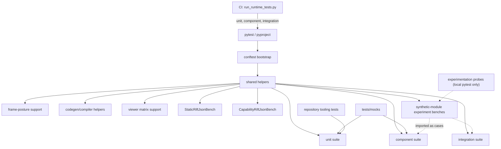

# Tests Components (C3/C2/C1)

## Metadata
- Doc ID: COMP-TESTS-2026-01-22
- Status: in_progress
- Owner:
- Created: 2026-01-22
- Updated: 2026-10-25T03:47:32Z

## Scope
This document defines C3 components, C2 subcomponents, and C1 code references
for tests under `tests/`. It complements `tests_architecture`, which owns the
layer boundaries, by describing the test components inside them, the shared
support layers they use, and the behaviour each surface protects.

Covered: the three pytest tiers CI runs (`unit`, `component`, `integration`); the
repository-tooling trees under `tests/unit/` that test the CI scripts and support
tools rather than `melder`; the locally collected experimentation tree and the
opt-in profiling scripts; the mock corpus; and the CI driver that runs the tiers.

## Documentation Quality Standard
This document is treated as durable context. It must be deep enough to recover
system understanding from a blank slate without handwaving.

Required rules:
- No vague summaries. Every claim must be grounded in source evidence or marked as unknown.
- Explicit entrypoints and method-level call flows for important test behavior.
- Explicit ownership and cleanup for shared harnesses.
- Tier boundaries must match the real test tree.

## Indexing
This document is AUTHORED. Its only generated companion is its index
(`tests_components_index`), rebuilt in the SAME pass as any edit by the
documentation tooling that maintains these documents. The commands live with that
tooling, not here: this document ships with the code and the tooling does not.

The navigable unit is the H3 `### Component: <Name>` entry.
`## C3 Components Catalog` is a CONTAINER - it indexes as a range spanning every
component beneath it, so select a component, never the catalog.

Consume it by slicing a named section rather than reading it whole, and verify the
index proof (line count, line ending, content hash) before trusting a range.

This index was STALE for an extended period before 2026-08-02 - 140 recorded lines
against a live 767 - so every range it returned was wrong while still parsing.
Regenerate on mismatch; never eyeball an offset.

### Verifying the cited test paths and ranges in this document

THIS SIDE HAS NO GRAPH. `src_graph_index.md` is built from the source tree, so
every source-side citation gets a free resolution check and NOTHING here does.
A renamed or deleted test file leaves a citation that still parses and points
nowhere, and a range that drifts inside a file that still exists is invisible
even to an existence check. That is why the instructions require ranges to be
REMEASURED every pass rather than carried forward.

Run this after any pass that touches the test tree or this document:

```bash
python - <<'EOF'
import pathlib, re

here = pathlib.Path.cwd().resolve()
root = next((p for p in (here, *here.parents) if (p / "tests").is_dir()), here)
docs = next(p for p in (pathlib.Path("system_docs"), pathlib.Path("."))
            if list(p.glob("tests_*.md")))

CITE = re.compile(r"`?((?:tests|src)/[A-Za-z0-9_/.]*\.py):(\d+)(?:\s*-\s*(\d+))?`?")
PATH = re.compile(r"`((?:tests|src)/[^`]+\.py)`")

for doc in docs.glob("tests_*.md"):
    if doc.name.endswith("_index.md"):
        continue
    text = doc.read_text(encoding="utf-8")

    # 1. every cited path exists. Globs are statements about a set, not
    #    citations, so they are skipped rather than reported.
    for i, line in enumerate(text.split("\n"), 1):
        for p in PATH.findall(line):
            if "*" in p or "?" in p:
                continue
            if not (root / p).exists():
                print("MISSING", doc.name, i, p)

    # 2. every path:line range is in bounds
    for i, line in enumerate(text.split("\n"), 1):
        for m in CITE.finditer(line):
            f = root / m.group(1)
            if not f.exists():
                continue
            n = len(f.read_bytes().decode("utf-8", "replace").splitlines())
            s = int(m.group(2)); e = int(m.group(3) or m.group(2))
            if s < 1 or e > n or s > e:
                print("OUT OF BOUNDS", doc.name, i, m.group(0), "file has", n)

    # 3. every C1 record's end_line still matches the file on disk. This is the
    #    check that catches drift, and the one nothing else here can do.
    cur = None
    for i, line in enumerate(text.split("\n"), 1):
        m = re.match(r"^- path: `([^`]+)`", line)
        if m:
            cur = m.group(1); continue
        if cur:
            m2 = re.match(r"^\s+end_line:\s*(\d+)", line)
            if m2:
                f = root / cur
                if f.exists():
                    n = len(f.read_bytes().decode("utf-8", "replace").splitlines())
                    if int(m2.group(1)) != n:
                        print("STALE RANGE", doc.name, i, cur, m2.group(1), "->", n)
                cur = None
EOF
```

Measured ranges in this repository go stale FAST - a re-verification on 2026-08-03
found sixteen source-side ranges that had been green earlier the same day. A
range here is true as of its `verified_at` stamp and no longer.

## DO NOT ASSUME / Unknowns Gate
Rule: No Unverified Claims.
Any statement that is not directly supported by evidence must be treated as UNKNOWN.

If not evidenced => UNKNOWN.

## Unknowns
- RESOLVED 2026-09-26 (was UNKNOWN: external CI ownership of suite
  partitioning/sharding, blocked while the checkout had no in-repo `.github/`
  workflow config). CI is in the repository and does not shard: each OS/Python
  cell runs `tests/unit`, `tests/component` and `tests/integration` in one pytest
  process through `.github/scripts/run_runtime_tests.py`. See
  `### Component: Pytest Runner And Path Bootstrap`.
- RESOLVED 2026-10-05 (was UNKNOWN: which Python releases a given CI run tested, because
  the matrix was discovered per run). The tree records them: one manifest per exact
  release under `.github/python/tests/` (3.14.0 through 3.14.8) builds the matrix with no
  network lookup, so "passes in CI" names exactly the manifests at that commit.
- UNKNOWN: whether six tracked `bundle.json` files under
  tests/unit/melder/utilities/_caching_system_tmp_load_*/ are fixtures or leftovers.
  Why it matters: no test references those directories, so they are dead
  fixtures or committed droppings of the cwd-relative cache tests.
  Where to investigate: `tests/unit/melder/utilities/test_caching_system.py` history.
  Current status: raised to the owner; not changed.
- UNKNOWN: whether the 140 tracked `.py` files under
  tests/experimentation/_physical_to_synth_swap_tmp/ and
  tests/experimentation/_synthetic_edge_tmp/ should be in the repository.
  Why it matters: they are case packages the two synthetic-module benches write
  (50 of the tree's 57 `__init__.py` files). The benches create a fresh suffixed or
  uuid-named directory per case, so no run reads the tracked copies back; they only
  inflate the tree and its file counts.
  EVIDENCE:
  - tests/experimentation/physical_to_synthetic_module_swap_semantics_testbench.py:109-123
  - tests/experimentation/unittest_synthetic_module_edge_cases_testbench.py:62-65
  Where to investigate: the two benches' teardown and the commits that added the
  directories.
  Current status: raised to the owner; not changed.

## Table of Contents
- Scope
- Documentation Quality Standard
- Indexing
- DO NOT ASSUME / Unknowns Gate
- Unknowns
- Component Template
- C3 Components Catalog
- C2 Subcomponents Catalog
- Method-Level Call Flows (C1)
- C1 Code Map (Core)
- Diagrams
- Information Sources
- Open Questions
- Context / Handoff Summary

## Component Template
Each component entry includes:
- Purpose
- Responsibilities
- Protects (added 2026-09-26: the behaviour a regression in this surface breaks,
  so an entry cannot describe a harness without naming what it guards; C2
  clusters carry the same line)
- Inputs
- Outputs
- Owned State
- Lifecycle/Cleanup
- Concurrency/Threading
- Invariants/Guarantees
- Failure Modes
- Observability
- Extension Points
- Key Files (C1)

## C3 Components Catalog

### Component: Pytest Runner And Path Bootstrap
Purpose:
- Start the suite from the repo root and bind test imports to `src/`; in CI, run
  the three tiers on a verified free-threaded interpreter.

Responsibilities:
- Define collection through `[tool.pytest.ini_options]` in `pyproject.toml`:
  `testpaths = ["tests"]`, a `norecursedirs` list (`benchmarks`, `Plans`,
  `context_compass`, `UX_and_AIX_experiences`, `performance_hunt`, `profiles`,
  `build_scripts`, `.venv`, `.venv_new`, `__pycache__`, `__melder_cache__`) and the
  two declared markers `integration` and `component`.
- Prepend `src/` and the project root to `sys.path` through `tests/conftest.py`;
  the second lets `import tests.mocks...` and the `tests/_*_support` modules
  resolve under a bare `pytest`, not only under `python -m pytest`.
- In CI, `run_runtime_tests.py` `main` runs `tests/unit`, `tests/component` and
  `tests/integration` in one `pytest.main` call with a JUnit report, adding
  `--cov=melder --cov-branch` into one XML only when `--coverage-report` is given.

Protects:
- that tests import the workspace `src/`, never an installed `melder`
- that a CI result comes from a 3.14+ free-threaded build with the GIL off for the
  whole run: `require_free_threading` raises before `pytest.main` and again after
  it, so an import or plugin that re-enabled the GIL fails the run
- that the driver's exit code is pytest's exit code, never masked by reporting

Inputs:
- `pyproject.toml`; the local filesystem layout
- CI: `--report` (JUnit path), optional `--coverage-report`, and `PYTHON_GIL=0`,
  which the workflow sets for the test process

Outputs:
- one import path for local `melder` code; collection rooted at `tests/`
- CI: JUnit XML on every run; coverage XML when requested

Owned State:
- two `sys.path` entries, each inserted only when absent; no runtime state

Lifecycle/Cleanup:
- bootstrap runs once when pytest imports the root conftest; the CI runtime check
  runs in the same process before and after `pytest.main`

Concurrency/Threading:
- no threads of its own; the driver's contract is the process's threading posture
  (free-threaded build, GIL disabled), not test concurrency

Invariants/Guarantees:
- local tests target local `src/`
- collection never enters a `norecursedirs` tree; the list names no `codex*` entry
  (an earlier revision of this entry claimed worktrees were excluded - they are not)
- CI never shards: one pytest process per OS/Python cell runs all three tiers, and
  `tests/experimentation/` is not among them

Failure Modes:
- broken path bootstrap: import failure or a wrong-package import
- `RuntimeError` from the driver naming the required runtime (3.14+ free-threaded,
  `PYTHON_GIL=0`), before or after the run
- a new top-level tree with Python that is not in `norecursedirs` is collected
  silently

Observability:
- pytest import/collection output; the JUnit report of each CI cell

Extension Points:
- markers or options in `pyproject.toml`; tier arguments in the driver

Key Files (C1):
- `pyproject.toml`
- `tests/conftest.py`
- `.github/scripts/run_runtime_tests.py`
- `.github/workflows/test-runtime.yml`

### Component: Shared Test Support And Matrix Fixtures
Purpose:
- Provide reusable runtime support surfaces so tests do not duplicate
  descriptor/viewer fixtures, frame-posture helpers, compiler/codegen helpers,
  and experimentation setup inline.

Responsibilities:
- Build descriptor/compiled-surface/viewer fixtures for viewer and ACL tests.
- Provide reusable frame-posture configuration helpers for runtime-heavy
  spellbook, conduit, crystallizer, and mutation-research tests.
- Provide reusable codegen/compiler doubles and phase-runner helpers for
  codegen-system and spell compiler test lanes.
- Provide reusable static and capability room integration benches.
- Provide reusable synthetic-module and importlib experiment runners that the
  crystallizer component/integration tests wrap as stable cases.
- Resolve manifest placeholders and turn-script references for JSON-driven
  integration tests.

Protects:
- that viewer and ACL tests at all three tiers assert against one descriptor and
  compiled-surface shape: `_nexus_viewer_matrix_support.py` is imported by 38 unit,
  18 component and 6 integration files, so a projection change fails every tier
  together instead of drifting in one
- that static and capability room behaviour is proven on real runtime stacks (the
  Rift JSON benches), not on mocks
- that every annotation in `src/melder` stays evaluable on 3.14
  (`_annotation_audit_support.py`, enforced by
  `tests/unit/melder/test_annotation_integrity.py`)
- that one object stays one spell where a test needs a second registration of "the same" class
  (`_spell_identity_test_support.py`, 0.2.8257): `version_of` builds a version of it - a subclass with the
  same name, qualname and module and the class-level values given - whose code, and so spell_id, differs
  while every lookup by name reads the original's; a test that restores or grafts the version defines a
  module-level class instead, because a runtime class cannot be imported by its qualname

Inputs:
- descriptor payload builders
- compiled ACL surface builders
- runtime objects (`Aether`, `Spellbook`, `Conduit`, `Nexus`, `Rift`)

Outputs:
- `FrameViewer` fixtures
- real room harnesses
- manifest-driven JSON dispatch helpers

Owned State:
- bench-local runtime objects and manifests

Lifecycle/Cleanup:
- harnesses explicitly cleanup owned spellbooks/conduits/rifts

Concurrency/Threading:
- no independent worker model; relies on runtime objects under test

Invariants/Guarantees:
- support modules are deterministic and fixture-oriented, not production code
- the static/capability benches are real-runtime, not pure mocks

Failure Modes:
- stale singleton state if reset fixtures are bypassed
- broken placeholder resolution if manifest/turn paths drift

Observability:
- visible through parametrized matrix and turn-script test results

Extension Points:
- new room-mode benches
- additional viewer/ACL matrix builders

Key Files (C1):
- `tests/_frame_posture_test_support.py`
- `tests/_codegen_system_support.py`
- `tests/_nexus_viewer_matrix_support.py`
- `tests/_annotation_audit_support.py`
- `tests/_spell_identity_test_support.py`
- `tests/component/melder/spellbook/compiler_test_helpers.py`
- `tests/component/melder/spellbook/spell_compiler_runtime_test_support.py`
- `tests/integration/melder/aether/rift/static_rift_json_testbench_support.py`
- `tests/integration/melder/aether/rift/capability_rift_json_testbench_support.py`
- `tests/experimentation/unittest_synthetic_module_edge_cases_testbench.py`
- `tests/experimentation/physical_to_synthetic_module_swap_semantics_testbench.py`

### Component: Unit Test Suite
Purpose:
- Validate isolated contracts for runtime classes, descriptors, ACL surfaces,
  spellbook internals, utilities, the package-root surface and build assets; in
  three separate trees, the repository tooling that qualifies and ships the package.

Responsibilities:
- Cover `melder/aether`, `melder/crystallizer`, `melder/mutation_research`,
  `melder/spellbook`, `melder/utilities` and `melder/build_assets`, plus nine
  package-root modules directly under tests/unit/melder/.
- Cover repository tooling that is not `melder`: the CI scripts under `.github/scripts/`
  (`github_workflows`), the LLM support bundle builder (`llm_support`) and the
  architecture-docs tool (`architecture_and_design`).
- Exercise direct API and lifecycle/error-path behavior.
- Reset singleton runtime surfaces around runtime-heavy files, and boot a fresh
  `Aether()` after each reset.

Protects:
- per-class contracts - returns, raises and cleanup - so a regression fails beside
  the class that caused it rather than inside a stack test
- the package-root contract: every `__all__` name resolves to its concrete-path
  object, internal classes stay unbindable, the version and build-asset stamps
  agree (see `### Subcomponent: Package Root Unit Cluster`)
- the release gates in the CI scripts: fail-closed routing, candidate and source
  identity, distribution contents, the free-threaded runtime gate and the provenance
  of what the release candidate and the release upload (see `### Subcomponent: Repository Tooling Unit Cluster`)
- race fixes, as deterministic stand-ins for the concurrent writer (see
  `### Flow: Concurrent-Writer Stand-In`)
- managed spells (0.2.8241-0.2.8246, 0.2.8254): the member and its Phase 6 rank, the bind options with their
  refusals and the ids they leave alone, the pool in each mode and its rebind, the release registry and the lease,
  the plans' managed sites and the owner stamp through an ownership transfer (see
  `### Subcomponent: Managed Spell Pools Unit Cluster` and the spellbook clusters)
- the control plane's capability flag (0.2.8247): `SpellState.non_resolvable`, the registry's published set of
  flagged lineages and RiskManager's Book flag that leaves them out (see
  `### Subcomponent: DevOps Control Plane Unit Cluster`)
- conjure's wiring of the versions parked before it (0.2.8248): each parked version gets the active loop's owner
  stamp and nothing else, under the Book lock, a raising stamp logged (see
  `### Subcomponent: Spellbook Runtime And Binding Unit Cluster`)
- the public notch target (0.2.8249): `notch_spell` resolving a version id through the Book, passing an owned
  `spell` through, and refusing every malformed or foreign target with nothing started, the in-window re-check
  included (see `### Subcomponent: Spellbook Runtime And Binding Unit Cluster`)
- contract consumers and dependents following a provider change (0.2.8250): the registry's downstream walk from
  a notch and from every contract mark (see `### Subcomponent: DevOps Control Plane Unit Cluster`); the borrower
  Book's contract marks and the meld gate without the per-meld contract scan, with its catch-up of stale
  dependencies (see `### Subcomponent: Spellbook Runtime And Binding Unit Cluster`); and the lost-provider
  report, Phase 4's warning (see `### Subcomponent: Spellbook Compiler Unit Cluster`) shown as the spell's
  reason (see `### Subcomponent: Utilities Unit Cluster`)
- the Rift rooms' lookups by spell_id (0.2.8253): a spell_id or a source id answers the version it names, never
  the one its index has active - the capability room through the owner Book, the static room by melding only
  that version - the refusals name what was asked, and the index path and the spell-index ACL hold (see
  `### Subcomponent: Aether/Nexus/Rift Unit Cluster`)

Inputs:
- local runtime classes and helper fixtures; `MagicMock` collaborators where the
  unit is one class (the conduit conftest stubs the Spellbook, Aether, DevOps
  manager, conduit cloud and frame around real `Conduit` objects)
- CI scripts loaded by file path through `tests/unit/github_workflows/conftest.py`,
  without booting Melder

Outputs:
- direct contract assertions with minimal external wiring

Owned State:
- test-local fixtures only, except twelve `CachingSystem` tests that write cwd-relative
  tests/unit/melder/utilities/_caching_system_tmp_* directories which survive runs
  (TREE ARTIFACTS in `tests_architecture`)

Lifecycle/Cleanup:
- runtime-heavy files use autouse fixtures that reset `AetherUtilitySystem`, `Nexus`
  and `Aether`, then boot `Aether()` and bind it to `Spellbook._aether`, both before
  and after each test (`tests/unit/melder/aether/conduit/conftest.py:65-85`); a reset
  alone boots nothing (see `### Flow: Singleton Reset And Re-Boot`)

Concurrency/Threading:
- direct coverage of the synchronization primitives (creation gate and controller,
  load gate, phase scheduler, latches, switches, weak concurrent containers);
  `test_abstract_elastic_pool_multithreaded.py` runs threads against the pool, and the managed pool and the
  release registry each have a multithreaded file of eight barrier-released threads (see
  `### Flow: Managed Pool Stress Under Eight Threads`); a race in larger code is pinned by a stand-in, not by
  threads

Invariants/Guarantees:
- unit tests stay close to class/method behavior
- the densest tier: 517 `test_*.py` modules among 520 `.py` files (recounted 2026-10-25)
- CI-script tests never import `melder`; each script is loaded as a standalone module

Failure Modes:
- singleton leakage, or a SINGLETON VOID (a reset without a re-boot), makes a test
  pass alone and fail after another file
- stale cwd-relative cache directories survive between runs

Observability:
- direct pytest failures on contract mismatch

Extension Points:
- new subsystem-level direct contract tests; a new CI script gets a loader fixture
  in the github_workflows conftest

Key Files (C1):
- `tests/unit/melder/aether/conduit/conftest.py`
- The aether tree carries 208 `test_*.py` modules beneath these; they are the
  CONTENT of this component rather than its key surfaces, and are counted here
  rather than cited so the core set stays a set an agent can verify.
- No harness or support module of its own; the 49 test_*.py modules in
  tests/unit/melder/crystallizer/ depend only on the shared surfaces at tests/ and the scoped
  conftests named in `tests_architecture.md`. Paths in this bullet are written
  WITHOUT backticks because they are directories - descriptive, never citations.
- No harness or support module of its own; the 20 test_*.py modules in
  tests/unit/melder/mutation_research/ depend only on the shared surfaces at tests/ and the scoped
  conftests named in `tests_architecture.md`. Paths in this bullet are written
  WITHOUT backticks because they are directories - descriptive, never citations.
- `tests/unit/melder/spellbook/spell_compiler/support/compiler_test_support.py`
- The spellbook tree carries 161 `test_*.py` modules beneath these; they are the
  CONTENT of this component rather than its key surfaces, and are counted here
  rather than cited so the core set stays a set an agent can verify.
- No harness or support module of its own; the 54 test_*.py modules in
  tests/unit/melder/utilities/ depend only on the shared surfaces at tests/ and the scoped
  conftests named in `tests_architecture.md`. Paths in this bullet are written
  WITHOUT backticks because they are directories - descriptive, never citations.
- The 3 test_*.py modules in tests/unit/melder/build_assets/ and the 9 package-root
  modules directly under tests/unit/melder/ are cited in their C2 clusters.
- `tests/unit/github_workflows/conftest.py`
- The repository-tooling trees carry 12 `test_*.py` modules (github_workflows 10,
  llm_support 1, architecture_and_design 1), cited in their C2 cluster.

### Component: Component Test Suite
Purpose:
- Exercise small, real slices of the system where unit tests are too narrow
  and full integration would be too expensive.

Responsibilities:
- use real core objects
- stub or mock external collaborators where needed
- validate internal contracts that span multiple objects

Protects:
- seams inside one subsystem, with real objects: descriptor/ACL publication and
  cleanup, crystallizer graph extraction over real module graphs, the
  mutation-research root on a real Aether, bind/configuration/contract/cache
  behavior of a real Spellbook, compiler phases through real conjures (key-set
  plans, cache restage, spell ids across two interpreters), creation-gate drains
  and load-gate/scheduler composition
- the agent text reader against the real packaged documents rather than generated
  fixtures (`test_agent_text_reader_component.py`)
- managed objects leased and given back through real melds, injections and `Conduit.managed_spell_meld`
  (0.2.8245; see `### Subcomponent: Aether Component Cluster`)
- the exact lookup by spell_id on a real Book (0.2.8253): every spell_id answers its own Spell through each
  move between the Book's maps, by single-key reads (see
  `### Subcomponent: Spellbook Runtime And Binding Component Cluster`)

Inputs:
- small real runtime slices
- controlled fake/stub collaborators

Outputs:
- slice-level behavioral assertions

Owned State:
- test-local slices and stubs; component cache tests write under the package
  directory (TREE ARTIFACTS in `tests_architecture`)

Lifecycle/Cleanup:
- follows the same singleton reset-and-re-boot discipline when runtime objects are
  involved

Concurrency/Threading:
- no parallel harness layer of its own; the synchronization component files start
  threads to prove that a gate drain waits for tickets in flight
  (`tests/component/melder/utilities/synchronization/test_creation_gate_component.py`)

Invariants/Guarantees:
- tier intent is explicitly documented in `tests/component/INFO.MD`: real core
  objects, stubbed external boundaries, deterministic, contract-level assertions
- 172 `test_*.py` modules among 174 `.py` files (recounted 2026-10-25)

Failure Modes:
- component tests drift into unit-style internals or full integration sprawl

Observability:
- visible through component-slice regressions

Extension Points:
- new slice tests for cross-object seams

Key Files (C1):
- `tests/component/INFO.MD`
- No harness or support module of its own; the 80 test_*.py modules in
  tests/component/melder/aether/ depend only on the shared surfaces at tests/ and the scoped
  conftests named in `tests_architecture.md`. Paths in this bullet are written
  WITHOUT backticks because they are directories - descriptive, never citations.
- No harness or support module of its own; the 7 test_*.py modules in
  tests/component/melder/crystallizer/ depend only on the shared surfaces at tests/ and the scoped
  conftests named in `tests_architecture.md`. Paths in this bullet are written
  WITHOUT backticks because they are directories - descriptive, never citations.
- No harness or support module of its own; the 1 test_*.py modules in
  tests/component/melder/mutation_research/ depend only on the shared surfaces at tests/ and the scoped
  conftests named in `tests_architecture.md`. Paths in this bullet are written
  WITHOUT backticks because they are directories - descriptive, never citations.
- `tests/component/melder/spellbook/compiler_test_helpers.py`
- `tests/component/melder/spellbook/spell_compiler_runtime_test_support.py`
- The spellbook tree carries 78 `test_*.py` modules beneath these; they are the
  CONTENT of this component rather than its key surfaces, and are counted here
  rather than cited so the core set stays a set an agent can verify.
- No harness or support module of its own; the 4 test_*.py modules in
  tests/component/melder/utilities/ depend only on the shared surfaces at tests/ and the scoped
  conftests named in `tests_architecture.md`. Paths in this bullet are written
  WITHOUT backticks because they are directories - descriptive, never citations.

### Component: Integration Runtime Suite
Purpose:
- Validate real runtime wiring across Melder subsystems and AR surfaces.

Responsibilities:
- build real Spellbook/Conduit/Nexus/Rift stacks
- exercise descriptor projection and viewer matrices
- exercise room-mode harnesses and JSON-like request drivers
- cover additional integration lanes for conduit, crystallizer, live_sim,
  multithreading, mutation_research, and spellbook behavior

Protects:
- behaviour that only exists once several real subsystems are wired: meld through
  the real front door across linked and clustered conduits, scope ordering and
  existence across lineages and SpellSpaces, contracts and ownership transfer,
  disposal order at scoped teardown, Nexus projection after passive publication,
  and room behaviour driven through the Rift benches
- the concurrency claims the unit tier cannot make: link/contract churn under
  concurrent melds, the meld lock order (shapes that deadlocked before the
  per-slot build locks), and thread-safe lazy loading of the packaged documents
  (see `### Subcomponent: Multithreading Integration Cluster`)
- a whole application bootstrapped the way a user would, automatic and dynamic
  (see `### Subcomponent: Live Sim Integration Cluster`)
- managed pools through real worlds (0.2.8241-0.2.8246): pools in the owning root's store, leases across frames,
  binding names, notches, borrowers and lessers, the release registry, ownership transfers, a restored world and a
  settings change that keeps one spell and pool (0.2.8254) (see `### Subcomponent: Conduit Integration Cluster`)
- versions staged before conjure (0.2.8248): every family staged with `bind_inactive` before conjure melds after a
  notch as one staged after it (see `### Subcomponent: Spellbook Integration Cluster`)
- the public notch target (0.2.8249): the stage -> notch -> meld loop and its revert by version id in real worlds,
  and every foreign target refused with both indexes intact (see `### Subcomponent: Spellbook Integration Cluster`)
- contract consumers and dependents following a provider change (0.2.8250): a borrower's contract consumer
  follows its lender's notches with one rebuild each or fails as a first meld would, a lost provider is named
  with its remedy, a version grant comes back on a notch back, and dependents one and two hops from a notched
  spell, in its Book or across Books, build the new version (see
  `### Subcomponent: Conduit Integration Cluster`)
- the exact lookup by spell_id (0.2.8253): a parked version's spell_id answers that version on its lender and
  on a linked borrower, each version answers its own permissions and is granted and ungranted by its spell_id,
  and a transfer and a dependency grant keep resolving through the index (see
  `### Subcomponent: Spellbook Integration Cluster`); a capability room answers the active version by spell_id,
  source id and index and refuses a parked one (see `### Subcomponent: Aether Integration Cluster`)

Inputs:
- real runtime objects
- shared bench support

Outputs:
- end-to-end or near-end-to-end behavioral assertions

Owned State:
- harness-local runtime objects and manifests

Lifecycle/Cleanup:
- runtime-heavy files reset singleton surfaces and cleanup harness-owned
  objects explicitly

Concurrency/Threading:
- the multithreading directory drives real threads: orchestrated mutation lanes
  against concurrent meld workers, lock-order shapes run in child processes under
  gate timeouts with a `subprocess.run(timeout=...)` backstop, and sixteen-thread
  races on first lazy loads; the conduit concurrency file stresses
  concurrent melds across four linked conduits

Invariants/Guarantees:
- integration tests use real runtime stacks rather than hand-built shallow mocks
- 178 `test_*.py` modules among 185 `.py` files (recounted 2026-10-19); the others are benches and the
  live-sim application

Failure Modes:
- expensive or flaky runtime setup if singleton/reset discipline drifts
- a rare race shows as an intermittent multithreading failure; it is pinned by a
  deterministic stand-in at the unit tier, not by rerunning this suite

Observability:
- matrix and harness failures expose multi-object regressions

Extension Points:
- new room-mode benches
- new subsystem integration lanes

Key Files (C1):
- `tests/integration/melder/aether/rift/capability_rift_json_testbench_support.py`
- `tests/integration/melder/aether/rift/codegen_rift_json_testbench_support.py`
- `tests/integration/melder/aether/rift/static_rift_json_testbench_support.py`
- The aether tree carries 50 `test_*.py` modules beneath these; they are the
  CONTENT of this component rather than its key surfaces, and are counted here
  rather than cited so the core set stays a set an agent can verify.
- The rift tree (inside the aether tree) carries 4 `test_*.py` modules, three of them
  over the same three benches; they are counted here rather than cited.
- No harness or support module of its own; the 45 test_*.py modules in
  tests/integration/melder/conduit/ depend only on the shared surfaces at tests/ and the scoped
  conftests named in `tests_architecture.md`. Paths in this bullet are written
  WITHOUT backticks because they are directories - descriptive, never citations.
- No harness or support module of its own; the 18 test_*.py modules in
  tests/integration/melder/crystallizer/ depend only on the shared surfaces at tests/ and the scoped
  conftests named in `tests_architecture.md`. Paths in this bullet are written
  WITHOUT backticks because they are directories - descriptive, never citations.
- `tests/integration/melder/live_sim/bootstrap.py`
- `tests/integration/melder/live_sim/conftest.py`
- `tests/integration/melder/live_sim/interfaces/protocols.py`
- `tests/integration/melder/live_sim/mini_application/application.py`
- The live_sim tree carries 2 `test_*.py` modules beneath these; they are the
  CONTENT of this component rather than its key surfaces, and are counted here
  rather than cited so the core set stays a set an agent can verify.
- No harness or support module of its own; the 6 test_*.py modules in
  tests/integration/melder/multithreading/ depend only on the shared surfaces at tests/ and the scoped
  conftests named in `tests_architecture.md`. Paths in this bullet are written
  WITHOUT backticks because they are directories - descriptive, never citations.
- No harness or support module of its own; the 3 test_*.py modules in
  tests/integration/melder/mutation_research/ depend only on the shared surfaces at tests/ and the scoped
  conftests named in `tests_architecture.md`. Paths in this bullet are written
  WITHOUT backticks because they are directories - descriptive, never citations.
- No harness or support module of its own; the 54 test_*.py modules in
  tests/integration/melder/spellbook/ depend only on the shared surfaces at tests/ and the scoped
  conftests named in `tests_architecture.md`. Paths in this bullet are written
  WITHOUT backticks because they are directories - descriptive, never citations.

### Component: Mock Fixture Corpus
Purpose:
- Provide deterministic helper modules, classes, scan-bind fixtures, and
  crystallizer harness surfaces for tests that should not depend on ad hoc
  inline mock object definitions.

Responsibilities:
- host spellbook-oriented helper classes/modules
- host crystallizer fixture packages and synthetic-module harnesses
- support scan/bind import and duplicate/reexport cases

Protects:
- scan-bind refusals and edge cases against modules of fixed shape (corrupt
  `scan_bind` metadata, duplicates, an empty module, lambdas, re-exports, wrapped
  callables)
- crystallizer module-graph extraction against one fixed physical package
  (`spell_crystal_demo_pkg`), which `spell_crystal_harness.py` imports under a known
  prefix so the expected targets, dependencies and kinds are stable

Inputs:
- imported by unit/component/integration tests

Outputs:
- stable fake modules, helper classes, and crystallizer test harness packages

Owned State:
- static fixture modules only

Lifecycle/Cleanup:
- normal Python module import lifecycle

Concurrency/Threading:
- no dedicated threading behavior

Invariants/Guarantees:
- mocks are repo-local and deterministic

Failure Modes:
- drift between fixture modules and the import/use cases they support

Observability:
- scan/bind and spellbook tests fail when mock modules drift

Extension Points:
- new deterministic fixture modules for new scan/bind or spellbook cases

Key Files (C1):
- `tests/mocks/crystallizer/spell_crystal_demo_pkg/__init__.py`
- `tests/mocks/crystallizer/spell_crystal_demo_pkg/api/__init__.py`
- `tests/mocks/crystallizer/spell_crystal_demo_pkg/api/feature.py`
- `tests/mocks/crystallizer/spell_crystal_demo_pkg/api/surface.py`
- `tests/mocks/crystallizer/spell_crystal_demo_pkg/branch/__init__.py`
- `tests/mocks/crystallizer/spell_crystal_demo_pkg/branch/aggregate.py`
- `tests/mocks/crystallizer/spell_crystal_demo_pkg/branch/leaf_a.py`
- `tests/mocks/crystallizer/spell_crystal_demo_pkg/branch/leaf_b.py`
- `tests/mocks/crystallizer/spell_crystal_demo_pkg/deep/__init__.py`
- `tests/mocks/crystallizer/spell_crystal_demo_pkg/deep/level1/__init__.py`
- `tests/mocks/crystallizer/spell_crystal_demo_pkg/deep/level1/level2/__init__.py`
- `tests/mocks/crystallizer/spell_crystal_demo_pkg/deep/level1/level2/provider.py`
- `tests/mocks/crystallizer/spell_crystal_demo_pkg/deep/level1/provider.py`
- `tests/mocks/crystallizer/spell_crystal_demo_pkg/nested/__init__.py`
- `tests/mocks/crystallizer/spell_crystal_demo_pkg/nested/provider.py`
- `tests/mocks/crystallizer/spell_crystal_demo_pkg/nested/reexport.py`
- `tests/mocks/crystallizer/spell_crystal_demo_pkg/root.py`
- `tests/mocks/crystallizer/spell_crystal_demo_pkg/root_api_feature.py`
- `tests/mocks/crystallizer/spell_crystal_demo_pkg/root_api_surface.py`
- `tests/mocks/crystallizer/spell_crystal_demo_pkg/root_branch.py`
- `tests/mocks/crystallizer/spell_crystal_demo_pkg/root_deep.py`
- `tests/mocks/crystallizer/spell_crystal_demo_pkg/root_duplicate.py`
- `tests/mocks/crystallizer/spell_crystal_demo_pkg/root_multibranch.py`
- `tests/mocks/crystallizer/spell_crystal_demo_pkg/root_package_import.py`
- `tests/mocks/crystallizer/spell_crystal_demo_pkg/root_reexport.py`
- `tests/mocks/crystallizer/spell_crystal_demo_pkg/root_with_synthetic.py`
- `tests/mocks/crystallizer/spell_crystal_demo_pkg/shared.py`
- `tests/mocks/crystallizer/spell_crystal_harness.py`
- `tests/mocks/crystallizer/synthetic_module_harness.py`
- `tests/mocks/spellbook/contract_classes.py`
- `tests/mocks/spellbook/core_classes.py`
- `tests/mocks/spellbook/deep_layers.py`
- `tests/mocks/spellbook/factories.py`
- `tests/mocks/spellbook/protocols.py`
- `tests/mocks/spellbook/scan_bind_module_bad_metadata.py`
- `tests/mocks/spellbook/scan_bind_module_core.py`
- `tests/mocks/spellbook/scan_bind_module_duplicate.py`
- `tests/mocks/spellbook/scan_bind_module_empty.py`
- `tests/mocks/spellbook/scan_bind_module_lambda.py`
- `tests/mocks/spellbook/scan_bind_module_lambda_invalid.py`
- `tests/mocks/spellbook/scan_bind_module_reexport.py`
- `tests/mocks/spellbook/scan_bind_module_wrapped.py`

### Component: Experimentation And Profiling Trees (Local Only)
Purpose:
- Hold the experiments, probes and benches that informed design decisions, plus
  opt-in profiling scripts, outside the three tiers CI runs.

Responsibilities:
- `tests/experimentation/`: 33 `test_*.py` experiment and probe modules (cache and
  meld parity probes, lineage and SpellSpace experiments, performance
  comparisons) and bench modules; a local `pytest` collects the test modules
- supply the two synthetic-module benches that component and integration
  crystallizer tests import as stable cases (see
  `### Subcomponent: Synthetic Module Experiment Benches`)
- `tests/experiments/cprofile_testing/`: crystallizer and mutation-research
  profiling scripts; their `pytest_profile_*.py` wrappers are named to avoid
  default discovery and run only when passed explicitly

Protects:
- nothing CI enforces. The probes record measured answers to design questions; a
  probe that starts failing means the question's answer changed, which is worth
  reading but is not a regression gate

Inputs:
- the local runtime; for the profiling scripts, a size argument such as `small`

Outputs:
- pytest results locally; profiling timings and `.prof`/`.txt` files under
  `results/`, ignored by that directory's own `.gitignore`

Owned State:
- case packages the synthetic-module benches write under their own directory
  (see `## Unknowns` for the tracked copies)

Lifecycle/Cleanup:
- the benches remove their case directories in teardown with
  `shutil.rmtree(..., ignore_errors=True)`, so a removal that fails leaves the
  directory behind without a signal; a new case always gets a fresh directory name

Concurrency/Threading:
- several experiments measure thread behavior (cross-thread SpellSpace scope,
  atomic counters); none is a gate

Invariants/Guarantees:
- not in CI: the driver runs only the three tiers, and `tests/experiments/` holds
  no module matching default discovery
- 196 `.py` files in `tests/experimentation/`, 140 of them generated case packages

Failure Modes:
- a probe written for older behavior fails after a deliberate change; update or
  retire the probe rather than the runtime

Observability:
- local pytest output; profiling scripts print their timings

Extension Points:
- new probe modules; new profiling tiers in the profiling harness

Key Files (C1):
- `tests/experimentation/unittest_synthetic_module_edge_cases_testbench.py`
- `tests/experimentation/physical_to_synthetic_module_swap_semantics_testbench.py`
- `tests/experiments/cprofile_testing/profile_harness.py`
- The 33 `test_*.py` modules in tests/experimentation/ are counted here rather than
  cited; they are this component's content.

## C2 Subcomponents Catalog

### Subcomponent: `conftest.py` Path Bootstrap
Parent Component: Pytest Runner And Path Bootstrap
Purpose:
- prepend `src/` to `sys.path` for test execution
Contract/Interface:
- project-root and `src/` path insertion
Key Files (C1):
- `tests/conftest.py`

### Subcomponent: Frame Posture Test Support
Parent Component: Shared Test Support And Matrix Fixtures
Purpose:
- centralize automatic/dynamic frame-posture configuration helpers reused
  across runtime-heavy test lanes
Contract/Interface:
- applies default frame posture to `SpellbookConfiguration` objects for test
  setup without duplicating posture boilerplate in each test file
Key Files (C1):
- `tests/_frame_posture_test_support.py`

### Subcomponent: Nexus Viewer Matrix Support
Parent Component: Shared Test Support And Matrix Fixtures
Purpose:
- build descriptor, compiled ACL surface, and `FrameViewer` fixtures
Contract/Interface:
- `build_descriptor`, `build_surface`, `build_viewer`,
  `build_multi_frame_viewer`
Key Files (C1):
- `tests/_nexus_viewer_matrix_support.py`

### Subcomponent: Annotation Integrity Audit Support
Parent Component: Shared Test Support And Matrix Fixtures
Purpose:
- locate annotations in a source tree that raise when Python 3.14 evaluates them: a string literal
  used as a `|` operand (`"Conduit" | None`) or a name no scope binds, even under `TYPE_CHECKING`
  (added 2026-09-26)
Contract/Interface:
- `AnnotationAudit(src_root, package, static=..., dynamic=...).run().findings()` returns
  `AnnotationFinding` rows (`kind`, `path`, `line`, `owner`, `detail`); kinds `STRING_IN_UNION`,
  `UNDEFINED_NAME`, `UNPARSEABLE_STRING`, `EVAL_ERROR`, plus `IMPORT_ERROR` / `TC_IMPORT_ERROR` when a
  module or one of its `TYPE_CHECKING` imports cannot be loaded
- `StaticAnnotationAudit` parses source only; `DynamicAnnotationAudit` imports every module, binds
  its own `TYPE_CHECKING` imports and evaluates every annotation owner in VALUE format, so it mutates
  module globals and runs in a separate process through the command-line entry point
- guard: `tests/unit/melder/test_annotation_integrity.py` asserts zero static and dynamic findings
  for `src/melder`, checks both passes against a seeded control package, and pins the string-union
  shapes that raise on every observed 3.14 build (a `typing.Union` operand is build-dependent: it
  raised on 3.14.0rc2 and wraps the string in a ForwardRef on 3.14.7)
Key Files (C1):
- `tests/_annotation_audit_support.py`
- `tests/unit/melder/test_annotation_integrity.py`

### Subcomponent: Static Rift JSON Bench
Parent Component: Shared Test Support And Matrix Fixtures
Purpose:
- build a real static-room harness with JSON-like request and turn-script
  dispatch
Contract/Interface:
- `StaticRiftJsonBench`
- manifest/object/turn placeholder resolution
Key Files (C1):
- `tests/integration/melder/aether/rift/static_rift_json_testbench_support.py`
- `tests/integration/melder/aether/rift/test_static_rift_json_testbench_integration.py`

### Subcomponent: Capability Rift JSON Bench
Parent Component: Shared Test Support And Matrix Fixtures
Purpose:
- build a real capability-room harness with JSON-like request and turn-script
  dispatch
Contract/Interface:
- `CapabilityRiftJsonBench`
- manifest and saved-turn placeholder resolution
Key Files (C1):
- `tests/integration/melder/aether/rift/capability_rift_json_testbench_support.py`
- `tests/integration/melder/aether/rift/test_capability_rift_json_testbench_integration.py`

### Subcomponent: Synthetic Module Experiment Benches
Parent Component: Shared Test Support And Matrix Fixtures
Purpose:
- provide reusable synthetic-module and importlib scenario runners consumed by
  crystallizer component/integration tests
Contract/Interface:
- stable experiment functions wrapped as component/integration cases instead of
  re-encoding synthetic graphs inside the test files
Key Files (C1):
- `tests/experimentation/unittest_synthetic_module_edge_cases_testbench.py`
- `tests/experimentation/physical_to_synthetic_module_swap_semantics_testbench.py`

### Subcomponent: Compiler And Codegen Test Helpers
Parent Component: Shared Test Support And Matrix Fixtures
Purpose:
- provide reusable doubles and phase-runner helpers for codegen-system and
  spell compiler test lanes
Contract/Interface:
- namespace/event/memory doubles for codegen tests plus helper functions that
  drive compiler phases through the supported compiler-system surfaces
Key Files (C1):
- `tests/_codegen_system_support.py`
- `tests/component/melder/spellbook/compiler_test_helpers.py`
- `tests/component/melder/spellbook/spell_compiler_runtime_test_support.py`

### Subcomponent: Aether/Nexus/Rift Unit Cluster
Parent Component: Unit Test Suite
Purpose:
- cover AR-facing runtime contracts, descriptors, ACLs, room surfaces, and
  related manager classes
Protects:
- FrameLink cleanup's inside-lock guard (`test_frame_link_runtime_contracts.py`): a real cleanup
  completes before the outer lock acquisition, so the outer call must return without touching
  retired fields; metadata then refuses access and another cleanup returns normally. The stand-in
  uses no worker threads or scheduling deadline (see `### Flow: FrameLink Cleanup Guard Stand-In`)
- cluster admission callback progress (0.2.8265): a second thread can read Cloud during member recording
  and during sharing; a failed registration before publication propagates its error and permits retry
- Nexus singleton and cold-start rules (a Nexus needs an Aether and publishes no
  singleton before one), Rift creation gated on an enabled Nexus and creation
  permission, projection refresh through the Rift gate barrier
- Rift constructor and frame-link guardrails, one primary space, idempotent cleanup
  that re-checks the cleaned flag under its lock; workstation binding and target
  guardrails; command-system lookups (conduit ids resolve through Aether's live lookup and a
  missing runtime frame keeps its frame error), and one room memory per top-level public call
- the value snapshot the four root configurations expose (`get_configuration_dictionary()`, 0.2.8212): exact
  properties, independence, equality, lifecycle states and the cleaned refusal
- the Aether reload lane carrying the spell-id regime (0.2.8213): a recorded per-frame regime reloads frozen,
  an absent one keeps the default and is reported missing
- the configuration read accessors (0.2.8208): `SpellbookConfiguration.aether_frame` ("default" when omitted,
  a named frame round-trips) and `frozen` (False until `freeze()` or `finalize()`), the posture's `frozen`
  (its builders refuse once it reads True), reads that change nothing, and the cleaned refusal
- the static rooms treating a managed spell like `many` (0.2.8243): static access names the existence instead
  of probing a store, the status payload says why, and a live pool never makes it a live static spell
- the Rift rooms' lookups by spell_id (0.2.8253; `test_command_system_spell_id_lookups.py`, 12 tests): over
  doubles that publish an index's active version and a parked one, the capability room's
  `get_spell_by_source_id` and `get_spell_by_spell_id` answer the version named through the owner Book's
  lookup, never the index's active one, refuse an ownerless record and a spell_id the owner Book no longer
  holds with messages naming the source id, and still check the spell-index ACL first; the static room melds
  only the named version for a spell_id or a source id and names what was asked when it refuses (not live,
  unsupported existence), while its index path still answers the first record of the index with a live
  object; both rooms advertise `get_spell_by_spell_id` and keep no `get_spell_by_id`
- the codegen presets' file posture (0.2.8270, D-10): the compiled deny list carries `open` for safe (the default
  profile), hybrid and every chain with the precision overlay, and not for permissive or full_access, and
  `pathlib` is an allowed import root of the permissive list only
  (`test_frame_acl_codegen_validation_profiles.py`); the engine's no-projection default denies `__import__` plus
  exactly the safe tuple, imports off (`test_codegen_system_unit_matrix.py`); and runtime builtins built from
  the safe tuple carry no `open` (`test_codegen_namespace_runtime_unit_matrix.py`)
Key Files (C1):
- `tests/unit/melder/aether/test_nexus.py`
- `tests/unit/melder/aether/test_conduit_cloud.py` (callback lock boundaries and admission retry, 2026-10-19)
- `tests/unit/melder/aether/test_root_configuration_value_snapshots.py` (root configuration snapshots, 2026-09-30)
- `tests/unit/melder/aether/test_configuration_read_accessors.py` (configuration read accessors, 2026-09-29)
- `tests/unit/melder/aether/test_rift_runtime_contracts.py`
- `tests/unit/melder/aether/test_workstation.py`
- `tests/unit/melder/aether/test_command_system_direct.py`
- `tests/unit/melder/aether/test_static_rooms_managed_spell_quantity.py` (static rooms, 2026-10-15)
- `tests/unit/melder/aether/test_command_system_spell_id_lookups.py` (room lookups by spell_id, 2026-10-17)

### Subcomponent: Aetheric Mediator Lifecycle Unit Cluster
Parent Component: Unit Test Suite
Purpose:
- verify owner-driven mediator/session teardown and public cleaned-state boundaries
Protects:
- repeated sequential cleanup remains harmless for the plane and its owned components
- a session cleans its owned request and staged records, preserves the borrowed holder and never
  runs inverse callbacks merely because it is being cleaned
- public inspection, mutation and record access begun after cleanup raise the cleaned-state error
Lifecycle boundary (owner clarified 2026-09-28):
- teardown is serialized by the owner after use stops; a public entry check is not a lifetime lease
  against destruction by another caller. Eight simultaneous cleanup calls are outside this contract.
Key Files (C1):
- `tests/unit/melder/aether/aetheric_mediator/test_aetheric_mediator_unit.py`

### Subcomponent: DevOps Control Plane Unit Cluster
Parent Component: Unit Test Suite
Purpose:
- verify the per-frame control plane's capability flag and the Book flag RiskManager distils from its risk sets,
  on a real `SpellSystemStates` registry rather than a stub
- verify the registry's downstream walk from a notch and from every contract mark (0.2.8250), on the same real
  registry
Protects:
- `SpellState.non_resolvable` (0.2.8247; `test_spell_system_states_non_resolvable.py`, 34 tests): `update_flags`
  and `has_flag` leave validity alone and refuse a cleaned state; `clear_dirty` keeps the flag; `register_index`
  sets it for resolvable=False, clears it for True, keeps it with no capability only for an unchanged selection,
  refuses a non-bool before registering anything, writes it before the gate's RiskManager callback and
  re-publishes once when the flag changed on a lineage already gated; the published `non_resolvable_index_ids`
  follows every registration path, `unregister_index` and cleanup's tombstone, is replaced rather than mutated,
  and agrees with each lineage's flag
- RiskManager's distillation (0.2.8247; `test_risk_manager_non_resolvable.py`, 11 tests): a flagged lineage alone
  leaves the Book flag down while the risk sets keep it, one unflagged risky lineage raises it, `spell:` keys and
  removed lineages count, a registration that clears the flag raises the Book flag at its event - also in a
  borrower after a notch back to a lineage already gated - and `register_conduit` and `register_spell` write the
  flag once; the registry stub of `test_risk_manager.py` answers an empty set, so its 21 tests keep their meaning
- the downstream walk (0.2.8250; `test_spell_system_states_dependent_walk.py`, 17 tests): a walk from a lineage
  marks the chain downstream of it by edge (`impacted_by_dependency`, transitively dirty) and never the seed; a
  SpellContract consumer, in any Book, of a reached lineage's binding key gets the contract mark (`gated` +
  `contract_unvalidated`) and its own dependents the edge mark; a lineage reached both ways carries both; one
  with no recorded key is followed by edge only; a contract cycle across Books ends with the other lineage
  marked once; a dependent with no registered state is passed over; empty seeds mark and publish nothing; a
  walk publishes `gated` once per marked lineage, a second walk nothing, and adds every marked lineage to the
  dirty worklist; `register_index` keeps the recorded key when given none and replaces it when given one, and
  `unregister_index` and cleanup drop it; `mark_contract_dependents_dirty` walks on from the consumers it marks
  and returns only them; and a walk on a cleaned registry raises the use-after-clean RuntimeError
Key Files (C1):
- `tests/unit/melder/aether/dev_ops/spell_system_states/test_spell_system_states_non_resolvable.py` (2026-10-16)
- `tests/unit/melder/aether/dev_ops/risk_manager/test_risk_manager_non_resolvable.py` (2026-10-16)
- `tests/unit/melder/aether/dev_ops/spell_system_states/test_spell_system_states_dependent_walk.py` (2026-10-16)

### Subcomponent: Managed Spell Pools Unit Cluster
Parent Component: Unit Test Suite
Purpose:
- cover the managed lifetime's runtime pieces under tests/unit/melder/aether/conduit/ (added 2026-10-15,
  0.2.8243-0.2.8246): the pool of one managed version (`ManagedSpellQuantity`), the Creations pool map, the
  release registry (`ReleaseManagedSpell`) and its lease (`ManagedSpellLease`), the meld doors' store readers
  and the owner stamp an ownership transfer moves
Protects:
- the pool in each mode (`test_managed_spell_quantity.py`): elastic keeps min(20, limit) idle with the kernel
  pools' stretch, settle and decay and never refuses; limited_quantity refuses at its limit before anything is
  built, unless an object came back after the plan's empty pop; a queue waiter is served by a release (the same
  object, no build) or by the place a destroyed or abandoned build frees, raises at its one deadline, and wakes
  with the torn-down error when the root is torn down; a release runs the reset names in order and never
  disposes; a raising reset destroys the object and its recorded children and frees its place; cleanup disposes
  the idle objects, then the children of objects out, then orphans, in one aggregated group, and leaves objects
  out to their holders; the pool keeps no reference to an object out; a rebind (0.2.8254) with equal settings keeps
  the band, and one with new settings takes a higher or smaller limit, a timeout and reset names, keeps every
  object alive and counted under a smaller limit (the fixed capacity evicting the oldest idle object at later
  releases), resizes the band from elastic to limited_quantity and back like a fresh pool, wakes a queue waiter
  into a raised limit, makes a limited pool turned queue wait, describes the new settings and leaves a torn-down
  pool alone
- the queue deadline across wake-ups (`test_queue_deadline_is_taken_once_across_wakeups`): the real reserve
  loop uses a controlled module-local monotonic clock and condition wake-ups. The remaining wait budgets
  decrease to the original deadline, and waking at or beyond it raises exhaustion with capacity unchanged;
  a finite wake sequence rejects restarted deadlines without depending on thread scheduling or wall time
- the pool under eight threads (`test_managed_spell_quantity_multithreaded.py`): limited_quantity 3 never has
  more than 3 objects alive or out; queue 2 never hangs and never exceeds 2; elastic ends with its count equal to
  its idle objects; six waiters on a full queue all wake with the torn-down error; a queue of 1 never hands one
  object to two leases; a ninth thread changing the limit between 3 and 5 against eight leasers leaves the count
  equal to the objects alive (0.2.8254) (see `### Flow: Managed Pool Stress Under Eight Threads`)
- the store (`test_creations_managed_quantities.py`): one pool per version, composed only for a managed spell
  in a live store; an idempotent ensure; a rebind under the same spell_id keeping the pool and giving it the new
  Spell's settings, with the store lock free while it runs (0.2.8254); a pool never in
  `_creations`; purge 0; clears that never touch a pool; pools cleaned before the disposable registry and newest
  first, their failures in the store's group; the `managed` extract/restore row (a replaced pool cleaned, its
  failures raised once the moved pool is in place); the registry calls at ensure, extract, restore and cleanup.
  `test_creations_discard_managed_quantity.py` pins the identity-checked discard: unregistered, never cleaned,
  removed once under concurrent callers
- the registry (`test_release_managed_spell.py`): one process singleton that Aether builds and cleans, a bare
  first construction refused, the reset hook; a release by exact class (a subclass never reaches its base's
  pool), the `spell_id` and `conduit` filters, the selected version preferred (a notch moves the preference)
  and every ambiguity named with its pools; `managed`, `release_all` (every object released, the failures raised
  together) and `describe`. `test_release_managed_spell_multithreaded.py` keeps releases routing while another
  class registers and unregisters, keeps 32 concurrent registrations and removals exact, and lets 64
  registrations racing the registry's cleanup land or raise the cleaned error
- the lease (`test_managed_spell_lease.py`): one release however often it is called; `with` releases on exit
  and when the block raises and never suppresses; a raising reset or a torn-down pool still ends the lease
- the meld doors (`test_meld_doors_managed_spell_quantity.py`): conduit purge answers 0 from the caller's
  store, the SpellSpace purge keeps refusing a managed spell, `meld_existing_spell` refuses it, and both live probes
  report the owner root's pool - an empty or unstamped pool is not live
- the owner stamp through a transfer (`test_transfer_of_ownership_owner_stamps.py`): the flip stamps the
  target's store, gate controller and caching posture; a rollback stamps back and discards and cleans only the
  pools the stamps composed; stamped parked members of every existence are re-stamped and rolled back; a
  raising stamp is still rolled back; a failed move puts the rows back before the stamps; a version staged
  before conjure moves unstamped, as before (stamping such versions is an open owner decision)
- the Conduit bind facade forwarding the four managed options, None when the caller leaves them out
  (`test_conduit_facade.py`)
Key Files (C1):
- `tests/unit/melder/aether/conduit/creations/test_managed_spell_quantity.py` (the pool, 2026-10-15)
- `tests/unit/melder/aether/conduit/creations/test_managed_spell_quantity_multithreaded.py` (2026-10-15)
- `tests/unit/melder/aether/conduit/creations/test_creations_managed_quantities.py` (the store, 2026-10-15)
- `tests/unit/melder/aether/conduit/creations/test_creations_discard_managed_quantity.py` (2026-10-15)
- `tests/unit/melder/aether/conduit/creations/test_release_managed_spell.py` (the registry, 2026-10-15)
- `tests/unit/melder/aether/conduit/creations/test_release_managed_spell_multithreaded.py` (2026-10-15)
- `tests/unit/melder/aether/conduit/creations/test_managed_spell_lease.py` (the lease, 2026-10-15)
- `tests/unit/melder/aether/conduit/meld/test_meld_doors_managed_spell_quantity.py` (meld doors, 2026-10-15)
- `tests/unit/melder/aether/conduit/conduit_ward/transfer/test_transfer_of_ownership_owner_stamps.py` (2026-10-15)

### Subcomponent: Crystallizer Unit Cluster
Parent Component: Unit Test Suite
Purpose:
- cover the hosted crystallizer root, configuration builder, spell-crystal
  graph extraction, and synthetic-module import/materialization behavior
Protects:
- the crystallizer as an Aether-hosted singleton that refuses a first init without
  Aether and activates only with an activated configuration
- spell crystals recording unknown import targets instead of skipping them
- synthetic modules that materialize, import nested package graphs, re-execute
  updated source on reload, allow a benign import cycle and surface a bad one
- per-frame spell worlds (0.2.8213-0.2.8214): the crystal's custody key (the bare id by default,
  "<id>@<frame>" per frame, the key statics, the facade reading the regime); two frames' copies coexisting in
  the record, with lookups, activity, removal, segment payloads and index grafts addressing one copy; the facade
  verbs needing the frame under per-frame ids and ignoring it otherwise; the retarget re-key; the impact read by
  payload id; restore stage 1 (install, both shortfalls, the missing key, the refusal) and per-Book translation
- the custody boundary as it stands (2026-10-10; pins today's behaviour while root precedence awaits an owner
  decision): a virtual environment nested in the user root classifies as user source, is walked, fingerprinted
  and has its text retained, whatever the descent setting; a root that excludes it makes its packages
  site-package leaves, walked only with descent on and never fingerprinted; user roots never make a module
  importable; `with_defaults()` takes the working directory as the user root, with descent off
- managed options in the record (0.2.8242): a managed crystal records the mode's name, the limit, the timeout
  and the reset names in order; other crystals carry none of the four keys; a payload's options replay as bind
  keywords (none from a 4.1 record or another existence); RecordVersion 4.2.0 still reads 4.1 records
- the binding hash in the record (0.2.8258; `test_spell_crystal_binding_hash.py`, 3 tests): a crystal
  records its spell's `binding_hash`, two bindings of one spell_id record two binding hashes, and a cleaned
  crystal refuses the read; RecordVersion is 4.3.0
Key Files (C1):
- `tests/unit/melder/crystallizer/test_crystallizer.py`
- `tests/unit/melder/crystallizer/test_crystallizer_configuration.py`
- `tests/unit/melder/crystallizer/test_spell_crystal.py`
- `tests/unit/melder/crystallizer/test_synthetic_module.py`
- `tests/unit/melder/crystallizer/crystal_loader_system/test_restore_spell_id_regime.py` (2026-09-30)
- `tests/unit/melder/crystallizer/crystal_analysis/test_custody_boundary_characterization.py` (2026-10-10)
- `tests/unit/melder/crystallizer/test_spell_crystal_managed_options.py` (record 4.2.0, 2026-10-15)
- `tests/unit/melder/crystallizer/test_spell_crystal_binding_hash.py` (record 4.3.0, 2026-10-18)

### Subcomponent: MutationResearch Unit Cluster
Parent Component: Unit Test Suite
Purpose:
- cover the mutation-research root/configuration surface, session management,
  and placeholder mutation-conduit/frame cleanup guards
Protects:
- configuration defaults and a value-typed payload; a guaranteed default research
  set and unique set names; composition emission only while active
- activation that hydrates an untouched registry from the record and never
  clobbers live research; idempotent world-entry recording
Key Files (C1):
- `tests/unit/melder/mutation_research/test_mutation_research_root.py`
- `tests/unit/melder/mutation_research/test_mutation_research_root_matrix.py`

### Subcomponent: Spellbook Runtime And Binding Unit Cluster
Parent Component: Unit Test Suite
Purpose:
- cover spellbook runtime/binding/configuration surfaces such as bind,
  scan-bind, spell state, spellbook creation-system behaviors, caching
  verification, and snapshot-style helpers
Protects:
- bind refusals: modules, Protocols bound as spells, existing objects and callables
  without `unique` existence, unnamed lambdas, a non-bool `resolvable` before the target is examined;
  the spell_id is the target's code digest (`Bind.spell_id_inspector` answers it), and two objects with
  identical code and data share one spell_id while a content difference keeps them apart, with no
  memory address in either (0.2.8257; `test_stable_spell_fingerprint.py` keeps its name)
- Spell hooks, mutation override and cleanup; SpellIndex hash/equality stability
  and its context manager; scan-bind of marked objects; configuration defaults,
  freeze and disposal priority; conjure cache-path classification and emission
- Spell constructor reflection (`test_spell_constructor_introspection.py`, four cases): VALUE-format
  signatures of the class and constructor retain Optional[ManagedSpellMode], None and keyword-only binding;
  Mock and MagicMock specifications record declared method calls and reject unknown members. This pins the
  NameError seen during ward/state-registry fixture setup on early Python 3.14, without weakening the spec.
- the target pass's dependency flags (0.2.8215): an owned, resolvable dependency with no plan and no published
  context is flagged `resolution_required` once (door epoch bumped, written under its own spell lock, ids
  sorted), and only when the pass succeeds; own plans, published contexts, existing creations, non-resolvable
  or borrowed spells, the target and already-flagged spells are left alone. The deferred lane that reads the
  flag is pinned in the aether tree's `test_meld.py`: a spell that is neither an existing creation nor its
  Phase 5 root runs the full target pass and must read resolution-valid; a failed pass re-flags and re-raises
- scan_bind option parity (0.2.8228): the new options' defaults and storage (resolvable kept as given,
  disposal names and metadata snapshotted at decoration, bare strings and the 24 reserved keys refused, the
  reserved set checked against the bind chain's signatures), the immutable declaration, scanned
  registrations matching direct binds (native policy, Book disposal order under both priorities, Protocol
  definitions, Bind's refusals) and discovery - undecorated subclasses, instances of a decorated class,
  metaclass declarations and attribute-answering proxies skipped, a directly decorated instance bound as a
  unique-only existing object, aliases bound once, distinct collisions and rescans still raising,
  wraps-based wrappers kept
- the internal-registration guard's identity (2026-10-10): a user subclass of a guarded class registers, an
  instance of one is refused while staying usable, and the guard compares `(module, qualname)` strings - a
  class under another top-level package passes, a user class claiming a Melder identity is refused - with
  every manifest entry rooted at `melder`
- managed bind options (0.2.8242; `test_bind_managed_spell_options.py`): the mode vocabulary and the elastic
  defaults (limit 256, no timeout, no resets); every refusal - an option on another existence, a function,
  method or existing object, an unknown mode, a bad limit, a timeout outside queue or not finite and positive,
  reset names that are not a list or tuple naming methods of the class; one spell_id - the class's code
  digest - whatever the mode, limit, timeout and reset names (0.2.8257; the 0.2.8241 literal ids are
  retired; 0.2.8254 took the settings out of the id, and from 0.2.8242 to 0.2.8253 a
  `managed:<mode>:<limit>:<timeout>:<names>` part moved it); the index minted with that id; the decorator
  form and `spell_id_inspector` parity, which answers the class's code too. Around it:
  `scan_bind` storing, reserving and replaying the options (`test_scan_bind_managed_options.py`), the Spell's
  read-only properties (`test_spell_managed_spell_options.py`) and `SpellBinder.as_managed_spell_quantity`
  (`test_spellbinder_managed_options.py`)
- the member and its pool stamp (0.2.8241-0.2.8243): `managed_spell_quantity` appended after the six members,
  whose values do not move (`test_existence_managed_spell_quantity.py`); the resolution matrix counting seven
  members, the managed one supported for class spells only (`test_resolution_style_matrix.py`); an owner stamp
  ensuring the version's pool, and no pool for another existence or a stamp without a store
  (`test_spell_managed_quantity_stamp.py`); the selected-version probe, which answers instead of raising under a
  racing cleanup (`test_spell_index_selected_probe.py`); the parity test reading `scan_bind`'s signature in
  the FORWARDREF format (`test_scan_bind_option_parity.py`)
- the versions parked before conjure (0.2.8248; `test_spellbook_creation_system_parked_versions.py`):
  `define_conduit_into_spells` stamps each parked version once with the active loop's arguments (the root's id,
  name and store, its dynamic flag and gate controller, the caching posture; three postures), under the Book lock
  (a prober thread is kept out of it during every stamp); a parked existing object is stamped but not registered
  while an active one is; a parked version's resolution flag is left as it was; one raising parked stamp is
  logged with its id and the method tag while every other version is wired; a Book with nothing parked is wired
  as before
- the public notch target (0.2.8249; `test_conduit_notch_target.py`, 16 tests over the conduit conftest's stub
  Book): by spell_id the Book's `_get_owned_spell` is asked and the resolved version reaches the transaction
  metadata, `_notch_spell` and the fan-out; an owned `spell` passes through; `change_reason` is passed on; the
  active version by spell_id does not fan out; both or neither target, a non-str spell_id, a str given as `spell`,
  an unknown spell_id, another index's version by spell_id and by object, a Spell the Book does not own and a stale
  Spell are refused with no transaction started and the seam not called; a target moved after the first check is
  refused inside the window with the transaction ended as failed; an automatic conduit still raises the
  dynamic-mode RuntimeError before the Book is asked
- the index moves by spell_id (0.2.8249, the owner's extension; `test_conduit_index_move_target.py`, 16 tests over
  the same stub Book): for `add_to_spell_index` and `remove_from_spell_index` a spell_id is resolved through
  `_get_owned_spell` and the resolved Spell reaches the transaction metadata, the Book's entry and the index-link
  fan-out (add: the member added on the target and removed from the source); `spell=` passes through without
  asking the Book; both or neither, a non-str spell_id, a str given as `spell` and an unknown spell_id are refused
  in the verb's own words with no transaction started, the Book's entries not called and nothing fanned out; an
  automatic conduit raises the dynamic-mode RuntimeError before the Book is asked
- the borrower Book's contract marks (0.2.8250; six tests in `test_spellbook.py`): an add, a park, a
  reactivation and a removal of an active contracted copy, and a clear of a peer's copies (by the key each
  active copy is filed under), each mark the Book's consumers of the copy's key (`gated` +
  `contract_unvalidated`); a parked copy's change and any change before conjure mark nothing; each mutator marks
  once, after it releases the Book lock; a mark that raises is logged and propagates with the map change left
  published
- the meld gate and its catch-up (0.2.8250; the aether tree's `test_meld.py`, 97 tests): a `valid` contract
  consumer melds with no contract lookup, verdict write or 5-11 pass; a marked consumer whose provider is
  present reruns its structure and rebuilds once (`structure_changed`), and one whose provider is gone raises
  SpellbookValidationError - three tests that replace the retired per-meld scan's five; before a spell
  compiles, the catch-up refreshes each stale dependency its plan expands with the dependency's owner Book,
  under its rebuild window and then its lock, and resets that dependency's plan (an existing creation's
  excepted); it takes a recorded target to its lineage's current version, follows a contract socket through
  the Book's active copy, walks a refreshed dependency's new topology, refreshes a shared dependency once,
  rechecks staleness under the lock and holds no lock while it walks; it leaves a `valid` dependency alone,
  raises SpellbookValidationError naming a broken dependency (pinned `invalid`) or one left gated, and does not
  walk for a spell that will not compile; the deferred lane runs it before its pass and the gate leaves it to
  that lane
- one version, one copy (0.2.8251; three tests in `test_spellbook.py`, one parametrized): removing a parked
  version beside the active copy of another version of its index removes only the parked copy and marks nothing,
  and removing the active version then marks its consumers; a spell_id the Book holds no copy of raises the
  not-found RuntimeError and leaves the active copy; both versions removed in either order leave no copy, active
  or parked, and an empty set of borrowed spell_ids
- spell identity is the code (0.2.8257-0.2.8258): `test_spell_code_digest.py` (35 tests, 69 cases) pins
  what moves a spell_id - a class's code (TestClassCode), a change inside a method body (TestInsideAMethod),
  functions and values (TestFunctionsAndValues), an existing object's class and data (TestExistingObjects)
  - what runtime state does not count (TestRuntimeStateDoesNotCount) and the digest's contract
  (TestContract); `test_spell_code_digest_libraries.py` (9 tests) names installed third-party code by its
  distribution version, digests an application class over an installed base by its own code, counts a
  decorator and the function it wraps and a dataclass default factory, and leaves out a class a
  class-level value names and a module-level helper a method calls; `test_binding_manifest.py` (7 tests,
  20 cases) moves the binding hash with every manifest field and the disposal order, writes equal
  settings alike and pins the hash's SHA256 input and `describe()`
Key Files (C1):
- `tests/unit/melder/spellbook/test_spellbook.py`
- `tests/unit/melder/spellbook/test_spell.py`
- `tests/unit/melder/spellbook/test_spell_constructor_introspection.py`
- `tests/unit/melder/spellbook/test_scan_bind.py`
- `tests/unit/melder/spellbook/test_scan_bind_option_parity.py` (scan_bind option parity, 2026-10-10)
- `tests/unit/melder/spellbook/test_spellbinder.py`
- `tests/unit/melder/spellbook/test_cache_runtime_verification.py`
- `tests/unit/melder/spellbook/configuration/test_configuration.py`
- `tests/unit/melder/spellbook/bind/test_bind.py`
- `tests/unit/melder/spellbook/bind/test_spell_index.py`
- `tests/unit/melder/spellbook/bind/test_stable_spell_fingerprint.py` (address-free fingerprints, 2026-09-26)
- `tests/unit/melder/spellbook/bind/test_internal_registration_identity.py` (guard identity, 2026-10-10)
- `tests/unit/melder/spellbook/test_spellbook_creation_system_dependency_flags.py` (target-pass flags, 2026-09-30)
- `tests/unit/melder/spellbook/bind/test_bind_managed_spell_options.py` (managed bind options, 2026-10-15)
- `tests/unit/melder/spellbook/test_scan_bind_managed_options.py` (2026-10-15)
- `tests/unit/melder/spellbook/test_spell_managed_spell_options.py` (2026-10-15)
- `tests/unit/melder/spellbook/test_spellbinder_managed_options.py` (2026-10-15)
- `tests/unit/melder/spellbook/test_existence_managed_spell_quantity.py` (2026-10-15)
- `tests/unit/melder/spellbook/test_spell_managed_quantity_stamp.py` (2026-10-15)
- `tests/unit/melder/spellbook/bind/test_spell_index_selected_probe.py` (2026-10-15)
- `tests/unit/melder/spellbook/test_spellbook_creation_system_parked_versions.py` (parked versions, 2026-10-16)
- `tests/unit/melder/aether/conduit/test_conduit_notch_target.py` (public notch target, 2026-10-16)
- `tests/unit/melder/aether/conduit/test_conduit_index_move_target.py` (index moves by spell_id, 2026-10-16)
- `tests/unit/melder/spellbook/bind/test_spell_code_digest.py` (the spell_id is the code, 2026-10-18)
- `tests/unit/melder/spellbook/bind/test_spell_code_digest_libraries.py` (installed code, 2026-10-18)
- `tests/unit/melder/spellbook/bind/test_binding_manifest.py` (the binding hash, 2026-10-18)

### Subcomponent: Spellbook Compiler Unit Cluster
Parent Component: Unit Test Suite
Purpose:
- cover current-surface `spell_compiler` classes and the retained legacy
  `spell_crafter` compatibility subtree that still anchors many low-level DAG,
  validation, topology, and system tests
Protects:
- the compiler system's owned surfaces and phase delegation; Phase 1 building once
  and honouring cancellation; the phase 2-5 codegen IR shape and deterministic
  signature hashing; the validation-strategy registry and Phase-6 validity gating
- key-set plan lowering (`test_site_plan_lowering.py`): demand, placement, guard
  order, call shape, unresolved inputs, and the store a miss's `many` children register in (the meld's
  innermost scope, as at the plan top, with no adoption line; 0.2.8267)
- copied pool reads (`test_compiler_pool_snapshot_reads.py`): Phases 3, 5 and 6 and
  the Phase-8 walk survive a pool that grows while iterated, and Phase 5 skips an
  entry with no registered state (see `### Flow: Concurrent-Writer Stand-In`)
- the door-held root (0.2.73): the normal plan of a `unique_per_conduit` or
  spellspace root does not take the slot guard its route door already holds;
  every other site and plan keeps its guard, and the root's miss registers its `many` child in the
  innermost scope (0.2.8267) (`test_site_plan_door_held_root.py`)
- canonical address collisions (2026-09-28): same-name entries at distinct addresses remain valid;
  case/default aliases and different display names at one address still collide, with identical
  results through fresh and pass-cached validation (`test_duplicate_spell_name_strategy.py`).
- the managed site (0.2.8245; `test_site_plan_lowering_managed.py`): an automatic owner's pool bound as a plan
  constant, a per-creation read elsewhere and the missing-pool error; the lease taken right before its
  consumer, one leasing site per consumer and one lease per injection path; the reserve-first miss (a refusal
  at the limit builds nothing, a queue lease is served by a release); every lease given back when a sibling,
  the consumer or its publication fails or a shared consumer loses its cold race, failed returns kept as notes
  or one group; disposal-bearing children recorded with the object and disposed when its build fails; overrides
  that remove the site, build it fresh and unpooled, or apply only on a miss; unresolved inputs refused before
  a place is reserved
- the seams a managed spell passes (0.2.8241-0.2.8245): per-path instance keys and occurrences, the manifest's
  "managed" route key, door rows reusing the `many` templates and `rows_contain_managed_step`
  (`test_managed_dispense_seams.py`); route family "managed" (`test_spell_artifact_processor_core.py`); the
  solo family declining a managed spell and many_only a graph holding one (`test_codegen_plan_discovery_core.py`);
  the singleton specializer keeping the plain door (`test_generalized_specializer_wrapper.py`); Phase 6 ranking
  a managed spell with `unique` - it may hold unique, managed and many, never a narrower lifetime, and any
  holder may hold it (`test_scope_ordering_strategy.py`)
- the lost-provider warning (0.2.8250): Phase 4's presence check names the contract key and the remedy -
  contract one from a linked conduit (`add_index_to_contract`, or `add_spell_to_contract` for one version) and
  meld again (`test_contract_provider_presence_strategy.py`); Phase 4 gates a lineage on exactly the warnings
  the validation report lists as a spell's reason, and a warning the report only counts leaves it valid
  (`test_compiler_phase_4.py`)
Key Files (C1):
- `tests/unit/melder/spellbook/spell_compiler/test_spell_compiler_system.py`
- `tests/unit/melder/spellbook/spell_compiler/test_spell_compiler.py`
- `tests/unit/melder/spellbook/spell_compiler/support/compiler_test_support.py`
- `tests/unit/melder/spellbook/spell_compiler/phases/test_compiler_phase_1.py`
- `tests/unit/melder/spellbook/spell_compiler/phases/test_shared_compiler_executions.py`
- `tests/unit/melder/spellbook/spell_crafter/validation/test_validation_system.py`
- `tests/unit/melder/spellbook/spell_crafter/dag/test_dag_index.py` (PathRegistry only since 2026-09-26)
- `tests/unit/melder/spellbook/spell_crafter/system/test_spell_system_validation_system.py`
- `tests/unit/melder/spellbook/spell_compiler/shared_assets/test_site_plan_lowering.py` (key-set plans, 2026-09-26)
- `tests/unit/melder/spellbook/spell_compiler/phases/test_compiler_pool_snapshot_reads.py`
- `tests/unit/melder/spellbook/spell_compiler/shared_assets/test_site_plan_door_held_root.py`
- `tests/unit/melder/spellbook/spell_crafter/validation/strategies/test_duplicate_spell_name_strategy.py`
- `tests/unit/melder/spellbook/spell_compiler/shared_assets/test_site_plan_lowering_managed.py` (2026-10-15)
- `tests/unit/melder/spellbook/spell_compiler/test_managed_dispense_seams.py` (2026-10-15)

### Subcomponent: Package Root Unit Cluster
Parent Component: Unit Test Suite
Purpose:
- cover what `import melder` publishes and pins: the root surface, the metadata
  modules, the internal registration guard, the annotation guard and the packaged
  system documents
Protects:
- every `__all__` name resolving on the root to the concrete-path object (identity,
  not equality), user-held surfaces and catchable errors reaching the root, and
  internal depths such as `ConduitWard` staying off it
- one version truth: `__version__` is the metadata literal, generated build assets
  are stamped for it, and `py.typed` ships beside the package
- internal classes refused by bind through the manifest (the test sets up its own
  world; see `### Flow: Singleton Reset And Re-Boot`)
- the system-document views: construction imports nothing deferred, slices are
  exact, refusal never reads as empty, graph walks terminate on cycles, and search,
  impact and cite stay index-shaped
- the managed surface (0.2.8244): `ManagedSpellMode`, `ReleaseManagedSpell`, `ManagedSpellLease` and
  `ManagedSpellExhaustedError` on the root and in `__all__`, each the concrete-path object, while the pool
  class `ManagedSpellQuantity` stays off the root
Key Files (C1):
- `tests/unit/melder/test_package_public_surface.py`
- `tests/unit/melder/test_package_version_metadata.py`
- `tests/unit/melder/test_package_author_metadata.py`
- `tests/unit/melder/test_package_description_metadata.py`
- `tests/unit/melder/test_package_license_metadata.py`
- `tests/unit/melder/test_melder_registration_guard.py`
- `tests/unit/melder/test_annotation_integrity.py`
- `tests/unit/melder/test_system_documents.py`
- `tests/unit/melder/test_system_document_view.py`

### Subcomponent: Build Assets Unit Cluster
Parent Component: Unit Test Suite
Purpose:
- cover the build-time asset runner and its builders (agent metadata, system
  documents) without importing `melder`
Protects:
- refusal above all: `--check` fails on a version change, a hand-edited artifact,
  a missing artifact, a schema drift or an empty asset root, reports every stale
  asset, and propagates its exit code
- byte-deterministic rendering, and source fingerprints that ignore checkout line
  endings
- the system-documents builder transcribing the source index rather than
  re-deriving ranges, refusing an index without its proof, and catching a one-byte
  edit by digest
Key Files (C1):
- `tests/unit/melder/build_assets/test_build_asset_runner.py`
- `tests/unit/melder/build_assets/test_system_documents_builder.py`
- `tests/unit/melder/build_assets/test_agent_metadata_builder.py`

### Subcomponent: Utilities Unit Cluster
Parent Component: Unit Test Suite
Purpose:
- cover the utility layer class by class: synchronization primitives, weak and
  pooled data structures, custom exceptions, helpers, the logger adapter, the
  caching system and the agent text reader
Protects:
- gate semantics the runtime depends on: creation gate and controller state and
  drains; load-gate holder rules (one labelled holder, the holder passes free,
  foreign threads wait); phase-scheduler failure semantics (fail-fast, timeout,
  cancellation); latches and switches
- exception texts users read, above all the conjure validation report layout
  (`test_spellbook_validation_error.py`)
- `SignatureReflection` output for `TYPE_CHECKING`-only names; creation-cache
  persistence round trips; exact line accounting in the agent text reader
- the Cleanable cleanup contexts (0.2.8203): `using_cleanup()` and `async_using_cleanup()` clean up at
  most once and let the cleanup error propagate, chained to the block's error
- the elastic pool algorithm (0.2.8234), one test per rule with a fake clock: a miss records pressure, a burst
  is kept whole (with optional headroom, capped at `max_idle`), returns without pressure trim, decay waits for the
  settle time, steps per interval, catches up and stops at the baseline, a later miss postpones it, a fixed pool
  evicts without the clock, and a failing destroy keeps the rest of its trim pooled; concurrent band returns and a
  concurrent burst stay within bounds
- `ManagedSpellExhaustedError` (0.2.8243): the limited and queue texts - the limit, the timeout printed without
  trailing zeros, the two ways out - caught as a `MeldExecutionError`, with no inner cause
- the lost-provider reason (0.2.8250; five tests in `test_spellbook_validation_error.py`): a spell whose lineage
  a gating Phase-4 warning holds lists that warning as its reason instead of "No validation error was
  recorded"; other warnings stay counted beside it; the warning joins the hidden count when the spell shows
  errors; a spell with only that reason is still listed when conduit diagnostics are given; and
  `GATING_WARNING_CODES` is exactly `SPELL_CONTRACT_MISSING_PROVIDER`
- the notch refusal's preface (0.2.8262; `test_spellbook_validation_error_preface.py`, 11 tests): without a preface
  the message is unchanged; with one it is the first line and the report follows byte for byte, also for an
  error with no broken spells; a non-str, an empty or a multi-line preface (a newline, CRLF, a trailing break,
  U+2028) raises TypeError naming what it got
Key Files (C1):
- `tests/unit/melder/utilities/synchronization/test_creation_gate.py`
- `tests/unit/melder/utilities/synchronization/test_creation_gate_controller.py`
- `tests/unit/melder/utilities/synchronization/test_load_gate.py`
- `tests/unit/melder/utilities/synchronization/test_phase_scheduler.py`
- `tests/unit/melder/utilities/custom_exceptions/test_spellbook_validation_error.py`
- `tests/unit/melder/utilities/helpers/test_signature_reflection.py`
- `tests/unit/melder/utilities/test_caching_system.py`
- `tests/unit/melder/utilities/ai_native_support_tools/test_agent_text_reader.py`
- `tests/unit/melder/utilities/data_structures/test_abstract_elastic_pool_multithreaded.py`
- `tests/unit/melder/utilities/general_base/test_cleanable_cleanup_contexts.py`
- `tests/unit/melder/utilities/custom_exceptions/test_managed_spell_exhausted_error.py` (2026-10-15)
- `tests/unit/melder/utilities/custom_exceptions/test_spellbook_validation_error_preface.py` (2026-10-19)

### Subcomponent: Repository Tooling Unit Cluster
Parent Component: Unit Test Suite
Purpose:
- cover tooling that is not `melder`: the CI scripts under `.github/scripts/`, the
  LLM support bundle builder and the architecture-docs tool; each is loaded by path
  (or from its own package) and never boots Melder
Protects:
- fail-closed CI policy: forged or stage-skipping routes refused, every mandatory
  job required, publication only for the live candidate with a resolved release
  tag, and the runtime guard checking actual free threading
- candidate and source qualification: identical trees across merge SHAs, no fallback
  to an older green run, bounded waits and API reads, immutable uploads
- distribution contents (wheel and sdist members, versions, the PEP 561 marker) and
  reproducible sdist normalization; workflow wiring checked on parsed YAML
- Melder's runtime-dependency pins: every test manifest and the speed manifest pin
  each `[project.dependencies]` name (at its version when it is declared exact), and
  both installed-package probes install the wheel beside the running release's pins
  and run `pip check` before the smoke test
- the release candidate's provenance gate (2026-10-24): the TestPyPI upload by Trusted
  Publishing through the publish action pinned to its commit, `id-token: write` held by that job
  alone in all the workflows and no secret in its steps; `RC / provenance` between the upload and every
  install probe; its five layers - a provenance on TestPyPI (a late 404 retried, a redirect
  refused), the publisher record, Sigstore through the pinned verifier, the signing certificate
  read claim by claim from its DER (Fulcio's .8-.24 exact, this run and publish attempt for a
  file this run uploaded, the legacy .1-.6 agreeing with their successors) and the statement's
  file and sha256 - and the tool, installed from an exact hashed lock, proven every run on a
  recorded genuine attestation and two tampered copies of it; and every `.github/scripts/`
  module importing the standard library only, with its two named exceptions
- the release's provenance (2026-10-25): the PyPI upload by Trusted Publishing - `id-token: write` beside the
  candidate lookup's `actions: read`, the publish action pinned to the release candidate's commit with attestations
  on and no user, password or secret, and the job's run attempt as an output; `id-token: write` held by the two
  upload jobs alone and no workflow naming either retired upload token; `Release / provenance` after the upload, on
  the downloaded build with the release tag and the upload's attempt, keeping its report; the same five layers with
  the release identity - `python-publish.yml` at `refs/tags/<tag>` for a published release or at `refs/heads/prod`
  for a dispatch with no tag, the run's commit, this run and the upload's attempt, the `pypi` environment, every
  claim exact - checked against PyPI's real release attestation of the verifier's own wheel; and the shared layers
  reading their index from a policy (pypi.org, its texts and the entry prefix), the candidate's policy keeping
  TestPyPI
- the LLM bundle builder's deterministic build/check lifecycle and explicit
  opt-in for untracked files; the architecture-docs tool's manifest, link, anchor
  and render-hash checks
Key Files (C1):
- `tests/unit/github_workflows/conftest.py`
- `tests/unit/github_workflows/test_ci_policy.py`
- `tests/unit/github_workflows/test_workflow_contracts.py`
- `tests/unit/github_workflows/test_candidate_publication.py`
- `tests/unit/github_workflows/test_candidate_provenance.py`
- `tests/unit/github_workflows/test_release_provenance.py`
- `tests/unit/github_workflows/test_source_qualification.py`
- `tests/unit/github_workflows/test_python_runtime_matrix.py`
- `tests/unit/github_workflows/test_distributions.py`
- `tests/unit/github_workflows/test_checkout_identity.py`
- `tests/unit/github_workflows/test_sdist_normalization.py`
- `tests/unit/llm_support/test_builder.py`
- `tests/unit/architecture_and_design/test_architecture_docs_tool.py`

### Subcomponent: Aether Component Cluster
Parent Component: Component Test Suite
Purpose:
- validate descriptor/ACL/viewer and conduit/dev_ops slices with real objects
Protects:
- the descriptor manager keeping frame, conduit and spell records coherent; one ACL
  container per descriptor creation flow, cleaned on frame detach even without
  managed-frame state; the extended viewer surface matrix
- scope exits (0.2.8203): `with conduit:` disposes (a lesser pooled with its objects disposed, a root torn
  down, the block's error kept), `enter_lesser_conduit`, children-first pool return, finish-then-raise on
  every exit, idempotent soft cleanup (two cleanups, one pool entry), and the SpellSpace lease flag (a kept
  handle refuses meld and purge; a space released or destroyed inside its own block exits cleanly)
- root configuration guards: Aether's sealed spell-id regime refusing another regime once a frame exists
  (0.2.8209), and an active Nexus refusing another configuration until deactivated (0.2.8210)
- the spell-id regime in force (`Aether.process_wide_unique_spell_ids`, 0.2.8213): process-wide on a fresh
  Aether, the installed configuration's value before the first frame, the sealed value after it (frozen
  defaults when no configuration was installed), and the cleaned refusal
- injected dependencies (0.2.8215): a provider bound after conjure and first built as a consumer's dependency
  melds directly afterwards - the instance its scope holds for unique_per_conduit and unique, a new one for
  many - in named and unnamed lessers, on the root, in sibling lessers (isolated), on a root holding a spell
  at conjure, with system caching cold and warm, and through the SpellSpace door; provider-first and
  bind-before-conjure controls
- elastic kernel pools (0.2.8234): a repeat burst of 30 lessers or 30 nested managed spellspaces reuses every
  shell, a burst past 256 keeps 256, the root pool decays to 20 after the settle time with catch-up (fake clock
  through `_time_func`) and stretches again, and prewarming keeps 40 of each
- a `many` belongs to the scope that built it (0.2.8267;
  `test_conduit_component_many_child_belongs_to_the_scope_that_built_it.py`): a slotted holder's disposal-bearing
  `many` child is recorded in the store of the lesser or spellspace that first melded the holder and disposed exactly
  once, when that scope ends, while the holder's owner keeps serving the holder (`unique`, `unique_per_conduit`,
  lineage; nested and override routes); controls for holders built where they live; the opt-in singleton
  specializer builds one child, recorded by the scope that built it
- managed spells through real melds (0.2.8245; `test_conduit_component_managed_spell_quantity.py`): a released
  object is the next meld's; every door of the spell leases from one pool; a `many` holder takes a lease per
  meld and a stored `unique` holder keeps its own; limited_quantity refuses until a release, and a queue meld
  is served by one or raises at its timeout; a failed holder gives its lease back; overrides remove the site or
  build a fresh object; an elastic trim disposes the object with its recorded child; the activation hooks run on
  every lease; `managed_spell_meld` releases through its `with` (also when the block raises), once without it,
  and refuses another existence; lessers and spellspaces lease from the root's pool; root teardown disposes
  what is idle and leaves objects out; a dynamic root reads its pool per creation.
  `test_conduit_component_purge.py` pins a managed purge: 0, before any lock, the pool kept
- non-resolvable definitions and the Book flag (0.2.8247; `test_non_resolvable_validation_flag_component.py`, 9
  tests): automatic and dynamic worlds holding a Protocol definition keep the Book flag down, so later melds skip
  the validation gate while a meld of the definition is still refused; an override consumer of a definition melds
  without the gate; a notch to a definition and back moves the flag; an index-linked borrower revalidates the
  version it gets back after a repeat notch; a transferred definition keeps the exclusion on its new owner and a
  rolled-back transfer on its source; a contract consumer beside a definition still follows its lender's notch;
  and four threads melding while 40 notches flip the lineage never build the definition (a lookup that lands
  inside a notch's swap may raise the pre-existing KeyError, which the test accepts). Every flag check asserts
  that the registry's published set agrees with the lineage's flag
- purge and the live-creation probes by spell_id (0.2.8269;
  `test_conduit_component_probe_and_purge_reach_every_version.py`, 24 tests, 37 cases): a version a notch parked is
  probed and purged by its spell_id in the store its existence selects - `unique`, `many`, `unique_per_conduit`,
  lineage - and a notch back after its purge builds a fresh object; a parked version never built probes False and
  purges 0; a parked `many` is disposed newest first while the active version's stay; a lesser purges only its own
  entries, the lineage root alone a parked lineage version, and a lesser is refused a parked `unique`; a spellspace
  purges its entries of a parked version while the conduit still refuses a spellspace lifetime; the elected leader
  alone purges a parked cluster version; a parked managed version reports its own pool and purges nothing; a parked
  existing object is live and purge retires nothing; a borrower reaches its parked copy of a `unique` (a grant, an
  index link) and purges its own `many` entries of one; unknown, disposed and foreign spell_ids still raise the
  KeyError; the meld doors stay active-only; a spell_id purge still needs `purge_all=True`; an instance of a parked
  version resolves through its address; a `unique` version with no owner store is refused with a RuntimeError; a
  split version and a transfer's moved versions are reached where they live; other selectors still name the active
  version; a Spell object is not a selector; versions staged before conjure are reached like those staged after
- a rebind while the removed definition's objects are still alive (2026-10-25;
  `test_conduit_component_rebind_while_old_objects_are_alive.py`, 6 tests, 10 cases): two known gaps of
  STORY-2026-10-18-revalidate_on_binding_change held as its corrected contract under strict xfails - a `many` spell
  cleaned up and bound again under other disposal names has its new objects disposed with their own methods, at the
  root's teardown and at a lesser's pool return (today the store runs the removed definition's list on them, and
  nothing raises), and a held `unique` or `unique_per_conduit` spell bound again as `many` melds a new object that
  its scope disposes (today the meld builds the object, raises AttributeError and loses it); controls that pass: the
  same list both times, a first or a second binding without disposal names, and a slotted definition never melded.
  Its `Svc` records the disposal methods Melder runs on it and holds no class-level state: the spell_id digests
  class-level values and closure cells, and the defects need the rebind to keep its spell_id
Key Files (C1):
- `tests/component/melder/aether/test_frame_descriptor_manager_component.py`
- `tests/component/melder/aether/test_frame_acl_component.py`
- `tests/component/melder/aether/test_nexus_viewer_extended_surface_component_matrix.py`
- `tests/component/melder/aether/conduit/test_conduit_component_scope_exit_dispose.py`
- `tests/component/melder/aether/conduit/test_spellspace_component_lease_release.py`
- `tests/component/melder/aether/test_aether_sealed_regime_guard_component.py` (sealed regime, 2026-09-30)
- `tests/component/melder/aether/test_nexus_active_reconfiguration_guard_component.py` (active Nexus, 2026-09-30)
- `tests/component/melder/aether/test_aether_spell_id_regime_property_component.py` (regime in force, 2026-09-30)
- `tests/component/melder/aether/conduit/test_conduit_component_injected_provider_direct_meld.py` (2026-09-30)
- `tests/component/melder/aether/conduit/test_kernel_pool_elastic_retention.py` (elastic pools, 2026-10-12)
- `tests/component/melder/aether/conduit/test_conduit_component_many_child_belongs_to_the_scope_that_built_it.py` (2026-10-24)
- `tests/component/melder/aether/conduit/test_conduit_component_managed_spell_quantity.py` (2026-10-15)
- `tests/component/melder/aether/dev_ops/spell_system_states/test_non_resolvable_validation_flag_component.py`
- `tests/component/melder/aether/conduit/test_conduit_component_probe_and_purge_reach_every_version.py` (2026-10-25)
- `tests/component/melder/aether/conduit/test_conduit_component_rebind_while_old_objects_are_alive.py` (2026-10-25)

### Subcomponent: Crystallizer Component Cluster
Parent Component: Component Test Suite
Purpose:
- validate spell-crystal and synthetic-module graph extraction against real
  physical or mixed module graphs
Protects:
- graph extraction (module targets, direct dependencies, kind mapping, paths)
  over real module graphs; the bench cases executing repeatably and leaving
  `sys.modules` and the meta path clean
Key Files (C1):
- `tests/component/melder/crystallizer/test_spell_crystal_component.py`
- `tests/component/melder/crystallizer/test_synthetic_module_component.py`

### Subcomponent: MutationResearch Component Cluster
Parent Component: Component Test Suite
Purpose:
- validate the Aether-owned mutation-research root and placeholder
  mutation-conduit/frame surfaces against live spellbook and conduit state
Protects:
- the Aether-owned root reachable from a real conduit, its default set ready on a
  real Aether, and the configuration/activation matrix
Key Files (C1):
- `tests/component/melder/mutation_research/test_mutation_research_root_component.py`

### Subcomponent: Spellbook Runtime And Binding Component Cluster
Parent Component: Component Test Suite
Purpose:
- validate spellbook runtime/binding/configuration surfaces as small real
  slices, including caching, spell index behavior, conduit-definition posture,
  and spellbook contract/bind behavior
Protects:
- bind metadata, Protocol member enforcement and detailed profiles; configuration
  adoption and refusal against the frame; contracted-spell maps and peer
  collisions; SpellIndex version tracking; cache-gate posture stamps
- the conduit cache bundle rebuilt from each non-full-hit conjure, and spell ids
  that agree across two fresh interpreters
- a dynamic conjure refused by the recorded-world configuration discipline leaving its frame unsettled, and
  the predicted conjure mode agreeing with settlement for every posture and flag (0.2.8211)
- scanned registrations over real Book wiring (0.2.8228): registration callbacks run once per registered
  object before and after conjure, a post-conjure scan carries disposal order and a non-resolvable
  definition into a live world, and a failed scan keeps the registrations made before the failure in all
  five transaction modes
- the structural snapshot's notch event (0.2.8250; `test_spellbook_component_structural_snapshot_parity.py`):
  cold and hydrated worlds still end alike through a notch, now both recording the first meld's
  UnresolvedInputError after a notch to a class `engine: Engine` does not select, and building with Engine
  after the notch back
- contracted-copy removal by spell_id (0.2.8251; `test_spellbook_component_contracts.py`): the removal test now
  names the active copy by its own spell_id and still finds every member id of the live index dropped; it used to
  name a member with no copy and rely on the membership match the fix removed
- the exact lookup by spell_id (0.2.8253; `test_spellbook_component_find_spell_by_spell_id.py`, 10 tests;
  renamed from `test_spellbook_component_find_spell_by_id.py`, never catalogued): `find_spell_by_spell_id`
  answers an active and a parked spell_id with its own Spell, and still does after a notch, an add-to-index
  move and a split to a fresh index; a transfer moves both spell_ids to the target Book; a disposed parked
  version, an unknown spell_id and another Book's spell_id answer None; the lookup never iterates the live
  active-index map, and a parked version disposed mid-lookup returns the Spell it read, borrowed, with the
  next lookup missing
- one object, one spell over real wiring (0.2.8257-0.2.8258; `test_spellbook_component_spell_identity.py`,
  8 tests): the spell_id bind returns is the object's code digest; a class bound another way keeps its
  spell_id and changes its binding hash; a second registration of one object, and a second staging of one
  class, are refused naming its spell_id; an edited class stages beside the old one and melds after a
  notch; `inspect_spell` finds an existing object by its code and data; a spell keeps its binding after
  cleanup; and a binding changed under one spell_id is another world to the creation cache
- the contracts-first order of a disposal (0.2.8261;
  `test_spellbook_component_dispose_spell_releases_contracts_first.py`, 3 tests): `_dispose_spell` runs its
  `release_contracts` hook with the spell_id between the decision and the disposal and never for a refused
  disposal, and a raising hook disposes nothing, clears the in-flight mark and lets a retry complete
- staging keeps the active signature (0.2.8263;
  `test_spellbook_component_staged_version_keeps_active_signature.py`, 6 tests): `bind_inactive` keyed like the
  active version, after conjure and before it, an index move back, a lone parked `cleanup_spell` and a staging
  under another Book's key leave the active spell's frame claim, Book route and address melds in place and the
  signature refused to another Book; a version staged under its own key claims nothing
Key Files (C1):
- `tests/component/melder/spellbook/test_spellbook_component_bind.py`
- `tests/component/melder/spellbook/test_spellbook_component_configuration.py`
- `tests/component/melder/spellbook/test_spellbook_component_configuration_core.py`
- `tests/component/melder/spellbook/test_spellbook_component_contracts.py`
- `tests/component/melder/spellbook/test_spellbook_component_spell_index.py`
- `tests/component/melder/spellbook/test_spellbook_component_spellbook.py`
- `tests/component/melder/spellbook/test_spellbook_component_caching_system.py`
- `tests/component/melder/spellbook/test_conjure_cache_restage.py` (bundle rebuilt per non-full-hit conjure, 2026-09-26)
- `tests/component/melder/spellbook/test_spell_id_process_stability.py` (spell ids in two fresh interpreters, 2026-09-26)
- `tests/component/melder/spellbook/test_conjure_refusal_leaves_frame_unsettled_component.py` (refusal before settlement, 2026-09-30)
- `tests/component/melder/spellbook/test_scan_bind_parity_component.py` (scan parity over real wiring, 2026-10-10)
- `tests/component/melder/spellbook/test_spellbook_component_find_spell_by_spell_id.py` (exact lookup, 2026-10-17)
- `tests/component/melder/spellbook/test_spellbook_component_spell_identity.py` (one object, one spell, 2026-10-18)
- `tests/component/melder/spellbook/test_spellbook_component_dispose_spell_releases_contracts_first.py` (2026-10-19)
- `tests/component/melder/spellbook/test_spellbook_component_staged_version_keeps_active_signature.py` (2026-10-19)

### Subcomponent: Spellbook Compiler Component Cluster
Parent Component: Component Test Suite
Purpose:
- validate current-surface spell compiler flows and the retained legacy
  `spell_crafter` compatibility subtree through real spellbook/component
  slices and shared compiler helpers
Protects:
- phase 3-7 records through the compiler system and direct structural phases that
  match the system surfaces; real codegen processor and planner outputs;
  generalized-family discovery routing
- key-set plans through real conjures: a supplied dependency and its subtree are
  never built, three of five supplied parts build only the other two, positional
  payloads, collection members, stored shared sites
Key Files (C1):
- `tests/component/melder/spellbook/test_spell_compiler_component_system.py`
- `tests/component/melder/spellbook/compiler_test_helpers.py`
- `tests/component/melder/spellbook/spell_compiler_runtime_test_support.py`
- `tests/component/melder/spellbook/spell_compiler/test_spell_codegen_pipeline_component.py`
- `tests/component/melder/spellbook/spell_compiler/test_generalized_cache_creation_component.py`
- `tests/component/melder/spellbook/spell_crafter/system/test_spellbook_component_spell_system.py`
- `tests/component/melder/spellbook/spell_crafter/dag/test_spellbook_component_dag_local_frame.py`
- `tests/component/melder/spellbook/spell_crafter/validation/test_spellbook_component_validation_system.py`
- `tests/component/melder/spellbook/test_spellbook_component_override_key_set_plans.py` (key-set plans, 2026-09-26)

### Subcomponent: Utilities Component Cluster
Parent Component: Component Test Suite
Purpose:
- validate synchronization pieces composed with real collaborators and the agent
  text reader against the real packaged documents
Protects:
- a creation-gate controller drain waiting for tickets in flight; the load gate
  and phase scheduler composed so a parallel restore runs behind held load
  authority; the scheduler's inter-phase guarantees
- the text reader's line accounting on real documents, not generated fixtures
Key Files (C1):
- `tests/component/melder/utilities/synchronization/test_creation_gate_component.py`
- `tests/component/melder/utilities/synchronization/test_load_gate_scheduler_cohort_component.py`
- `tests/component/melder/utilities/synchronization/test_phase_scheduler_pipeline_component.py`
- `tests/component/melder/utilities/test_agent_text_reader_component.py`

### Subcomponent: Aether Integration Cluster
Parent Component: Integration Runtime Suite
Purpose:
- validate real Nexus projection, viewer matrices, passive ingest, ACL chain,
  and AR integration behavior
Protects:
- exclusive cluster admission (0.2.8265): eight adds of one conduit produce one success and seven
  exclusivity ValueErrors, with member sets, DevOps lookup and shared-root ownership agreeing. The
  natural schedule remains; two forced schedules cover the same cluster and two competing clusters.
  `_MembershipAdmissionGate` counts distinct threads at admission/write boundaries, holding the first
  member write until all eight arrive. Real registration and sharing remain active; setup pre-resolves
  discovery so unrelated lookup locking cannot release the gate. Before the fix all eight adds succeed,
  and the two-cluster case retains two memberships. The coordinator is restored before teardown.
- Rift frame viewers after passive publication; the extended viewer method matrix
  through both Nexus and Rift; the ACL chain provisioned on publish, advanced and
  rolled back after conjure, and removed on frame detach; Aether's conduit lookups over real
  scopes - named lessers by name at any depth, anonymous and nested lessers by id, roots through
  the root-named lookups, returned scopes absent, frame-naming errors and the frame-string TypeError
  (0.2.79 regression for named lessers looking absent from Aether)
- Aether's frame lookups (0.2.8208): on a fresh world no lookup creates a frame or installs or freezes the
  configuration; a Spellbook's frame is found as the same object; the listing follows creation order and is a
  snapshot; a cleaned frame is absent everywhere; the not-found message and its ERROR log line; non-string and
  cleaned-Aether refusals; listing and lookups while other threads create and clean frames; the frame's shared
  configuration (None without sharing, the bound object with it, the one the next Book adopts) and
  `Conduit.spellbook` for roots, lessers, a torn-down root and an upgraded lesser
- what the codegen room's profiles stop around the core and what each does with files (2026-10-10, file
  postures 0.2.8270; a characterization, not protection; 46 tests): an `import melder` statement refused under
  every standard profile but full_access; hybrid refusing import statements of its denied roots; every
  profile's file posture - `open` called to write or read, or only named, refused under safe, hybrid, the
  precision overlay and the engine's default posture for a frame the room holds no projection for, and run
  under permissive and full_access; `io.open`, `os.open` and pathlib writes following each profile's import
  list, so only permissive and full_access run them - with `test_safe_profile_refuses_writing_files`, the
  strict xfail for this gap (D-10) until 0.2.8270, passing; and one known gap held as its profiles' documented
  contract under strict xfail, `__import__` loading roots the hybrid profile and the precision overlay deny
- a capability room's lookups by spell_id (0.2.8253;
  `test_rift_spell_id_lookups_return_that_spell_integration.py`, 4 tests): in a dynamic frame open to Rift
  rooms, with PricingV1 active and PricingV2 parked on one index, the room answers PricingV1 by its spell_id,
  its source id and its index with the same Spell; after a notch it answers PricingV2 by all three; and before
  and after the notch it refuses the parked version's spell_id and source id ("was not found in frame
  'default'") rather than answering the active one
Key Files (C1):
- `tests/integration/melder/aether/test_nexus_frame_surface_projection_integration.py`
- `tests/integration/melder/aether/test_aether_integration_cluster_transactions_concurrency.py`
- `tests/integration/melder/aether/test_nexus_viewer_extended_surface_integration_matrix.py`
- `tests/integration/melder/aether/test_frame_acl_chain_integration.py`
- `tests/integration/melder/aether/test_aether_named_lesser_lookup.py`
- `tests/integration/melder/aether/test_aether_frame_lookups.py` (frame lookups and read accessors, 2026-09-29)
- `tests/integration/melder/aether/test_codegen_core_boundary_integration.py` (characterization, 2026-10-10;
  file postures, 2026-10-25)
- `tests/integration/melder/aether/rift/test_rift_spell_id_lookups_return_that_spell_integration.py` (2026-10-17)

### Subcomponent: Crystallizer Integration Cluster
Parent Component: Integration Runtime Suite
Purpose:
- validate real bound-spell crystallization and synthetic-module import
  behavior across hosted crystallizer integration cases
Protects:
- crystallization of really bound spells (root module name and kind, targets,
  direct dependencies, describe snapshot) and the synthetic-module cases through
  the hosted crystallizer
- restores into live worlds: a world whose first frame sealed the Aether regime (0.2.8209), and a live active
  Nexus replaced by the recorded policy through deactivate-first, recorded "disabled" included (0.2.8210)
- per-frame spell worlds (0.2.8213-0.2.8214): the Aether twin recording the regime through configuration
  activation and the utility re-emission; one class bound in two frames restoring both tenants under per-frame
  ids; distinct classes restoring per-frame; a process-wide world keeping bare custody keys; a process-wide host
  refusing a same-class per-frame record; removal in one frame keeping the other frame's custody
- recorded installed-package leaves staying readable (2026-10-10): with descent off a site-package leaf is
  recorded unwalked, `MutationResearch.source_view` and a safe-profile codegen room's `research_source` read
  its text from the live disk, its unwalked interior answers `unknown_module`, and an edit after recording
  reads back with no drift verdict while the fingerprinted project module reports drift
- managed options through a record (0.2.8242; `test_managed_spell_options_record_integration.py`): the crystal
  records the active and the parked versions' options; a restore rebinds both with their options and spell
  ids, and a spell-index graft into a Book in another frame carries both members' options; the parked version
  differs in its disposal methods, because settings alone make the same spell (0.2.8254)
- disposal order through a record (`test_ordered_disposal_replay.py`, 6 tests, 23 cases): the crystal and
  its JSON keep each member's order, a cached restore keeps the order and the real cleanup, a graft keeps
  the members under the receiving Book's order, and a restore under another receiving policy keeps every
  spell_id and the exact selected member, reports each binding it rebuilt in `binding_changes` (0.2.8258)
  and regrants contract details; a merge does not adopt a skipped resident's selection
Key Files (C1):
- `tests/integration/melder/crystallizer/test_spell_crystal_integration.py`
- `tests/integration/melder/crystallizer/test_synthetic_module_integration.py`
- `tests/integration/melder/crystallizer/test_restore_sealed_aether_regime_integration.py` (2026-09-30)
- `tests/integration/melder/crystallizer/test_restore_over_active_nexus_integration.py` (2026-09-30)
- `tests/integration/melder/crystallizer/test_crystallizer_aether_twin_integration.py` (2026-09-30)
- `tests/integration/melder/crystallizer/test_restore_per_frame_spell_worlds_integration.py` (2026-09-30)
- `tests/integration/melder/crystallizer/test_recorded_leaf_source_read_integration.py` (leaf source reads, 2026-10-10)
- `tests/integration/melder/crystallizer/test_managed_spell_options_record_integration.py` (2026-10-15)
- `tests/integration/melder/crystallizer/test_ordered_disposal_replay.py` (receiving policy, 2026-10-18)

### Subcomponent: MutationResearch Integration Cluster
Parent Component: Integration Runtime Suite
Purpose:
- validate shared Aether-owned mutation-research behavior and live frame
  service wiring across dynamic integration frames
Protects:
- one Aether-owned root shared across frames and returned by dynamic conduits;
  bound spell ids registering into the default set; dynamic binds auto-declaring
  research; the residency view joining live runtime; research lines surviving a
  composition round trip
- a research lane is not a runtime fork (2026-10-10): a lane anchored at a running spell starts empty and
  names its anchor, a version registered into it is research only, and the running spell's lane, `active`
  residency and meld result do not move
Key Files (C1):
- `tests/integration/melder/mutation_research/test_mutation_research_root_integration.py`
- `tests/integration/melder/mutation_research/test_research_lane_runtime_isolation_integration.py` (2026-10-10)

### Subcomponent: Spellbook Integration Cluster
Parent Component: Integration Runtime Suite
Purpose:
- validate end-to-end spellbook runtime behavior plus current-surface compiler
  integration flows across binding, resolution, existence, contracts, hooks,
  public API, scan-bind, and compiler-system execution
Protects:
- configuration shared and locked across named frames; conjure registration and
  cleanup; scan-bind order and refusals (re-exports, duplicates, rescans); meld by
  id, name, class, Protocol or string spellframe, forward-reference type hints and
  collection DI; read-only public mappings; compiler phases followed by a meld
- qualified same-named classes (2026-09-28): real conjure and repeated meld by id/address return the
  exact registered types in automatic and dynamic frames. Discoverable twins permit conjure but
  retain direct-meld refusal; genuine case-normalized address conflicts still fail at bind.
  Contracted validation tests verify independent owner/borrower bindings and validity after unlink.
- managed bind options through a real Book (0.2.8242; `test_managed_bind_options_integration.py`): the options
  on the Spell, not in its metadata; one class bound unique and managed gets two ids, and managed with a limit
  the managed one's id (0.2.8254; it was a third); a refused binding (an option on `unique`, a managed function)
  registers nothing; a root's `bind` and `bind_inactive` forward the options (the parked version differing in its
  disposal methods); SpellBinder ends in the same Spell
- versions staged before conjure (0.2.8248; `test_spellbook_integration_parked_before_conjure.py`): in a dynamic
  world a version staged with `bind_inactive` before conjure melds after a notch exactly as one staged after it,
  for unique, unique_per_conduit, many, managed_spell_quantity, an existing object and a function; before its
  notch neither is meldable by id (KeyError); a staged existing object is not registered in the store; a managed
  version staged before conjure has its pool (count 0) and its registry entry from conjure on and leases from it
  after the notch, `with` giving the object back. The creation cache's generation history ends at 23
  (`test_cache_schema_version_integration.py`: generation 23 is admitted, 1-22 load cold; 22 joined at 0.2.8254,
  23 - the binding manifest's keys - at 0.2.8258)
- one spell_id, three binding hashes (0.2.8258; `test_managed_bind_options_integration.py`): one managed
  class bound three ways keeps one spell_id - its code - and each binding has its own binding hash, because
  the existence and the settings are the binding; a refused binding leaves the Book unchanged
- the public notch target (0.2.8249; `test_notch_spell_by_id_integration.py`, 10 tests): in a dynamic world a
  notch by the spell_id `bind_inactive` returned promotes a version staged after conjure and one staged before it,
  the next meld builds it and the call returns it; a notch back by spell_id restores the first version with both
  members kept; the active spell_id is a no-op; a parked version of another index (by spell_id and by object),
  another index's active version, another Book's version and an unknown spell_id are refused with ValueError while
  both indexes keep their selection, members and melds; an index-linked borrower melds the version notched in by
  spell_id
- the index moves by spell_id (0.2.8249, the owner's extension; `test_index_moves_by_spell_id_integration.py`, 10
  tests): in a dynamic world `add_to_spell_index(spell_id=...)` moves a parked spell onto another index, where a
  notch to it melds it, and `remove_from_spell_index(spell_id=...)` splits it into a fresh index of its own while
  the source keeps its active spell; an unknown spell_id, another Book's spell_id, both and neither are refused
  with ValueError, and an active spell's spell_id with the Book's RuntimeError, each leaving both indexes'
  selection, members and melds intact
- one version, one copy (0.2.8251; `test_spell_index_meld_and_contract_lifecycle.py`, 3 tests): after the owner
  notches a linked index to a version staged on it, `remove_index_from_contract` removes both members' copies and
  untracks the index whichever member it visits first (the order fixed through `SpellIndex.spells_in_index`); a
  borrower granted a version and then the version notched in keeps the new version's active copy, and melds it,
  when the old version's grant is removed by its Spell
- a lookup by spell_id answers that spell (0.2.8253; `test_spell_id_lookup_returns_that_spell_integration.py`,
  10 tests): in a dynamic world of a lender (English active and French parked on Greeter's index, the
  consumer Polite) linked to a borrower, `get_spell_by_spell_id` answers French's spell_id with French on both
  conduits and each spell_id with its own spell after a notch; `get_spell_permissions` answers each version's
  own permissions; an unknown spell_id raises ValueError and the old names raise AttributeError; a grant and
  an ungrant by French's spell_id proceed, the grant parking the copy on the borrower and the lender's
  outbound listing naming French; three guards keep the index-step answers - a transfer by the parked
  spell_id moves the whole index with English still active, a dependency grant after a notch contracts
  French, and a transfer with dependencies after a notch moves Greeter's index with French active
- a cleanup of an index's active version refuses while parked versions remain (0.2.8256;
  `test_direct_cleanup_refuses_active_member_with_parked_versions_integration.py`, 9 tests): in a dynamic
  world with English active and French parked on Greeter's index, contracted whole by a linked borrower,
  `English.cleanup()` and `cleanup_and_remove_spell` - by the Spell and by its spell_id - raise the
  multi-member RuntimeError naming the three remedies and change nothing (the index live and selecting
  English, both versions uncleaned and found by the frame, the lineage registered, the borrower's copies as
  staged, English meldable); `cleanup_spell(English)` raises its own refusal naming the same remedies; after
  a refusal each remedy works - a notch to French and then `cleanup_spell` of the parked English,
  `cleanup_spell(French)` and then `English.cleanup()`, `remove_from_spell_index(French)` and then
  `English.cleanup()` (French stays parked, alone in a fresh index); and English alone on its index is still
  removed by either door, its index cleaned and gone from the frame
- a version moved into an index of its own is known to its frame (0.2.8259;
  `test_separated_version_is_known_to_its_frame_integration.py`, 12 tests): in a dynamic world with English
  active and French parked on English's index under its own binding name, after
  `remove_from_spell_index(French)` the frame finds French's index under the lender and both Conduit lookups
  answer, parked and notched active; a linked borrower's grant by spell_id gives a parked or an active copy as
  French is; a transfer by spell_id moves French to the target root; a second bind of French's spell_id is
  refused by another Book of the frame and of another frame, conjured or not; the lender's teardown takes
  French's index out of the frame and a new Book may bind French; moving French back leaves no registered
  index behind; and residency reads French parked in its own index, then active after a notch
- a Book's teardown retires its parked versions (0.2.8260;
  `test_book_teardown_retires_parked_versions_integration.py`, 8 tests): after the root's teardown a version
  parked on a shared index, and one alone in an index `remove_from_spell_index` minted, read cleaned - the frame
  kept or collapsed - with the minted index cleaned and the version's own `cleanup()` returning; a direct
  `Spellbook.cleanup()` retires a version parked before conjure; the teardown unregisters the pools of an active
  and a parked managed version and cleans the parked Spell; an active-only Book and a parked version disposed
  first tear down as before
- a disposed version leaves every contract first (0.2.8261;
  `test_cleanup_releases_contracts_integration.py`, 10 tests): in a dynamic world with English active and
  French parked on a lender's index, contracted whole by a linked borrower, the lender's `cleanup_spell(French)`
  leaves the borrower no entry, borrowed id or member Detail of French, and the borrower's unlink afterwards
  leaves nothing; a notch to French staged again completes for the borrower, which melds it; a grant of parked
  French and a grant of Solo, the sole active member of its index, leave with their version (a meld of the
  disposed Solo raises KeyError); the Spellbook's own `cleanup_spell` and a lesser conduit's release the root's
  contracts, for a parked member and for a sole member whose index link goes too; the borrower drops the
  version while it is still live; and a refused cleanup of the active English changes no contract
- a notch refused at its commit check moves nothing (0.2.8262; `test_notch_refused_at_commit_integration.py`,
  14 tests): in a dynamic world with English active on a lender's index, a staged version broken by a
  self-dependency (SelfMade) or by an ambiguous provider (TimedGreeter, two Clocks) is refused - the error's
  first line says the notch did not happen and names English, the report and the cause follow - and the index,
  the active and parked maps, the frame claim and the Book lookup stay on English, which melds by address and by
  spell_id; a retry is refused again; a version staged at another address leaves that address unclaimed; an
  index-linked borrower keeps its copies and its consumer melds English; a notch back is a no-op and a sound
  notch after a refusal moves lender and borrower; the Nexus record stays on English; a minted index refused
  stays parked, untracked, unpublished and unclaimed; the Book flag falls after one meld of English; and with
  MutationResearch active a refused notch journals nothing while a standing one journals one promotion
Key Files (C1):
- `tests/integration/melder/spellbook/test_spellbook_integration_core.py`
- `tests/integration/melder/spellbook/test_spellbook_integration_scan_bind.py`
- `tests/integration/melder/spellbook/test_spellbook_integration_resolution_contract.py`
- `tests/integration/melder/spellbook/test_spellbook_integration_public_api.py`
- `tests/integration/melder/spellbook/test_spellbook_integration_spell_crafter.py`
- `tests/integration/melder/spellbook/test_spell_compiler_system_integration.py`
- `tests/integration/melder/spellbook/test_spellbook_qualified_same_name_regressions.py`
- `tests/integration/melder/spellbook/test_spellbook_integration_validation_system.py`
- `tests/integration/melder/spellbook/test_managed_bind_options_integration.py` (2026-10-15)
- `tests/integration/melder/spellbook/test_spellbook_integration_parked_before_conjure.py` (2026-10-16)
- `tests/integration/melder/spellbook/test_direct_cleanup_refuses_active_member_with_parked_versions_integration.py` (2026-10-18)
- `tests/integration/melder/spellbook/test_separated_version_is_known_to_its_frame_integration.py` (2026-10-19)
- `tests/integration/melder/spellbook/test_book_teardown_retires_parked_versions_integration.py` (2026-10-19)
- `tests/integration/melder/aether/conduit/test_notch_spell_by_id_integration.py` (2026-10-16)
- `tests/integration/melder/aether/conduit/test_index_moves_by_spell_id_integration.py` (2026-10-16)
- `tests/integration/melder/aether/conduit/test_spell_index_meld_and_contract_lifecycle.py` (2026-10-16)
- `tests/integration/melder/aether/conduit/test_spell_id_lookup_returns_that_spell_integration.py` (2026-10-17)
- `tests/integration/melder/aether/conduit/test_cleanup_releases_contracts_integration.py` (2026-10-19)
- `tests/integration/melder/aether/conduit/test_notch_refused_at_commit_integration.py` (2026-10-19)

### Subcomponent: Conduit Integration Cluster
Parent Component: Integration Runtime Suite
Purpose:
- validate conduits through the real meld front door: lineage, clusters,
  SpellSpaces, links, contracts, lifecycle and teardown
Protects:
- existence semantics across lineages, clusters and SpellSpaces (including scope
  ordering and structural resolution alignment), and SpellSpace isolation across
  threads
- link and contract transactions (a standalone add admits its own transaction;
  clearing a contract keeps the link), ownership transfer end to end, and
  automatic-mode refusal of dynamic APIs
- teardown: idempotent cleanup that blocks meld, and dependents disposed before
  their dependencies; a failing disposal method no longer skips the object's later methods
  (0.2.80); conduit cleanup and a SpellSpace exit finish and then raise the failures as one
  ExceptionGroup (0.2.8203)
- door-held first builds (0.2.73): concurrent first melds of one root, on one
  conduit or in one shared SpellSpace, construct it and its dependency once
- a `many` belongs to the scope that built it (0.2.8267;
  `test_conduit_integration_many_child_belongs_to_the_scope_that_built_it.py`): a borrower that first melds a
  contracted `unique` and a cluster member that first melds a cluster holder dispose the `many` child they built
  when they tear down, once, while the holder lives on with its owner
- cluster lifetimes (0.2.8236-0.2.8237): a torn-down member or leader leaves its cluster (unelect and elect work,
  the cluster stays deletable, a failed transactional leave still drops it), an explicit leave unshares the leaver's
  roots from every member, the cluster's object survives a leader change and is disposed once by deletion or frame
  teardown, a failing disposal is raised after the deletion, and only the elected leader purges it
- holder cleanup (0.2.8267; `test_conduit_integration_holder_cleanup_leaves_its_many_children.py`): purging a holder -
  whole or one instance, with or without disposal methods, in a spellspace and by the owner of a `unique` - runs only
  the holder's own methods and leaves its `many` child to the store that built it, which disposes it once at its end
  and raises a failing child's disposal there; a `many` purge of the child's spell disposes every child its store
  recorded; an ownership move leaves the child in the store that built it (with `include_dependencies` it moves with
  its spell and is disposed once, at the target); teardown disposes a holder before its `many` child
- transfer default (0.2.8239): a default transfer keeps a `unique` as one object and moves a tracked `many` object;
  `move_creations=False` builds a new instance on the target
- managed pools (0.2.8243-0.2.8246; `test_conduit_integration_managed_quantity_pool.py`): conjure, a dynamic
  conjure and post-conjure binds composing each version's pool in the root's store; root teardown disposing
  what the pool holds and an out object's recorded child, never the object; purge 0 and `cleanup_spell`
  leaving the pool; the live probes reading the root's pool, from a lesser too
- leases through real worlds (`test_conduit_integration_managed_spell_quantity.py`): roots in two frames and
  two binding names in one root leasing from their own pools, a dynamic late bind, a notch leasing from the new
  version's pool while the old one keeps its objects, a borrower and a lesser leasing from the owner root's
  pool, and a restored world leasing from an empty pool
- the release registry (`test_conduit_integration_release_managed_spell.py`): conjure registers and teardown
  unregisters; a notch moves a same-class release; two binding names need `spell_id`, two roots are told apart
  by `conduit` (a lesser names its root) and a cleaned conduit filter is refused; Aether's teardown leaves the
  next boot an empty registry
- ownership transfers (`test_conduit_integration_managed_transfer.py`): a move carries the pool, its idle
  objects and the stamp, releases reach the moved pool and a parked version notched in leases from its moved
  pool; no move gives the target fresh pools and disposes nothing; a failed transfer, with or without a move,
  leaves the pools, the stamps and a `unique` object with the owner; a parked `unique` version moved and
  notched in stores its object in the target
- a managed spell's settings outside its spell_id (0.2.8254; `test_conduit_integration_managed_settings_rebind.py`, 3
  tests): staging the class again on its SpellIndex with only another limit is refused as the same spell and
  changes nothing; `cleanup_spell` then `bind` with limit 2 keeps the spell_id and the pool, leases up to 2,
  refuses a third and takes back the object leased before; elastic with three idle objects rebound
  limited_quantity 1 keeps all three alive and counted and disposes one at the next release above the limit. The
  other managed files make their second versions differ in identity - another class, or other disposal methods -
  where they differed in settings
- contract consumers and dependents following a provider change (0.2.8250;
  `test_conduit_integration_notch_revalidation.py`, 16 tests): a borrower's contract consumer follows its
  lender's notch, notch back and repeat notch with one 5-11 pass each and none on warm melds, an object built
  before keeping its provider; a notch marks the consumer and builds nothing; a `unique` consumer keeps its
  object and builds the new version after a purge; a notch to an unresolvable version raises the first meld's
  UnresolvedInputError and the notch back recovers; an index destroy, an index uncontract and a version
  uncontract fail the consumer with SpellbookValidationError naming the contract and its remedy; a notch back
  makes a parked version grant active again (one pass; a linked peer that never borrowed it gains nothing), and
  a grant of a parked version becomes active when the lender notches to it; dependents one and two hops from a
  notched dependency build its new version whichever end melds first, or raise the first meld's error when the
  annotation does not select it; a contract consumer's dependent compiled before the link resolves the linked
  provider; a dependency notch in the lending Book reaches the borrower's dependents; and four threads melding
  against 20 notches, held as a non-strict xfail until
  TASK-2026-10-16-order_inflight_borrower_melds_against_notch_fanout (see `tests_architecture`)
- probes and purges during notches (0.2.8269; `test_conduit_integration_probe_and_purge_during_notches.py`, 1 test,
  2 cases): while one thread notches two indexes back and forth - at least 40 turns, and until each of two prober
  threads has run 20 rounds - the probers, from the lender and from a borrower whose index links follow the
  notches, probe both versions of a `unique` index (each live, each answered as itself) and purge both versions of
  a `many` index (0 each); nothing raises, no answer names another version and no object is disposed
Key Files (C1):
- `tests/integration/melder/conduit/test_conduit_integration_concurrency.py`
- `tests/integration/melder/conduit/test_conduit_integration_lifecycle.py`
- `tests/integration/melder/conduit/test_conduit_integration_links_contracts.py`
- `tests/integration/melder/conduit/test_conduit_integration_existence.py`
- `tests/integration/melder/conduit/test_conduit_integration_scope_resolution_alignment.py`
- `tests/integration/melder/conduit/test_conduit_integration_spellspace_scope_safety.py`
- `tests/integration/melder/conduit/test_conduit_integration_disposal_ordering.py`
- `tests/integration/melder/conduit/test_conduit_integration_disposal_failures.py`
- `tests/integration/melder/conduit/test_conduit_integration_transfer_ownership.py`
- `tests/integration/melder/conduit/test_ordered_disposal_runtime.py`
- `tests/integration/melder/conduit/test_conduit_integration_door_held_first_build.py`
- `tests/integration/melder/conduit/test_conduit_integration_many_child_belongs_to_the_scope_that_built_it.py` (2026-10-24)
- `tests/integration/melder/conduit/test_conduit_integration_cluster_member_lifetime.py` (2026-10-14)
- `tests/integration/melder/conduit/test_conduit_integration_holder_cleanup_leaves_its_many_children.py` (2026-10-24)
- `tests/integration/melder/conduit/test_conduit_integration_managed_quantity_pool.py` (2026-10-15)
- `tests/integration/melder/conduit/test_conduit_integration_managed_spell_quantity.py` (2026-10-15)
- `tests/integration/melder/conduit/test_conduit_integration_release_managed_spell.py` (2026-10-15)
- `tests/integration/melder/conduit/test_conduit_integration_managed_transfer.py` (2026-10-15)
- `tests/integration/melder/conduit/test_conduit_integration_notch_revalidation.py` (2026-10-16)
- `tests/integration/melder/conduit/test_conduit_integration_managed_settings_rebind.py` (2026-10-18)
- `tests/integration/melder/conduit/test_conduit_integration_probe_and_purge_during_notches.py` (2026-10-25)

### Subcomponent: Multithreading Integration Cluster
Parent Component: Integration Runtime Suite
Purpose:
- run real threads against real runtime stacks and shared documents
Protects:
- link, bind and contract churn under concurrent meld workers, with orchestrated
  mutation lanes and mid-run cleanup
- the meld lock order: shapes that deadlocked while doors held the store lock now
  complete, each in its own child interpreter with a timeout backstop
- thread-safe first loads, private cursors and consistent search, walk and impact
  results on the packaged system documents and the agent text reader
- deterministic index publication (2026-09-28): an Event pauses the first mapping constructor while
  another public lookup runs; all four views must return complete data. A failing mapping constructor
  must propagate its error and permit a successful retry. Existing simultaneous-load tests remain.
- a contract mutation inside a meld's resolution pass (0.2.8227): a link sever or an uncontract is forced to
  finish just before the Phase 9 contract or runtime processor (the two that raised RuntimeError on a pool
  miss); the meld must raise SpellbookValidationError, never PhaseExecutionError, and the consumer melds again
  once the contract returns
- the explicit mark (0.2.8250): with the per-meld contract scan retired, a warm meld of a satisfied consumer no
  longer compiles, so each mid-resolution test marks the consumer as a provider change does
  (`mark_contract_dependents_dirty`) before its forced meld
Key Files (C1):
- `tests/integration/melder/multithreading/test_multithreading_link_bind_contract_features.py`
- `tests/integration/melder/multithreading/test_contract_mutation_during_meld_resolution_integration.py`
- `tests/integration/melder/multithreading/test_multithreading_spell_system_states.py`
- `tests/integration/melder/multithreading/test_multithreading_meld_lock_order_deadlock.py`
- `tests/integration/melder/multithreading/test_multithreading_system_document_view.py`
- `tests/integration/melder/multithreading/test_multithreading_agent_text_reader.py`

### Subcomponent: Live Sim Integration Cluster
Parent Component: Integration Runtime Suite
Purpose:
- bootstrap a small application the way a user would, in automatic and dynamic
  mode, and meld its root
Protects:
- automatic bootstrap resolving the application with interface-typed
  dependencies; dynamic bootstrap contracting owner dependencies into linked
  conduits before the application resolves
Key Files (C1):
- `tests/integration/melder/live_sim/bootstrap.py`
- `tests/integration/melder/live_sim/conftest.py`
- `tests/integration/melder/live_sim/test_live_sim_automatic.py`
- `tests/integration/melder/live_sim/test_live_sim_dynamic.py`

### Subcomponent: Mock Spellbook Fixtures
Parent Component: Mock Fixture Corpus
Purpose:
- provide fake classes/modules for scan/bind and spellbook behavior
Key Files (C1):
- `tests/mocks/spellbook/core_classes.py`
- `tests/mocks/spellbook/contract_classes.py`
- `tests/mocks/spellbook/scan_bind_module_core.py`

### Subcomponent: Mock Crystallizer Harnesses
Parent Component: Mock Fixture Corpus
Purpose:
- provide deterministic spell-crystal and synthetic-module harness data for
  crystallizer unit/component/integration graph cases
- the harness spell double carries `aetheric_frame = "default"`, which SpellCrystal reads for its custody key
  (0.2.8214), and a `binding_hash` - the SHA256 of "binding:" and its spell_id, a fixed 64-hex value per
  spell_id - which SpellCrystal records (record 4.3.0, 0.2.8258)
Key Files (C1):
- `tests/mocks/crystallizer/spell_crystal_harness.py`
- `tests/mocks/crystallizer/synthetic_module_harness.py`

## Method-Level Call Flows (C1)

### Flow: Pytest Bootstrap
1. pytest starts from `pyproject.toml`.
2. collection is rooted at `tests/`.
3. `tests/conftest.py` prepends `src/` to `sys.path`.
4. tests import local `melder` modules from the workspace.

### Flow: Singleton Reset And Re-Boot
1. an autouse fixture calls `AetherUtilitySystem._reset_singleton_for_tests()`,
   `Nexus._reset_singleton_for_tests()` and `Aether._reset_singleton_for_tests()`.
   A reset cleans and forgets the instance; it boots nothing.
2. the fixture boots `Aether()`, which builds the Nexus and the other hosted
   roots, and binds it to the class-level references its tests use. Three exist in
   src: `Spellbook._aether` (a `ClassVar`), `CommandSystem._aether` and
   `StaticFrameViewer._aether`. `Conduit` has no class-level `_aether`, so the
   `Conduit._aether = ...` lines many test files carry set an attribute nothing
   reads.
3. test builds runtime fixtures.
4. teardown repeats steps 1-2; `tests/unit/melder/aether/conduit/conftest.py:65-85`
   is the model. A teardown that stops after step 1 leaves no world, and the next
   file's `Spellbook()` raises "Nexus must be initialized with an Aether instance".
   `tests/unit/melder/test_system_document_view.py:51-84` did that until
   2026-09-26 (its teardown now ends by booting); the registration-guard file now
   boots its own world (`tests/unit/melder/test_melder_registration_guard.py:22-45`).

### Flow: Viewer Matrix Fixture Build
1. helper builds one `FrameDescriptor`.
2. helper builds one compiled ACL surface.
3. helper creates one `FrameViewer` around those fixtures.
4. unit/component/integration tests drive viewer methods over the same shared
   support shape.

### Flow: Static Rift JSON Bench
1. harness builds `Aether`, `Spellbook`, root + lesser `Conduit`, `Nexus`,
   `Rift`, `StaticRiftSpace`, viewer, command system, and workstation.
2. harness exposes a JSON-like dispatcher.
3. request matrix and turn-script tests drive the live room.
4. harness cleanup tears down owned runtime objects.

### Flow: Capability Rift JSON Bench
1. harness builds two Spellbooks/conduits plus one capability Rift stack.
2. harness exposes the same JSON-like surface concept over capability-room
   behavior.
3. request matrix and turn-script tests drive the live capability room.
4. harness cleanup tears down owned runtime objects.

### Flow: CI Runtime Qualification
1. the workflow sets `PYTHON_GIL: "0"` and runs `run_runtime_tests.py` with
   `--report` and `--coverage-report` (`.github/workflows/test-runtime.yml:76-79`).
2. `main` parses its arguments, imports pytest and calls
   `require_free_threading(sys.version_info, Py_GIL_DISABLED, sys._is_gil_enabled())`,
   which raises `RuntimeError` unless the process is 3.14+, free-threaded and
   running with the GIL off.
3. `pytest.main(["-q", "tests/unit", "tests/component", "tests/integration",
   "--junitxml=..."])`, plus `--cov=melder --cov-branch --cov-report=xml:...` when
   a coverage report was requested.
4. `require_free_threading` runs again on the same process, then `main` returns
   pytest's exit code unchanged.
   EVIDENCE: .github/scripts/run_runtime_tests.py:10-50

### Flow: Candidate Provenance Check End To End
1. `CandidateRun(provenance, monkeypatch, tmp_path)` replaces every boundary of
   `verify_candidate`: `package_version` (0.2.8300), `verified_files` (`build_files()`: a wheel
   and an sdist), `fetch_provenance` (answers from `documents`), `tool_environment` (a path;
   nothing is built), `subprocess.run` (plays the verifier: reads the request, keeps the bytes
   each entry names, answers from `outcomes`, which refuse the two tampered controls) and
   `git_output`; the fetch, the tool and the verifier stand-ins record what crossed them.
2. `serve(wheel_claims, sdist_claims)` makes TestPyPI hold one attestation per built file:
   `Signer.provenance` around a certificate `Signer.certificate` writes element by element
   (`Der`) with the claims a release-candidate run in `pypitest` signs with.
3. `verify_candidate(dist, report, rerun_environment())` runs as a failed-jobs re-run (attempt 2
   of a run whose attempt 1 uploaded only the wheel): the run's variables and the upload record
   are read, the recorded control is checked, then each file's provenance (publisher record,
   statement, certificate claims), then one verifier process on all five entries (three
   controls, two candidates), then the report is written.
4. `test_every_candidate_file_is_checked_in_all_five_layers` asserts the entries' order, the
   wheel's exact run invocation (attempt 1) beside the sdist's patterns, that every stored
   provenance is the bytes TestPyPI answered, one tool environment and the report field by
   field. The refusal tests assert what never happened: no tool, no verifier request and no
   report when a standard-library layer refuses first
   (`test_a_wrong_signer_is_refused_before_the_tool_is_built`), and no fetch when the lock no
   longer installs the control (`test_the_controls_are_checked_before_testpypi_is_asked`).
   EVIDENCE: tests/unit/github_workflows/test_candidate_provenance.py:937-1097
   EVIDENCE: .github/scripts/testpypi_provenance.py:757-793

### Flow: Release Provenance Check End To End
1. `ReleaseRun(release_provenance, monkeypatch, tmp_path)` replaces every boundary of `verify_release`:
   `package_version` (0.2.8300), `released_files` (records the directory, version and tag it is asked for and
   answers a wheel and an sdist), `fetch_provenance` (answers from `documents` and records the policy it was
   given), `tool_environment` (a path; nothing is built), `subprocess.run` (plays the verifier: reads the request,
   keeps the bytes each entry names, answers from `outcomes`, which refuse the two tampered controls) and
   `git_output`; the fetch, the tool and the verifier stand-ins record what crossed them.
2. `serve(wheel_claims, sdist_claims, publisher=None)` makes PyPI hold one attestation per released file:
   `ReleaseSigner.provenance` puts a certificate `ReleaseSigner.certificate` writes element by element (`Der`),
   with the claims a run of `python-publish.yml` in `pypi` signs with, into the candidate tests' provenance
   document under PyPI's publisher record.
3. `verify_release(dist, report, ReleaseSigner.environment())` runs as a re-run of the check alone (attempt 2 of a
   run whose attempt 1 uploaded): the run's variables, the upload's attempt, the version and the tag-checked files
   are read, the recorded control is checked, then each file's provenance (publisher record, statement,
   certificate claims), then one verifier process on all five entries (three controls, two `release:` entries),
   then the report is written.
4. `test_every_released_file_is_checked_in_all_five_layers` asserts the tag handed to the distributions check, one
   fetch per file with the release policy, the entries' order, each file's exact identity (every claim, no
   pattern), that every stored provenance is the bytes PyPI answered, one tool environment and the report field by
   field; `test_a_dispatched_release_is_checked_against_prod` runs the same check from a dispatch on prod with no
   tag. The refusal tests assert what never happened: no tool, verifier request or report when a standard-library
   layer refuses first (`test_a_wrong_signer_or_publisher_is_refused_before_the_tool_is_built`), no file read and
   no fetch when the run is not the release's (`test_the_run_is_checked_before_anything_is_read`), and no fetch
   when the lock no longer installs the control (`test_the_controls_are_checked_before_pypi_is_asked`).
   EVIDENCE: tests/unit/github_workflows/test_release_provenance.py:458-652
   EVIDENCE: .github/scripts/pypi_provenance.py:208-251

### Flow: Concurrent-Writer Stand-In
1. the regression builds a real Spellbook, binds `PoolConfig`, `PoolRepository` and
   `PoolService`, and conjures, so every compiler pass has a real graph.
2. it replaces `spellbook._spell_id_pool` with `_GrowsWhileIterated`, a dict whose
   `items`/`values`/`keys`/iteration insert one entry after yielding the first,
   which is what a live iteration sees when another thread binds; its `copy()`
   returns the entries as they were, as a real pool's copy does.
3. each test runs one pass - a structural rerun, Phase 5 local, Phases 5 and 6
   frame-wide, the Phase-8 walk - and asserts the pass completes (and, for Phase 5,
   that an entry with no registered state is left out). On source that iterates the
   live pool they fail as the race did: "dictionary changed size during iteration",
   "requires a live SpellSystemState", or a Phase-8 walk that returns None.
   EVIDENCE:
   - tests/unit/melder/spellbook/spell_compiler/phases/test_compiler_pool_snapshot_reads.py:51-103
   - tests/unit/melder/spellbook/spell_compiler/phases/test_compiler_pool_snapshot_reads.py:148-235

### Flow: FrameLink Cleanup Guard Stand-In
1. `test_frame_link_cleanup_rechecks_cleaned_inside_lock` installs `_CoordinatedLock`, whose first
   entry clears a one-shot trigger before calling the real `FrameLink.cleanup` again. Nested entry
   acquires the RLock without firing the trigger, and that cleanup retires the actual fields and lock.
2. The outer entry then acquires the retained lock object. The inside-lock cleaned-state guard
   returns before any retired field is touched, and the context manager releases the acquisition.
3. The test checks the cleaned latch, metadata's cleaned-state refusal and repeated cleanup. A
   missing inside-lock guard raises in the test thread; no coordination worker can time out or hang.
   EVIDENCE: tests/unit/melder/aether/test_frame_link_runtime_contracts.py:145-191

### Flow: Managed Pool Stress Under Eight Threads
1. each test builds one `ManagedSpellQuantity` over a Spell stub (the mode, the limit, the timeout, a `reset`
   and a `close`) and hands a body to `_run_threads`, which starts eight threads behind one `threading.Barrier`
   and joins each with a timeout: a thread still alive fails the test as "a worker hung" instead of hanging the
   run.
2. a body leases the way an emitted plan does - `_lease` pops `_idle` and, on `IndexError`, calls `reserve()`
   and builds unless an idle object was served - and gives the object back with `put_back`; `_OutTracker`
   counts the objects out under its own lock and keeps the peak.
3. the assertions are the pool's invariants under contention: no body raised (limited_quantity's refusals are
   caught and counted), the peak out and `count` stay within the limit, `count == idle_count` once everything
   is back, six waiters woken by `cleanup()` raise the torn-down error, and no object is held by two leases at
   once. The release registry's stress file starts its workers the same way, behind one barrier with a join
   timeout. A ninth thread changing the pool's limit between 3 and 5, 200 times, against eight leasers (its own
   barrier of nine, the same join timeout) leaves the count equal to the objects built and not destroyed, every
   one idle and never more than 5 (0.2.8254).
   EVIDENCE:
   - tests/unit/melder/aether/conduit/creations/test_managed_spell_quantity_multithreaded.py:77-124
   - tests/unit/melder/aether/conduit/creations/test_managed_spell_quantity_multithreaded.py:127-238
   - tests/unit/melder/aether/conduit/creations/test_managed_spell_quantity_multithreaded.py:241-311
   - tests/unit/melder/aether/conduit/creations/test_release_managed_spell_multithreaded.py:94-122

## C1 Code Map (Core)
- path: `tests/unit/melder/aether/test_conduit_cloud.py`
  start_line: 1
  end_line: 667
  loc: 667
  verified_at: 2026-10-19T23:18:53Z
  note: Cloud lifecycle/discovery and cluster admission, including callback progress and failed-registration retry.
- path: `tests/integration/melder/aether/test_aether_integration_cluster_transactions_concurrency.py`
  start_line: 1
  end_line: 495
  loc: 495
  verified_at: 2026-10-19T23:18:53Z
  note: ten cluster concurrency cases, including natural and forced same-conduit admission schedules.
- path: `tests/unit/melder/aether/aetheric_mediator/test_aetheric_mediator_unit.py`
  start_line: 1
  end_line: 1147
  loc: 1147
  verified_at: 2026-09-28T11:31:18Z
  note: mediator contracts including owner-driven cleanup, owned records and public use-after-clean guards.

- path: `tests/integration/melder/spellbook/test_spellbook_qualified_same_name_regressions.py`
  start_line: 1
  end_line: 131
  loc: 131
  verified_at: 2026-09-28T01:11:03Z
  note: frame-isolated automatic/dynamic qualified-name regressions and real collision controls.

Core is the DEDUPLICATED UNION OF EVERY `Key Files (C1)` LIST in the catalogs
above - 284 paths (recounted 2026-10-25) - and nothing else. Change a component's key files and this set
follows; if the two ever disagree, this section is wrong, not the catalog.

WHAT COUNTS AS A KEY FILE ON THIS SIDE. A test component's key files are its
HARNESS AND SUPPORT SURFACES - conftests, benches, mock packages, shared
builders - not every `test_*.py` module beneath it. The 868 test modules of the
three CI tiers (and the 33 experimentation modules) are the component's CONTENT;
they are counted in each entry rather than cited, because a
core set that lists the entire tree is not a set anyone can verify, which is the
whole reason the contract narrows it.

Every range was RE-MEASURED from disk on 2026-09-26 (first measured 2026-08-02);
each entry's `verified_at` is the pass that measured it. THIS SIDE HAS NO GRAPH TO JOIN
AGAINST - `src_graph_index.md` is built from the source tree, so nothing will
ever tell you a test path here has rotted. Existence is checked explicitly and
ranges are remeasured every pass rather than carried forward.

The previous version of this section was a bare 18-path list titled
`C1 Code Map (Key Paths)`: no ranges, no LOC, no timestamps, a DIRECTORY entry
that cannot be remeasured, and it was NOT the union of the Key Files lists.


- path: `tests/conftest.py`
  start_line: 1
  end_line: 22
  loc: 22
  verified_at: 2026-09-26T22:11:36Z
- path: `tests/_frame_posture_test_support.py`
  start_line: 1
  end_line: 263
  loc: 263
  verified_at: 2026-09-26T22:11:36Z
- path: `tests/_codegen_system_support.py`
  start_line: 1
  end_line: 248
  loc: 248
  verified_at: 2026-09-26T22:11:36Z
- path: `tests/_nexus_viewer_matrix_support.py`
  start_line: 1
  end_line: 638
  loc: 638
  verified_at: 2026-09-26T22:11:36Z
- path: `tests/_annotation_audit_support.py`
  start_line: 1
  end_line: 628
  loc: 628
  verified_at: 2026-09-26T22:11:36Z
- path: `tests/_spell_identity_test_support.py`
  start_line: 1
  end_line: 46
  loc: 46
  verified_at: 2026-10-18T23:13:06Z
  note: `version_of`: a version of a class - same name, qualname and module, other class-level values - for tests that
    need a second registration of one class (0.2.8257).
- path: `tests/unit/melder/test_annotation_integrity.py`
  start_line: 1
  end_line: 224
  loc: 224
  verified_at: 2026-09-26T22:11:36Z
- path: `tests/component/melder/spellbook/compiler_test_helpers.py`
  start_line: 1
  end_line: 231
  loc: 231
  verified_at: 2026-09-26T22:11:36Z
- path: `tests/component/melder/spellbook/spell_compiler_runtime_test_support.py`
  start_line: 1
  end_line: 114
  loc: 114
  verified_at: 2026-09-26T22:11:36Z
- path: `tests/integration/melder/aether/rift/static_rift_json_testbench_support.py`
  start_line: 1
  end_line: 606
  loc: 606
  verified_at: 2026-09-26T22:11:36Z
- path: `tests/integration/melder/aether/rift/capability_rift_json_testbench_support.py`
  start_line: 1
  end_line: 487
  loc: 487
  verified_at: 2026-09-26T22:11:36Z
- path: `tests/experimentation/unittest_synthetic_module_edge_cases_testbench.py`
  start_line: 1
  end_line: 868
  loc: 868
  verified_at: 2026-09-26T22:11:36Z
- path: `tests/experimentation/physical_to_synthetic_module_swap_semantics_testbench.py`
  start_line: 1
  end_line: 920
  loc: 920
  verified_at: 2026-09-26T22:11:36Z
- path: `tests/unit/melder/aether/conduit/conftest.py`
  start_line: 1
  end_line: 445
  loc: 445
  verified_at: 2026-09-26T22:11:36Z
- path: `tests/unit/melder/spellbook/spell_compiler/support/compiler_test_support.py`
  start_line: 1
  end_line: 55
  loc: 55
  verified_at: 2026-09-26T22:11:36Z
- path: `tests/component/INFO.MD`
  start_line: 1
  end_line: 17
  loc: 17
  verified_at: 2026-09-26T22:11:36Z
- path: `tests/integration/melder/aether/rift/codegen_rift_json_testbench_support.py`
  start_line: 1
  end_line: 443
  loc: 443
  verified_at: 2026-09-26T22:11:36Z
- path: `tests/integration/melder/live_sim/bootstrap.py`
  start_line: 1
  end_line: 375
  loc: 375
  verified_at: 2026-09-26T22:11:36Z
- path: `tests/integration/melder/live_sim/conftest.py`
  start_line: 1
  end_line: 28
  loc: 28
  verified_at: 2026-09-26T22:11:36Z
- path: `tests/integration/melder/live_sim/interfaces/protocols.py`
  start_line: 1
  end_line: 34
  loc: 34
  verified_at: 2026-09-26T22:11:36Z
- path: `tests/integration/melder/live_sim/mini_application/application.py`
  start_line: 1
  end_line: 132
  loc: 132
  verified_at: 2026-09-26T22:11:36Z
- path: `tests/mocks/crystallizer/spell_crystal_demo_pkg/__init__.py`
  start_line: 1
  end_line: 3
  loc: 3
  verified_at: 2026-09-26T22:11:36Z
- path: `tests/mocks/crystallizer/spell_crystal_demo_pkg/api/__init__.py`
  start_line: 1
  end_line: 3
  loc: 3
  verified_at: 2026-09-26T22:11:36Z
- path: `tests/mocks/crystallizer/spell_crystal_demo_pkg/api/feature.py`
  start_line: 1
  end_line: 15
  loc: 15
  verified_at: 2026-09-26T22:11:36Z
- path: `tests/mocks/crystallizer/spell_crystal_demo_pkg/api/surface.py`
  start_line: 1
  end_line: 13
  loc: 13
  verified_at: 2026-09-26T22:11:36Z
- path: `tests/mocks/crystallizer/spell_crystal_demo_pkg/branch/__init__.py`
  start_line: 1
  end_line: 3
  loc: 3
  verified_at: 2026-09-26T22:11:36Z
- path: `tests/mocks/crystallizer/spell_crystal_demo_pkg/branch/aggregate.py`
  start_line: 1
  end_line: 15
  loc: 15
  verified_at: 2026-09-26T22:11:36Z
- path: `tests/mocks/crystallizer/spell_crystal_demo_pkg/branch/leaf_a.py`
  start_line: 1
  end_line: 15
  loc: 15
  verified_at: 2026-09-26T22:11:36Z
- path: `tests/mocks/crystallizer/spell_crystal_demo_pkg/branch/leaf_b.py`
  start_line: 1
  end_line: 15
  loc: 15
  verified_at: 2026-09-26T22:11:36Z
- path: `tests/mocks/crystallizer/spell_crystal_demo_pkg/deep/__init__.py`
  start_line: 1
  end_line: 3
  loc: 3
  verified_at: 2026-09-26T22:11:36Z
- path: `tests/mocks/crystallizer/spell_crystal_demo_pkg/deep/level1/__init__.py`
  start_line: 1
  end_line: 3
  loc: 3
  verified_at: 2026-09-26T22:11:36Z
- path: `tests/mocks/crystallizer/spell_crystal_demo_pkg/deep/level1/level2/__init__.py`
  start_line: 1
  end_line: 3
  loc: 3
  verified_at: 2026-09-26T22:11:36Z
- path: `tests/mocks/crystallizer/spell_crystal_demo_pkg/deep/level1/level2/provider.py`
  start_line: 1
  end_line: 15
  loc: 15
  verified_at: 2026-09-26T22:11:36Z
- path: `tests/mocks/crystallizer/spell_crystal_demo_pkg/deep/level1/provider.py`
  start_line: 1
  end_line: 13
  loc: 13
  verified_at: 2026-09-26T22:11:36Z
- path: `tests/mocks/crystallizer/spell_crystal_demo_pkg/nested/__init__.py`
  start_line: 1
  end_line: 3
  loc: 3
  verified_at: 2026-09-26T22:11:36Z
- path: `tests/mocks/crystallizer/spell_crystal_demo_pkg/nested/provider.py`
  start_line: 1
  end_line: 15
  loc: 15
  verified_at: 2026-09-26T22:11:36Z
- path: `tests/mocks/crystallizer/spell_crystal_demo_pkg/nested/reexport.py`
  start_line: 1
  end_line: 7
  loc: 7
  verified_at: 2026-09-26T22:11:36Z
- path: `tests/mocks/crystallizer/spell_crystal_demo_pkg/root.py`
  start_line: 1
  end_line: 21
  loc: 21
  verified_at: 2026-09-26T22:11:36Z
- path: `tests/mocks/crystallizer/spell_crystal_demo_pkg/root_api_feature.py`
  start_line: 1
  end_line: 13
  loc: 13
  verified_at: 2026-09-26T22:11:36Z
- path: `tests/mocks/crystallizer/spell_crystal_demo_pkg/root_api_surface.py`
  start_line: 1
  end_line: 13
  loc: 13
  verified_at: 2026-09-26T22:11:36Z
- path: `tests/mocks/crystallizer/spell_crystal_demo_pkg/root_branch.py`
  start_line: 1
  end_line: 15
  loc: 15
  verified_at: 2026-09-26T22:11:36Z
- path: `tests/mocks/crystallizer/spell_crystal_demo_pkg/root_deep.py`
  start_line: 1
  end_line: 15
  loc: 15
  verified_at: 2026-09-26T22:11:36Z
- path: `tests/mocks/crystallizer/spell_crystal_demo_pkg/root_duplicate.py`
  start_line: 1
  end_line: 17
  loc: 17
  verified_at: 2026-09-26T22:11:36Z
- path: `tests/mocks/crystallizer/spell_crystal_demo_pkg/root_multibranch.py`
  start_line: 1
  end_line: 17
  loc: 17
  verified_at: 2026-09-26T22:11:36Z
- path: `tests/mocks/crystallizer/spell_crystal_demo_pkg/root_package_import.py`
  start_line: 1
  end_line: 13
  loc: 13
  verified_at: 2026-09-26T22:11:36Z
- path: `tests/mocks/crystallizer/spell_crystal_demo_pkg/root_reexport.py`
  start_line: 1
  end_line: 15
  loc: 15
  verified_at: 2026-09-26T22:11:36Z
- path: `tests/mocks/crystallizer/spell_crystal_demo_pkg/root_with_synthetic.py`
  start_line: 1
  end_line: 22
  loc: 22
  verified_at: 2026-09-26T22:11:36Z
- path: `tests/mocks/crystallizer/spell_crystal_demo_pkg/shared.py`
  start_line: 1
  end_line: 15
  loc: 15
  verified_at: 2026-09-26T22:11:36Z
- path: `tests/mocks/crystallizer/spell_crystal_harness.py`
  start_line: 1
  end_line: 779
  loc: 779
  verified_at: 2026-10-18T23:13:06Z
  note: Rewritten for S1 and S2 (0.2.8257-0.2.8258).
- path: `tests/mocks/crystallizer/synthetic_module_harness.py`
  start_line: 1
  end_line: 531
  loc: 531
  verified_at: 2026-09-26T22:11:36Z
- path: `tests/mocks/spellbook/contract_classes.py`
  start_line: 1
  end_line: 425
  loc: 425
  verified_at: 2026-09-26T22:11:36Z
- path: `tests/mocks/spellbook/core_classes.py`
  start_line: 1
  end_line: 245
  loc: 245
  verified_at: 2026-09-26T22:11:36Z
- path: `tests/mocks/spellbook/deep_layers.py`
  start_line: 1
  end_line: 1255
  loc: 1255
  verified_at: 2026-09-26T22:11:36Z
- path: `tests/mocks/spellbook/factories.py`
  start_line: 1
  end_line: 174
  loc: 174
  verified_at: 2026-09-26T22:11:36Z
- path: `tests/mocks/spellbook/protocols.py`
  start_line: 1
  end_line: 74
  loc: 74
  verified_at: 2026-09-26T22:11:36Z
- path: `tests/mocks/spellbook/scan_bind_module_bad_metadata.py`
  start_line: 1
  end_line: 28
  loc: 28
  verified_at: 2026-09-26T22:11:36Z
- path: `tests/mocks/spellbook/scan_bind_module_core.py`
  start_line: 1
  end_line: 98
  loc: 98
  verified_at: 2026-09-26T22:11:36Z
- path: `tests/mocks/spellbook/scan_bind_module_duplicate.py`
  start_line: 1
  end_line: 59
  loc: 59
  verified_at: 2026-09-26T22:11:36Z
- path: `tests/mocks/spellbook/scan_bind_module_empty.py`
  start_line: 1
  end_line: 25
  loc: 25
  verified_at: 2026-09-26T22:11:36Z
- path: `tests/mocks/spellbook/scan_bind_module_lambda.py`
  start_line: 1
  end_line: 42
  loc: 42
  verified_at: 2026-09-26T22:11:36Z
- path: `tests/mocks/spellbook/scan_bind_module_lambda_invalid.py`
  start_line: 1
  end_line: 14
  loc: 14
  verified_at: 2026-09-26T22:11:36Z
- path: `tests/mocks/spellbook/scan_bind_module_reexport.py`
  start_line: 1
  end_line: 8
  loc: 8
  verified_at: 2026-09-26T22:11:36Z
- path: `tests/mocks/spellbook/scan_bind_module_wrapped.py`
  start_line: 1
  end_line: 123
  loc: 123
  verified_at: 2026-09-26T22:11:36Z
- path: `tests/integration/melder/aether/rift/test_static_rift_json_testbench_integration.py`
  start_line: 1
  end_line: 935
  loc: 935
  verified_at: 2026-09-26T22:11:36Z
- path: `tests/integration/melder/aether/rift/test_capability_rift_json_testbench_integration.py`
  start_line: 1
  end_line: 1148
  loc: 1148
  verified_at: 2026-09-26T22:11:36Z
- path: `tests/unit/melder/aether/test_nexus.py`
  start_line: 1
  end_line: 6374
  loc: 6374
  verified_at: 2026-10-15T22:33:31Z
- path: `tests/unit/melder/aether/test_root_configuration_value_snapshots.py`
  start_line: 1
  end_line: 197
  loc: 197
  verified_at: 2026-09-30T00:31:41Z
- path: `tests/unit/melder/aether/test_configuration_read_accessors.py`
  start_line: 1
  end_line: 80
  loc: 80
  verified_at: 2026-10-01T10:23:50Z
- path: `tests/unit/melder/aether/test_rift_runtime_contracts.py`
  start_line: 1
  end_line: 458
  loc: 458
  verified_at: 2026-09-26T22:11:36Z
- path: `tests/unit/melder/aether/test_workstation.py`
  start_line: 1
  end_line: 282
  loc: 282
  verified_at: 2026-09-26T22:11:36Z
- path: `tests/unit/melder/aether/test_command_system_direct.py`
  start_line: 1
  end_line: 477
  loc: 477
  verified_at: 2026-10-15T22:33:31Z
- path: `tests/unit/melder/crystallizer/test_crystallizer.py`
  start_line: 1
  end_line: 206
  loc: 206
  verified_at: 2026-10-18T23:13:06Z
  note: Rewritten for S1 and S2 (0.2.8257-0.2.8258).
- path: `tests/unit/melder/crystallizer/test_crystallizer_configuration.py`
  start_line: 1
  end_line: 124
  loc: 124
  verified_at: 2026-09-26T22:11:36Z
- path: `tests/unit/melder/crystallizer/test_spell_crystal.py`
  start_line: 1
  end_line: 484
  loc: 484
  verified_at: 2026-10-15T22:33:31Z
- path: `tests/unit/melder/crystallizer/test_synthetic_module.py`
  start_line: 1
  end_line: 363
  loc: 363
  verified_at: 2026-09-26T22:11:36Z
- path: `tests/unit/melder/crystallizer/crystal_loader_system/test_restore_spell_id_regime.py`
  start_line: 1
  end_line: 234
  loc: 234
  verified_at: 2026-09-30T18:35:14Z
- path: `tests/unit/melder/crystallizer/crystal_analysis/test_custody_boundary_characterization.py`
  start_line: 1
  end_line: 345
  loc: 345
  verified_at: 2026-10-10T11:47:06Z
  note: custody classification, descent and retention around a nested virtual environment; roots never grant import.
- path: `tests/unit/melder/mutation_research/test_mutation_research_root.py`
  start_line: 1
  end_line: 994
  loc: 994
  verified_at: 2026-10-19T00:01:11Z
  note: Remeasured (it had drifted).
- path: `tests/unit/melder/mutation_research/test_mutation_research_root_matrix.py`
  start_line: 1
  end_line: 138
  loc: 138
  verified_at: 2026-09-26T22:11:36Z
- path: `tests/unit/melder/spellbook/test_spellbook.py`
  start_line: 1
  end_line: 5605
  loc: 5605
  verified_at: 2026-10-16T21:54:02Z
- path: `tests/unit/melder/spellbook/test_spell.py`
  start_line: 1
  end_line: 1581
  loc: 1581
  verified_at: 2026-10-15T22:33:31Z
- path: `tests/unit/melder/spellbook/test_spell_constructor_introspection.py`
  start_line: 1
  end_line: 53
  loc: 53
  verified_at: 2026-10-19T21:51:02Z
  note: VALUE-format constructor reflection and retained Mock/MagicMock specification contracts.
- path: `tests/unit/melder/spellbook/test_scan_bind.py`
  start_line: 1
  end_line: 334
  loc: 334
  verified_at: 2026-09-26T22:11:36Z
- path: `tests/unit/melder/spellbook/test_scan_bind_option_parity.py`
  start_line: 1
  end_line: 770
  loc: 770
  verified_at: 2026-10-15T22:33:31Z
  note: scan_bind decoration contract, parity with direct bind and own-declaration discovery (0.2.8228).
- path: `tests/unit/melder/spellbook/test_spellbinder.py`
  start_line: 1
  end_line: 432
  loc: 432
  verified_at: 2026-09-26T22:11:36Z
- path: `tests/unit/melder/spellbook/test_cache_runtime_verification.py`
  start_line: 1
  end_line: 699
  loc: 699
  verified_at: 2026-10-18T23:13:06Z
  note: Rewritten for S1 and S2 (0.2.8257-0.2.8258).
- path: `tests/unit/melder/spellbook/configuration/test_configuration.py`
  start_line: 1
  end_line: 610
  loc: 610
  verified_at: 2026-09-26T22:11:36Z
- path: `tests/unit/melder/spellbook/bind/test_bind.py`
  start_line: 1
  end_line: 1608
  loc: 1608
  verified_at: 2026-10-18T23:13:06Z
  note: Rewritten for S1 and S2 (0.2.8257-0.2.8258).
- path: `tests/unit/melder/spellbook/bind/test_spell_index.py`
  start_line: 1
  end_line: 296
  loc: 296
  verified_at: 2026-09-26T22:11:36Z
- path: `tests/unit/melder/spellbook/spell_compiler/test_spell_compiler_system.py`
  start_line: 1
  end_line: 402
  loc: 402
  verified_at: 2026-09-26T22:11:36Z
- path: `tests/unit/melder/spellbook/spell_compiler/test_spell_compiler.py`
  start_line: 1
  end_line: 150
  loc: 150
  verified_at: 2026-09-26T22:11:36Z
- path: `tests/unit/melder/spellbook/spell_compiler/phases/test_compiler_phase_1.py`
  start_line: 1
  end_line: 147
  loc: 147
  verified_at: 2026-09-26T22:11:36Z
- path: `tests/unit/melder/spellbook/spell_compiler/phases/test_shared_compiler_executions.py`
  start_line: 1
  end_line: 65
  loc: 65
  verified_at: 2026-09-26T22:11:36Z
- path: `tests/unit/melder/spellbook/spell_crafter/validation/test_validation_system.py`
  start_line: 1
  end_line: 1314
  loc: 1314
  verified_at: 2026-09-26T22:11:36Z
- path: `tests/unit/melder/spellbook/spell_crafter/dag/test_dag_index.py`
  start_line: 1
  end_line: 55
  loc: 55
  verified_at: 2026-09-26T22:11:36Z
- path: `tests/unit/melder/spellbook/spell_crafter/system/test_spell_system_validation_system.py`
  start_line: 1
  end_line: 742
  loc: 742
  verified_at: 2026-09-26T22:11:36Z
- path: `tests/component/melder/aether/test_frame_descriptor_manager_component.py`
  start_line: 1
  end_line: 156
  loc: 156
  verified_at: 2026-09-26T22:11:36Z
- path: `tests/component/melder/aether/test_frame_acl_component.py`
  start_line: 1
  end_line: 74
  loc: 74
  verified_at: 2026-09-26T22:11:36Z
- path: `tests/component/melder/aether/test_nexus_viewer_extended_surface_component_matrix.py`
  start_line: 1
  end_line: 188
  loc: 188
  verified_at: 2026-09-26T22:11:36Z
- path: `tests/component/melder/aether/conduit/test_conduit_component_scope_exit_dispose.py`
  start_line: 1
  end_line: 394
  loc: 394
  verified_at: 2026-09-27T23:41:28Z
- path: `tests/component/melder/aether/conduit/test_spellspace_component_lease_release.py`
  start_line: 1
  end_line: 317
  loc: 317
  verified_at: 2026-09-27T23:41:28Z
- path: `tests/component/melder/aether/test_aether_sealed_regime_guard_component.py`
  start_line: 1
  end_line: 121
  loc: 121
  verified_at: 2026-09-30T00:31:41Z
- path: `tests/component/melder/aether/test_nexus_active_reconfiguration_guard_component.py`
  start_line: 1
  end_line: 160
  loc: 160
  verified_at: 2026-09-30T00:31:41Z
- path: `tests/component/melder/aether/test_aether_spell_id_regime_property_component.py`
  start_line: 1
  end_line: 88
  loc: 88
  verified_at: 2026-09-30T18:35:14Z
- path: `tests/component/melder/aether/conduit/test_conduit_component_injected_provider_direct_meld.py`
  start_line: 1
  end_line: 286
  loc: 286
  verified_at: 2026-09-30T20:10:45Z
- path: `tests/component/melder/aether/conduit/test_kernel_pool_elastic_retention.py`
  start_line: 1
  end_line: 183
  loc: 183
  verified_at: 2026-10-14T18:24:30Z
- path: `tests/component/melder/aether/conduit/test_conduit_component_many_child_belongs_to_the_scope_that_built_it.py`
  start_line: 1
  end_line: 511
  loc: 511
  verified_at: 2026-10-24T22:04:25Z
- path: `tests/component/melder/crystallizer/test_spell_crystal_component.py`
  start_line: 1
  end_line: 135
  loc: 135
  verified_at: 2026-09-26T22:11:36Z
- path: `tests/component/melder/crystallizer/test_synthetic_module_component.py`
  start_line: 1
  end_line: 163
  loc: 163
  verified_at: 2026-09-26T22:11:36Z
- path: `tests/component/melder/mutation_research/test_mutation_research_root_component.py`
  start_line: 1
  end_line: 159
  loc: 159
  verified_at: 2026-09-26T22:11:36Z
- path: `tests/component/melder/spellbook/test_spellbook_component_bind.py`
  start_line: 1
  end_line: 575
  loc: 575
  verified_at: 2026-10-18T23:13:06Z
  note: Rewritten for S1 and S2 (0.2.8257-0.2.8258).
- path: `tests/component/melder/spellbook/test_spellbook_component_configuration.py`
  start_line: 1
  end_line: 408
  loc: 408
  verified_at: 2026-09-26T22:11:36Z
- path: `tests/component/melder/spellbook/test_spellbook_component_configuration_core.py`
  start_line: 1
  end_line: 251
  loc: 251
  verified_at: 2026-09-26T22:11:36Z
- path: `tests/component/melder/spellbook/test_spellbook_component_contracts.py`
  start_line: 1
  end_line: 752
  loc: 752
  verified_at: 2026-10-16T21:54:02Z
- path: `tests/component/melder/spellbook/test_spellbook_component_spell_index.py`
  start_line: 1
  end_line: 46
  loc: 46
  verified_at: 2026-09-26T22:11:36Z
- path: `tests/component/melder/spellbook/test_spellbook_component_spellbook.py`
  start_line: 1
  end_line: 1715
  loc: 1715
  verified_at: 2026-10-16T17:07:35Z
- path: `tests/component/melder/spellbook/test_spellbook_component_caching_system.py`
  start_line: 1
  end_line: 675
  loc: 675
  verified_at: 2026-09-26T22:11:36Z
- path: `tests/component/melder/spellbook/test_spell_compiler_component_system.py`
  start_line: 1
  end_line: 798
  loc: 798
  verified_at: 2026-09-26T22:11:36Z
- path: `tests/component/melder/spellbook/spell_compiler/test_spell_codegen_pipeline_component.py`
  start_line: 1
  end_line: 157
  loc: 157
  verified_at: 2026-09-26T22:11:36Z
- path: `tests/component/melder/spellbook/spell_compiler/test_generalized_cache_creation_component.py`
  start_line: 1
  end_line: 76
  loc: 76
  verified_at: 2026-09-26T22:11:36Z
- path: `tests/component/melder/spellbook/spell_crafter/system/test_spellbook_component_spell_system.py`
  start_line: 1
  end_line: 292
  loc: 292
  verified_at: 2026-09-26T22:11:36Z
- path: `tests/component/melder/spellbook/spell_crafter/dag/test_spellbook_component_dag_local_frame.py`
  start_line: 1
  end_line: 231
  loc: 231
  verified_at: 2026-09-26T22:11:36Z
- path: `tests/component/melder/spellbook/spell_crafter/validation/test_spellbook_component_validation_system.py`
  start_line: 1
  end_line: 324
  loc: 324
  verified_at: 2026-09-30T00:32:11Z
- path: `tests/integration/melder/aether/test_nexus_frame_surface_projection_integration.py`
  start_line: 1
  end_line: 215
  loc: 215
  verified_at: 2026-09-26T22:11:36Z
- path: `tests/integration/melder/aether/test_nexus_viewer_extended_surface_integration_matrix.py`
  start_line: 1
  end_line: 620
  loc: 620
  verified_at: 2026-09-26T22:11:36Z
- path: `tests/integration/melder/aether/test_frame_acl_chain_integration.py`
  start_line: 1
  end_line: 283
  loc: 283
  verified_at: 2026-09-26T22:11:36Z
- path: `tests/integration/melder/aether/test_aether_named_lesser_lookup.py`
  start_line: 1
  end_line: 145
  loc: 145
  verified_at: 2026-09-27T11:46:59Z
- path: `tests/integration/melder/aether/test_aether_frame_lookups.py`
  start_line: 1
  end_line: 275
  loc: 275
  verified_at: 2026-10-01T10:23:50Z
- path: `tests/integration/melder/aether/test_codegen_core_boundary_integration.py`
  start_line: 1
  end_line: 456
  loc: 456
  verified_at: 2026-10-25T08:18:26Z
  note: codegen import gate around melder, every profile's file posture (open, io, os, pathlib; the
    no-projection default) and one strict-xfail gap (__import__).
- path: `tests/integration/melder/crystallizer/test_spell_crystal_integration.py`
  start_line: 1
  end_line: 215
  loc: 215
  verified_at: 2026-09-26T22:11:36Z
- path: `tests/integration/melder/crystallizer/test_restore_sealed_aether_regime_integration.py`
  start_line: 1
  end_line: 121
  loc: 121
  verified_at: 2026-09-30T00:31:41Z
- path: `tests/integration/melder/crystallizer/test_restore_over_active_nexus_integration.py`
  start_line: 1
  end_line: 136
  loc: 136
  verified_at: 2026-09-30T00:31:41Z
- path: `tests/integration/melder/crystallizer/test_crystallizer_aether_twin_integration.py`
  start_line: 1
  end_line: 145
  loc: 145
  verified_at: 2026-09-30T18:35:14Z
- path: `tests/integration/melder/crystallizer/test_restore_per_frame_spell_worlds_integration.py`
  start_line: 1
  end_line: 295
  loc: 295
  verified_at: 2026-09-30T18:35:14Z
- path: `tests/integration/melder/crystallizer/test_recorded_leaf_source_read_integration.py`
  start_line: 1
  end_line: 221
  loc: 221
  verified_at: 2026-10-10T11:47:06Z
  note: recorded site-package leaves read from the live disk by source_view and research_source, no drift verdict.
- path: `tests/integration/melder/crystallizer/test_synthetic_module_integration.py`
  start_line: 1
  end_line: 142
  loc: 142
  verified_at: 2026-09-26T22:11:36Z
- path: `tests/integration/melder/mutation_research/test_mutation_research_root_integration.py`
  start_line: 1
  end_line: 251
  loc: 251
  verified_at: 2026-09-26T22:11:36Z
- path: `tests/integration/melder/mutation_research/test_research_lane_runtime_isolation_integration.py`
  start_line: 1
  end_line: 115
  loc: 115
  verified_at: 2026-10-10T11:47:06Z
  note: an anchored lane and its versions leave the running selection, residency and meld result unchanged.
- path: `tests/integration/melder/spellbook/test_spellbook_integration_core.py`
  start_line: 1
  end_line: 1459
  loc: 1459
  verified_at: 2026-09-26T22:11:36Z
- path: `tests/integration/melder/spellbook/test_spellbook_integration_scan_bind.py`
  start_line: 1
  end_line: 522
  loc: 522
  verified_at: 2026-09-26T22:11:36Z
- path: `tests/integration/melder/spellbook/test_spellbook_integration_resolution_contract.py`
  start_line: 1
  end_line: 1970
  loc: 1970
  verified_at: 2026-10-15T22:33:31Z
- path: `tests/integration/melder/spellbook/test_spellbook_integration_public_api.py`
  start_line: 1
  end_line: 259
  loc: 259
  verified_at: 2026-09-26T22:11:36Z
- path: `tests/integration/melder/spellbook/test_spellbook_integration_spell_crafter.py`
  start_line: 1
  end_line: 970
  loc: 970
  verified_at: 2026-09-26T22:11:36Z
- path: `tests/integration/melder/spellbook/test_spell_compiler_system_integration.py`
  start_line: 1
  end_line: 587
  loc: 587
  verified_at: 2026-09-26T22:11:36Z

- path: `tests/unit/melder/spellbook/spell_compiler/shared_assets/test_site_plan_lowering.py`
  start_line: 1
  end_line: 1468
  loc: 1468
  verified_at: 2026-10-24T22:04:25Z
- path: `tests/component/melder/spellbook/test_spellbook_component_override_key_set_plans.py`
  start_line: 1
  end_line: 476
  loc: 476
  verified_at: 2026-09-26T22:11:36Z
- path: `pyproject.toml`
  start_line: 1
  end_line: 246
  loc: 246
  verified_at: 2026-09-30T00:32:11Z
- path: `.github/scripts/run_runtime_tests.py`
  start_line: 1
  end_line: 54
  loc: 54
  verified_at: 2026-09-26T22:11:36Z
- path: `.github/workflows/test-runtime.yml`
  start_line: 1
  end_line: 175
  loc: 175
  verified_at: 2026-10-24T19:37:10Z
- path: `tests/unit/github_workflows/conftest.py`
  start_line: 1
  end_line: 85
  loc: 85
  verified_at: 2026-10-25T03:14:26Z
- path: `tests/experiments/cprofile_testing/profile_harness.py`
  start_line: 1
  end_line: 176
  loc: 176
  verified_at: 2026-09-26T22:11:36Z
- path: `tests/unit/melder/spellbook/bind/test_stable_spell_fingerprint.py`
  start_line: 1
  end_line: 220
  loc: 220
  verified_at: 2026-10-18T23:13:06Z
  note: Rewritten for S1 and S2 (0.2.8257-0.2.8258).
- path: `tests/unit/melder/spellbook/bind/test_spell_code_digest.py`
  start_line: 1
  end_line: 464
  loc: 464
  verified_at: 2026-10-18T23:13:06Z
  note: what moves a spell_id and what does not (0.2.8257).
- path: `tests/unit/melder/spellbook/bind/test_spell_code_digest_libraries.py`
  start_line: 1
  end_line: 119
  loc: 119
  verified_at: 2026-10-18T23:13:06Z
  note: installed third-party code named by distribution version (0.2.8257).
- path: `tests/unit/melder/spellbook/bind/test_binding_manifest.py`
  start_line: 1
  end_line: 101
  loc: 101
  verified_at: 2026-10-18T23:13:06Z
  note: the binding manifest and its hash (0.2.8258).
- path: `tests/unit/melder/spellbook/bind/test_internal_registration_identity.py`
  start_line: 1
  end_line: 141
  loc: 141
  verified_at: 2026-10-10T11:47:06Z
  note: the registration guard's string identity - no MRO walk, instances by type, forked and claimed identities.
- path: `tests/unit/melder/spellbook/test_spellbook_creation_system_dependency_flags.py`
  start_line: 1
  end_line: 283
  loc: 283
  verified_at: 2026-09-30T20:10:45Z
- path: `tests/unit/melder/spellbook/test_spellbook_creation_system_parked_versions.py`
  start_line: 1
  end_line: 366
  loc: 366
  verified_at: 2026-10-16T11:13:43Z
  note: conjure's owner stamp of the versions parked before it (0.2.8248).
- path: `tests/unit/melder/aether/conduit/test_conduit_notch_target.py`
  start_line: 1
  end_line: 252
  loc: 252
  verified_at: 2026-10-16T15:48:52Z
  note: the notch target named by spell_id or Spell, resolved and checked before and inside the transaction
    (0.2.8249).
- path: `tests/unit/melder/aether/conduit/test_conduit_index_move_target.py`
  start_line: 1
  end_line: 232
  loc: 232
  verified_at: 2026-10-16T15:48:52Z
  note: the index moves name their spell by spell_id or Spell; the argument checks and the resolution (0.2.8249).
- path: `tests/unit/melder/spellbook/spell_compiler/phases/test_compiler_pool_snapshot_reads.py`
  start_line: 1
  end_line: 235
  loc: 235
  verified_at: 2026-09-26T22:11:36Z
- path: `tests/unit/melder/test_package_public_surface.py`
  start_line: 1
  end_line: 386
  loc: 386
  verified_at: 2026-10-15T22:33:31Z
- path: `tests/unit/melder/test_package_version_metadata.py`
  start_line: 1
  end_line: 113
  loc: 113
  verified_at: 2026-09-26T22:11:36Z
- path: `tests/unit/melder/test_package_author_metadata.py`
  start_line: 1
  end_line: 18
  loc: 18
  verified_at: 2026-09-26T22:11:36Z
- path: `tests/unit/melder/test_package_description_metadata.py`
  start_line: 1
  end_line: 19
  loc: 19
  verified_at: 2026-09-26T22:11:36Z
- path: `tests/unit/melder/test_package_license_metadata.py`
  start_line: 1
  end_line: 16
  loc: 16
  verified_at: 2026-09-26T22:11:36Z
- path: `tests/unit/melder/test_melder_registration_guard.py`
  start_line: 1
  end_line: 69
  loc: 69
  verified_at: 2026-09-26T22:11:36Z
- path: `tests/unit/melder/test_system_documents.py`
  start_line: 1
  end_line: 263
  loc: 263
  verified_at: 2026-09-26T22:11:36Z
- path: `tests/unit/melder/test_system_document_view.py`
  start_line: 1
  end_line: 1049
  loc: 1049
  verified_at: 2026-09-26T22:11:36Z
- path: `tests/unit/melder/build_assets/test_build_asset_runner.py`
  start_line: 1
  end_line: 716
  loc: 716
  verified_at: 2026-09-26T22:11:36Z
- path: `tests/unit/melder/build_assets/test_system_documents_builder.py`
  start_line: 1
  end_line: 994
  loc: 994
  verified_at: 2026-09-26T22:11:36Z
- path: `tests/unit/melder/build_assets/test_agent_metadata_builder.py`
  start_line: 1
  end_line: 437
  loc: 437
  verified_at: 2026-09-26T22:11:36Z
- path: `tests/unit/melder/utilities/synchronization/test_creation_gate.py`
  start_line: 1
  end_line: 515
  loc: 515
  verified_at: 2026-09-26T22:11:36Z
- path: `tests/unit/melder/utilities/synchronization/test_creation_gate_controller.py`
  start_line: 1
  end_line: 665
  loc: 665
  verified_at: 2026-09-26T22:11:36Z
- path: `tests/unit/melder/utilities/synchronization/test_load_gate.py`
  start_line: 1
  end_line: 630
  loc: 630
  verified_at: 2026-09-26T22:11:36Z
- path: `tests/unit/melder/utilities/synchronization/test_phase_scheduler.py`
  start_line: 1
  end_line: 629
  loc: 629
  verified_at: 2026-09-26T22:11:36Z
- path: `tests/unit/melder/utilities/custom_exceptions/test_spellbook_validation_error.py`
  start_line: 1
  end_line: 404
  loc: 404
  verified_at: 2026-10-16T17:07:35Z
  note: the conjure validation report; a gating warning shown as a spell's reason (0.2.8250).
- path: `tests/unit/melder/utilities/helpers/test_signature_reflection.py`
  start_line: 1
  end_line: 221
  loc: 221
  verified_at: 2026-09-26T22:11:36Z
- path: `tests/unit/melder/utilities/test_caching_system.py`
  start_line: 1
  end_line: 742
  loc: 742
  verified_at: 2026-10-15T22:33:31Z
- path: `tests/unit/melder/utilities/ai_native_support_tools/test_agent_text_reader.py`
  start_line: 1
  end_line: 581
  loc: 581
  verified_at: 2026-09-26T22:11:36Z
- path: `tests/unit/melder/utilities/data_structures/test_abstract_elastic_pool_multithreaded.py`
  start_line: 1
  end_line: 265
  loc: 265
  verified_at: 2026-10-12T20:34:01Z
- path: `tests/unit/melder/utilities/general_base/test_cleanable_cleanup_contexts.py`
  start_line: 1
  end_line: 114
  loc: 114
  verified_at: 2026-09-27T23:41:28Z
- path: `tests/unit/github_workflows/test_ci_policy.py`
  start_line: 1
  end_line: 604
  loc: 604
  verified_at: 2026-10-25T00:34:42Z
- path: `tests/unit/github_workflows/test_workflow_contracts.py`
  start_line: 1
  end_line: 1114
  loc: 1114
  verified_at: 2026-10-25T03:14:26Z
- path: `tests/unit/github_workflows/test_candidate_publication.py`
  start_line: 1
  end_line: 565
  loc: 565
  verified_at: 2026-10-25T00:34:42Z
- path: `tests/unit/github_workflows/test_candidate_provenance.py`
  start_line: 1
  end_line: 1169
  loc: 1169
  verified_at: 2026-10-25T00:34:42Z
  note: the candidate provenance check's five layers on a recorded attestation and on certificates built byte by byte.
- path: `tests/unit/github_workflows/test_release_provenance.py`
  start_line: 1
  end_line: 667
  loc: 667
  verified_at: 2026-10-25T03:14:26Z
  note: the release provenance check: run identity, exact signer, PyPI fetch, a real release certificate, end to end.
- path: `tests/unit/github_workflows/test_source_qualification.py`
  start_line: 1
  end_line: 412
  loc: 412
  verified_at: 2026-10-06T11:24:15Z
- path: `tests/unit/github_workflows/test_python_runtime_matrix.py`
  start_line: 1
  end_line: 539
  loc: 539
  verified_at: 2026-10-24T21:52:32Z
- path: `tests/unit/github_workflows/test_distributions.py`
  start_line: 1
  end_line: 185
  loc: 185
  verified_at: 2026-09-26T22:11:36Z
- path: `tests/unit/github_workflows/test_checkout_identity.py`
  start_line: 1
  end_line: 130
  loc: 130
  verified_at: 2026-09-26T22:11:36Z
- path: `tests/unit/github_workflows/test_sdist_normalization.py`
  start_line: 1
  end_line: 86
  loc: 86
  verified_at: 2026-09-26T22:11:36Z
- path: `tests/unit/llm_support/test_builder.py`
  start_line: 1
  end_line: 376
  loc: 376
  verified_at: 2026-09-26T22:11:36Z
- path: `tests/unit/architecture_and_design/test_architecture_docs_tool.py`
  start_line: 1
  end_line: 278
  loc: 278
  verified_at: 2026-09-26T22:11:36Z
- path: `tests/component/melder/spellbook/test_conjure_cache_restage.py`
  start_line: 1
  end_line: 212
  loc: 212
  verified_at: 2026-10-15T22:33:31Z
- path: `tests/component/melder/spellbook/test_spell_id_process_stability.py`
  start_line: 1
  end_line: 109
  loc: 109
  verified_at: 2026-10-18T23:13:06Z
  note: Rewritten for S1 and S2 (0.2.8257-0.2.8258).
- path: `tests/component/melder/spellbook/test_spellbook_component_spell_identity.py`
  start_line: 1
  end_line: 187
  loc: 187
  verified_at: 2026-10-18T23:13:06Z
  note: one object, one spell, over real wiring (0.2.8257-0.2.8258).
- path: `tests/component/melder/spellbook/test_spellbook_component_dispose_spell_releases_contracts_first.py`
  start_line: 1
  end_line: 115
  loc: 115
  verified_at: 2026-10-19T12:09:01Z
  note: `_dispose_spell` runs `release_contracts` between its decision and its disposal, never for a
    refusal; a raising hook disposes nothing and a retry completes (0.2.8261).
- path: `tests/component/melder/spellbook/test_spellbook_component_staged_version_keeps_active_signature.py`
  start_line: 1
  end_line: 380
  loc: 380
  verified_at: 2026-10-19T14:19:12Z
  note: staging, an index move back and a lone parked disposal keep the active spell's binding signature
    (0.2.8263).
- path: `tests/component/melder/spellbook/test_conjure_refusal_leaves_frame_unsettled_component.py`
  start_line: 1
  end_line: 148
  loc: 148
  verified_at: 2026-09-30T00:31:41Z
- path: `tests/component/melder/spellbook/test_scan_bind_parity_component.py`
  start_line: 1
  end_line: 201
  loc: 201
  verified_at: 2026-10-10T09:33:01Z
  note: scanned registrations over real Book wiring and the failed-scan boundary in five modes (0.2.8228).
- path: `tests/component/melder/utilities/synchronization/test_creation_gate_component.py`
  start_line: 1
  end_line: 303
  loc: 303
  verified_at: 2026-09-26T22:11:36Z
- path: `tests/component/melder/utilities/synchronization/test_load_gate_scheduler_cohort_component.py`
  start_line: 1
  end_line: 368
  loc: 368
  verified_at: 2026-09-26T22:11:36Z
- path: `tests/component/melder/utilities/synchronization/test_phase_scheduler_pipeline_component.py`
  start_line: 1
  end_line: 180
  loc: 180
  verified_at: 2026-09-26T22:11:36Z
- path: `tests/component/melder/utilities/test_agent_text_reader_component.py`
  start_line: 1
  end_line: 290
  loc: 290
  verified_at: 2026-09-26T22:11:36Z
- path: `tests/integration/melder/conduit/test_conduit_integration_concurrency.py`
  start_line: 1
  end_line: 1738
  loc: 1738
  verified_at: 2026-09-26T22:11:36Z
- path: `tests/integration/melder/conduit/test_conduit_integration_lifecycle.py`
  start_line: 1
  end_line: 669
  loc: 669
  verified_at: 2026-09-26T22:11:36Z
- path: `tests/integration/melder/conduit/test_conduit_integration_links_contracts.py`
  start_line: 1
  end_line: 758
  loc: 758
  verified_at: 2026-09-26T22:11:36Z
- path: `tests/integration/melder/conduit/test_conduit_integration_existence.py`
  start_line: 1
  end_line: 406
  loc: 406
  verified_at: 2026-09-26T22:11:36Z
- path: `tests/integration/melder/conduit/test_conduit_integration_scope_resolution_alignment.py`
  start_line: 1
  end_line: 718
  loc: 718
  verified_at: 2026-10-15T22:33:31Z
- path: `tests/integration/melder/conduit/test_conduit_integration_spellspace_scope_safety.py`
  start_line: 1
  end_line: 330
  loc: 330
  verified_at: 2026-09-26T22:11:36Z
- path: `tests/integration/melder/conduit/test_conduit_integration_disposal_ordering.py`
  start_line: 1
  end_line: 342
  loc: 342
  verified_at: 2026-09-26T22:11:36Z
- path: `tests/integration/melder/conduit/test_conduit_integration_disposal_failures.py`
  start_line: 1
  end_line: 142
  loc: 142
  verified_at: 2026-09-27T23:41:28Z
- path: `tests/integration/melder/conduit/test_conduit_integration_transfer_ownership.py`
  start_line: 1
  end_line: 288
  loc: 288
  verified_at: 2026-10-14T23:59:35Z
- path: `tests/integration/melder/conduit/test_ordered_disposal_runtime.py`
  start_line: 1
  end_line: 132
  loc: 132
  verified_at: 2026-10-15T22:33:31Z
- path: `tests/integration/melder/multithreading/test_multithreading_link_bind_contract_features.py`
  start_line: 1
  end_line: 1069
  loc: 1069
  verified_at: 2026-09-26T22:11:36Z
- path: `tests/integration/melder/multithreading/test_contract_mutation_during_meld_resolution_integration.py`
  start_line: 1
  end_line: 353
  loc: 353
  verified_at: 2026-10-16T17:07:35Z
  note: a contract mutation forced inside a meld's resolution pass (0.2.8227); the consumer is
    marked before the forced meld (0.2.8250).
- path: `tests/integration/melder/multithreading/test_multithreading_spell_system_states.py`
  start_line: 1
  end_line: 959
  loc: 959
  verified_at: 2026-09-26T22:11:36Z
- path: `tests/integration/melder/multithreading/test_multithreading_meld_lock_order_deadlock.py`
  start_line: 1
  end_line: 540
  loc: 540
  verified_at: 2026-09-26T22:11:36Z
- path: `tests/integration/melder/multithreading/test_multithreading_system_document_view.py`
  start_line: 1
  end_line: 415
  loc: 415
  verified_at: 2026-09-28T09:42:05Z
  note: deterministic partial-publication/retry regressions plus concurrent lazy-load and query contracts.
- path: `tests/integration/melder/multithreading/test_multithreading_agent_text_reader.py`
  start_line: 1
  end_line: 359
  loc: 359
  verified_at: 2026-09-26T22:11:36Z
- path: `tests/integration/melder/live_sim/test_live_sim_automatic.py`
  start_line: 1
  end_line: 48
  loc: 48
  verified_at: 2026-09-26T22:11:36Z
- path: `tests/integration/melder/live_sim/test_live_sim_dynamic.py`
  start_line: 1
  end_line: 82
  loc: 82
  verified_at: 2026-09-26T22:11:36Z

- path: `tests/unit/melder/spellbook/spell_compiler/shared_assets/test_site_plan_door_held_root.py`
  start_line: 1
  end_line: 402
  loc: 402
  verified_at: 2026-10-24T22:04:25Z
- path: `tests/integration/melder/conduit/test_conduit_integration_door_held_first_build.py`
  start_line: 1
  end_line: 324
  loc: 324
  verified_at: 2026-09-26T22:15:16Z
- path: `tests/integration/melder/conduit/test_conduit_integration_many_child_belongs_to_the_scope_that_built_it.py`
  start_line: 1
  end_line: 197
  loc: 197
  verified_at: 2026-10-24T22:04:25Z
- path: `tests/integration/melder/conduit/test_conduit_integration_cluster_member_lifetime.py`
  start_line: 1
  end_line: 352
  loc: 352
  verified_at: 2026-10-14T23:59:35Z
- path: `tests/integration/melder/conduit/test_conduit_integration_holder_cleanup_leaves_its_many_children.py`
  start_line: 1
  end_line: 440
  loc: 440
  verified_at: 2026-10-24T22:04:25Z
- path: `tests/integration/melder/spellbook/test_spellbook_integration_validation_system.py`
  start_line: 1
  end_line: 1797
  loc: 1797
  verified_at: 2026-09-30T18:35:14Z
- path: `tests/unit/melder/spellbook/spell_crafter/validation/strategies/test_duplicate_spell_name_strategy.py`
  start_line: 1
  end_line: 553
  loc: 553
  verified_at: 2026-09-30T18:35:14Z

- path: `tests/unit/melder/aether/conduit/creations/test_managed_spell_quantity.py`
  start_line: 1
  end_line: 1070
  loc: 1070
  verified_at: 2026-10-20T00:13:14Z
  note: the managed pool per mode: reserve, waits, put_back and resets, destroy, adopt, abandon, cleanup (0.2.8243);
    the rebind under the same spell_id (0.2.8254).
    The deadline-across-wakeups regression controls clock/wait boundaries and checks remaining budgets (2026-10-19).
- path: `tests/unit/melder/aether/conduit/creations/test_managed_spell_quantity_multithreaded.py`
  start_line: 1
  end_line: 311
  loc: 311
  verified_at: 2026-10-18T01:46:13Z
  note: eight barrier-released threads against the pool's limits, waits and teardown (0.2.8243); a rebinding
    ninth thread (0.2.8254).
- path: `tests/unit/melder/aether/conduit/creations/test_creations_managed_quantities.py`
  start_line: 1
  end_line: 433
  loc: 433
  verified_at: 2026-10-18T01:46:13Z
  note: the Creations pool map: ensure, cleanup order, the managed row, the registry calls (0.2.8243-0.2.8244); the
    rebind after the store lock (0.2.8254).
- path: `tests/unit/melder/aether/conduit/creations/test_creations_discard_managed_quantity.py`
  start_line: 1
  end_line: 152
  loc: 152
  verified_at: 2026-10-15T22:33:31Z
  note: the identity-checked discard of a pool a transfer stamp composed (0.2.8246).
- path: `tests/unit/melder/aether/conduit/creations/test_release_managed_spell.py`
  start_line: 1
  end_line: 544
  loc: 544
  verified_at: 2026-10-15T22:33:31Z
  note: the Aether-owned release registry: singleton, routing, filters, ambiguity, lease, describe (0.2.8244).
- path: `tests/unit/melder/aether/conduit/creations/test_release_managed_spell_multithreaded.py`
  start_line: 1
  end_line: 238
  loc: 238
  verified_at: 2026-10-15T22:33:31Z
  note: releases and registrations against the registry's copy-on-write maps under eight threads (0.2.8244).
- path: `tests/unit/melder/aether/conduit/creations/test_managed_spell_lease.py`
  start_line: 1
  end_line: 197
  loc: 197
  verified_at: 2026-10-15T22:33:31Z
  note: the lease: one release, `with` releasing on exit and on raise, never suppressing (0.2.8244).
- path: `tests/unit/melder/aether/conduit/meld/test_meld_doors_managed_spell_quantity.py`
  start_line: 1
  end_line: 174
  loc: 174
  verified_at: 2026-10-16T11:13:43Z
  note: the meld doors' purge, existing-object and live-probe answers for a managed spell (0.2.8243).
- path: `tests/unit/melder/aether/conduit/conduit_ward/transfer/test_transfer_of_ownership_owner_stamps.py`
  start_line: 1
  end_line: 484
  loc: 484
  verified_at: 2026-10-16T11:13:43Z
  note: the owner stamp through a transfer's flip, migration and rollback (0.2.8246).
- path: `tests/unit/melder/aether/test_static_rooms_managed_spell_quantity.py`
  start_line: 1
  end_line: 100
  loc: 100
  verified_at: 2026-10-15T22:33:31Z
  note: static rooms treat a managed spell like `many` (0.2.8243).
- path: `tests/unit/melder/aether/dev_ops/spell_system_states/test_spell_system_states_non_resolvable.py`
  start_line: 1
  end_line: 484
  loc: 484
  verified_at: 2026-10-16T01:19:21Z
  note: the capability flag, `register_index`'s write and re-publication, the published set (0.2.8247).
- path: `tests/unit/melder/aether/dev_ops/risk_manager/test_risk_manager_non_resolvable.py`
  start_line: 1
  end_line: 296
  loc: 296
  verified_at: 2026-10-16T01:19:21Z
  note: RiskManager's Book flag ignores flagged lineages, on a real registry (0.2.8247).
- path: `tests/unit/melder/aether/dev_ops/spell_system_states/test_spell_system_states_dependent_walk.py`
  start_line: 1
  end_line: 377
  loc: 377
  verified_at: 2026-10-16T17:07:35Z
  note: the registry's downstream walk, a binding key per lineage, the contract mark walking
    on (0.2.8250).
- path: `tests/unit/melder/crystallizer/test_spell_crystal_managed_options.py`
  start_line: 1
  end_line: 151
  loc: 151
  verified_at: 2026-10-18T23:13:06Z
  note: the crystal's managed options and RecordVersion 4.2.0 (0.2.8242). Rewritten for S1 and S2 (0.2.8257-0.2.8258).
- path: `tests/unit/melder/crystallizer/test_spell_crystal_binding_hash.py`
  start_line: 1
  end_line: 79
  loc: 79
  verified_at: 2026-10-18T23:13:06Z
  note: the crystal's binding hash, record 4.3.0 (0.2.8258).
- path: `tests/unit/melder/spellbook/bind/test_bind_managed_spell_options.py`
  start_line: 1
  end_line: 511
  loc: 511
  verified_at: 2026-10-18T23:13:06Z
  note: the four managed bind options at the Bind seam: defaults, refusals, settings outside the id (0.2.8242,
    0.2.8254). Rewritten for S1 and S2 (0.2.8257-0.2.8258).
- path: `tests/unit/melder/spellbook/bind/test_spell_index_selected_probe.py`
  start_line: 1
  end_line: 64
  loc: 64
  verified_at: 2026-10-15T22:33:31Z
  note: SpellIndex's cleanup-safe selected-version probe (0.2.8244).
- path: `tests/unit/melder/spellbook/spell_compiler/shared_assets/test_site_plan_lowering_managed.py`
  start_line: 1
  end_line: 878
  loc: 878
  verified_at: 2026-10-24T22:04:25Z
  note: the plans' managed site: lease, miss, returns, recorded children, overrides (0.2.8245); the missing-pool
    text (0.2.8248).
- path: `tests/unit/melder/spellbook/spell_compiler/test_managed_dispense_seams.py`
  start_line: 1
  end_line: 101
  loc: 101
  verified_at: 2026-10-15T22:33:31Z
  note: the phase 9-11 seams a managed spell passes (0.2.8245).
- path: `tests/unit/melder/spellbook/test_existence_managed_spell_quantity.py`
  start_line: 1
  end_line: 50
  loc: 50
  verified_at: 2026-10-15T22:33:31Z
  note: the seventh Existence member (0.2.8241).
- path: `tests/unit/melder/spellbook/test_scan_bind_managed_options.py`
  start_line: 1
  end_line: 205
  loc: 205
  verified_at: 2026-10-15T22:33:31Z
  note: scan_bind declaring and replaying the managed options (0.2.8242).
- path: `tests/unit/melder/spellbook/test_spell_managed_quantity_stamp.py`
  start_line: 1
  end_line: 185
  loc: 185
  verified_at: 2026-10-18T23:13:06Z
  note: an owner stamp ensuring the managed version's pool (0.2.8243). Remeasured (it had drifted).
- path: `tests/unit/melder/spellbook/test_spell_managed_spell_options.py`
  start_line: 1
  end_line: 121
  loc: 121
  verified_at: 2026-10-15T22:33:31Z
  note: the Spell's read-only managed options (0.2.8242).
- path: `tests/unit/melder/spellbook/test_spellbinder_managed_options.py`
  start_line: 1
  end_line: 106
  loc: 106
  verified_at: 2026-10-15T22:33:31Z
  note: SpellBinder staging a managed binding (0.2.8242).
- path: `tests/unit/melder/utilities/custom_exceptions/test_managed_spell_exhausted_error.py`
  start_line: 1
  end_line: 52
  loc: 52
  verified_at: 2026-10-15T22:33:31Z
  note: the exhaustion error's texts and type (0.2.8243).
- path: `tests/unit/melder/utilities/custom_exceptions/test_spellbook_validation_error_preface.py`
  start_line: 1
  end_line: 97
  loc: 97
  verified_at: 2026-10-19T13:16:16Z
  note: SpellbookValidationError's one-line preface and its refusals (0.2.8262).
- path: `tests/component/melder/aether/conduit/test_conduit_component_managed_spell_quantity.py`
  start_line: 1
  end_line: 491
  loc: 491
  verified_at: 2026-10-15T22:33:31Z
  note: leases through real melds, injections and `managed_spell_meld` (0.2.8245).
- path: `tests/component/melder/aether/conduit/test_conduit_component_probe_and_purge_reach_every_version.py`
  start_line: 1
  end_line: 788
  loc: 788
  verified_at: 2026-10-25T03:47:32Z
  note: purge and the live-creation probes by spell_id: parked, split, borrowed and transferred versions, and the
    refusals that stay (0.2.8269).
- path: `tests/component/melder/aether/conduit/test_conduit_component_rebind_while_old_objects_are_alive.py`
  start_line: 1
  end_line: 359
  loc: 359
  verified_at: 2026-10-25T08:35:07Z
  note: a rebind while the removed definition's objects are alive: two known gaps of S3 as strict xfails
    (another disposal list; a held slotted spell rebound as `many`) and their controls (2026-10-25).
- path: `tests/component/melder/aether/dev_ops/spell_system_states/test_non_resolvable_validation_flag_component.py`
  start_line: 1
  end_line: 456
  loc: 456
  verified_at: 2026-10-16T01:19:21Z
  note: non-resolvable definitions keep the Book flag down through worlds, notches, transfers and races (0.2.8247).
- path: `tests/integration/melder/conduit/test_conduit_integration_managed_quantity_pool.py`
  start_line: 1
  end_line: 263
  loc: 263
  verified_at: 2026-10-18T23:13:06Z
  note: pools in the owning root's store through conjure, binds, teardown and the probes (0.2.8243).
    Rewritten for S1 and S2 (0.2.8257-0.2.8258).
- path: `tests/integration/melder/conduit/test_conduit_integration_managed_spell_quantity.py`
  start_line: 1
  end_line: 302
  loc: 302
  verified_at: 2026-10-18T23:13:06Z
  note: leases through real worlds: frames, binding names, notches, borrowers, lessers, a restore (0.2.8245).
    Rewritten for S1 and S2 (0.2.8257-0.2.8258).
- path: `tests/integration/melder/conduit/test_conduit_integration_release_managed_spell.py`
  start_line: 1
  end_line: 336
  loc: 336
  verified_at: 2026-10-18T23:13:06Z
  note: the registry routing releases to the pools of live roots (0.2.8244).
    Rewritten for S1 and S2 (0.2.8257-0.2.8258).
- path: `tests/integration/melder/conduit/test_conduit_integration_managed_transfer.py`
  start_line: 1
  end_line: 360
  loc: 360
  verified_at: 2026-10-18T23:13:06Z
  note: pools and owner stamps through moves, no-moves and failed transfers (0.2.8246).
    Rewritten for S1 and S2 (0.2.8257-0.2.8258).
- path: `tests/integration/melder/conduit/test_conduit_integration_managed_settings_rebind.py`
  start_line: 1
  end_line: 184
  loc: 184
  verified_at: 2026-10-18T01:46:13Z
  note: settings outside the spell_id: a settings-only re-stage refused; a rebind keeps one spell and pool
    (0.2.8254).
- path: `tests/integration/melder/conduit/test_conduit_integration_notch_revalidation.py`
  start_line: 1
  end_line: 675
  loc: 675
  verified_at: 2026-10-18T23:13:06Z
  note: contract consumers and dependents following notches, grants and uncontracts; the
    meld-vs-notch race as a non-strict xfail (0.2.8250). Rewritten for S1 and S2 (0.2.8257-0.2.8258).
- path: `tests/integration/melder/conduit/test_conduit_integration_probe_and_purge_during_notches.py`
  start_line: 1
  end_line: 189
  loc: 189
  verified_at: 2026-10-25T03:47:32Z
  note: probes and purges by spell_id racing notches, from the lender and an index-link borrower (0.2.8269).
- path: `tests/integration/melder/crystallizer/test_managed_spell_options_record_integration.py`
  start_line: 1
  end_line: 185
  loc: 185
  verified_at: 2026-10-18T23:13:06Z
  note: managed options through record, restore and graft (0.2.8242). Rewritten for S1 and S2 (0.2.8257-0.2.8258).
- path: `tests/integration/melder/crystallizer/test_ordered_disposal_replay.py`
  start_line: 1
  end_line: 356
  loc: 356
  verified_at: 2026-10-18T23:13:06Z
  note: disposal order through a record; a receiving policy keeps every spell_id (0.2.8258).
    Rewritten for S1 and S2 (0.2.8257-0.2.8258).
- path: `tests/integration/melder/spellbook/test_managed_bind_options_integration.py`
  start_line: 1
  end_line: 180
  loc: 180
  verified_at: 2026-10-18T23:13:06Z
  note: managed bind options through a real Spellbook and its root (0.2.8242); settings outside the id (0.2.8254).
    Rewritten for S1 and S2 (0.2.8257-0.2.8258).
- path: `tests/integration/melder/spellbook/test_spellbook_integration_parked_before_conjure.py`
  start_line: 1
  end_line: 250
  loc: 250
  verified_at: 2026-10-16T11:13:43Z
  note: versions staged before or after conjure meld after a notch, every family (0.2.8248).
- path: `tests/integration/melder/spellbook/test_direct_cleanup_refuses_active_member_with_parked_versions_integration.py`
  start_line: 1
  end_line: 312
  loc: 312
  verified_at: 2026-10-18T16:37:15Z
  note: the three cleanup doors refuse an index's active version while parked versions remain; the
    remedies; a sole member still removed (0.2.8256).
- path: `tests/integration/melder/spellbook/test_separated_version_is_known_to_its_frame_integration.py`
  start_line: 1
  end_line: 411
  loc: 411
  verified_at: 2026-10-19T00:01:11Z
  note: a version moved into an index of its own is found by spell_id, granted, transferred and guarded
    against a second bind; the root's teardown takes its index; residency reads it parked (0.2.8259).
- path: `tests/integration/melder/spellbook/test_book_teardown_retires_parked_versions_integration.py`
  start_line: 1
  end_line: 330
  loc: 330
  verified_at: 2026-10-19T01:22:58Z
  note: a Book's teardown retires its parked versions and the indexes only they hold, and a version's own
    `cleanup()` returns afterwards; active-only and disposed-first controls (0.2.8260).
- path: `tests/integration/melder/aether/conduit/test_cleanup_releases_contracts_integration.py`
  start_line: 1
  end_line: 307
  loc: 307
  verified_at: 2026-10-19T12:09:01Z
  note: a lender's cleanup_spell takes the version out of every contract first - index-link members and
    version grants, from every door - and a refused cleanup changes none (0.2.8261).
- path: `tests/integration/melder/aether/conduit/test_notch_refused_at_commit_integration.py`
  start_line: 1
  end_line: 601
  loc: 601
  verified_at: 2026-10-19T13:16:16Z
  note: a notch whose incoming version fails its structural check is refused with nothing moved - lender,
    borrower, address claims, Nexus and the research journal (0.2.8262).
- path: `tests/integration/melder/aether/conduit/test_notch_spell_by_id_integration.py`
  start_line: 1
  end_line: 276
  loc: 276
  verified_at: 2026-10-18T23:13:06Z
  note: the stage -> notch -> meld loop by spell_id, its revert, and foreign targets refused intact (0.2.8249).
    Rewritten for S1 and S2 (0.2.8257-0.2.8258).
- path: `tests/integration/melder/aether/conduit/test_index_moves_by_spell_id_integration.py`
  start_line: 1
  end_line: 234
  loc: 234
  verified_at: 2026-10-18T23:13:06Z
  note: add and remove by spell_id in a dynamic world; the refusals leave both indexes intact (0.2.8249).
    Rewritten for S1 and S2 (0.2.8257-0.2.8258).
- path: `tests/integration/melder/aether/conduit/test_spell_index_meld_and_contract_lifecycle.py`
  start_line: 1
  end_line: 271
  loc: 271
  verified_at: 2026-10-16T21:54:02Z
  note: meld and contract lifecycle on real dynamic conduits; one version, one copy - the unlink after a notch in
    either member order and the removal of a parked version's grant (0.2.8251).
- path: `tests/unit/melder/aether/test_command_system_spell_id_lookups.py`
  start_line: 1
  end_line: 287
  loc: 287
  verified_at: 2026-10-17T23:33:39Z
  note: the Rift rooms' lookups by spell_id and source id answer the version named, the static room melds only it,
    and the command is renamed with no alias (0.2.8253).
- path: `tests/component/melder/spellbook/test_spellbook_component_find_spell_by_spell_id.py`
  start_line: 1
  end_line: 315
  loc: 315
  verified_at: 2026-10-17T23:33:39Z
  note: `find_spell_by_spell_id` answers each spell_id with its own Spell through notch, index moves, transfer and
    disposal, by single-key reads (0.2.8253).
- path: `tests/integration/melder/aether/conduit/test_spell_id_lookup_returns_that_spell_integration.py`
  start_line: 1
  end_line: 235
  loc: 235
  verified_at: 2026-10-17T23:33:39Z
  note: a spell_id answers that spell on a lender and its borrower: permissions, grants by a parked spell_id, and the
    transfer and dependency guards (0.2.8253).
- path: `tests/integration/melder/aether/rift/test_rift_spell_id_lookups_return_that_spell_integration.py`
  start_line: 1
  end_line: 152
  loc: 152
  verified_at: 2026-10-17T23:33:39Z
  note: a capability room answers the active version by spell_id, source id and index and refuses a parked one
    (0.2.8253).

## Diagrams
### ASCII Component Diagram (C3/C2)
```text
[CI: test-runtime.yml -> run_runtime_tests.py]   (free-threaded gate before + after)
        |
        v
[pytest + pyproject]
        |
        v
[conftest bootstrap]
        |
        v
[shared helpers] ----> [unit suite]
        |              [component suite]
        |              [integration suite]
        |
        +--> [frame-posture support]
        +--> [codegen/compiler helpers]
        +--> [viewer matrix support]
        +--> [static Rift bench]
        +--> [capability Rift bench]
        +--> [synthetic-module experiment benches]

[mocks] feed spellbook and crystallizer test lanes
[unit/github_workflows, llm_support, architecture_and_design] test repository tooling
[experimentation + experiments/cprofile_testing] local only; CI never runs them
```

### Mermaid Component Diagram (C3/C2)


## Information Sources
- `tests/unit/melder/aether/test_conduit_cloud.py`
- `tests/integration/melder/aether/test_aether_integration_cluster_transactions_concurrency.py`
- `tests/unit/melder/aether/aetheric_mediator/test_aetheric_mediator_unit.py`
- `tests/integration/melder/spellbook/test_spellbook_qualified_same_name_regressions.py`
- `tests/unit/melder/spellbook/spell_crafter/validation/strategies/test_duplicate_spell_name_strategy.py`
- `pyproject.toml`
- `tests/conftest.py`
- `.github/scripts/run_runtime_tests.py`
- `.github/workflows/test-runtime.yml`
- `tests/unit/github_workflows/conftest.py`
- `tests/unit/github_workflows/test_candidate_provenance.py`
- `.github/scripts/testpypi_provenance.py`
- `.github/workflows/release-candidate.yml`
- `tests/unit/github_workflows/test_release_provenance.py`
- `.github/scripts/pypi_provenance.py`
- `.github/workflows/python-publish.yml`
- `tests/unit/melder/aether/conduit/conftest.py`
- `tests/unit/melder/test_system_document_view.py`
- `tests/unit/melder/test_melder_registration_guard.py`
- `tests/unit/melder/spellbook/spell_compiler/phases/test_compiler_pool_snapshot_reads.py`
- `tests/unit/melder/spellbook/test_scan_bind_option_parity.py`
- `tests/component/melder/spellbook/test_scan_bind_parity_component.py`
- `tests/integration/melder/multithreading/test_contract_mutation_during_meld_resolution_integration.py`
- `tests/unit/melder/crystallizer/crystal_analysis/test_custody_boundary_characterization.py`
- `tests/unit/melder/spellbook/bind/test_internal_registration_identity.py`
- `tests/integration/melder/crystallizer/test_recorded_leaf_source_read_integration.py`
- `tests/integration/melder/mutation_research/test_research_lane_runtime_isolation_integration.py`
- `tests/integration/melder/aether/test_codegen_core_boundary_integration.py`
- `tests/experiments/cprofile_testing/README.md`
- `src/melder/aether/spellbook/spellbook.py` (`Spellbook._aether`, the one `ClassVar` Aether cache)
- `src/melder/nexus/rift/command_system/command_system.py` (`CommandSystem._aether`)
- `src/melder/nexus/rift/frame_viewer/static_frame_viewer.py` (`StaticFrameViewer._aether`)
- module docstrings and test names of every file cited in a `Protects:` line (read 2026-09-26)
- `tests/_annotation_audit_support.py`
- `tests/unit/melder/test_annotation_integrity.py`
- `tests/_frame_posture_test_support.py`
- `tests/_codegen_system_support.py`
- `tests/component/INFO.MD`
- `tests/_nexus_viewer_matrix_support.py`
- `tests/component/melder/spellbook/compiler_test_helpers.py`
- `tests/component/melder/spellbook/spell_compiler_runtime_test_support.py`
- `tests/experimentation/unittest_synthetic_module_edge_cases_testbench.py`
- `tests/experimentation/physical_to_synthetic_module_swap_semantics_testbench.py`
- `tests/integration/melder/aether/test_nexus_frame_surface_projection_integration.py`
- `tests/integration/melder/aether/test_nexus_viewer_extended_surface_integration_matrix.py`
- `tests/integration/melder/aether/rift/static_rift_json_testbench_support.py`
- `tests/integration/melder/aether/rift/capability_rift_json_testbench_support.py`
- `tests/integration/melder/aether/rift/test_static_rift_json_testbench_integration.py`
- `tests/integration/melder/aether/rift/test_capability_rift_json_testbench_integration.py`
- `tests/unit/melder/crystallizer/test_crystallizer.py`
- `tests/unit/melder/mutation_research/test_mutation_research_root.py`
- `tests/component/melder/crystallizer/test_spell_crystal_component.py`
- `tests/component/melder/mutation_research/test_mutation_research_root_component.py`
- `tests/integration/melder/crystallizer/test_spell_crystal_integration.py`
- `tests/integration/melder/mutation_research/test_mutation_research_root_integration.py`
- `tests/mocks/crystallizer/spell_crystal_harness.py`
- `tests/mocks/crystallizer/synthetic_module_harness.py`
- `tests/unit/melder/aether/test_nexus.py`
- `tests/unit/melder/aether/test_rift_runtime_contracts.py`
- `tests/unit/melder/aether/test_workstation.py`
- `tests/unit/melder/aether/test_command_system_direct.py`
- `tests/integration/melder/aether/test_aether_named_lesser_lookup.py`
- `tests/integration/melder/aether/test_aether_frame_lookups.py`
- `tests/unit/melder/aether/test_configuration_read_accessors.py`
- module docstrings, test names and test docstrings of the 28 managed-spell files below, the bodies of
  the two multithreaded ones, and the CR-insensitive diffs of the eight changed files after them
  (read 2026-10-15)
- `tests/unit/melder/aether/conduit/creations/test_managed_spell_quantity.py`
- `tests/unit/melder/aether/conduit/creations/test_managed_spell_quantity_multithreaded.py`
- `tests/unit/melder/aether/conduit/creations/test_creations_managed_quantities.py`
- `tests/unit/melder/aether/conduit/creations/test_creations_discard_managed_quantity.py`
- `tests/unit/melder/aether/conduit/creations/test_release_managed_spell.py`
- `tests/unit/melder/aether/conduit/creations/test_release_managed_spell_multithreaded.py`
- `tests/unit/melder/aether/conduit/creations/test_managed_spell_lease.py`
- `tests/unit/melder/aether/conduit/meld/test_meld_doors_managed_spell_quantity.py`
- `tests/unit/melder/aether/conduit/conduit_ward/transfer/test_transfer_of_ownership_owner_stamps.py`
- `tests/unit/melder/aether/test_static_rooms_managed_spell_quantity.py`
- `tests/unit/melder/crystallizer/test_spell_crystal_managed_options.py`
- `tests/unit/melder/spellbook/bind/test_bind_managed_spell_options.py`
- `tests/unit/melder/spellbook/bind/test_spell_index_selected_probe.py`
- `tests/unit/melder/spellbook/spell_compiler/shared_assets/test_site_plan_lowering_managed.py`
- `tests/unit/melder/spellbook/spell_compiler/test_managed_dispense_seams.py`
- `tests/unit/melder/spellbook/test_existence_managed_spell_quantity.py`
- `tests/unit/melder/spellbook/test_scan_bind_managed_options.py`
- `tests/unit/melder/spellbook/test_spell_managed_quantity_stamp.py`
- `tests/unit/melder/spellbook/test_spell_managed_spell_options.py`
- `tests/unit/melder/spellbook/test_spellbinder_managed_options.py`
- `tests/unit/melder/utilities/custom_exceptions/test_managed_spell_exhausted_error.py`
- `tests/component/melder/aether/conduit/test_conduit_component_managed_spell_quantity.py`
- `tests/integration/melder/conduit/test_conduit_integration_managed_quantity_pool.py`
- `tests/integration/melder/conduit/test_conduit_integration_managed_spell_quantity.py`
- `tests/integration/melder/conduit/test_conduit_integration_release_managed_spell.py`
- `tests/integration/melder/conduit/test_conduit_integration_managed_transfer.py`
- `tests/integration/melder/conduit/test_conduit_integration_managed_settings_rebind.py`
- `tests/integration/melder/crystallizer/test_managed_spell_options_record_integration.py`
- `tests/integration/melder/spellbook/test_managed_bind_options_integration.py`
- `tests/component/melder/aether/conduit/test_conduit_component_purge.py`
- `tests/component/melder/aether/conduit/test_conduit_component_probe_and_purge_reach_every_version.py`
- `tests/integration/melder/conduit/test_conduit_integration_probe_and_purge_during_notches.py`
- `tests/component/melder/aether/conduit/test_conduit_component_rebind_while_old_objects_are_alive.py`
- `tests/unit/melder/aether/dev_ops/spell_system_states/test_spell_system_states_non_resolvable.py`
- `tests/unit/melder/aether/dev_ops/risk_manager/test_risk_manager_non_resolvable.py`
- `tests/component/melder/aether/dev_ops/spell_system_states/test_non_resolvable_validation_flag_component.py`
- `tests/unit/melder/aether/conduit/test_conduit_facade.py`
- `tests/unit/melder/spellbook/spell_compiler/test_codegen_plan_discovery_core.py`
- `tests/unit/melder/spellbook/spell_compiler/test_generalized_specializer_wrapper.py`
- `tests/unit/melder/spellbook/spell_compiler/test_spell_artifact_processor_core.py`
- `tests/unit/melder/spellbook/spell_crafter/system/validation/test_scope_ordering_strategy.py`
- `tests/unit/melder/spellbook/test_resolution_style_matrix.py`
- `tests/unit/melder/test_package_public_surface.py`
- `tests/unit/melder/spellbook/test_spellbook_creation_system_parked_versions.py`
- `tests/integration/melder/spellbook/test_spellbook_integration_parked_before_conjure.py`
- `tests/integration/melder/spellbook/test_cache_schema_version_integration.py`
- `tests/unit/melder/aether/conduit/test_conduit_notch_target.py`
- `tests/integration/melder/aether/conduit/test_notch_spell_by_id_integration.py`
- `tests/unit/melder/aether/conduit/test_conduit_index_move_target.py`
- `tests/integration/melder/aether/conduit/test_index_moves_by_spell_id_integration.py`
- `tests/unit/melder/aether/dev_ops/spell_system_states/test_spell_system_states_dependent_walk.py`
- `tests/integration/melder/conduit/test_conduit_integration_notch_revalidation.py`
- `tests/unit/melder/aether/conduit/meld/test_meld.py`
- `tests/unit/melder/spellbook/test_spellbook.py`
- `tests/unit/melder/utilities/custom_exceptions/test_spellbook_validation_error.py`
- `tests/unit/melder/spellbook/spell_crafter/validation/strategies/test_contract_provider_presence_strategy.py`
- `tests/unit/melder/spellbook/spell_compiler/phases/test_compiler_phase_4.py`
- `tests/component/melder/spellbook/test_spellbook_component_structural_snapshot_parity.py`
- `tests/integration/melder/aether/conduit/test_spell_index_meld_and_contract_lifecycle.py`
- `tests/unit/melder/aether/test_command_system_spell_id_lookups.py`
- `tests/component/melder/spellbook/test_spellbook_component_find_spell_by_spell_id.py`
- `tests/integration/melder/aether/conduit/test_spell_id_lookup_returns_that_spell_integration.py`
- `tests/integration/melder/aether/rift/test_rift_spell_id_lookups_return_that_spell_integration.py`
- `tests/integration/melder/spellbook/test_direct_cleanup_refuses_active_member_with_parked_versions_integration.py`
- `tests/integration/melder/spellbook/test_separated_version_is_known_to_its_frame_integration.py`
- `tests/integration/melder/spellbook/test_book_teardown_retires_parked_versions_integration.py`
- `tests/integration/melder/aether/conduit/test_cleanup_releases_contracts_integration.py`
- `tests/component/melder/spellbook/test_spellbook_component_dispose_spell_releases_contracts_first.py`
- `tests/component/melder/spellbook/test_spellbook_component_staged_version_keeps_active_signature.py`
- `tests/integration/melder/aether/conduit/test_notch_refused_at_commit_integration.py`
- `tests/unit/melder/utilities/custom_exceptions/test_spellbook_validation_error_preface.py`
- direct filesystem inventory of `tests/`
- `tests/_spell_identity_test_support.py`
- `tests/unit/melder/spellbook/bind/test_spell_code_digest.py`
- `tests/unit/melder/spellbook/bind/test_spell_code_digest_libraries.py`
- `tests/unit/melder/spellbook/bind/test_binding_manifest.py`
- `tests/unit/melder/crystallizer/test_spell_crystal_binding_hash.py`
- `tests/component/melder/spellbook/test_spellbook_component_spell_identity.py`
- `tests/integration/melder/crystallizer/test_ordered_disposal_replay.py`
- `tests/component/melder/aether/conduit/test_conduit_component_many_child_belongs_to_the_scope_that_built_it.py`
- `tests/integration/melder/conduit/test_conduit_integration_many_child_belongs_to_the_scope_that_built_it.py`
- `tests/integration/melder/conduit/test_conduit_integration_holder_cleanup_leaves_its_many_children.py`
- `tests/unit/melder/aether/test_frame_acl_codegen_validation_profiles.py`
- `tests/unit/melder/aether/test_codegen_system_unit_matrix.py`
- `tests/unit/melder/aether/test_codegen_namespace_runtime_unit_matrix.py`

## Open Questions
- ANSWERED 2026-09-26 (was: whether future external CI/docs should describe a
  formal marker taxonomy or shard map; no in-repo CI workflow evidence existed).
  CI is in the repository and runs no shards; tiers are selected by directory,
  not by the declared `integration` and `component` markers.
- Whether the tracked generated packages under tests/experimentation/ and the six
  `bundle.json` leftovers should leave the repository (see `## Unknowns`).
- Whether the mocks directory needs its own canonical component doc later as
  scan/bind coverage grows.

## Context / Handoff Summary

2026-10-25 a rebind while the removed definition's objects are alive (no notch; tests and documentation only;
TASK-2026-10-25-rebind_while_old_objects_are_alive_tests, on the owner's request): the Aether Component Cluster
gains `test_conduit_component_rebind_while_old_objects_are_alive.py` (6 tests, 10 cases: two known gaps of
STORY-2026-10-18-revalidate_on_binding_change as strict xfails - a `many` rebound under other disposal names has its
new objects disposed with the removed definition's list, at a root's teardown and at a lesser's pool return; a held
`unique` or `unique_per_conduit` rebound as `many` fails its next meld with AttributeError and loses the object it
built - and four controls that pass); the core map adds it, Information Sources lists it and the key-file union
gains one path. Counts are recounted from disk (unit 520 `.py`, 517 of them `test_*.py`; component 174, 172;
integration 187, 180; 869 test modules in the three tiers): this lane adds one component module. The Component Test
Suite's tier line (169 of 171, from 2026-10-19) and its aether-tree count (77) are brought to the recount (172 of
174; 80); its spellbook-tree count (78) is left as it was, and the disk holds 80. Still unknown: the Unknowns
section, unchanged. Map next: S3's tests when its fix lands, which takes these markers off.

2026-10-25 purge and the live-creation probes by spell_id (0.2.8269;
STORY-2026-10-25-probe_and_purge_reach_every_version): the Aether Component Cluster gains
`test_conduit_component_probe_and_purge_reach_every_version.py` (24 tests, 37 cases: a parked version's objects
probed and purged by its spell_id in the store and under the authority its existence selects, for every lifetime,
from roots, lessers, spellspaces, cluster leaders and borrowers, with the refusals that stay) and the Conduit
Integration Cluster `test_conduit_integration_probe_and_purge_during_notches.py` (probes and purges racing notches
from the lender and an index-link borrower, the GIL off and on); the core map adds both and Information Sources
lists them. Counts are unchanged: the recount of this date already took both in. Still unknown: the Unknowns
section, unchanged. Map next: the meld-identity tests of STORY-2026-10-17-notch_moves_signature_by_incoming_key_only
when its fix lands.

2026-10-25 the release's provenance (no notch; CI, tests and documentation only;
STORY-2026-10-25-pypi_trusted_publishing_and_provenance): the Repository Tooling Unit Cluster gains
`test_release_provenance.py` (29 tests, 68 cases: the release policy and the publisher job it reads; the run identity
of a published release at its tag and of a dispatch on prod with no tag, every refusal; the upload's attempt; the
exact release signer, every claim on its own, a candidate's certificate refused; PyPI's real release attestation of
the verifier's wheel reproduced claim for claim; pypi.org's Integrity API without credentials, its 404 and redirect
refusals; the `release:` verdicts; the tag-checked files; the whole check end to end with its report; the command
line) and protects the PyPI Trusted Publishing posture, `Release / provenance`, the two `id-token: write` holders
and no retired upload token in any workflow; a call flow describes the end-to-end harness, and the candidate flow's
script citation is remeasured. The core map adds the module and remeasures `conftest.py` (85) and
`test_workflow_contracts.py` (1114); the key-file union is 284 paths. Counts are recounted from disk (unit 520
`.py`, 517 of them `test_*.py`; component 173, 171; integration 187, 180; 868 test modules in the three tiers): this
lane adds one unit module, and the count also takes in
`test_conduit_component_probe_and_purge_reach_every_version.py` and
`test_conduit_integration_probe_and_purge_during_notches.py`, which no cluster lists yet.

2026-10-25 the codegen presets' file posture (0.2.8270; TASK-2026-10-10-deny-file-access-under-safe-codegen,
defect D-10): the Aether Integration Cluster's codegen entry pins every profile's file posture in
`test_codegen_core_boundary_integration.py` (46 tests, D-11's four strict xfails among them) - `open` called or
named refused under safe, hybrid, the precision overlay and the engine's no-projection default and run under
permissive and full_access; `io.open`, `os.open` and pathlib writes following each import list, hybrid's included
now that `pathlib` is a permissive extra - and `test_safe_profile_refuses_writing_files` passes without the strict
xfail it carried since 2026-10-10. The Aether/Nexus/Rift Unit Cluster protects the compiled `open` deny per preset,
`pathlib` as a permissive-only import root, the no-projection default and the runtime builtins of the safe tuple
(new tests in three existing modules, named in its entry and in Information Sources). The core map remeasures the
integration module (456); the key-file union stays 283 paths, and this lane adds no module, so the counts are
unchanged.

2026-10-25 the candidate's provenance (no notch; CI, tests and documentation only;
STORY-2026-10-24-testpypi_trusted_publishing_and_provenance): the Repository Tooling Unit Cluster gains
`test_candidate_provenance.py` (163 tests: the strict DER reader and the signing certificate's claims, on PyPI's
recorded attestation of the pypi-attestations wheel and on certificates built byte by byte; every claim, the legacy
ones included; the run's identity and the publish job's upload record; the Integrity API's retries, redirect and
404 refusal; the publisher record and the statement; the hashed lock, the controls and the verifier process; the
whole check end to end with its report; the command line; the expected publisher read from the workflow; the
verifier read as source) and protects the TestPyPI Trusted Publishing posture, `RC / provenance` and the
standard-library rule for `.github/scripts/`; a call flow describes the end-to-end harness. The core map adds the
module and remeasures `conftest.py` (79), `test_workflow_contracts.py` (1048), `test_candidate_publication.py`
(565) and `test_ci_policy.py` (604, unchanged); the key-file union is 283 paths. Counts are recounted from disk
(unit 519 `.py`, 516 of them `test_*.py`; component 172, 170; integration 186, 179; 865 test modules in the three
tiers): this lane adds one unit module, and the count also takes in
`test_conduit_integration_windows_held_cache_bundle.py`, which no cluster lists yet.

2026-10-24 a `many` belongs to the scope that built it (0.2.8267;
STORY-2026-10-24-remove_many_child_holder_ownership): the Aether Component Cluster swaps
`test_conduit_component_many_child_disposed_with_its_holder.py` for
`test_conduit_component_many_child_belongs_to_the_scope_that_built_it.py` (24 tests: on every route the scope that
melded a holder records its `many` child and disposes it once when it ends, controls, the specializer), and the
Conduit Integration Cluster swaps `test_conduit_integration_many_child_disposed_with_its_holder.py` and
`test_conduit_integration_holder_children_lifetime.py` for
`test_conduit_integration_many_child_belongs_to_the_scope_that_built_it.py` (2 tests: a borrower and a cluster
member) and `test_conduit_integration_holder_cleanup_leaves_its_many_children.py` (10 tests: purge, transfer, the
child spell's purge, a failing child, teardown order); the unit `test_creations_holder_children.py` (thirteen
record cases) is deleted with the record, and the Spellbook Compiler Unit Cluster's lowering and door-held entries
say a miss registers its children in the innermost scope. The six changed or new modules are remeasured in the
core map; the key-file union stays 282 paths (three swapped one for one). Counts are recounted from disk (unit 518
`.py`, 515 of them `test_*.py`; component 172, 170; integration 185, 178; 863 test modules in the three tiers): this
lane removes one module net, and the count also takes in the two 0.2.8266 regression modules
(`test_conduit_component_refused_cache_save_does_not_fail_meld.py`, `test_caching_system_refused_save.py`), which no
cluster lists yet.

2026-10-24 Melder's runtime-dependency pins in CI (no notch; CI and documentation only): the Repository Tooling
Unit Cluster also protects those pins - every test manifest and the speed manifest pin each declared name, and
both installed-package probes install the wheel beside the running release's pins and run `pip check` - and the
C1 extents of `test_workflow_contracts.py` (954), `test_candidate_publication.py` (530) and
`test_python_runtime_matrix.py` (539) are remeasured. The module inventory is unchanged: the tests extend
existing files.

2026-10-24 Python 3.15 cells and publication without a test rerun (no notch; CI and documentation only): the C1
extents of `test-runtime.yml` (175) and `test_workflow_contracts.py` (943; the publication contract now asserts
no runtime test run and no Codecov branch override) are remeasured, and the CI qualification flow's citation
into `test-runtime.yml` points at the run step again (76-79; it read 70-73).

2026-10-19 FrameLink cleanup guard (test-only): the Aether/Nexus/Rift unit entry and a focused call flow
describe the deterministic acquisition-boundary stand-in. It completes a real cleanup before the outer
acquisition proceeds, replacing a timed two-worker arrangement that could strand a worker on failure.

2026-10-19 queue deadline regression (test-only): the managed-pool unit entry describes its controlled clock
and wake-ups, replacing a scheduling-sensitive elapsed-time assertion. Its C1 extent was remeasured; the
production timeout contract and the existing real-thread tests are unchanged.

2026-10-19 cluster admission (0.2.8265): the Aether unit and integration clusters describe callback progress,
retry after failed registration, and deterministic same/two-cluster competition. The original natural
schedule is retained and now requires exactly seven rejections. Both edited test modules are measured in
the core map; the module inventory is unchanged because the tests extend existing files.

2026-10-19 staging keeps the active signature (0.2.8263; STORY-2026-10-17-staged_version_releases_active_signature):
the Spellbook Runtime And Binding Component Cluster gains
`test_spellbook_component_staged_version_keeps_active_signature.py` (6 tests: staging after and before conjure, an
index move back, a lone parked cleanup, another Book's key, a version staged under its own key), a key file with a
code-map record. Counts are recounted from disk (component 169 of 171; 861 test modules in the three tiers); the
core key-file union is 279 paths.

2026-10-19 a refused notch moves nothing (0.2.8262; STORY-2026-10-17-failed_notch_keeps_switch_without_borrowers):
the Spellbook Integration Cluster gains `test_notch_refused_at_commit_integration.py` (14 tests: a
self-dependent and an ambiguous-provider version refused with nothing moved - lender, borrower, address claims,
Nexus, the research journal - a retry, a notch back, a sound notch after, a minted index, the Book flag) and the
Utilities Unit Cluster `test_spellbook_validation_error_preface.py` (11 tests: the preface's place and its
refusals), each a key file with a code-map record. Both modules were on disk and counted before (unit 514 of
517, integration 178 of 185; 860 test modules in the three tiers); the aether integration tree's count is
recounted from disk (50; it read 49). The core key-file union is 278 paths.

2026-10-19 cleanup releases the contracts (0.2.8261; STORY-2026-10-17-parked_cleanup_leaves_borrower_copies):
the Spellbook Integration Cluster gains `test_cleanup_releases_contracts_integration.py` (10 tests: a parked
index-link member and the unlink after it, a notch to the version staged again, a parked and a sole granted
version, the Spellbook's own door parked and sole, a lesser conduit's call, the live-version order, a refused
cleanup) and the Spellbook Runtime And Binding Component Cluster
`test_spellbook_component_dispose_spell_releases_contracts_first.py` (3 tests: the hook's place, never on a
refusal, a raising hook), each a key file with a code-map record. Counts are recounted from disk (component
168 of 170, integration 178 of 185; 860 test modules in the three tiers); the core key-file union is 276
paths.

2026-10-19 a Book's teardown retires its parked versions (0.2.8260;
STORY-2026-10-17-book_teardown_leaves_parked_versions_uncleaned): the Spellbook Integration Cluster gains
`test_book_teardown_retires_parked_versions_integration.py` (8 tests: a parked version on a shared index and
alone in a minted one, with the frame kept and collapsed; a version parked before conjure under a direct Book
cleanup; an active and a parked managed version; two controls), a key file with a code-map record. Counts are
recounted from disk (integration 177 of 184, spellbook tree 54; 858 test modules in the three tiers); the core
key-file union is 274 paths.

2026-10-19 the minted index is registered (0.2.8259; STORY-2026-10-17-minted_index_missing_from_frame_registry): the
Spellbook Integration Cluster gains `test_separated_version_is_known_to_its_frame_integration.py` (12 tests: the
version found, granted and transferred by spell_id, parked and notched active; a second bind refused in the frame
and across frames; the root's teardown; the move back; residency), a key file with a code-map record; the residency
unit file's record is remeasured (a selected version no lineage tracks reads parked). Counts are recounted from disk
(unit 514 of 517 `.py`, component 167 of 169, integration 176 of 183, spellbook tree 53; 857 test modules in the
three tiers); the core key-file union is recounted from the catalogs (273 paths; it read one short since 0.2.8256's
key file).

2026-10-18 spell identity is the code (0.2.8257-0.2.8258; S1 and S2 of EPIC-2026-10-18-spell_identity_is_the_code):
the Spellbook Runtime And Binding Unit Cluster gains `test_spell_code_digest.py` (35 tests, 69 cases),
`test_spell_code_digest_libraries.py` (9) and `test_binding_manifest.py` (7 tests, 20 cases), and its bind,
fingerprint and managed-option bullets now describe the code digest instead of the retired fingerprint; the
Crystallizer Unit Cluster gains `test_spell_crystal_binding_hash.py` (3, record 4.3.0); the Spellbook Runtime And
Binding Component Cluster gains `test_spellbook_component_spell_identity.py` (8); the Crystallizer Integration
Cluster names `test_ordered_disposal_replay.py` (6 tests, 23 cases) as a key file; the shared support gains
`_spell_identity_test_support.py` (`version_of`), which the suites use where a test bound one class twice; the
Spellbook Integration Cluster names the managed binding's three binding hashes and generation 23; the mock harness's
spell double carries a binding hash. Each new key file has a code-map record, so the core set is 272 paths, equal to
the code map. Every code-map range was checked against disk on this pass and 21 records of rewritten files were
re-stamped. Counts are recounted from disk (unit 514 of 517 `.py`, crystallizer tree 49, spellbook tree 161;
component 167 of 169, spellbook tree 78; integration 176 of 183, spellbook tree 53; 857 test modules in the three
tiers).

2026-10-18 direct cleanup refusal (0.2.8256; STORY-2026-10-17-direct_cleanup_of_active_member_orphans_parked_versions):
the Spellbook Integration Cluster gains `test_direct_cleanup_refuses_active_member_with_parked_versions_integration.py`
(9 tests: both direct doors refused with nothing changed, `cleanup_spell`'s message, the three remedies, the
sole-member controls), a key file with a code-map record. Counts are recounted from disk (unit 510 of 513
`.py`, utilities tree 54; integration 175 of 182, aether tree 49, conduit tree 45, spellbook tree 52; 851 test
modules in the three tiers). Besides this lane's module they take in the two red-test modules written for the
held STORY-2026-10-17-failed_notch_keeps_switch_without_borrowers (one unit, one integration;
18 tests that fail until that story lands and catalogues them), and the conduit tree's count, one short since
0.2.8254's module.

2026-10-18 managed settings leave the spell_id (0.2.8254; part A of
STORY-2026-10-17-release_routes_parked_version_objects_to_active_pool): the Conduit Integration Cluster gains
`test_conduit_integration_managed_settings_rebind.py` (3 tests: the settings-only re-stage refused, the rebind that
keeps one spell and pool, a mode change that destroys nothing), a key file with a code-map record; the Managed Spell
Pools Unit Cluster names the pool's ten rebind tests, the rebinding ninth thread of the stress file (its flow gains
the case) and the store's rebind after the store lock; the Spellbook clusters name the fingerprint without the
settings and the cache history ending at 22; the crystallizer and conduit clusters say their second versions now
differ in identity. Ten records are remeasured; counts are recounted from disk (integration 173 of 180; 848 test
modules in the three tiers). The core set is 264 paths, equal to the code map.

2026-10-17 lookup by spell_id is exact (0.2.8253): the Aether/Nexus/Rift Unit Cluster gains
`test_command_system_spell_id_lookups.py` (the Rift rooms' spell_id and source-id lookups over doubles, 12
tests), the Spellbook Runtime And Binding Component Cluster
`test_spellbook_component_find_spell_by_spell_id.py` (the exact Book lookup, 10 tests; renamed from the
uncatalogued `test_spellbook_component_find_spell_by_id.py`), the Spellbook Integration Cluster
`test_spell_id_lookup_returns_that_spell_integration.py` (a lender and borrower world, 10 tests) and the Aether
Integration Cluster `test_rift_spell_id_lookups_return_that_spell_integration.py` (a capability room, 4
tests), each a key file with a code-map record; the Unit, Component and Integration suites name the
protection. Fix #1's codemod renamed the lookups in 82 test files; two of them grew a line where a comment
about the old answer became history, and their records (`test_conduit_integration_release_managed_spell.py`,
`test_conduit_integration_notch_revalidation.py`) are remeasured. Counts are recounted from disk (unit 509 of
512 `.py`, aether tree 208; component 166 of 168; integration 172 of 179, aether tree 48, rift tree 4; 847
test modules in the three tiers). The core set is 263 paths, equal to the code map; the 0.2.8251 entry had
added a key file without moving the count from 258. Left stale on purpose: the record of
`test_spell_managed_quantity_stamp.py` (152 lines; 185 on disk), which changed with
TASK-2026-10-16-stamp_test_boots_its_own_aether and is that task's successor's to update.

2026-10-16 one version, one copy (0.2.8251): the Spellbook Runtime And Binding Unit Cluster names the three
removal tests in `test_spellbook.py`, the Component Cluster the contracts test that now removes the active copy by
its own spell_id, and the Spellbook Integration Cluster the unlink after a notch in either member order and the
grant removal, with `test_spell_index_meld_and_contract_lifecycle.py` as a key file and a new code-map record; the
records of `test_spellbook.py` and `test_spellbook_component_contracts.py` are remeasured.

2026-10-16 contract recheck on notch (0.2.8250): the DevOps Control Plane Unit Cluster gains
`test_spell_system_states_dependent_walk.py` (the downstream walk, 17 tests) and the Conduit Integration Cluster
`test_conduit_integration_notch_revalidation.py` (contract consumers and dependents following notches, grants
and uncontracts, 16 tests, the meld-vs-notch race among them as a non-strict xfail), each a key file with a
code-map record. The Spellbook Runtime And Binding Unit Cluster names the Book's contract marks and the meld
gate's catch-up (`test_meld.py`, whose five tests of the retired per-meld scan are replaced by three), the
Spellbook Compiler and Utilities Unit Clusters the lost-provider report, the Spellbook Runtime And Binding
Component Cluster the snapshot parity notch event, and the Multithreading Integration Cluster the explicit
mark; the Unit Test Suite and the Integration Runtime Suite name the protection. The records of
`test_spellbook.py`, `test_spellbook_component_spellbook.py`, `test_spellbook_validation_error.py` and the
mid-resolution file are remeasured. Counts are recounted from disk (unit 508 of 511 `.py`, aether tree 207,
spellbook tree 158; integration 170 of 177, conduit 44, spellbook 51; 844 test modules in the three tiers); the
two spellbook counts, the core section's module count (838) and the core set (252, while the catalog held 256)
had not followed the 0.2.8248 and 0.2.8249 entries. The core set is now 258 paths, equal to the code map.

2026-10-16 public notch target (0.2.8249): the Spellbook Runtime And Binding Unit Cluster gains
`test_conduit_notch_target.py` (16 tests: the spell_id resolved and passed on, every refusal with nothing started,
the in-window re-check) and the Spellbook Integration Cluster `test_notch_spell_by_id_integration.py` (10 tests:
the loop and its revert by spell_id, the no-op, the foreign targets refused with both indexes intact, an
index-linked borrower following), each a key file with a code-map record; the Unit Test Suite and the Integration
Runtime Suite name the protection. On the owner's extension the same two clusters gain
`test_conduit_index_move_target.py` (16 tests: the index moves' argument checks and spell_id resolution, nothing
started on a refusal) and `test_index_moves_by_spell_id_integration.py` (10 tests: add and remove by spell_id, the
refusals with both indexes intact), each a key file with a code-map record, and the notch files say spell_id. The
module counts are recounted from disk (unit 507 of 510 `.py`, aether tree 206; component 166 of 168; integration
169 of 176, aether tree 46; 842 test modules in the three tiers).

2026-10-16 parked versions wired at conjure (0.2.8248): the Spellbook Runtime And Binding Unit Cluster gains
`test_spellbook_creation_system_parked_versions.py` (the parked stamp, 9 tests) and the Spellbook Integration
Cluster `test_spellbook_integration_parked_before_conjure.py` (every family staged before or after conjure, 27
tests), each a key file with a code-map record; the cache-schema test expects generation 21; the records of the
managed lowering, meld-door and transfer-stamp files are remeasured (their assertions and docstrings follow the
new missing-pool text and the conjure stamp). The three suites' module counts, left at 2026-10-15 by the entry
below, are recounted from disk (unit 505 of 508 `.py`, component 166 of 168, integration 167 of 174; 838 test
modules), and the core set is 252 paths, equal to the code map.

2026-10-16 non-resolvable definitions (0.2.8247): a new DevOps Control Plane Unit Cluster carries the
capability-flag and Book-flag unit tests (`test_spell_system_states_non_resolvable.py`,
`test_risk_manager_non_resolvable.py`), the Aether Component Cluster gains
`test_non_resolvable_validation_flag_component.py`, and the Unit Test Suite names the cluster. Of the five test
files whose doubles follow the new `register_index` keyword, the two the map lists (`test_spellbook.py`,
`test_spellbook_component_spellbook.py`) are remeasured; the registry stub in `test_risk_manager.py` answers the
published set. The core set is 250 paths, equal to the code map; tier and subtree counts are recounted from disk
(836 test modules in the three tiers; unit aether 204, component aether 77).

2026-10-15 managed spells (0.2.8241-0.2.8246): the lane's 28 test files join the catalog - a new Managed Spell
Pools Unit Cluster (the pool and its stress file, the Creations pool map and discard, the release registry and
its stress file, the lease, the meld doors and the transfer stamps), dated Protects lines in ten existing
clusters (key files in nine), a line in each suite and a stress flow; the nine test files the lane changed are
named where their contracts sit. The core set is 247 paths, equal to the code map. Every code-map extent was
checked against disk: the 28 new records were measured and the 20 stale ones remeasured - 19 were already stale
at the 0.2.8240 commit, one (`test_scan_bind_option_parity.py`) is this lane's - and every other record matched.
Tier and subtree counts are recounted from disk: 833 test modules in the three tiers; four subtree counts had
not followed earlier lanes (unit aether and spellbook, component spellbook, integration conduit).

2026-10-14 slotted lifetimes (0.2.8236-0.2.8240): the Conduit Integration Cluster gains
`test_conduit_integration_cluster_member_lifetime.py` (eleven cluster-lifetime cases) and
`test_conduit_integration_holder_children_lifetime.py` (ten holder-record cases), and
`test_conduit_integration_transfer_ownership.py` pins the transfer default; the unit tier gains
`test_creations_holder_children.py` (thirteen record cases), and the cluster, cloud, facade, creations and site-plan
modules gained cases. Only the three integration code-map entries were measured.

2026-10-14 quiet-pool decay clock (no notch; tests only): `test_kernel_pool_elastic_retention.py`'s fake clock
starts on a whole second at or after the real monotonic time, so every whole-second advance and every deadline
the pool derives from it is exact; from a real-valued origin the advance to the settle time fell one ulp short (or
read the burst's miss one ulp inside the pressure window) for about 0.2-1% of origins and the quiet-pool test saw
no decay step. Only that file's code-map range was measured.

2026-10-14 holder-owned many children (0.2.8235): the Aether Component Cluster gains
`test_conduit_component_many_child_disposed_with_its_holder.py` (each slotted holder's `many` child recorded in and
disposed with the holder's owner; the specializer building one child) and the Conduit Integration Cluster
`test_conduit_integration_many_child_disposed_with_its_holder.py` (borrower and cluster member); the Spellbook
Compiler Unit Cluster's site-plan test pins a miss's children to the holder's store. The core set is 217 paths and
the tier counts are recounted from disk (802 test modules in the three tiers; the unit tier's 4 and 7 of the
component tier's 8 new modules came from earlier lanes). Only the two new code-map entries and the touched
`test_site_plan_lowering.py` were measured; 15 other stale ranges here and 2 in tests_architecture are left as
found.

2026-10-12 elastic pool retention (0.2.8234): the Aether Component Cluster gains
`test_kernel_pool_elastic_retention.py` (repeat bursts, the 256 cap, decay and catch-up on the root pool, prewarm
past 20) and the Utilities Unit Cluster's elastic-pool files carry the new algorithm, one test per rule; two tests
that force a pool to keep nothing now set its baseline and ceiling too.

2026-10-10 core-protection review regression suite (no notch; tests only): five new files pin the review's
findings - the custody boundary around a nested virtual environment (unit crystallizer), the registration
guard's string identity (unit spellbook), recorded site-package leaves staying readable (integration
crystallizer), research lanes leaving the running world alone (integration mutation_research) and a codegen
characterization around the core - not protection - holding two known gaps under strict xfail (integration aether).
Each joins its cluster's key files, so the C1 core set is 214 paths; the tier and tree counts they change are
recounted from disk (789 test modules in the three tiers). Only the five new code-map entries were measured.

2026-10-10 scan_bind option parity (0.2.8228): two new files join the spellbook clusters - the decoration
contract, parity with direct bind and own-declaration discovery (unit), and scanned registrations over real Book
wiring, including a failed scan's registrations in all five transaction modes (component). The C1 core set gains
them and `test_contract_mutation_during_meld_resolution_integration.py`, the 0.2.8227 regression that joined the
multithreading cluster's key files without a code-map entry (209 paths; the stated 206 had matched the map, not
the 207-path union). Tier and tree counts are recounted from disk (784 test modules in the three tiers); several
had not followed earlier lanes' files: the three tier totals, the unit aether and spellbook trees, the component
aether and spellbook trees and the integration aether, crystallizer, multithreading and spellbook trees. Only the
three new code-map entries were measured in this pass.

2026-10-06 speed tests beside CI (no notch): the speed tests left ci.yml for their own workflow, so the three CI
test modules this change rewrote, `test_ci_policy.py`, `test_workflow_contracts.py` and
`test_source_qualification.py`, carry remeasured C1 extents.

2026-10-05 manifest-driven CI (no notch): the per-run Python matrix unknown is resolved - the test manifests
in `.github/python/tests/` name every release CI runs. The two CI test files this change rewrote,
`test_workflow_contracts.py` and `test_python_runtime_matrix.py`, carry remeasured C1 extents; the other
github_workflows extents were not remeasured in this pass.

2026-10-01 frame lookups and read accessors (0.2.8208, documented now): the two files that landed with them
join their clusters - the noncreating frame lookups with the frame and conduit reads (integration) and the
configuration read accessors (unit) - and the C1 core set (206 paths). Tier counts re-counted, unchanged.

2026-09-30 injected dependencies (0.2.8215): two new files - the first direct meld of a dependency bound after
conjure, across scopes, lifetimes, caching and the SpellSpace door (component), and the target pass's
dependency flags (unit) - plus deferred-lane rows in the aether tree's `test_meld.py` (four new; four existing
rows now make their spell a Phase 5 root). The C1 core set gains the two key files (204 paths). The tier
counts are remeasured: several had not followed earlier lanes' new files (unit, component and integration
totals and the aether, crystallizer, spellbook, utilities and conduit trees).

2026-09-30 per-frame spell worlds (0.2.8213-0.2.8214): three new files - the regime-in-force read (component),
restore stage 1's regime branches and per-Book translation (unit), and per-frame worlds recorded and restored in
fresh worlds (integration) - plus the regime rows in the existing Aether twin integration file. New rows in the
reload-lane, persistence profile and system, record-sink, spell-crystal, impact and retarget unit files; seven
custody stubs gained `custody_key` (the profile stub also takes a frame) and two spell doubles `aetheric_frame`,
which the record now reads. The C1 core set gains the four key files and 2 catalog key files it had
missed before this pass, so it is the union again (202 paths); touched extents are measured.

2026-09-30 root configuration guards (0.2.8209-0.2.8212): six new files - root configuration value snapshots
(unit), the sealed Aether regime and the active-Nexus refusal (component), the conjure refusal before
settlement with its prediction table (component), and restores into live worlds over a sealed regime and over
an active Nexus (integration). Two `test_nexus.py` rows that re-activated the live Nexus with another policy as
setup now deactivate it first; what they assert is unchanged. The test-file extents are measured.

2026-09-28 mediator teardown contract: retired the session and component tests that required eight
callers to destroy one object simultaneously. Coverage now verifies owner-serialized, repeatable
teardown, session-owned records, borrowed-holder survival and public entry rejection after cleanup.
Runtime cleanup and lock handling are unchanged; entry checks do not confer a lifetime lease.

2026-09-28 document index: eight deterministic regressions cover concurrent reads during key-map
construction and recovery after a failed construction, across all four shipped views. The original
mixed index/text/adjacency contention test is retained; readiness claims no longer treat two writes as atomic.

2026-09-28 qualified-name validation: strategy unit tests compare canonical addresses, including
case/default normalization and pass caching. Public integration regressions verify exact classes after
conjure in both postures, discovery-only twins and genuine address refusal. Contracted tests now require
distinct addresses to remain valid before and after unlink. The two Fault-A xfails are regular regressions.

2026-09-27 scope exits (0.2.8203): `test_conduit_component_scope_exit_dispose.py` and
`test_spellspace_component_lease_release.py` joined the Aether Component Cluster (`with conduit:` as a
dispose scope, finish-then-raise exits, children-first pool return, idempotent soft cleanup, the SpellSpace
lease flag), and `test_cleanable_cleanup_contexts.py` the Utilities Unit Cluster (cleanup contexts let errors
propagate). `test_conduit_integration_disposal_failures.py` now expects conduit cleanup to raise its disposal
failures after finishing (remeasured, 142 lines); the rewritten lock and root `with` tests sit in files this
map keeps below cluster level (`test_conduit_lifecycle.py`, `test_conduit_integration_public_api.py`).

2026-09-27 disposal failures (0.2.80): `test_conduit_integration_disposal_failures.py` joined the Conduit
Integration Cluster (real conduit cleanup and managed SpellSpace exit run every disposal method after one
fails). The unit regression `test_creations_disposal_failure_aggregation_regression.py` and the updated
creations and component purge tests sit in files this map keeps below cluster level.

2026-09-27 conduit lookup coverage (0.2.79): `test_aether_named_lesser_lookup.py` joined the Aether Integration
Cluster (named lessers by name, anonymous and nested lessers by id, root-named lookups, returned scopes, frame
errors); the Aether/Nexus/Rift Unit Cluster's command-system lookups now resolve through Aether's live lookup.
Unit coverage of the lookup family, the Cloud listing and the snapshot ward walk sits in files this map keeps
below cluster level (`test_aether.py`, `test_conduit_cloud.py`, `test_conduit_ward.py`).

REFRESHED 2026-09-26 (paired with the `tests_architecture` refresh). Every C3 entry
and every test C2 cluster now carries a `Protects:` line naming the behaviour it
guards, read from the tests' own docstrings and names. New: the CI driver in the
runner component, an Experimentation And Profiling Trees component (local only),
C2 clusters for the package root, build assets, utilities (unit and component),
repository tooling, conduit, multithreading and live-sim lanes, and the CI and
concurrent-writer flows. Corrected: the `codex*` exclusion claim (no such entry),
the singleton-reset flow (a reset boots nothing; three class-level Aether caches;
`Conduit._aether` assignments are inert), and every tree count. The index commands
moved out of `## Indexing` (portability rule). melder_2's two 0.2.73 tests (door-held
first builds) are included. C1 ranges remeasured and the core
set rebuilt as the union of the Key Files lists. Open: the per-run CI matrix, the
tracked generated experimentation packages and the six `bundle.json` leftovers.
Next to map: the conduit integration lane per file, and the aether unit tree (183
modules) below cluster level.

2026-09-26 compiler pool reads: `test_compiler_pool_snapshot_reads.py` joined the
Spellbook Compiler Unit Cluster (see `### Flow: Concurrent-Writer Stand-In`).

2026-09-26 override site-plan lane: `test_site_plan_lowering.py` (key-set plan lowering and runtime
contracts: demand, placement and misses, guard order, call shape, unresolved inputs, disposal lists, lock-free
hits) joined the Spellbook Compiler Unit Cluster and `test_spellbook_component_override_key_set_plans.py`
(override and normal melds through real conjures, fresh and cached, both plan families) the Spellbook Compiler
Component Cluster. `test_dag_index.py` now covers `PathRegistry` only. Tests of retired code (SpellOverrider,
DagIndex targeting, the socket-reference sanity strategy, the old override and normal emitters) are gone. Stale
C1 ranges across this map were re-measured.

2026-09-26 spell-id stability and cache restage tests: address-free fingerprint unit contracts, a
two-interpreter id check and fresh-world cache sequences (provider change, live-set bundle, full hit,
function provider) joined the Spellbook runtime/binding clusters.

2026-09-26 annotation integrity guard: `tests/_annotation_audit_support.py` (static AST pass plus a
subprocess dynamic pass) and `tests/unit/melder/test_annotation_integrity.py` keep every annotation in
`src/melder` evaluable once its `TYPE_CHECKING` imports are bound. Added to Shared Test Support and the
C1 Code Map; measured on the device tree it reports zero findings.

RECOMPOSED 2026-08-02 to the Required Section Contract.

- `## Indexing` ADDED; it did not exist. Both test indexes had been STALE for an
  extended period - 115 recorded lines against a live 386 here, 140 against 767
  there - so every range they offered was wrong while still parsing.
- `## C1 Code Map (Key Paths)` RENAMED to `## C1 Code Map (Core)` and REBUILT as
  118 measured entries. It is now exactly the deduplicated union of every
  `Key Files (C1)` list; it previously named 18 paths, had no ranges, and was
  not the union of anything.
- TWENTY DIRECTORY CITATIONS removed from `Key Files (C1)`. They covered whole
  trees - one named a directory holding 181 test modules - and a directory
  carries no range and cannot be remeasured. WHAT REPLACED THEM IS THE POINT: a
  test component's key files are its HARNESS AND SUPPORT SURFACES (conftests,
  benches, mock packages, shared builders), not its 638 `test_*.py` modules.
  The modules are the component's CONTENT and are now counted per entry rather
  than cited, because a core set that lists the entire tree is not a set anyone
  can verify.
- Directory paths that remain in prose are written WITHOUT backticks, so a
  citation checker cannot mistake a description for a claim.
The tests layer is now mapped as a real multi-tier system with reusable
support/harness components. The most important recent addition is the
static/capability Rift JSON bench layer, which makes AR room-mode behavior
re-enterable from docs instead of only from code and board history.
